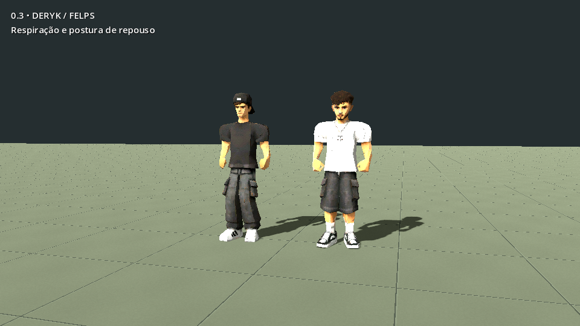
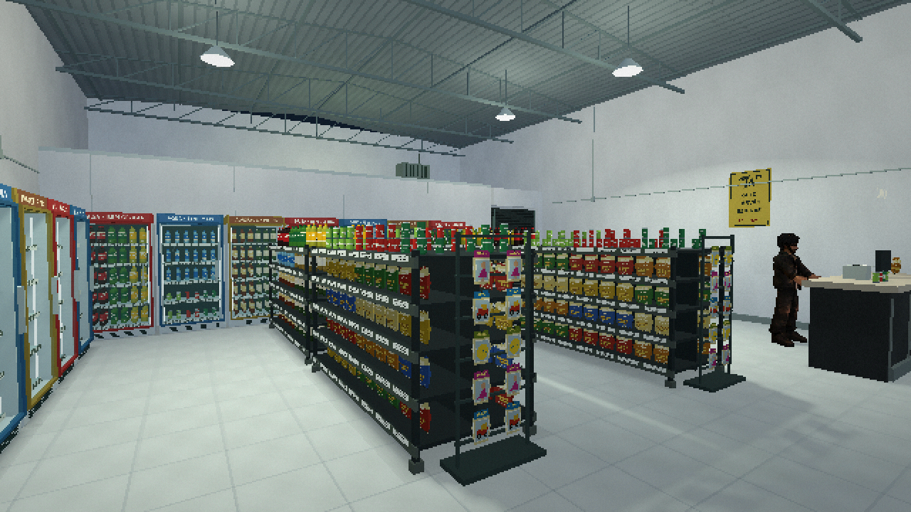

# A Última Venda — Depois do Fechamento

Demonstração jogável em **Godot 4.4.1 / GDScript / Compatibility**, ambientada em um depósito de bebidas de Franca-SP. Esta entrega estabelece a primeira base e uma rotina narrativa curta; não é a campanha de 1h30–2h30.

## Revisão 0.3 — Deryk, Felps e câmera

O Felps foi substituído pelo modelo correto enviado nesta revisão e recebeu rig. Deryk e Felps agora têm postura de repouso com braços próximos do corpo, respiração, transferência de peso, pequenos olhares e gestos. Caminhada e corrida acompanham a distância percorrida; pegar e transportar caixas usa as mãos animadas. A câmera recolhe o ombro perto das paredes e permite ver o corpo em primeira pessoa.

[Veja as gravações, comparação de poses e notas da etapa 2](docs/characters_v03/README.md).

## Revisão anterior — interior do depósito

A reconstrução 0.2 do interior recebeu gôndolas abastecidas por categoria, geladeiras contínuas com portas e produtos recuados, expositores, engradados azuis, caixa detalhado, treliças e luminárias suspensas. [Veja as imagens de antes/depois e a relação com as fotos](docs/depot_v02/README.md).

## Jogar

**[Baixar o jogo 0.3 para Windows x64 (ZIP)](https://github.com/Deriby/TheLastSale/raw/refs/heads/main/downloads/windows/A_Ultima_Venda_Windows_x64.zip)**

O pacote está versionado neste repositório em [`downloads/windows`](downloads/windows). Extraia o ZIP antes de abrir o jogo. A verificação SHA-256 está ao lado do arquivo.

**Windows:** extraia o pacote Windows e mantenha `A_Ultima_Venda.exe` junto de `A_Ultima_Venda.pck`. Abra o executável e escolha **Iniciar expediente**. O binário foi exportado nesta sessão Linux; sua execução no Windows ainda precisa de validação.

**Editor:** importe `project.godot` na Godot **4.4.1**, aguarde a importação dos GLBs e pressione **F6** em `scenes/main/main.tscn` ou **F5**. Não é necessário instalar Blender para jogar ou editar os sistemas.

**Nuvem/Linux:** `./tools/setup_cloud.sh`, depois `./tools/godot.sh --editor` em uma sessão com display. Para iniciar diretamente: `./tools/godot.sh`. Sem display: `./tools/test.sh` verifica o fluxo com física real. O wrapper mantém caches e saves em `/workspace/.runtime` no ambiente gerenciado, sem alterar HOME.

A Godot 4.4 tem Windows 10 como requisito oficial mínimo. **Windows 7/8 não são suportados por esta entrega.** Compatibility evita depender de Vulkan; não garante suporte a sistemas operacionais antigos. Referência: https://docs.godotengine.org/en/4.4/about/system_requirements.html

## Controles

| Entrada | Ação |
|---|---|
| WASD / mouse | Movimento em relação à câmera / olhar |
| Shift / Ctrl | Correr com fôlego / agachar |
| Roda para frente / trás | Aproximação contínua até primeira pessoa / terceira pessoa |
| E | Interação contextual |
| Q | Soltar caixa em superfície segura |
| Espaço | Avançar uma fala |
| Esc | Pausar, salvar e configurar |
| F | Lanterna, disponível depois do aviso do cliente |

## Percurso da demonstração

1. Entre pelo vão aberto e converse com Felps no caixa à direita.
2. Vá pelo corredor da direita até a porta **Estoque**, nos fundos; abra com E.
3. Pegue uma caixa de retornáveis e leve até a primeira geladeira da parede esquerda. Abra com E; use E novamente para repor. Repita com a segunda caixa.
4. Guarde a caixa solta no palete marcado **Devoluções**, no estoque.
5. Retorne à loja. Os clientes entram pela calçada, escolhem bebida, compram e saem. Após duas compras e as tarefas concluídas, chega o cliente preocupado.
6. Ouça o aviso. Após sua saída e a conversa, um ruído vem do estoque. Examine a porta **Sem acesso** para encerrar a sequência.

Os objetivos e legendas orientam o percurso. A ordem narrativa depende de tarefas e visitas concluídas; esperar parado não conclui o expediente. Um cliente bloqueado pelo jogador espera/recalcula seu caminho, sem teletransporte. A demo leva aproximadamente alguns minutos, conforme exploração e leitura, sem duração de campanha prometida.

## Entregue

- Depósito modular com gôndolas, garrafas instanciadas por MultiMesh, geladeiras, caixa, paletes, caixas transportáveis, portas, telhado e estrutura metálica.
- Trecho de rua com calçadas, casas, portões, postes/fios e carros; noite com luzes econômicas e atmosfera sonora original sintetizada.
- Dery com CharacterBody3D, aceleração, corrida, agachamento e câmera de ombro com SpringArm e transição de distância.
- Os três modelos enviados preservados integralmente em `assets/models/originals/`; derivados animados em `assets/models/characters/`.
- Deryk e Felps: rigs de 19 ossos, pesos revisados, texturas 1024², cabeça separada para primeira pessoa e 23 clipes procedurais cada. Enemy mantém a derivação anterior, com 14 clipes e textura 512².
- Respiração, variações de repouso, olhar contextual de Felps, passada ajustada ao deslocamento real e correção curta dos pés para desníveis. Caixas acompanham os punhos; pegar exige aproximação e tem alcance antes da fixação.
- Felps no caixa e três clientes modulares originais, com A* local, colisões e ciclo de compra completo.
- Duas reposições, organização do estoque, conversas, cliente preocupado e ruído final condicionado à progressão.
- Menu, pausa, legendas, objetivos, checkpoint/continuar e configurações persistentes. Resolução interna ajustável, dithering, granulação, VHS e interface em resolução plena.

## Organização

`scenes/main` contém a entrada; `scenes/world/props` contém cenas reutilizáveis. `scripts/world` constrói os módulos do cenário; `scripts/player`, `scripts/animation` e `scripts/camera` cuidam de controle, movimento e visão; `scripts/interactions` mantém os comportamentos contextuais; `scripts/ai` contém navegação e clientes; `scripts/systems` mantém sessão, diálogo, som, preferências e interface. O diálogo do aviso é configurável em `resources/warning.json`.

`Session` publica sinais de ações/progressão e grava checkpoints JSON versionados. `Dialogue` usa fila, avanço automático/manual e sinais de apresentação, deixando o jogador se mover. A navegação usa grade A* de 25 cm com obstáculos inflados pelo raio dos personagens; não depende de um bake de editor. Camadas: 1 cenário, 2 personagens, 3 reservada para interação.

## Limites e próximos passos

As referências e aproximações estão em [docs/REFERENCIAS.md](docs/REFERENCIAS.md). O estoque, a posição exata do caixa, profundidades e medidas não foram medidos. Não se afirma uma réplica arquitetônica exata.

As animações receberam a primeira revisão da etapa 2. Ainda precisam de acabamento artístico nas curvas, dedos, contato durante giros e atendimento; não há captura de movimento, animação facial, sincronização labial ou todos os clipes da campanha (morte, dano). A correção dos pés cobre pequenos desníveis, sem planejamento de passos sobre obstáculos. Os clientes mantêm seus rigs anteriores. Não há dublagem, trilha final licenciada ou física livre de empilhamento.

O Enemy está importado e rigado, mas **a IA de perseguição, esconderijos, câmeras de segurança, alternância de protagonistas e demais capítulos não foram implementados**. A porta antiga continua fechada; o ruído final é a conclusão desta demonstração. O save é de checkpoint: caixas soltas sem conclusão de objetivo retornam às posições iniciais; a caixa carregada e tarefas concluídas são restauradas.

Não foram medidos 60 FPS em PCs modestos nem testados binários em Windows real. O ambiente de revisão usa Mesa/llvmpipe em Linux. Próxima entrega recomendada: revisão artística do mapa e dos clientes, ajuste manual de pesos/contatos de animação e playtest do ritmo antes da etapa de perseguição.

## Ferramentas e validação

- `./tools/test.sh`: integração headless, isolando os saves em diretório temporário.
- `./tools/godot.sh --audio-driver Dummy res://tests/visual_review.tscn`: capturas em `/tmp` com display configurado.
- `blender -b -t 4 --python tools/rig_characters.py -- "$PWD"`: regenera Deryk e o Felps correto com os movimentos de `tools/humanoid_motion.py`, sem sobrescrever originais. `tools/rig_characters_legacy.py` regenera apenas Enemy.
- `blender -b -t 4 --python tools/make_customers.py -- "$PWD"`: regenera os clientes originais.
- `blender -b -t 4 --python tools/validate_rigs.py -- "$PWD"`: verifica poses exportadas e gera folhas de revisão em `/tmp/rig-review`.
- `blender -b -t 4 --python tools/measure_motion.py -- "$PWD"`: amostra as solas em 13 clipes por protagonista e registra contato com o chão.
- `./tools/godot.sh --fixed-fps 30 --write-movie /tmp/motion.avi res://tests/motion_review.tscn`: grava 38 segundos de movimento com display disponível.
- `python tools/make_depot_textures.py`: regenera a arte original dos produtos e superfícies do depósito (Python com Pillow).
- `python tools/make_textures.py`: regenera texturas e sons originais determinísticos.

Para exportar, instale os templates oficiais 4.4.1 no editor e use o preset **Windows Desktop**. Os originais e ferramentas ficam fora do pacote de jogo. Resultados e limites dos testes: [docs/VALIDACAO.md](docs/VALIDACAO.md).

Os modelos e fotografias são fornecidos pelo usuário. Não foi inferida licença de redistribuição pública para esses arquivos. Os sons e assets ambientais procedurais foram criados para esta entrega, sem conteúdo de outros jogos.
