# A Última Venda — Depois do Fechamento

Demonstração jogável em **Godot 4.4.1 / GDScript / Compatibility**, ambientada em um depósito de bebidas de Franca-SP, com uma primeira versão jogável da campanha de sexta a domingo. Acabamento e ritmo continuam em desenvolvimento.

**[Baixar o projeto 0.30.0 para Godot (ZIP)](https://github.com/Deriby/TheLastSale/raw/refs/heads/main/downloads/project/TheLastSale_Godot_0.30.0.zip)**

Extraia o ZIP, importe `project.godot` no Godot **4.4.1**, aguarde a importação dos modelos e pressione **F5**. O arquivo inclui os modelos animados, cenários, código e recursos usados no jogo. [Conteúdo e instruções do projeto](downloads/project/README.md).

## Revisão 0.30.0 — sustos no estoque e na volta do gerador

O estoque ganhou um arrasto atrás da porta antiga: ao se aproximar, o som para e a maçaneta começa a girar. Bryan caminha até a vitrine e dá uma batida como brincadeira. Na volta do gerador, uma figura atravessa o salão e segue fisicamente pelos fundos; a porta do pátio bate depois de sua passagem. Felps reage ao que Deryk realmente percebeu.

Os momentos dependem da posição e das ações, têm pausas entre si e ficam salvos sem repetir ao continuar. A câmera permanece livre, com terceira pessoa pela rodinha. A iluminação do salão oscila brevemente na travessia; refrigeração, gerador e circuitos continuam operando. [Prévia explicada, em três cenas](docs/scares_v030/explicada/README.md) · [Detalhes e validação](docs/scares_v030/README.md).

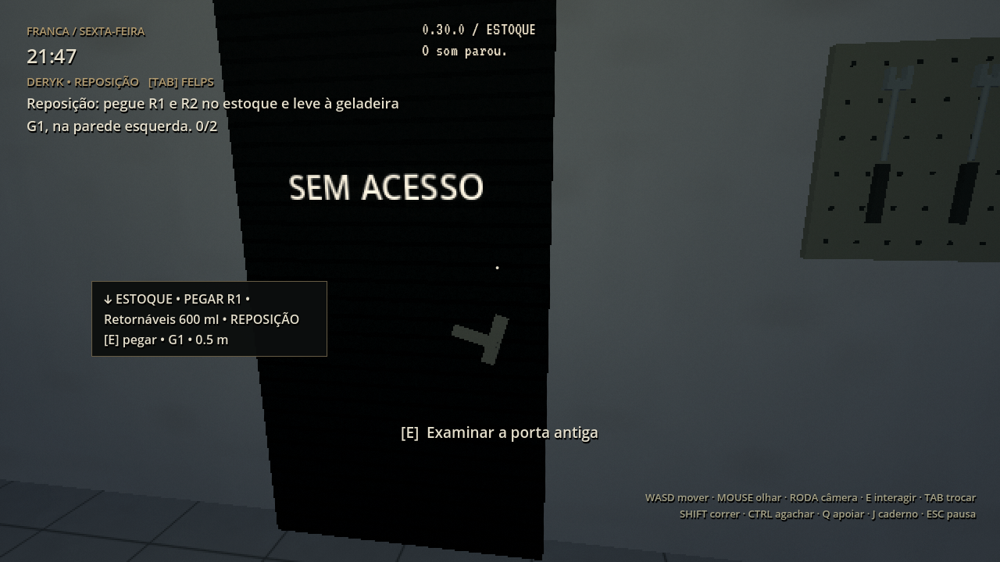

## Revisão 0.29.0 — os irmãos e a primeira noite

A chegada pela opção Iniciar apresenta Deryk e Felps como irmãos, com uma conversa sobre voltar para casa depois do expediente. O jogador conserva a câmera e a rodinha. As tarefas começam pela conversa habitual no balcão.

Clientes têm falas próprias: trânsito, corrida cancelada, família e a entrega do dia seguinte. O cliente de boné pergunta sobre a porta dos fundos, e a reação de Felps muda quando algo suspeito já foi percebido. Bryan tem humor de criança inquieta; Zirico comenta o sino quando esse acontecimento foi ouvido.

Conversar com o irmão depois de ver a pessoa na rua, ouvir o sino ou notar outros sinais muda o diálogo. As reações são únicas e ficam no save. O fechamento reúne a dupla, traz passos no salão esvaziado e retoma a preocupação na abertura do sábado. [Prévia com som e validação](docs/friday_story_v029/README.md).

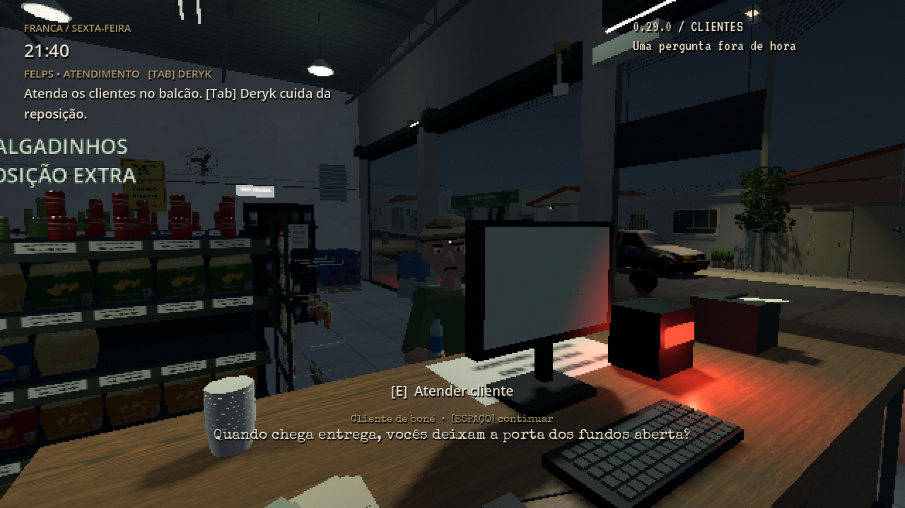

## Revisão 0.28.0 — rotina, primeira pessoa e suspense no depósito

O jogo começa em primeira pessoa, com corpo visível e câmera mais estável. A rodinha continua afastando para terceira pessoa e aproximando de volta. **J** abre o caderno com tarefas, controles e observações; o HUD recolhe as instruções repetidas, com opção de mantê-las nas configurações.

O salão ganhou luz mais fria de comércio e luminárias fluorescentes, enquanto o estoque tem sombras mais fechadas e a rua conserva a luz amarelada. A escuta 3D do viewport foi ativada: refrigeração localizada, rádio abafado nos fundos, sino da entrada, passos, motor de carro e sons distantes acompanham a posição do jogador.

As vendas comuns continuam antes do aviso, disponível após cinco minutos de rotina e os requisitos originais. Um sino inesperado com Deryk no estoque, um carro ligado, passos nos fundos e uma pessoa observável na rua ou nas câmeras acrescentam tensão gradual. Os acontecimentos e anotações ficam no save; a pessoa sai andando pela navegação. Diálogos mais curtos, pausas e olhares dão espaço ao expediente. [Prévia com som, imagens e validação](docs/everyday_v028/README.md).

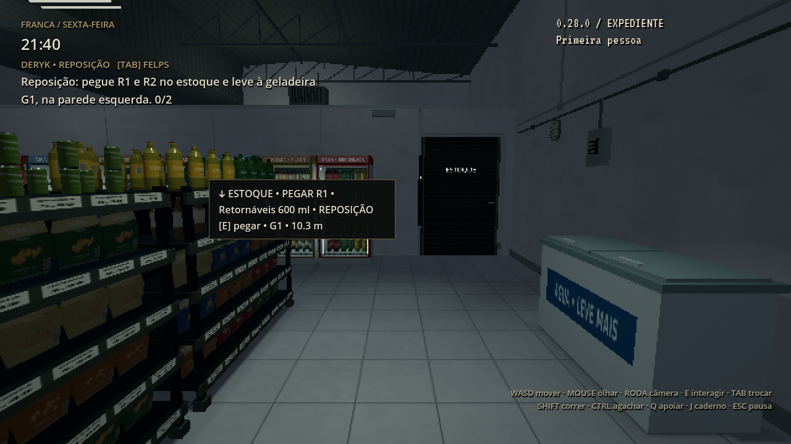
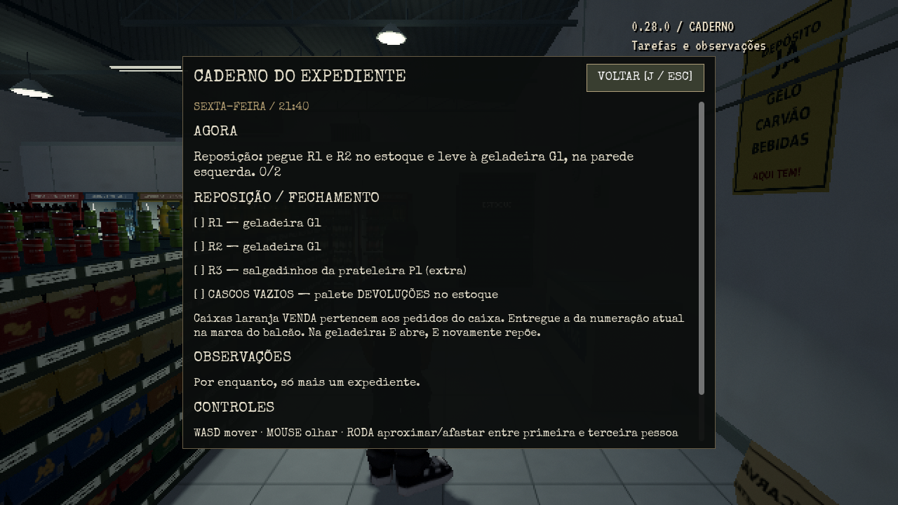

## Revisão 0.27.0 — passada e corrida de Deryk e Felps

Os protagonistas receberam curvas próprias de passada, com apoio regular, recuperação do pé e impulso. O quadril usa um arco pequeno e contínuo; a perna no ar ganha espaço sem puxar o corpo para baixo. A corrida deixa de prender os pés nas âncoras da caminhada, e a troca de ritmo tem limites diferentes para entrar e sair.

A revisão preserva os modelos, roupas, texturas, pesos, física, câmera, mecânicas, menu e o restante do elenco. [Comparação antes/depois, corrida na loja e validação](docs/sprint_v027/README.md).

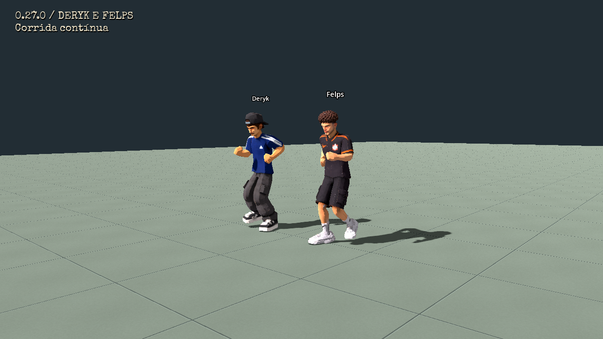

## Revisão 0.26.0 — nova base para as animações

A caminhada, corrida, repouso, agachamento e conversa agora partem de animações de referência de Quaternius (CC0), transferidas para os 11 rigs existentes. Quadril, ombros, braços e joelhos acompanham a passada; o apoio dos pés vem do contato real da referência. Zirico e Bryan conservam seus movimentos próprios, e os protagonistas e garotas têm variações de postura e cadência.

Nos clientes modulares, o giro do braço foi corrigido para a raiz real da manga, eliminando a peça que subia ao lado do rosto. As malhas, texturas, pesos, física, câmera, HUD, energia, saves, intro e menu foram preservados. [Vídeo da nova revisão e detalhes](docs/motion_v026/README.md).

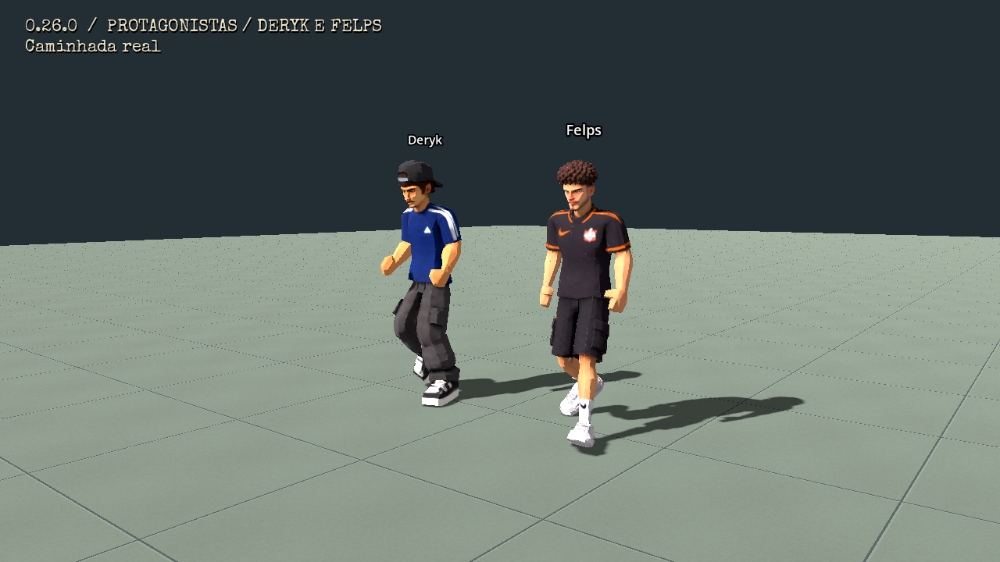

## Revisão 0.25.0 — movimentos próprios para o elenco

A locomoção usa clipes medidos por rig e perfis diferentes para Deryk, Felps, garotas, clientes homens, senhora, Zirico e Bryan. Zirico ganhou balanço irregular e braços de equilíbrio; Bryan tem passos curtos, cadência infantil e gestos inquietos.

Todos os clientes passam pelo controlador atualizado, inclusive os homens provisórios e o cliente do aviso. A passada segue o deslocamento real e para diante de obstáculos; os gestos de repouso terminam corretamente. Apoios são reiniciados nas transições e a correção horizontal dos pés é suavizada. Modelos, texturas, pesos, controles e ações de pegar/colocar caixas permanecem preservados. [Prévia e validação](docs/motion_v025/README.md).

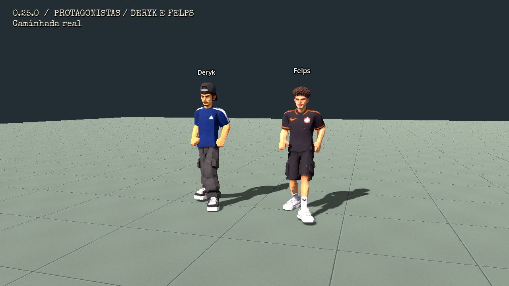

## Revisão 0.24.2 — suspense no cenário e entrada no expediente

A fachada agora tem falhas discretas de iluminação, uma luz se revela ao fundo e sons originais de rua dão profundidade ao menu: carro, cachorro distante, metal e zumbido elétrico. Os eventos têm intervalos variáveis e respeitam o volume de Efeitos. O título menor e as opções mais espaçadas deixam o depósito aparecer mais.

**Continuar** mostra a noite e o horário do checkpoint sem carregar a campanha. Ao iniciar, as letras se apagam, a fita estala e a troca de câmera acontece sob uma transição curta. Luzes, letreiro e personagens são restaurados antes de entregar o controle. [Prévia com som, imagens e validação](docs/title_v0242/README.md).

## Revisão 0.24.1 — tipografia e movimento do menu

A intro de **Two Brothers Lab** e o menu receberam fontes retrô próprias: **Bebas Neue** no título, **Special Elite** nas opções e **VT323** no visor de fita. O título combina creme e vermelho queimado, com uma composição mais alta de cartaz de terror.

O menu aparece em etapas, com aproximação lenta da câmera e destaque suave ao mudar de opção. Pausa e retorno das configurações usam transições curtas. [Prévia com som, imagens e validação](docs/title_v0241/README.md).

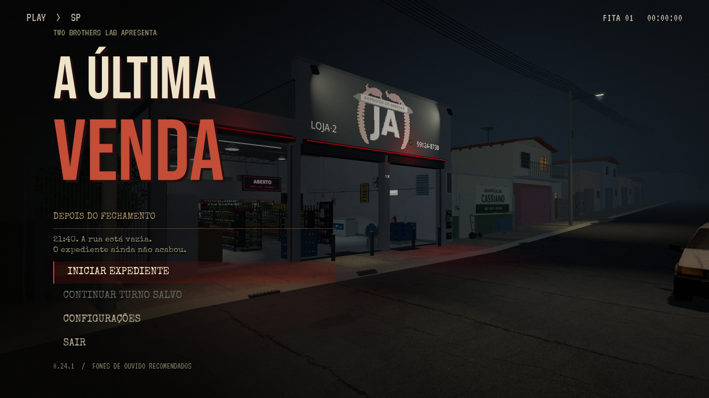

## Revisão 0.24.0 — abertura em fita e menu de suspense

A abertura de 9,4 segundos apresenta **Two Brothers Lab** e **Franca, São Paulo — sexta-feira, 21:40**, antes de revelar o depósito vazio à noite. **Espaço, Enter, Esc ou clique** pulam a sequência e levam ao menu. A tecla de pular é consumida para não começar uma partida por acidente.

O menu recebeu tipografia de cartaz de terror, sombra vermelha, granulação, linhas de fita e um movimento lento de câmera. Os sons de fita e a atmosfera de sintetizador foram criados para o jogo. Iniciar, continuar, configurar e sair continuam acessíveis por teclado e mouse; a pausa usa a mesma identidade sem repetir a intro. [Vídeo, imagens e validação](docs/title_v024/README.md).

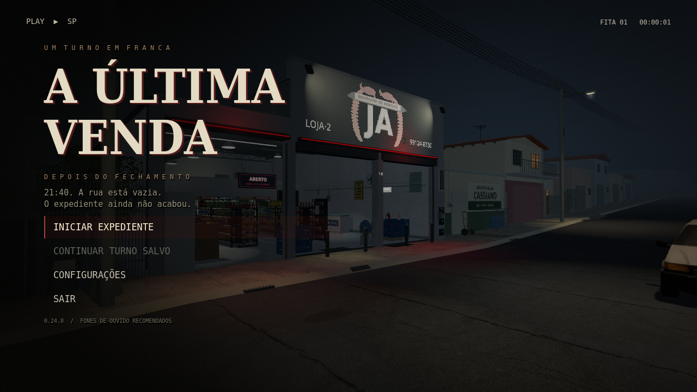

## Revisão anterior 0.23.1 — piso estável ao girar a câmera

Corrige o piso e outras superfícies com texturas repetidas que deslizavam ao mover a câmera nos modos PS1 e PS1/2. O mapeamento desses materiais permanece preso ao cenário. O efeito afim das texturas UV recebeu limites suaves, e o cálculo passou a preservar corretamente os vértices atrás da câmera.

As opções Desligada/Suave/Marcada continuam independentes. Modelos, animações, HUD, física, energia e saves foram preservados. O novo teste renderizado gira a câmera em seis direções, nas duas resoluções e intensidades: **48/48 casos** passaram; o shader 0.23.0 falha nos mesmos casos. [Correção e validação](docs/psx_v0231/README.md).

## Revisão anterior 0.23.0 — precisão de vértices e texturas afins PS1

Em **Configurações**, escolha **PS1 — 320×240** ou **PS1/2 — 640×480**. **Precisão de vértices PS1** e **Texturas afins PS1** têm seleções independentes: **Desligada**, **Suave** (padrão) e **Marcada**. As preferências ficam salvas. A precisão reduzida faz os vértices avançarem em pequenos passos na tela; a interpolação afim deforma as texturas sobre os triângulos, especialmente em superfícies oblíquas.

Os efeitos atuam no cenário 3D. HUD e menus continuam em resolução plena; modelos, animações, colisões, física e saves foram preservados. Apagão, gerador e circuitos continuam controlando a emissão dos materiais. [Configurações, comparações e validação](docs/psx_v023/README.md).

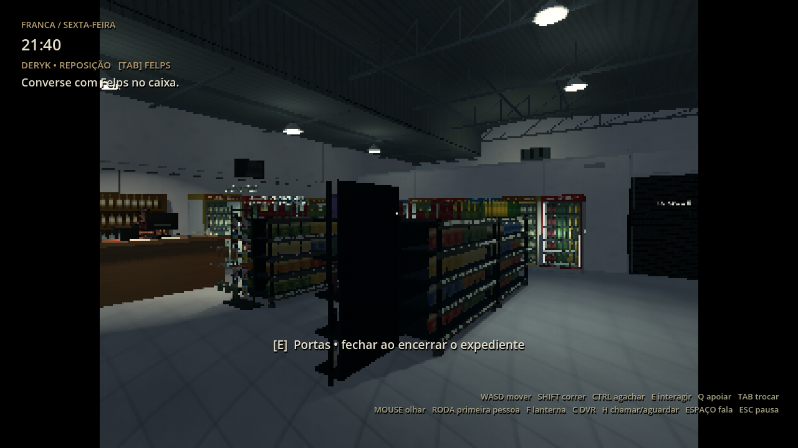

## Revisão anterior 0.22.0 — movimento e detalhes do cenário

Deryk, Felps e o elenco receberam locomoção e repouso ajustados às medidas de cada rig: menos elevação dos pés, cadência mais calma, quadril menos baixo, braços próximos do corpo e movimento independente do tronco. O apoio dos pés é estabilizado durante o deslocamento, a respiração continua em movimento e a inclinação responde à aceleração e às curvas. O Killer usa uma corrida própria para seu esqueleto.

O depósito recebeu ferramentas, papéis, fita, avisos, tapete e relógio com o horário do turno; a rua ganhou lixeira detalhada, bueiro, folhas e marcas de uso. Os modelos e texturas dos personagens foram preservados. As curvas de animação são carregadas prontas, sem gerar poses a cada quadro. [Vídeo, capturas, implementação e validação](docs/natural_v022/README.md). **431/431 verificações** passaram nas seis suítes em Linux.

## Revisão anterior 0.21.0 — reposição e entrega de pedidos

As caixas agora têm identificação e destino: **R1/R2 → geladeira G1**, **R3 → prateleira P1**, **VENDA #NNN → balcão** e **CASCOS VAZIOS → devoluções**. Um marcador legível indica qual caixa pegar e onde levá-la, inclusive nos modos PS1/PS1/2.

G1 abre com E e repõe com E novamente; P1 recebe os salgadinhos da R3. A reposição funciona mesmo antes da conversa inicial e o save conserva o que já foi abastecido. Caixas erradas mostram seu destino e permanecem com Deryk. Sábado e domingo não recriam tarefas de reposição da sexta.

Quando Felps pede uma caixa fechada, a chamada indica a caixa laranja daquele pedido. Deryk entrega por E na área marcada do balcão e Felps retoma a cobrança. [Guia, capturas e validação](docs/supplies_v021/README.md). **383/383 verificações** passaram nas cinco suítes em Linux.

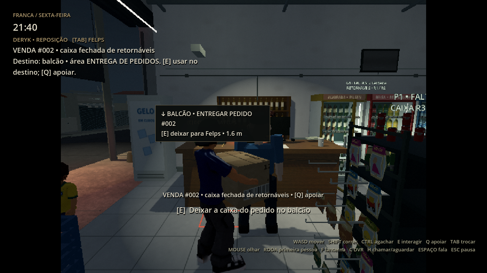

## Revisão anterior 0.20.0 — domingo, perseguição e três finais

Deryk recupera o módulo na sala atrás da porta antiga e o leva a Felps. O DVR reproduz um fragmento real de oito segundos, gravado no cenário do jogo, que liga o cliente recorrente ao acesso de manutenção. A revelação inicia a preparação da fuga.

Na separação, Deryk alimenta o estoque pelo gerador e Felps destrava a porta pelo terminal. O Killer persegue os dois no mesmo cenário, com visão, audição e memória. **H** alterna acompanhar/aguardar; **Ctrl + E** usa uma cobertura próxima. Abra a saída manual, reúna a dupla na calçada e escolha partir. Prova preservada, prova perdida ou abandono confirmado do companheiro produzem três epílogos. Uma captura permite retomar o checkpoint.

Saves versão 5 conservam a ameaça, portas, circuitos, prova e cobertura; formatos 1–4 continuam aceitos. [Controles, percurso, capturas e validação](docs/sunday_v020/README.md). O ZIP inclui todo o projeto para Godot 4.4.1. **348/348 verificações** passaram nas quatro suítes em Linux.

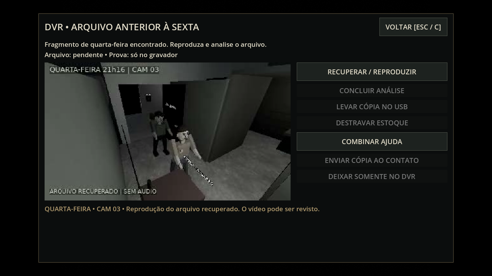

## Revisão anterior 0.19.0 — sábado, câmeras e investigação

Depois da sexta, **Começar sábado** inicia uma nova rotina com dois pedidos e o retorno do cliente de boné. Com Felps no posto do caixa, **C** abre o monitor: fachada, estoque e pátio mostram o mesmo cenário ao vivo. A porta do pátio se move durante a consulta; a observação fica registrada sem revelar quem está do outro lado. O DVR tem registros textuais explicitamente separados do vídeo ao vivo.

Felps anota o evento e separa o recibo; Deryk examina as marcas da porta antiga e a caixa deslocada. Bryan e Zirico têm relatos opcionais. No caderno, decida copiar os registros e recibos ou deixá-los no gravador, avisar o responsável ou esperar. A saída pode ser preparada no comando das portas. As escolhas e a cópia efetiva dos dados atravessam as noites.

Uma tentativa na porta inicia o fechamento: confira caixa e estoque, apague o salão, reúna a dupla e saia pela frente. **Domingo tem apenas a abertura; revelação, perseguição e finais continuam em desenvolvimento.** [Guia e validação](docs/saturday_v019/README.md).

O monitor usa uma única câmera em 384×216, atualizada a até 10 imagens por segundo, enquanto suspende a renderização encoberta do jogador. O caderno para o canal; fechar o monitor libera o viewport. Nenhuma nova luz com sombras foi adicionada. FPS nativo na Radeon R7 não foi medido.

**289/289 verificações** cobrem cenário, sexta e sábado, incluindo saves e fechamento. [Registros](docs/saturday_v019/validation.json).

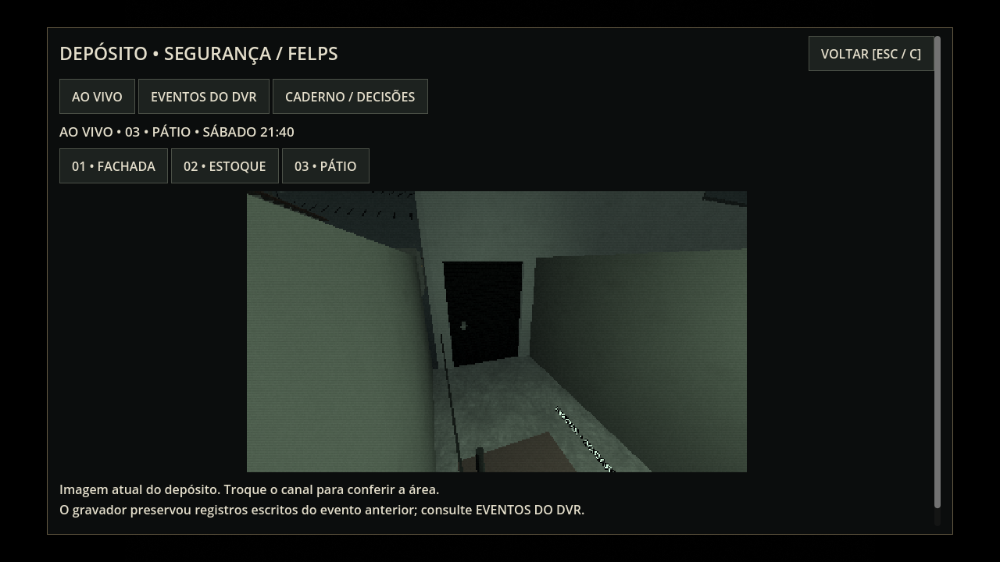

## Revisão anterior 0.18.1 — sexta-feira, apagão e fechamento

A sexta continua depois do aviso: a luz cai, Felps suspende o atendimento e Deryk busca a chave no estoque para ligar o gerador no pátio externo. Iluminação de emergência e lanternas mantêm o caminho legível. Rádio, ventilador, equipamentos, luzes e letreiros reagem à energia; a rua continua iluminada. Uma venda interrompida conserva produtos, dinheiro e troco.

Depois do último atendimento, Felps confere o caixa e Deryk verifica o estoque. Apague o salão, chame o companheiro no comando das portas e reúnam-se na calçada. O outro personagem vem andando pelo cenário; as portas só baixam com os dois do lado de fora. O resumo salva a sexta e permite ver a abertura de sábado. **Investigação de sábado, perseguição de domingo e finais diferentes continuam em desenvolvimento.**

Há seis identidades provisórias de clientes, usando três modelos simples com rig e roupas variadas. Elas podem receber os modelos do autor depois, preservando a identidade do atendimento e do save. Checkpoints versões 1, 2 e 3 continuam aceitos; o formato 4 registra campanha, energia, chave, fechamento, pistas e relatórios por noite.

**236/236 verificações** passaram no projeto e no ZIP extraído com importação limpa. [Como jogar, capturas e validação](docs/friday_v018/README.md).

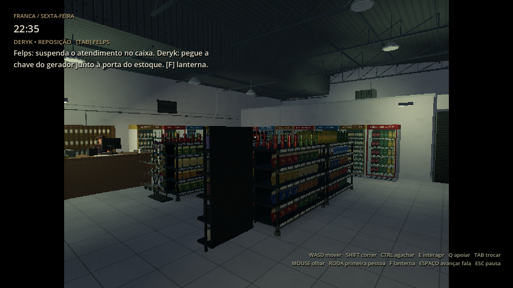

## Revisão anterior 0.17.0 — pedidos, dinheiro e troco

Felps agora registra produtos e quantidades, recebe dinheiro, separa o troco e entrega a compra. Os clientes fazem pedidos variados, esperam pelo atendimento e reagem a erros. Alguns pedidos precisam de uma caixa fechada: Felps chama Deryk, que busca a mercadoria no estoque e a entrega no balcão.

O monitor e a gaveta acompanham a venda, com produtos no balcão e efeitos de scanner, dinheiro e entrega. O salvamento conserva cliente, registro, dinheiro, troco parcial, recibos e os dois personagens. A receita é creditada uma vez por compra concluída. Cartão e Pix são as próximas formas de pagamento.

**183/183 verificações** passaram no projeto e no ZIP extraído após importação limpa. [Controles, capturas e validação](docs/checkout_v017/README.md).

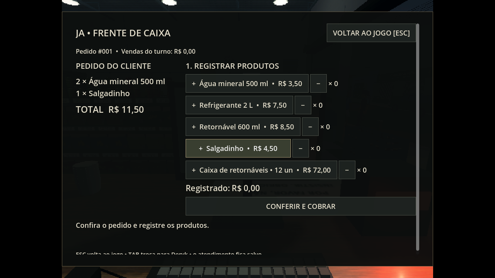

## Revisão anterior 0.16.0 — dupla jogável, caixas e atendimento básico

**Tab** alterna entre **Deryk**, responsável pelas caixas e reposição, e **Felps**, responsável pelo balcão. Os dois permanecem no cenário com seus próprios corpos, câmeras, posições e objetos. O cliente aguarda Felps usar **E** no caixa para começar o atendimento.

**Q** apoia a caixa em uma superfície livre. O comando durante a pegada é aguardado e executado ao terminar a animação; uma marca verde/vermelha indica o espaço disponível. Paredes, outros objetos e falta de apoio impedem a colocação, preservando o objeto. Caixas colocadas ficam em pé e podem ser pegas novamente.

O salvamento registra os dois personagens e as caixas soltas ou carregadas. Checkpoints antigos continuam aceitos. Também foram corrigidas as posições dos comandos, avisos e legendas na interface. PS1, PS1/2 e os demais modos gráficos foram mantidos. [Controles, capturas e validação](docs/gameplay_v016/README.md).

## Revisão anterior 0.15.1 — PS1/2 em 640×480

Em **Configurações → Resolução interna / qualidade**, escolha **PS1/2 — 640×480 (4:3)**. A opção oferece mais definição e ocupa a mesma área da janela que PS1 em 320×240, mantendo HUD e menus nítidos. A preferência fica salva; os dois modos continuam disponíveis.

**146/146 verificações** passaram no projeto e no ZIP extraído com importação limpa. [Comparação, instruções e validação](docs/resolution_v0151/README.md).

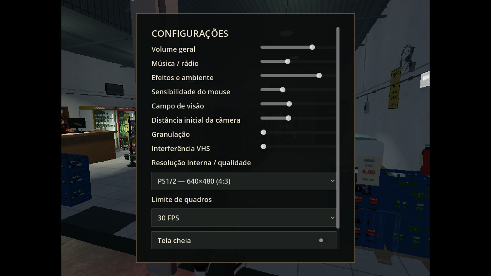

## Revisão anterior 0.15.0 — PS1 em 320×240 com janela grande

Em **Configurações → Resolução interna / qualidade**, escolha **PS1 — 320×240 (4:3)**. O cenário é renderizado em 320×240 e ampliado, mantendo a janela grande e os menus nítidos. Na janela padrão de 1280×720, a imagem ocupa 960×720 com barras laterais de 160 pixels. A preferência fica salva; os outros modos continuam disponíveis.

O painel de Configurações também foi corrigido para caber na janela, com rolagem quando necessária. **140/140 verificações** passaram, incluindo redimensionar a janela e retornar a Nítida sem reconstruir o mundo. [Instruções, capturas e validação](docs/resolution_v015/README.md).

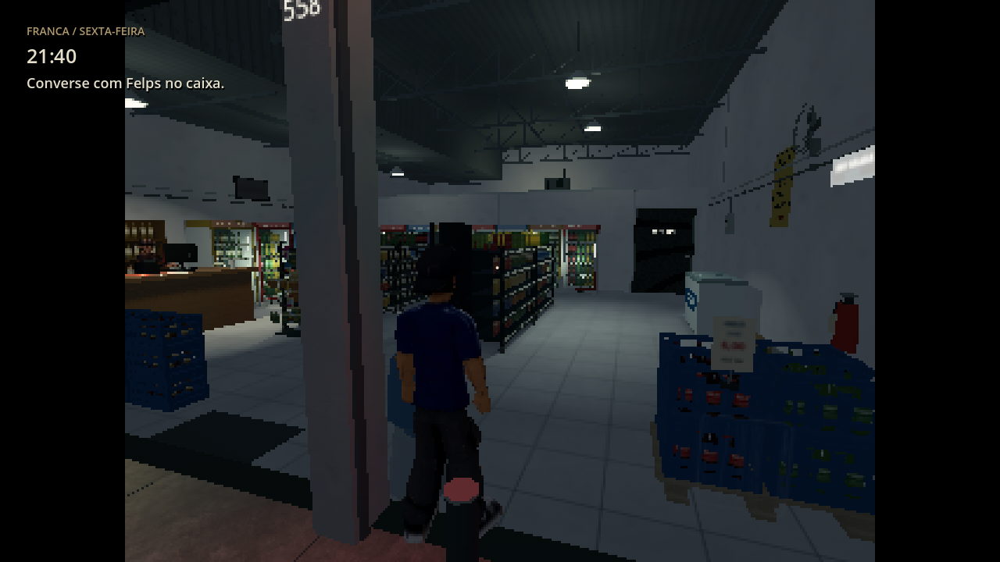

## Revisão anterior 0.14.0 — iluminação e atmosfera noturna

A iluminação do salão foi redistribuída para controlar os brancos estourados no piso, manter o caixa mais quente e deixar cantos e estoque mais escuros. As doze geladeiras têm iluminação restrita aos equipamentos e reflexos do salão capturados uma vez. O vermelho da fachada agora alcança a parede e a calçada; os postes formam áreas de luz mais localizadas. A névoa aumenta na distância, preservando o primeiro plano.

[Veja as mesmas vistas antes/depois](docs/lighting_v014/README.md). A imagem Nítida tem menos halo e preserva as transições de cor. O padrão continua em 30 FPS e há cinco luzes com sombras. Econômica desliga sombras e os efeitos adicionais. **132/132 verificações** passaram no projeto e no ZIP extraído; FPS nativo na Radeon R7 não foi medido.

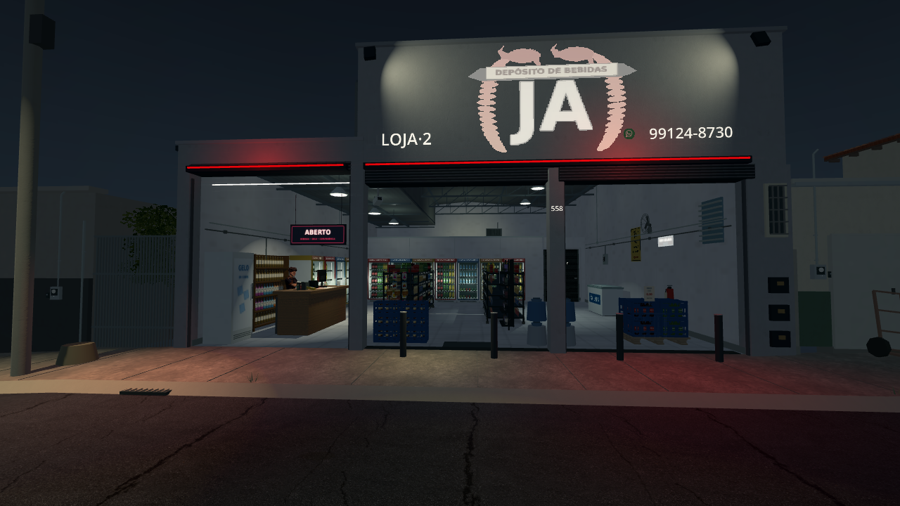

## Revisão anterior 0.13.0 — materiais e embalagens

Madeira, reboco, asfalto e concreto usam bases de superfícies reais CC0, ajustadas às cores e à escala do depósito. A bancada tem grão irregular e verniz; os paletes usam madeira crua. Piso, pintura, aço, plástico e vidro têm acabamentos distintos. Garrafas, latas e salgadinhos receberam arte mais definida e mapas que separam brilho do corpo, rótulo e tampa, com filtragem para a distância.

[Veja as comparações com as mesmas câmeras e luzes](docs/materials_v013/README.md). O modo Econômica desliga mapas de acabamento e camada de verniz; o limite padrão continua em 30 FPS. **125/125 verificações** passaram no projeto e no ZIP extraído. FPS na Radeon R7 ainda precisa de medição no computador alvo.

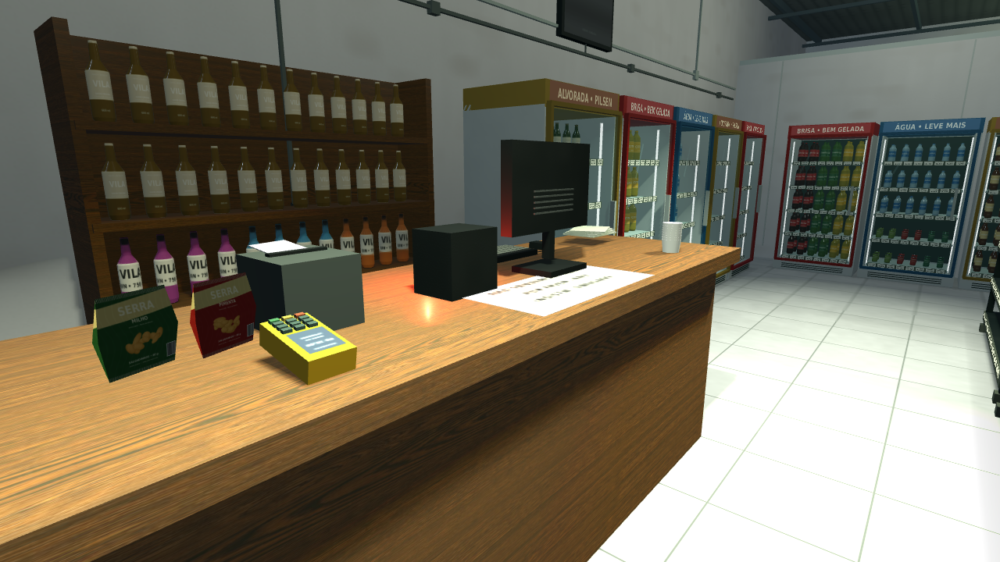

## Revisão anterior 0.12.0 — sombras, teto e circulação

A fiação não projeta sombras, e as faixas de autossombra no asfalto foram corrigidas. A cobertura baixa do lado esquerdo segue até os fundos. O expositor agora tem oito engradados com garrafas apoiadas, sobre um palete estruturado. As gôndolas foram encurtadas e reposicionadas: há cerca de 2,10 m até as geladeiras fechadas e 1,12 m livres com as portas abertas. Use **E** para abrir/fechar qualquer geladeira das duas fileiras.

[Veja o antes/depois dos quatro pontos e as portas abertas](docs/layout_v012/README.md). **119/119 verificações** passaram, incluindo a travessia real do corredor. O problema de largar a caixa foi somente registrado em [Pendências](docs/PENDENCIAS.md), para a etapa de jogabilidade.

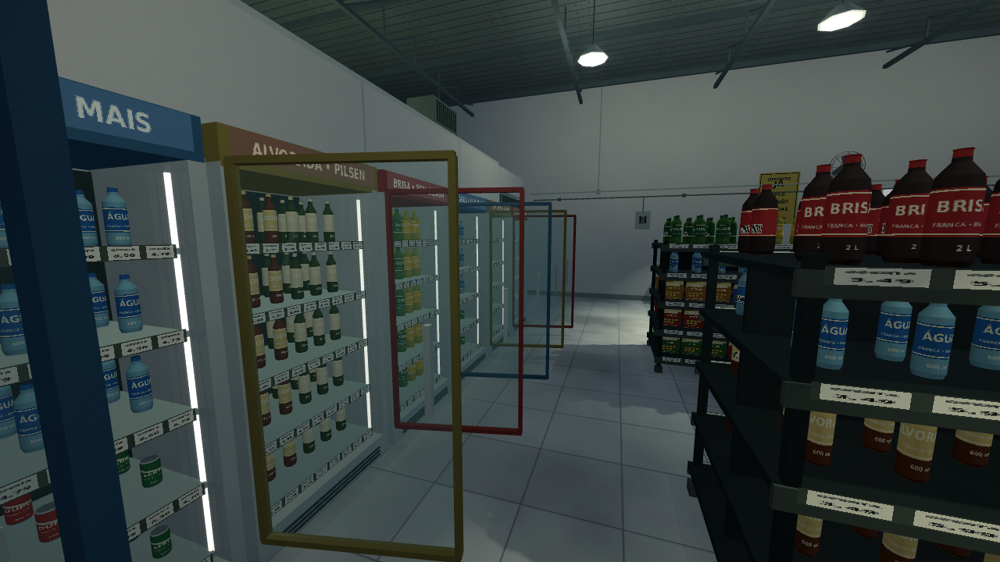

## Revisão anterior 0.11.0 — otimização para a meta de 30 FPS

As malhas usam 44,6% menos vértices armazenados e 34,0% menos dados nos arrays de geometria, mantendo a contagem de objetos e triângulos. O início do turno aproveita o cenário já carregado; a câmera evita atualizações repetidas de estado do corpo; o assassino oculto pausa suas animações.

O limite padrão é **30 FPS**, com opções de 60 FPS ou Sem limite em Configurações. Os detalhes, modelos, texturas e luzes foram mantidos. A medição foi feita em Linux/Mesa; 30 FPS na Radeon R7 ainda precisam de teste no PC alvo. [Relatório, dados e validação](docs/optimization_v011/README.md).

## Revisão anterior 0.10.0 — novo elenco recebido

Os novos Dery, Felps e Killer usam os FBX com rig fornecidos pelo autor. Bryan e Zirico têm presenças e conversas opcionais; Garota 1, Garota 2 e Velha 1 participam da rotina de clientes. O Carro 1 substitui o hatch estacionado. As animações foram criadas sobre os rigs recebidos, com medidas próprias para os pés, a passada e a altura de cada personagem.

[Veja os modelos, as capturas e a prévia animada de 12 segundos](docs/cast_v010/README.md). Os nove modelos derivados somam cerca de 33 MiB, com os 71 ossos recebidos e um controle adicional de peito superior por personagem. **106/106 testes** passaram no projeto e no pacote Linux.

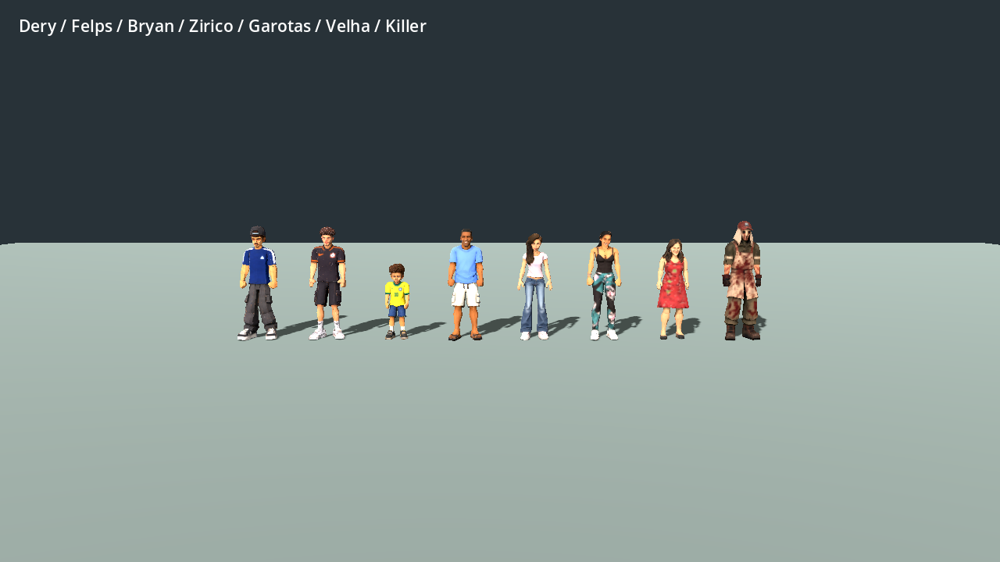

## Revisão anterior 0.9.0 — rua e vizinhança

Seis fachadas dos trechos aproximados ganharam projetos distintos: garagem de tijolo, casa com jardim, pequeno comércio com toldo, casa com azulejos, casa com quintal recuado e anexo de oficina. Portões, alturas, recuos, aberturas e coberturas variam entre os imóveis. As casas próximas reconhecíveis nas fotos e a fachada JA mantêm sua disposição.

A rua recebeu medidores e interfone por imóvel, calhas, antenas, parabólicas, caixa-d'água, bicicleta apoiada, gaiola de botijões e vegetação com copas diferentes. Há duas rampas físicas, juntas de calçada menos regulares e fechamentos nos vãos entre construções. Os imóveis distantes têm mais variação de altura e telhado dentro da névoa.

[Veja a comparação da rua, os detalhes e os testes de passagem](docs/neighborhood_v09/README.md).

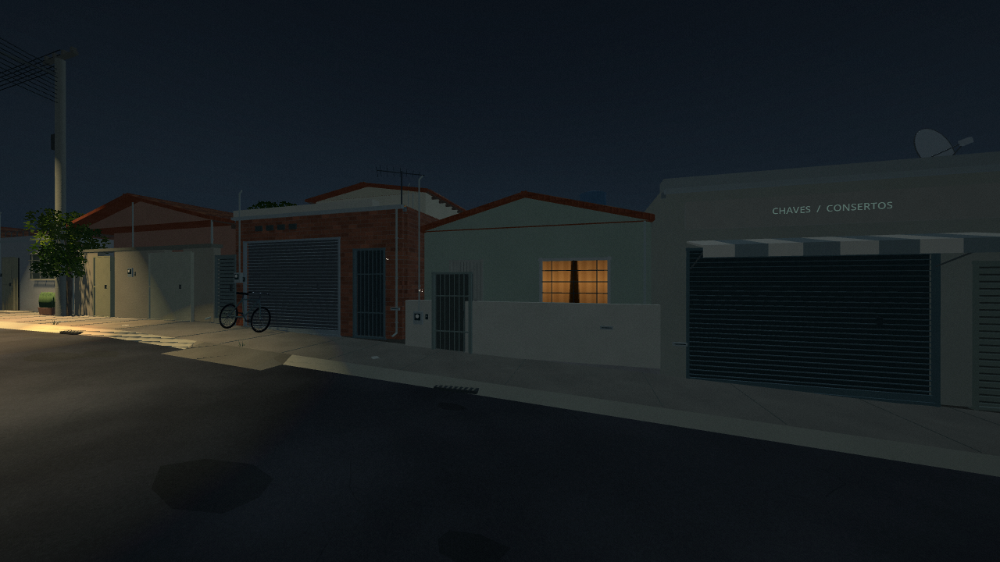

## Revisão anterior 0.8.0 — materiais e acabamento

A bancada recebeu veios irregulares na escala da madeira, riscos finos e variações de verniz. O piso tem peças cinza acetinadas de aproximadamente 60 cm, com rejunte, manchas suaves e pequenas diferenças entre peças. Paredes, reboco, asfalto e calçada agora têm rugosidade e relevo próprios. As cores e a escala foram orientadas pelas fotos do depósito.

Metal pintado, aço, plástico, pneus, vidro e pintura dos carros também receberam acabamentos distintos. Há 12 conjuntos de materiais originais, com mapas de cor, relevo e acabamento. Nítida e Retrô exibem os detalhes; Econômica desliga o relevo fino e a oclusão das texturas, além das sombras e do halo já desativados nesse modo.

[Veja as comparações de antes/depois com as mesmas câmeras e luzes](docs/materials_v08/README.md).

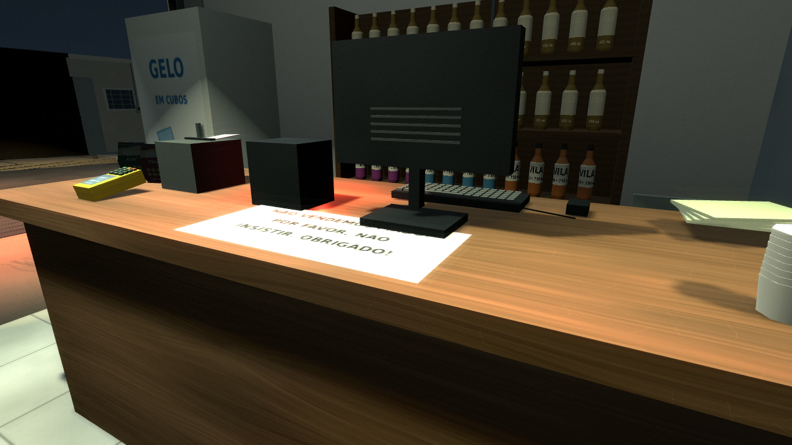

## Revisão anterior 0.7.0 — carros modelados, neon e telhado corrigido

Os carros foram substituídos por dois modelos originais feitos no Blender, com carroceria curva, para-brisas, vidros laterais, bancos, volante, retrovisores, faróis, rodas e recortes físicos dos para-lamas. A fachada recebeu iluminação vermelha e branca, letreiro ABERTO e reflexos locais nos carros. Uma névoa leve percorre apenas a rua, além da neblina do horizonte.

O desnível do telhado esquerdo agora tem fechamentos verticais, rufos, espessura e colisão. As casas receberam telhas curvas em relevo; o interior ganhou sacos de carvão, aviso de gelo, extintor e instalação elétrica. O balcão continua à esquerda, conforme as fotos. As referências de Fears to Fathom orientam luz e atmosfera; os modelos e a arte são próprios.

[Veja os carros de perto, a cobertura corrigida e a caminhada gravada](docs/finish_v07/README.md).

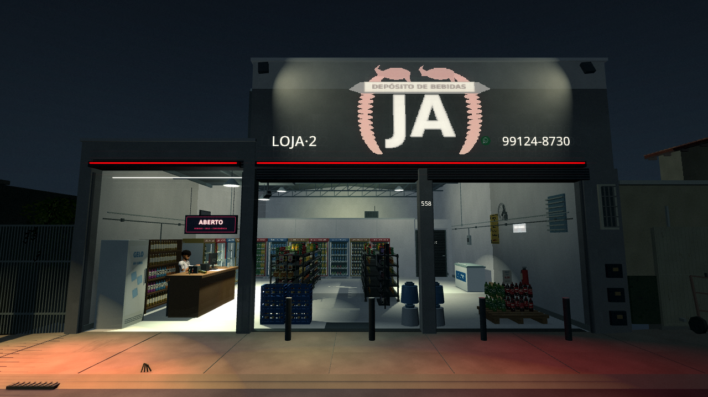

## Revisão anterior 0.6.0 — noite, luzes e rua

A iluminação agora tem sombras dos carros, árvores e personagens, trechos escuros entre os postes, janelas acesas e luz mais localizada dentro da loja. O céu noturno, os materiais do asfalto/calçada e a folhagem foram refeitos; os carros receberam carroceria com recortes das rodas. A copa das árvores se move suavemente, e o som dos passos muda entre o salão e a rua. A sombra do personagem continua completa em primeira pessoa.

[Veja o antes/depois e a caminhada gravada com o controlador real](docs/mood_v06/README.md).

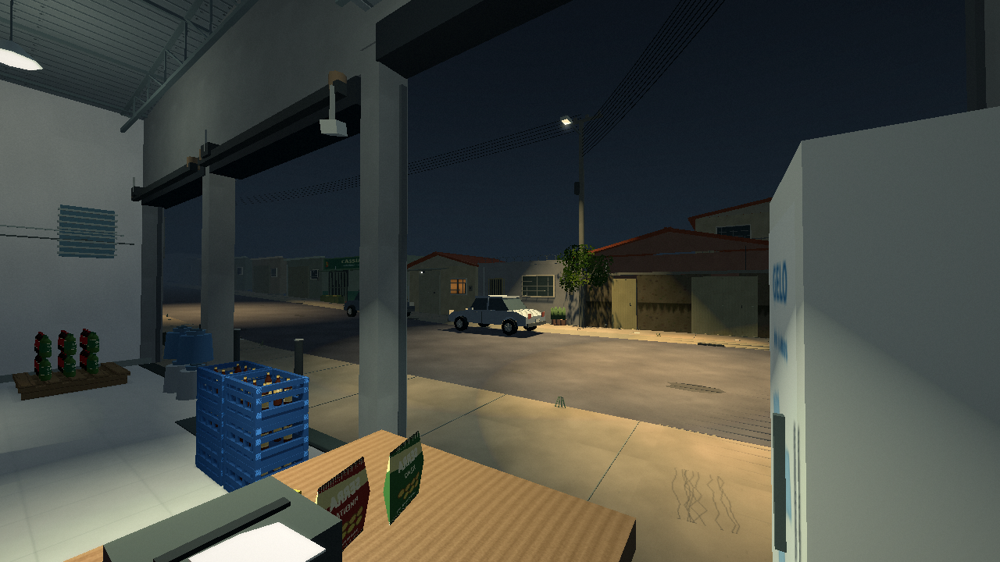

## Revisão anterior 0.5.0 — balcão, detalhes e atmosfera

O caixa foi corrigido pelas novas fotos: fica à esquerda de quem entra, com a bancada no sentido da profundidade da loja e o funcionário junto à parede. Há monitor, teclado, leitor com luz vermelha, maquininha amarela, gaveta, impressora, aviso sobre o tampo e bebidas atrás de Felps. Clientes atendem no novo ponto; checkpoints antigos são ajustados se estiverem dentro dos móveis.

O interior ganhou freezer de gelo, copos térmicos, ganchos de salgadinhos, ferragens das portas e ventilador em movimento. A visão de dentro para fora foi revisada, incluindo carros e o comércio CASSIANO em frente. A rua continua dentro de uma neblina distante; a loja iluminada contrasta com o bairro escuro, com granulação leve e sons ambientes originais. A resolução inicial usa a janela inteira; os modos Retrô e Econômica continuam disponíveis.

[Veja as vistas do funcionário e do cliente, a neblina e o vídeo com som](docs/scene_v05/README.md).

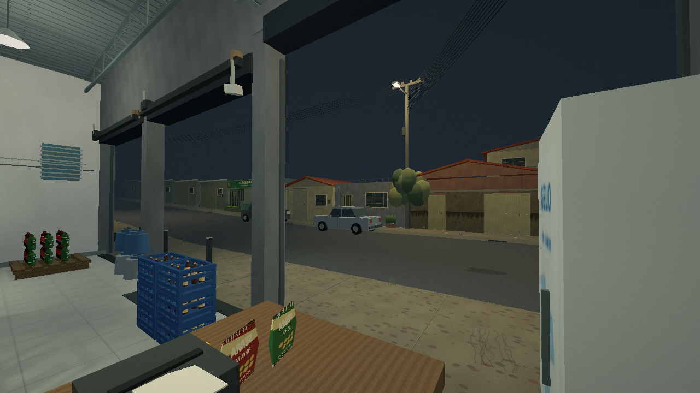

## Revisão anterior 0.4.0 — exterior e vizinhança

A fachada agora acompanha as capturas do Street View: anexo mais baixo, duas entradas principais, mural JA, pilares de proteção e janela lateral. Do outro lado aparecem as casas cinza, amarela e salmão; ao lado, o depósito de gás e o sobrado. A rua recebeu declive físico, asfalto sem faixa, calçadas, postes e fiação. As medidas são estimadas a partir das imagens.

[Veja referências, antes/depois e o passeio pelo exterior](docs/exterior_v04/README.md).

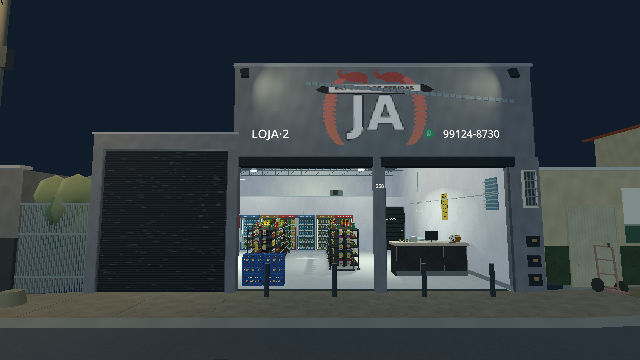

## Revisão anterior 0.3.1 — postura, tronco e correção das prateleiras

Os cotovelos e punhos foram reposicionados conforme a referência enviada, com braços proporcionais e mãos abaixo do quadril. Deryk e Felps agora usam 21 ossos, incluindo cintura e peito superior, com pesos e movimento próprios no tronco. Geladeiras, prateleiras e produtos passaram a usar malhas estáticas agrupadas por material, sem desenho por instâncias da GPU, para contornar a falha relatada no Windows 7 / Radeon R7 200.

[Veja a comparação com os ossos reais, os vídeos e os testes de renderização](docs/fixes_v031/README.md).

## Revisão anterior 0.3 — Deryk, Felps e câmera

O Felps foi substituído pelo modelo correto enviado nesta revisão e recebeu rig. Deryk e Felps agora têm postura de repouso com braços próximos do corpo, respiração, transferência de peso, pequenos olhares e gestos. Caminhada e corrida acompanham a distância percorrida; pegar e transportar caixas usa as mãos animadas. A câmera recolhe o ombro perto das paredes e permite ver o corpo em primeira pessoa.

[Veja as gravações, comparação de poses e notas da etapa 2](docs/characters_v03/README.md).

## Revisão anterior — interior do depósito

A reconstrução 0.2 do interior recebeu gôndolas abastecidas por categoria, geladeiras contínuas com portas e produtos recuados, expositores, engradados azuis, caixa detalhado, treliças e luminárias suspensas. [Veja as imagens de antes/depois e a relação com as fotos](docs/depot_v02/README.md).

## Jogar

**[Baixar o projeto Godot 0.30.0 (ZIP)](https://github.com/Deriby/TheLastSale/raw/refs/heads/main/downloads/project/TheLastSale_Godot_0.30.0.zip)**

O pacote está em [`downloads/project`](downloads/project), com a verificação SHA-256 ao lado. Extraia em uma pasta nova e abra no editor Godot 4.4.1. O menu mostra **0.30.0**. Para ver os detalhes em resolução plena, escolha **Configurações → Resolução interna / qualidade → Nítida**. Nítida usa MSAA 2×. O modo **Econômica** reduz a resolução e desliga o relevo fino dos materiais, a oclusão das texturas, as sombras dinâmicas e o halo de câmera.

O download atual é o projeto para o editor. O diretório `downloads/windows` guarda apenas a entrega anterior 0.9.0.

**Editor:** importe `project.godot` na Godot **4.4.1**, aguarde a importação dos GLBs e pressione **F6** em `scenes/main/main.tscn` ou **F5**. Não é necessário instalar Blender para jogar ou editar os sistemas.

**Nuvem/Linux:** `./tools/setup_cloud.sh`, depois `./tools/godot.sh --editor` em uma sessão com display. Para iniciar diretamente: `./tools/godot.sh`. Sem display: `./tools/test.sh` verifica o fluxo com física real. O wrapper mantém caches e saves em `/workspace/.runtime` no ambiente gerenciado, sem alterar HOME.

A Godot 4.4 tem Windows 10 como requisito oficial mínimo. **Windows 7/8 não são suportados por esta entrega.** Compatibility evita depender de Vulkan; não garante suporte a sistemas operacionais antigos. Referência: https://docs.godotengine.org/en/4.4/about/system_requirements.html

## Controles

| Entrada | Ação |
|---|---|
| WASD / mouse | Movimento em relação à câmera / olhar |
| Shift / Ctrl | Correr com fôlego / agachar |
| Roda para frente / trás | Aproximação contínua até primeira pessoa / terceira pessoa |
| E | Interação contextual |
| Q | Apoiar caixa em superfície livre |
| Tab / C | Trocar protagonista / terminal de Felps no caixa |
| J | Abrir/fechar o caderno do expediente, com o mundo pausado |
| H / Ctrl + E | Acompanhar ou aguardar / cobertura próxima no domingo |
| Espaço | Avançar uma fala |
| Esc | Pausar, salvar e configurar |
| F | Lanterna, disponível depois do aviso do cliente |

## Percurso da campanha

Sexta ensina atendimento e reposição, interrompe a rotina com a pane e termina no fechamento cooperativo. Sábado traz novas compras, câmeras, pistas e decisões. Domingo recupera a gravação antiga, revela o invasor e termina na fuga e nos três epílogos. [Guia completo do ZIP](tools/project_archive_readme.md).

Os objetivos e legendas orientam as ações; esperar parado não conclui as tarefas. As metas de duração da proposta narrativa ainda precisam de playtest.

## Entregue

- Depósito modular com gôndolas, garrafas e equipamentos em malhas estáticas agrupadas por material, geladeiras, caixa, paletes, caixas transportáveis, portas, telhado e estrutura metálica.
- Exterior baseado nas sete capturas do Street View: fachada JA em dois níveis, comércios vizinhos, casas distintas em frente, rua com declive físico, calçadas e meios-fios transitáveis, postes/fios e carros; noite com luzes econômicas e atmosfera sonora original sintetizada.
- Dery com CharacterBody3D, aceleração, corrida, agachamento e câmera de ombro com SpringArm e transição de distância.
- Os originais GLB anteriores permanecem em `assets/models/originals/` no repositório. Os novos FBX estão no pacote de origem do Drive; o ZIP para Godot inclui as derivações prontas para uso.
- Dery e Felps: 71 ossos recebidos mais um controle de peito superior, pele adaptada ao renderizador Compatibility, albedo 1024², cabeça separada para primeira pessoa e 23 clipes cada. Killer substitui Enemy, com quatro clipes preparados.
- Respiração, variações de repouso, olhar contextual de Felps, passada ajustada ao deslocamento real e correção curta dos pés para desníveis. Caixas acompanham os punhos; pegar exige aproximação e tem alcance antes da fixação.
- Felps no caixa, Bryan e Zirico com conversas opcionais, e Garota 1, Garota 2 e Velha 1 como clientes, com A* local, colisões e ciclo de compra completo.
- Duas reposições, organização do estoque, conversas, cliente preocupado e ruído final condicionado à progressão.
- Menu, pausa, legendas, objetivos, checkpoint/continuar e configurações persistentes. Resolução interna ajustável, dithering, granulação, VHS e interface em resolução plena.

## Organização

`scenes/main` contém a entrada; `scenes/world/props` contém cenas reutilizáveis. `scripts/world` constrói os módulos do cenário; `scripts/player`, `scripts/animation` e `scripts/camera` cuidam de controle, movimento e visão; `scripts/interactions` mantém os comportamentos contextuais; `scripts/ai` contém navegação e clientes; `scripts/systems` mantém sessão, diálogo, som, preferências e interface. O diálogo do aviso é configurável em `resources/warning.json`.

`Session` publica sinais de ações/progressão e grava checkpoints JSON versionados. `Dialogue` usa fila, avanço automático/manual e sinais de apresentação, deixando o jogador se mover. A navegação usa grade A* de 25 cm com obstáculos inflados pelo raio dos personagens; não depende de um bake de editor. Camadas: 1 cenário, 2 personagens, 3 reservada para interação.

## Limites e próximos passos

As referências e aproximações estão em [docs/REFERENCIAS.md](docs/REFERENCIAS.md). O estoque, a posição exata do caixa, profundidades e medidas não foram medidos. Não se afirma uma réplica arquitetônica exata.

As animações usam os rigs fornecidos nesta revisão. Ainda precisam de acabamento artístico nas curvas, dedos, contato durante giros e atendimento; não há captura de movimento, animação facial, sincronização labial ou todos os clipes da campanha (morte, dano). A correção dos pés cobre pequenos desníveis, sem planejamento de passos sobre obstáculos. Não há dublagem, trilha final licenciada ou física livre de empilhamento.

A campanha tem uma primeira versão completa do fluxo, com alternância, CCTV, perseguição, coberturas e três finais. Ela ainda precisa de playtests de dificuldade, ritmo, clareza dos objetivos e acabamento das animações. Não há duração final prometida. O salvamento conserva os mecanismos de domingo e um checkpoint separado para tentativas da fuga.

O ambiente de revisão usa Mesa/llvmpipe em Linux. FPS nativo na Radeon R7 não foi medido. A próxima etapa é testar a campanha inteira e ajustar o ritmo e as rotas com a experiência do jogador.

## Ferramentas e validação

- `./tools/test.sh`: integração headless, isolando os saves em diretório temporário.
- `./tools/godot.sh --audio-driver Dummy res://tests/visual_review.tscn`: capturas em `/tmp` com display configurado.
- `blender -b -t 4 --python tools/import_user_models.py -- "$PWD" /caminho/para/modelos`: regenera os modelos e animações desta revisão a partir do pacote FBX do autor. Blender e os originais só são necessários para essa regeneração.
- `tools/rig_characters.py`, `tools/rig_characters_legacy.py`, `tools/make_customers.py`, `tools/validate_rigs.py` e `tools/measure_motion.py` preservam os fluxos das versões antigas; não regeneram o novo elenco FBX.
- `python3 tools/package_project.py`: gera o ZIP do projeto Godot e seu SHA-256 em `downloads/project`.
- `./tools/godot.sh --fixed-fps 30 --write-movie /tmp/motion.avi res://tests/motion_review.tscn`: grava 38 segundos de movimento com display disponível.
- `./tools/godot.sh --fixed-fps 144 res://tests/retail_render_review.tscn`: compara as malhas agrupadas com uma referência de objetos individuais, incluindo pausa e recarga. Requer display.
- `python tools/make_depot_textures.py`: regenera a arte original dos produtos e superfícies do depósito (Python com Pillow).
- `python tools/make_street_textures.py`: regenera as superfícies, mural e placas do exterior (Python com Pillow).
- `python tools/make_scene_details.py`: regenera a arte do caixa, copos, bebidas e pequenos detalhes, além de dois sons ambientes originais (Python com Pillow).
- `python tools/make_mood_assets.py`: regenera céu, superfícies, folhas e sons de ambiente/passos originais (Python com Pillow e NumPy).
- `./tools/godot.sh --fixed-fps 30 --write-movie /tmp/walk.avi res://tests/mood_walkthrough.tscn`: grava um percurso automatizado de 34 segundos com o controlador, câmera de primeira pessoa, colisões e áudio do jogo; verifica saída, descida, retorno e entrada.
- `./tools/godot.sh --fixed-fps 60 res://tests/scene_review.tscn -- scene`: captura as vistas do balcão, interior, rua e a comparação de neblina em `/tmp/scene_*.png`. Requer display.
- `./tools/godot.sh --fixed-fps 30 --write-movie /tmp/scene.avi res://tests/scene_walkthrough.tscn`: grava o passeio de câmera de 30 segundos com som ambiente do jogo.
- `./tools/godot.sh --fixed-fps 60 res://tests/exterior_review.tscn -- exterior`: captura o exterior à noite e com iluminação diurna de comparação em `/tmp/exterior_*.png`. Requer display; a cena normal continua noturna.
- `./tools/godot.sh --fixed-fps 30 --write-movie /tmp/exterior.avi res://tests/exterior_walkthrough.tscn`: grava o passeio de câmera de 32 segundos pelo cenário noturno.
- `python tools/make_textures.py`: regenera texturas e sons originais determinísticos.

Para exportar, instale os templates oficiais 4.4.1 no editor e use o preset **Windows Desktop**. Os originais e ferramentas ficam fora do pacote de jogo. Resultados e limites dos testes: [docs/VALIDACAO.md](docs/VALIDACAO.md).

Os modelos e fotografias são fornecidos pelo usuário. A publicação deste projeto foi solicitada pelo autor; nenhuma licença geral de reutilização por terceiros foi definida. Os sons, modelos ambientais procedurais e artes de embalagens foram criados para esta entrega. As bases de quatro materiais são CC0, da Poly Haven; [fontes, autores e hashes](resources/material_sources/LICENSE.md).
