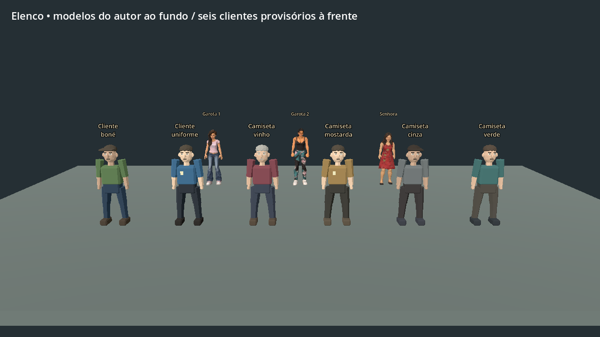
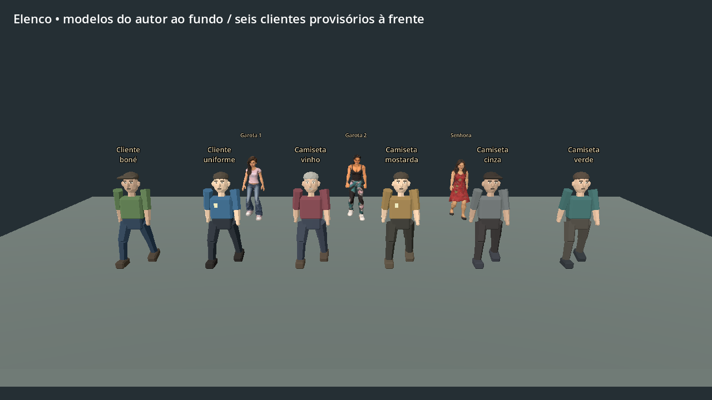

# Elenco provisório para as três noites

Estado: implementado e validado no rascunho local. O ZIP publicado 0.17.0 ainda
contém o elenco anterior.

O autor autorizou personagens visuais simples enquanto prepara os modelos com
rig. Deryk, Felps, Killer, Bryan, Zirico, Garota 1, Garota 2 e a senhora continuam
com os modelos fornecidos. A proposta de campanha está em
[CAMPANHA_TRES_NOITES.md](CAMPANHA_TRES_NOITES.md).

## Clientes disponíveis no rascunho

O cadastro em [resources/npc_cast.json](../resources/npc_cast.json) mantém as três
clientes do autor e adiciona seis identidades provisórias. Elas reaproveitam três
humanoides simples com rig, caminhada e repouso; roupa e acessórios diferenciam as
variações. As roupas usam materiais compartilhados por identidade e não alteram
as malhas nem os materiais originais.

| Identidade persistente | Aparência provisória |
| --- | --- |
| ClienteBone | Boné, camiseta verde-oliva |
| ClienteTrabalho | Camisa azul com crachá |
| ClienteVinho | Camiseta vinho, cabelo grisalho |
| ClienteMostarda | Camisa mostarda com crachá |
| ClienteCinza | Boné, camiseta cinza |
| ClienteVerde | Camiseta verde, cabelo castanho |

As chegadas alternam modelos do autor e provisórios. Cada NPC usa o controlador
de clientes existente: entrada, escolha de produtos, pedido, pagamento e saída.
A quantidade simultânea de compradores continua igual. O cliente do aviso
conserva seu papel e sua aparência separados desse rodízio.

## Substituir pelo modelo definitivo

1. Importar e preparar o FBX/GLB recebido, preservando o modelo e conferindo rig,
   escala, orientação, materiais e animações.
2. Manter o `id` do personagem e apontar `model` para o GLB preparado. Alterar o
   nome exibido em `label` se o autor lhe der um nome próprio.
3. Remover as cores provisórias de `colors`, marcar `placeholder` como `false` e
   integrar os clipes ao modo `living` depois da adaptação ao rig. Os perfis de
   altura, passada e contato dos pés ficam em `character_profiles.json`.
4. Conferir repouso, caminhada, mãos/produtos, passagem nos corredores e retomada
   do salvamento com esse cliente em atendimento.

O salvamento guarda a identidade, independente do nome do arquivo do modelo e da
ordem das visitas. Checkpoints anteriores sem esse campo conservam a interpretação
original de `appearance`: 0 é Garota1, 1 é Garota2 e 2 é Velha1.

## Sequência de produção

Primeiro, finalizar a sexta: apresentação da dupla, visitas de clientes, conversas,
apagão, gerador e fechamento. Usar esse trecho para acertar o ritmo antes de
produzir a investigação do sábado e a perseguição do domingo.

Conforme surgirem papéis adicionais no roteiro, atribuir identidades próprias ao
cliente recorrente, à testemunha, ao vizinho e aos demais participantes. Os
visuais simples permitem testar cenas e falas enquanto os modelos definitivos
são produzidos. Eles ainda não representam esses papéis narrativos no jogo.

Para revisão visual, executar `res://tests/npc_cast_review.tscn` em Linux com
display; ele grava repouso e caminhada em `/tmp/npc_cast_idle.png` e
`/tmp/npc_cast_walk.png`. `./tools/test.sh` verifica cadastro, materiais, rig,
compatibilidade dos checkpoints e o atendimento real com cliente provisório.

Validação deste rascunho: **188/188 verificações passaram**, sem erros de execução.
Importação e revisão visual concluídas no Godot 4.4.1, em Linux/Mesa llvmpipe.
Registros: [integração](npc_cast_draft/integration.log),
[capturas](npc_cast_draft/render.log) e [relatório](npc_cast_draft/validation.json).

