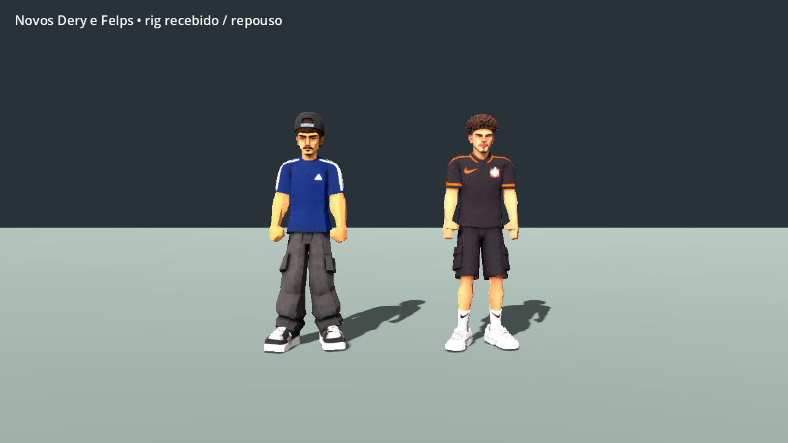
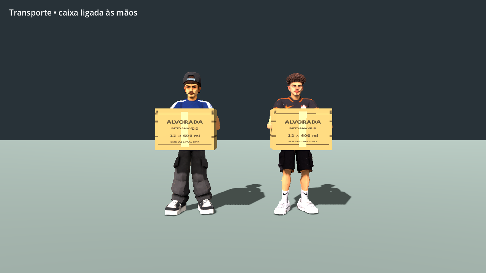
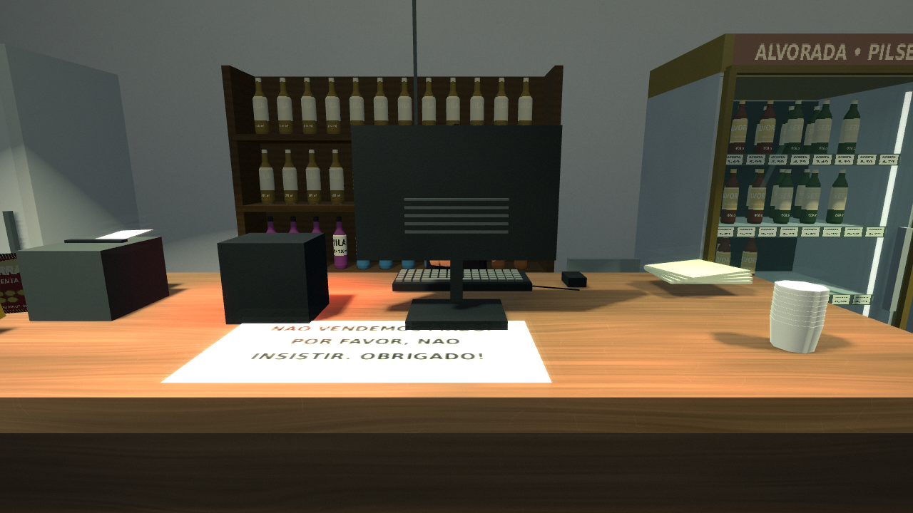
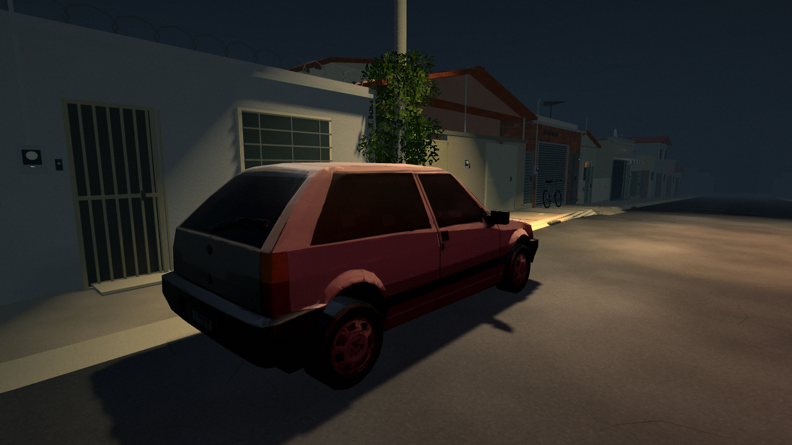

# Novo elenco — revisão 0.10.0

**[Baixar o projeto Godot 0.10.0 (ZIP)](https://github.com/Deriby/TheLastSale/raw/refs/heads/main/downloads/project/TheLastSale_Godot_0.10.0.zip)**. Extraia, importe `project.godot` no Godot 4.4.1 e pressione F5. Esta entrega inclui o novo elenco e mantém o cenário da 0.9.0.

## Originais e conversão

Fonte: [Modelos para The Last Sale.zip](https://drive.google.com/file/d/1qogHQIpLHR2YuTVj_vi3I2FP-i-Qapxe/view). O arquivo de 803.907.853 bytes passou pela verificação CRC de todos os 114 arquivos; SHA-256 em `source_archive.json`. Os FBX originais extraídos estão em `/workspace/references/incoming_models/originals/Modelos para The Last Sale`, fora do Git. As cópias antigas GLB em `assets/models/originals` foram preservadas.

A conversão usa os oito FBX identificados como RIG. Os 71 ossos do AccuRIG foram preservados, incluindo torções, suporte de joelhos/cotovelos, pés e face. Os nomes dos controles principais foram mapeados para a interface do jogo. Um controle sem pesos de peito superior foi acrescentado para ombros e pescoço; não houve um novo auto-rig. A redução de malha interpola os pesos existentes e normaliza as quatro influências dominantes por vértice para o renderizador Compatibility. Os shapes recebidos `Basis` e `V_None` eram idênticos; essa chave vazia foi removida antes da redução.

Albedo dos personagens: 1024²; normal: 512². Carro: albedo 2048², normal 1024², metal/rugosidade 512². Oito personagens e carro somam aproximadamente 33 MiB em GLB, incluindo clipes. Essa comparação com o ZIP de origem inclui a remoção de formatos duplicados e cópias de texturas; não é uma medição de FPS ou de memória durante o jogo.

| Modelo de runtime | Triângulos recebidos | Triângulos derivados | Ossos | Clipes |
| --- | ---: | ---: | ---: | ---: |
| Dery | 50000 | 35000 | 72 | 23 |
| Felps | 50000 | 35000 | 72 | 23 |
| Enemy | 49950 | 26000 | 72 | 4 |
| Bryan | 50000 | 24000 | 72 | 11 |
| Garota1 | 49986 | 24000 | 72 | 11 |
| Garota2 | 50000 | 24000 | 72 | 11 |
| Velha1 | 49886 | 24000 | 72 | 11 |
| Zirico | 50000 | 26000 | 72 | 11 |
| Carro1 | 50000 | 50000 | — | 0 |

## Integração e animações

- Dery e Felps substituídos; respiração, transferência de peso, caminhada, corrida, agachamento, deslocamento lateral/trás, gestos e trabalho. A cabeça é uma malha separada na primeira pessoa; as mãos continuam definindo o socket físico da caixa.
- Killer substitui Enemy, com repouso, olhar, caminhada e ataque preparados para o papel já reservado ao assassino. A campanha e as aparições completas continuam em desenvolvimento.
- Bryan tem escala infantil (1,19 m) e uma conversa opcional com Dery e Felps. Zirico tem conversa de conhecido e ritmo de repouso irregular. Essas presenças estabelecem os papéis dados pelo autor; as histórias particulares ainda precisam ser desenvolvidas.
- Garota 1, Garota 2 e Velha 1 entram, escolhem produto, vão ao novo caixa esquerdo, pagam e saem. Há gestos próprios para examinar prateleira, segurar garrafa e pagar. O visitante do aviso narrativo preserva sua identidade anterior.
- Carro 1 substitui o hatch estacionado, com tamanho físico de 4,20 × 2,08 × 1,58 m, colisão e obstáculo de navegação ajustados.
- Contato dos pés e passo usam medidas por personagem. O modo Econômica desliga o normal map dos modelos importados; Nítida o restaura.

Alturas adultas são aproximações de integração, ajustáveis pelo autor. Os rostos e as mãos mantêm as limitações da malha recebida; não há novos morphs de expressão ou animação individual dos dedos.

## Reproduzir

```bash
blender -b -t 4 --python tools/import_user_models.py -- /workspace/TheLastSale '/workspace/references/incoming_models/originals/Modelos para The Last Sale'
./tools/godot.sh --editor --import
./tools/test.sh
```

O relatório por modelo e os hashes de cada FBX estão em `../user_models_report.json`. `resources/character_profiles.json` fornece as medidas usadas em runtime.

## Validação

106/106 testes passaram no projeto e no pacote Linux lançado a partir de /tmp, fora da árvore de fontes. As revisões renderizaram 7 vistas do elenco, 8 do cenário em Nítida e 8 em Econômica, mais 7 vistas do elenco empacotado. Os materiais importados passaram de 9 normal maps ativos em Nítida para zero em Econômica. Os logs de runtime dessas execuções não têm erros; o importador headless havia emitido avisos de miniaturas de textura do renderer dummy, separados das execuções verificadas.

O projeto pode ser aberto diretamente no editor. A conferência do ZIP de distribuição está em [downloads/project](https://github.com/Deriby/TheLastSale/tree/main/downloads/project). O registro de um export local anterior foi preservado em `validation.json`; ele não é o download desta entrega. O desempenho na R7 permanece sem medição nativa.

## Capturas e movimento

[Assistir à prévia de 12 segundos](cast_motion.mp4) — repouso, caminhada e transporte reais, sem pose congelada.








A revisão de movimento de 12 segundos usa o mesmo LivingMotion e socket do jogo. Os testes e limites verificados estão em `validation.json` e nos logs desta pasta. O ambiente de validação foi Linux/Mesa. Windows 7 e Radeon R7 ainda precisam de teste nativo.
