# Revisão 0.3 — personagens e câmera

Registro da versão 0.3. A [correção 0.3.1](../fixes_v031/README.md) revisa novamente os braços, acrescenta rig no tronco e corrige a renderização do cenário.

Primeira passagem da etapa **2. Melhorar Dery e a câmera**, incluindo o novo Felps fornecido em 28/10/2026.

## Notas incorporadas à etapa 2

- Usar o Felps correto, criar o rig e preservar o arquivo enviado.
- Revisar pesos, apoio dos pés, caminhada, corrida e transporte de caixas.
- Dar vida a Deryk e Felps também parados: respiração, postura relaxada, transferência de peso, pequenos olhares e gestos.
- Reduzir os braços abertos e a rigidez das transições.
- Rever enquadramento, primeira pessoa e comportamento da câmera em corredores apertados.

## Movimento gravado no motor

[Assistir à gravação completa de 38 segundos (MP4)](motion.mp4). Ela usa os modelos exportados, o controlador de animação e o encaixe das caixas do jogo, em uma cena de revisão com piso visível. Não é uma animação conceitual. Deryk aparece à esquerda; Felps, à direita.

Repouso, respiração e postura:

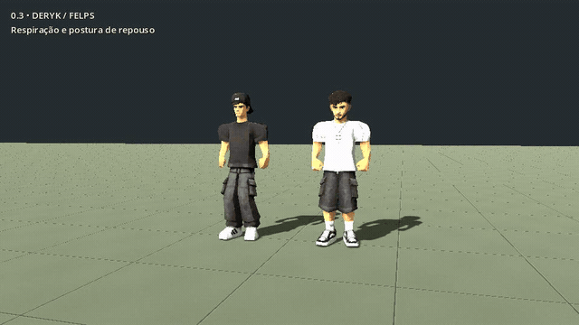

Caminhada, com deslocamento sobre o piso:

Corrida:

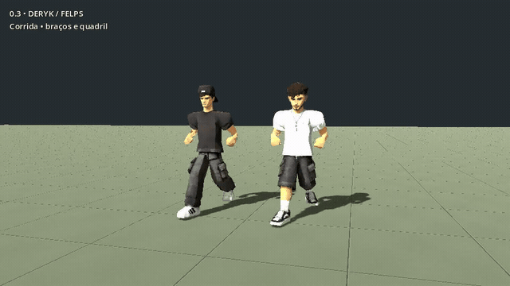

Transporte, com a caixa acompanhando as mãos:

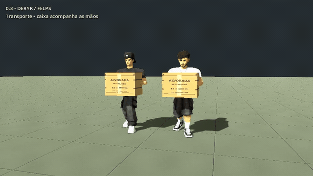

A gravação completa também mostra gestos, transferência de peso e caminhada agachada. Felps usa caminhada/corrida na cena de revisão; durante o expediente, continua trabalhando no caixa.

## Comparação de poses

Deryk antes, na versão 0.2:

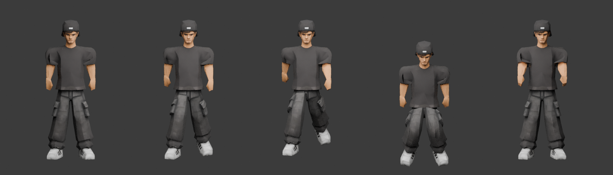

Deryk depois, na versão 0.3. Da esquerda para a direita: repouso, caminhada, corrida, agachamento e transporte (sem caixa nesta folha):

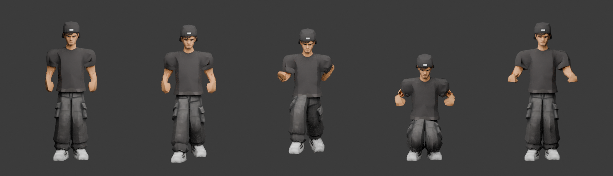

Felps correto com o novo rig, nas mesmas cinco poses:

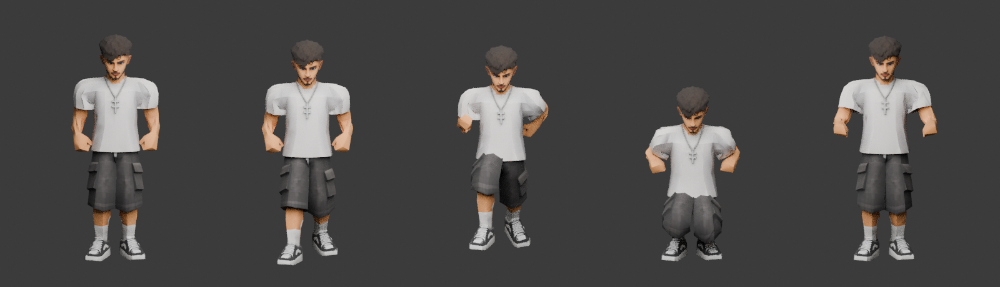

## Dentro do depósito

Felps no caixa:

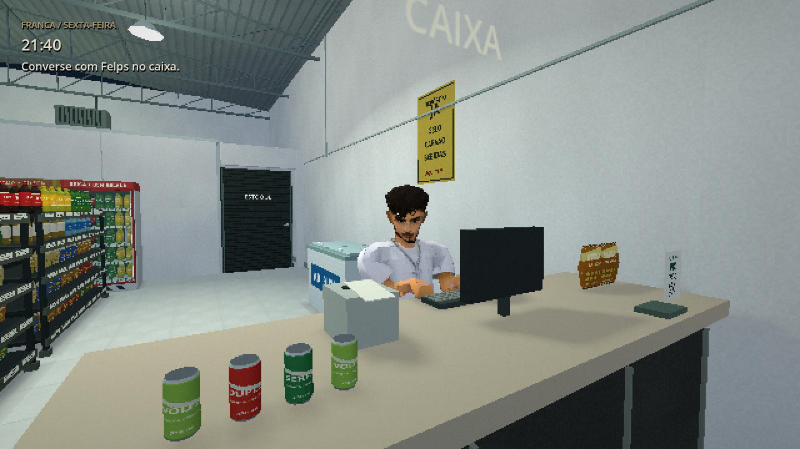

Câmera junto à parede do corredor:

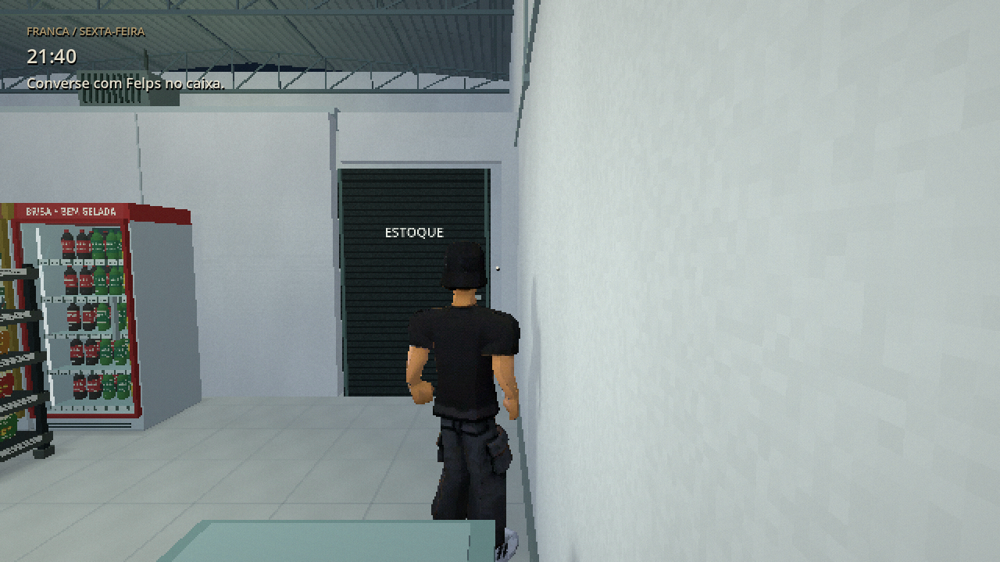

Transporte em terceira pessoa:

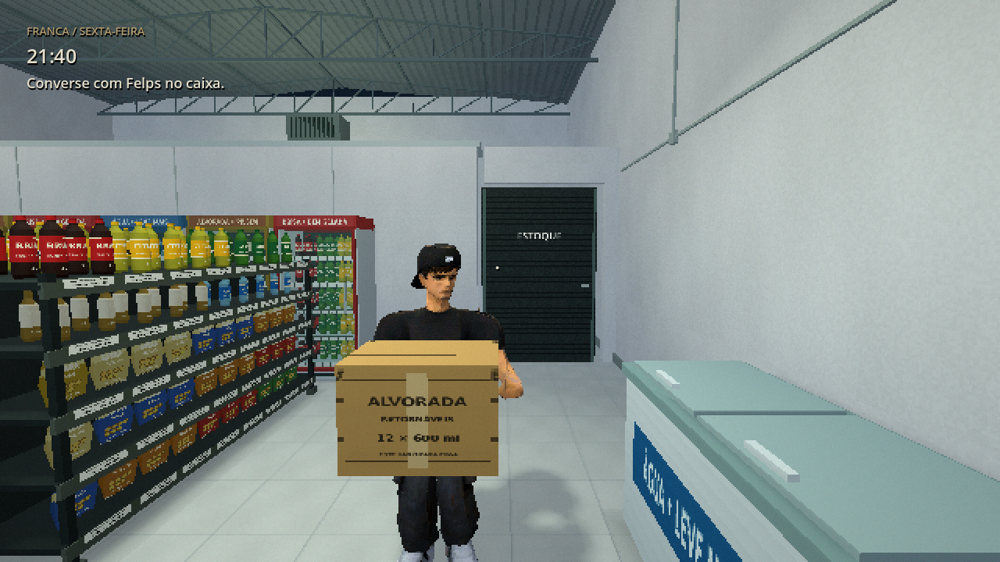

Caixa em primeira pessoa:

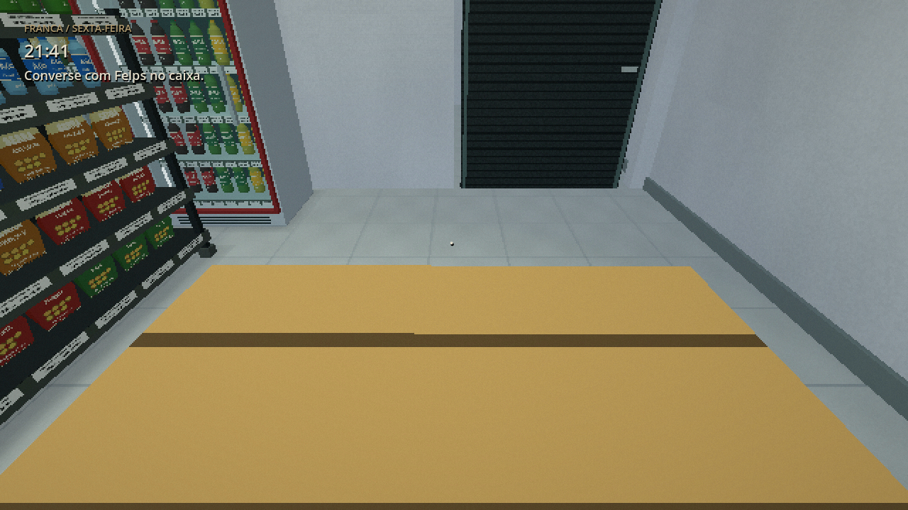

Corpo em primeira pessoa, olhando para baixo:

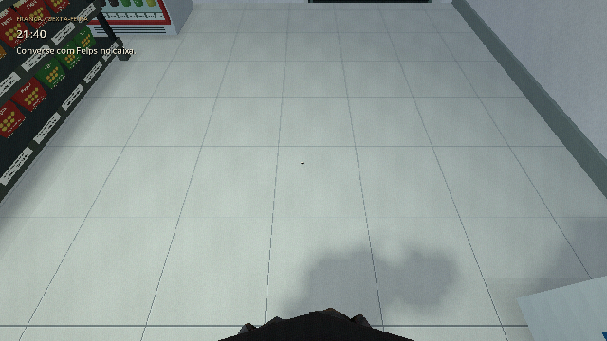

## Implementação

Deryk e Felps têm 19 ossos e **23 clipes cada**: repouso, transferência de peso, olhar, ajuste de postura, cansaço, caminhada, marcha à ré, passos laterais, corrida, repouso/caminhada agachados, repouso/caminhada carregando, pegar, colocar, baixar, conversa, trabalho/repouso no caixa, observação, susto e ataque. Os clipes de susto/ataque permanecem disponíveis; esta revisão não adiciona perseguição.

Os pesos têm transições nos ombros, cotovelos, joelhos e tornozelos, sem vértices sem influência. As solas são calibradas pela geometria de cada calçado. O ciclo alterna apoio e balanço, com flexão dos joelhos, rotação do tronco e movimento dos braços. O controlador ajusta a cadência à distância realmente percorrida, inclusive quando o jogador esbarra em uma parede. A correção adicional dos pés trata pequenos desníveis, preservando o pé que está no ar.

As mãos definem a posição e orientação da caixa. Pegar começa com alcance; a caixa só se prende depois do gesto inicial. É necessário chegar a até 95 cm. Colocar/baixar usa transição e bloqueia ações incompatíveis durante o gesto.

Felps alterna trabalho no caixa, repouso, pequenos olhares e transferência de peso. Durante diálogos, gesticula ao falar e acompanha o interlocutor com a cabeça. Deryk também tem atenção da cabeça e variações de repouso.

A câmera usa interpolação do deslocamento, suavização vertical, colisão esférica no SpringArm e teste lateral do ombro. O ombro recolhe rapidamente e retorna suavemente; o personagem é ocultado quando a terceira pessoa fica muito comprimida. Em primeira pessoa, apenas a cabeça é ocultada e o corpo permanece visível. Os novos padrões são distância de 2,2 m e FOV 68; configurações já salvas continuam sendo respeitadas.

## Modelos originais

O novo Felps veste camiseta branca, bermuda preta, corrente e tênis. [Render dos modelos de origem](source_models.png). Os arquivos originais de Deryk, Enemy e do novo Felps são preservados sem edição; a redução de geometria, os pesos e as animações existem nos derivados. O Felps anterior foi arquivado em `assets/models/originals/archive/Felps_superseded_v01.glb`.

[Hashes atuais](../original_checksums.json), [histórico da substituição](source_history.json) e [hashes anteriores](previous_original_checksums.json).

## Validação e limites

A integração do projeto e a execução do pacote Linux verificam o fluxo narrativo e os novos comportamentos. Os resultados finais estão em [VALIDACAO.md](../VALIDACAO.md).

O Blender reimporta os GLBs e amostra 41 instantes em 13 clipes por personagem: **1.066 poses amostradas**, com deformações finitas e maior penetração medida da sola de **7,4 mm**. O maior afastamento da sola durante as fases de apoio amostradas foi **11,2 mm**. Esses valores descrevem o piso plano da revisão; não certificam todos os terrenos ou giros. Dados em [motion_metrics.json](motion_metrics.json).

Esta é animação procedural com poses e IK analítico, sem captura de movimento. Ainda há espaço para polir curvas, giros com pés fixos, cotovelos, contato de colocação, dedos e atendimento. Não há rig facial, sincronização labial ou simulação de roupa. Clientes e Enemy mantêm os rigs anteriores. O executável Windows é exportado no Linux e ainda precisa ser jogado no Windows real.
