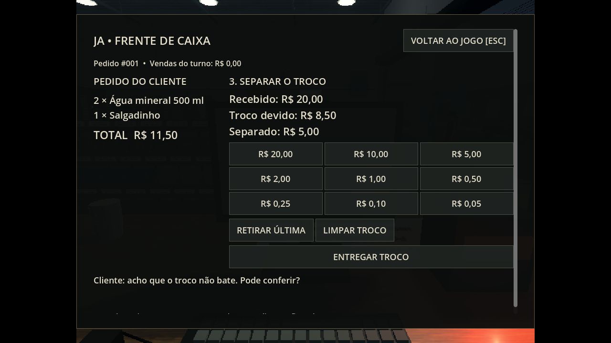
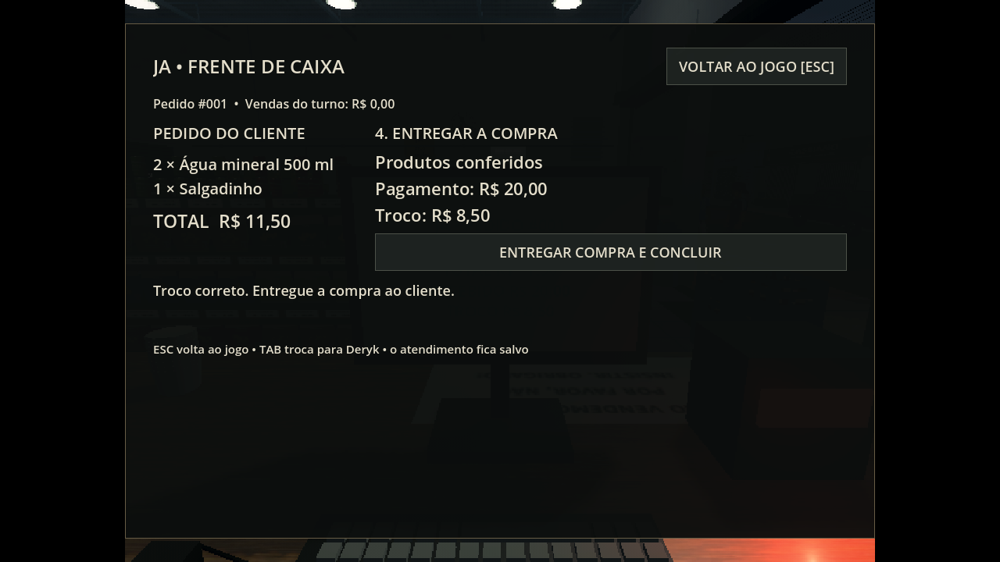
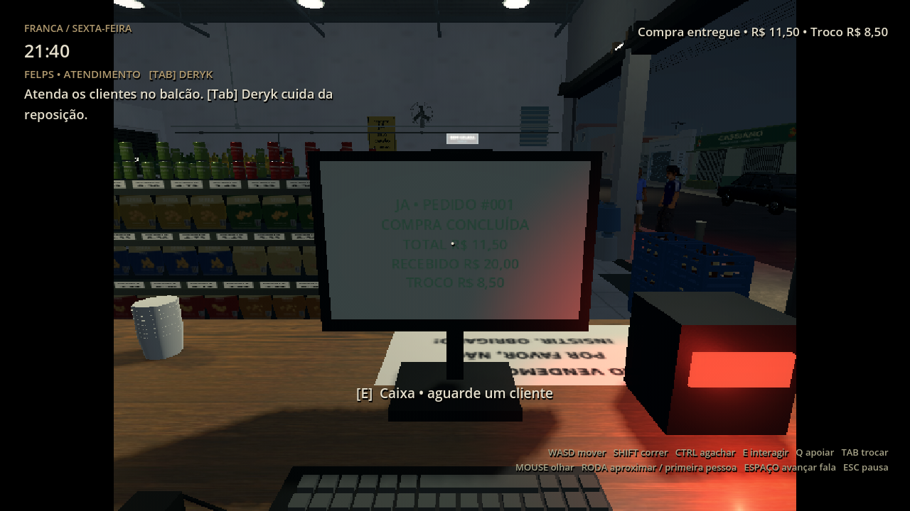
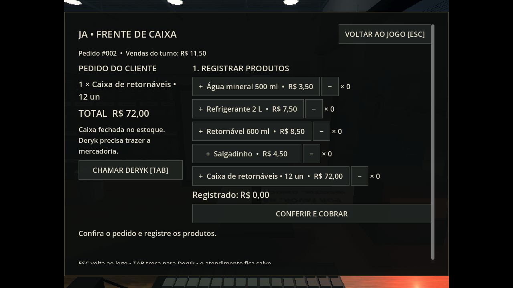

# Atendimento 0.17.0 — pedidos, registro, dinheiro e troco

[Baixar o projeto Godot 0.17.0](https://github.com/Deriby/TheLastSale/raw/refs/heads/main/downloads/project/TheLastSale_Godot_0.17.0.zip). Extraia numa pasta nova, importe `project.godot` no Godot 4.4.1 e pressione F5. Inicie um novo expediente para experimentar a rotina completa; checkpoints antigos continuam aceitos.

## Ciclo de atendimento

1. Converse com Felps para começar as tarefas. Os clientes entram, escolhem produtos e chegam ao balcão.
2. Troque para Felps com **Tab** e use **E** junto ao posto do caixa. **Espaço** avança a conversa e abre a frente de caixa.
3. Confira o pedido à esquerda e registre os produtos com **+**; **−** corrige uma unidade. O total é calculado automaticamente. **Conferir e cobrar** valida produtos e quantidades.
4. Receba a quantia oferecida pelo cliente. A gaveta abre e mostra o troco devido e o valor já separado.
5. Clique nas cédulas/moedas para separar o troco. **Retirar última** e **Limpar troco** permitem corrigir. O cliente comenta quando o valor não confere.
6. Entregue o troco e finalize em **Entregar compra e concluir**. O cliente recebe a compra, o recibo entra no total do turno e a saída fica liberada.

**Esc** fecha a frente de caixa. **Tab** troca de personagem. Ao abrir a tela, Felps fica no posto e o cursor controla os botões; o restante do cenário continua funcionando. A interface mantém a resolução normal nos modos PS1 e PS1/2.

## Pedidos que precisam de Deryk

Alguns clientes pedem uma **caixa fechada de retornáveis**. Use **Chamar Deryk**, busque a caixa identificada no estoque e leve-a ao balcão. **E** entrega a mercadoria quando Deryk está perto do cliente. Depois, volte a Felps com Tab e continue o registro e o pagamento.

O cliente espera e a cobrança exige que a mercadoria tenha chegado. A caixa do pedido tem identificação própria; as duas caixas da tarefa inicial continuam destinadas à geladeira. **Q** conserva a colocação em superfície livre e a soltura agendada durante a pegada da 0.16.0.

## Produtos e valores

| Produto | Valor |
|---|---:|
| Água mineral 500 ml | R$ 3,50 |
| Refrigerante 2 L | R$ 7,50 |
| Retornável 600 ml | R$ 8,50 |
| Salgadinho | R$ 4,50 |
| Caixa de retornáveis, 12 unidades | R$ 72,00 |

A rotina varia produtos e quantidades. Pagamento exato também funciona, com troco zero. Esta etapa usa dinheiro; cartão e Pix ficam para a próxima etapa.

## Cenário, clientes e salvamento

O monitor acompanha o pedido, o total, o dinheiro recebido e o troco. A gaveta tem abertura/fechamento e efeitos de scanner, dinheiro e entrega. Os produtos aparecem sobre o balcão. Os clientes comentam sobre espera e erros; Bryan e Zirico têm falas próprias conforme o personagem controlado e as visitas anteriores. Os clientes procuram um desvio quando alguém obstrui o caminho.

O checkpoint versão 3 registra pedido, quantidades já lançadas, etapa, dinheiro recebido, troco parcial, mercadoria entregue, posição e estado do cliente, recibos e receita. Continua conservando os dois personagens e suas caixas. É possível retomar com Felps separando troco ou Deryk carregando a caixa do pedido. Uma entrega concluída é creditada uma vez. Checkpoints das versões 1 e 2 continuam aceitos.

Os materiais, modelos e iluminação foram preservados. Os três efeitos de áudio novos foram sintetizados no projeto. O limite padrão continua em 30 FPS; desempenho nativo no Windows/Radeon R7 não foi medido.

## Validação

183/183 verificações passaram no projeto e no ZIP extraído após importação limpa. A suíte cobre o pedido real no painel, produtos e quantidades incorretos, cobrança bloqueada, troco errado e correção, pagamento exato, pagamento repetido bloqueado, retomada com troco parcial, retomada carregando a caixa do pedido, caminhada física de Deryk até o estoque e volta, recibo e receita únicos, percursos completos dos clientes e progressão da história.

Registros: [integration.log](integration.log), [render.log](render.log), [layout.json](layout.json) e [validation.json](validation.json). As capturas usam cliente posicionado no balcão para conferir a interface; as rotas completas são verificadas separadamente na integração. Capturas em Linux/Mesa llvmpipe, janela de 1280×720, cenário PS1/2 em 640×480. Para reproduzir em Linux com display, execute `res://tests/register_review.tscn`; arquivos em `/tmp/register_017_*`.
