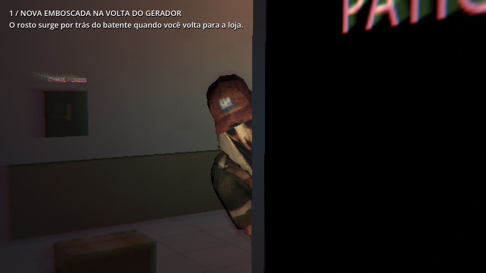
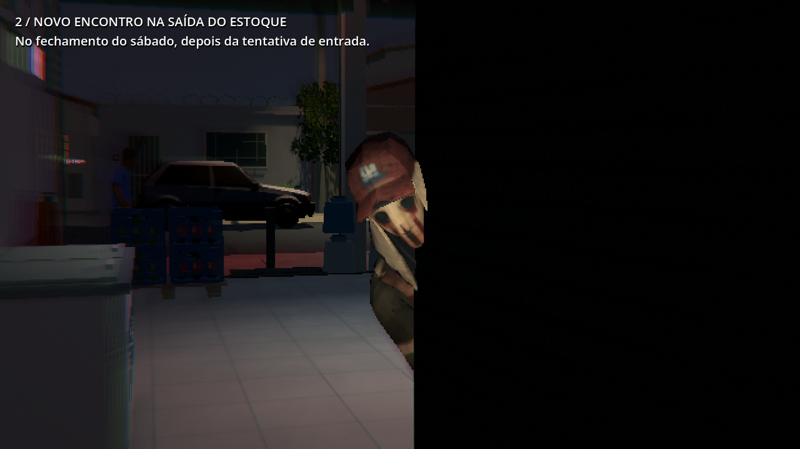
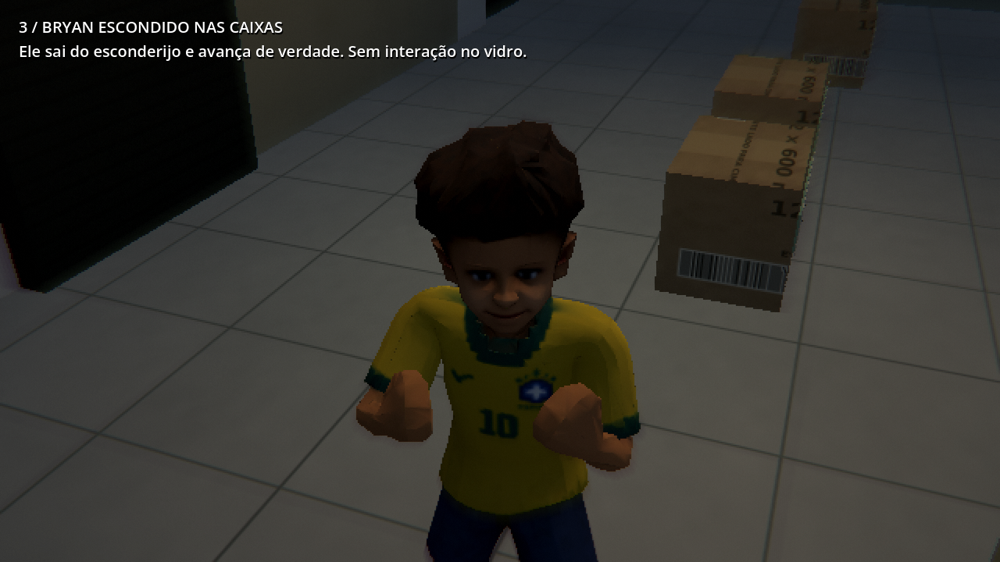
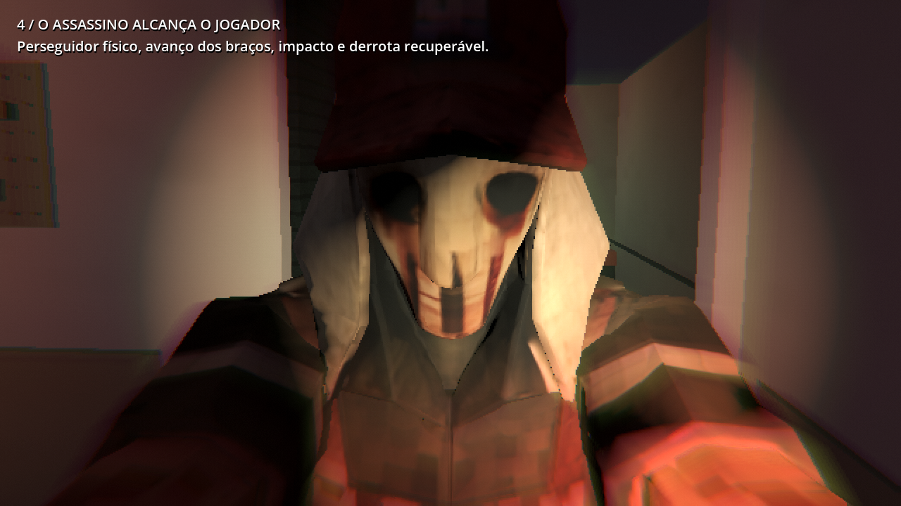
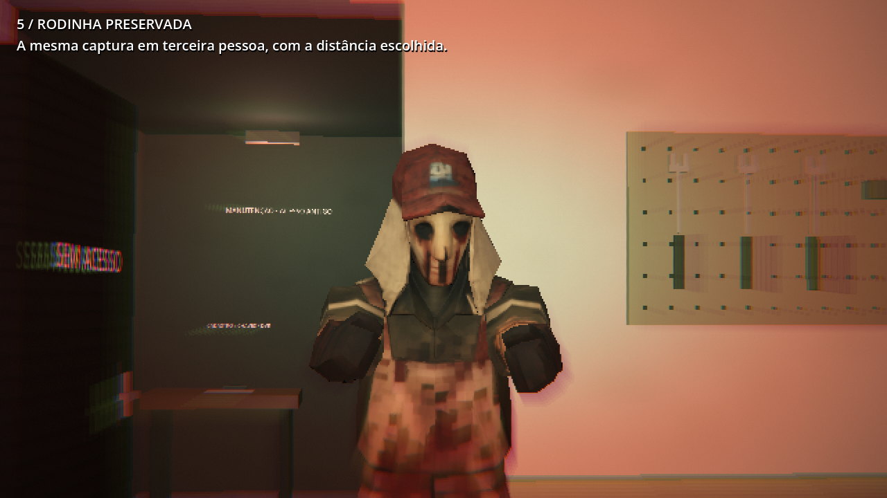

# 0.41.0 — emboscadas e sustos de contato

[Ver os cinco exemplos no jogo real](https://raw.githubusercontent.com/Deriby/TheLastSale/main/docs/contact_v041/sustos_preview.mp4) · [Projeto Godot 4.7 sem EXE](../../downloads/project/TheLastSale_Godot_0.41.0.zip).

A revisão usa a dinâmica dos exemplos enviados: ameaça saindo rapidamente da cobertura, enquadramento no rosto, aproximação física, braços em direção ao jogador e impacto breve na imagem. A referência foi analisada por amostragem de quadros e por intervalos menores nos trechos de aproximação. As situações usam os personagens e lugares do depósito.

Há duas emboscadas novas. Na sexta, depois de restaurar o gerador, o assassino pode espiar pelo batente ao voltar do pátio para a loja. No sábado, depois da tentativa de entrada e das decisões no computador, outro encontro aguarda a saída do estoque. São oportunidades próximas e privadas: passagem aberta, mãos livres, nenhum painel ou conversa, intervalo entre sustos e ausência de testemunhas próximas. O corpo fica encoberto pela parede; o rosto sai rapidamente e a câmera o enquadra. Os atores são retirados somente depois de recuar para a cobertura. Não há travessia pelo salão, fala automática ou pista obrigatória nova.

Bryan fica exclusivamente na peça atrás das caixas dos fundos. Ele caminha até o esconderijo, espera Deryk perto e sai depressa. A câmera não aponta antecipadamente para as caixas; o foco entra na revelação e acompanha o avanço curto pela física. Ele usa as animações naturais existentes, vira o corpo para Deryk e olha para cima sem a torção do pescoço e o salto artificial da prévia anterior. A risada e a conversa opcional trazem o alívio depois. Checkpoints antigos são encaminhados para esse esconderijo, sem recriar interação no vidro. A aproximação pode ser interrompida e salva sem teleporte.

Na fuga de domingo, o tempo para evitar o golpe permanece. Somente depois de o ataque realmente alcançar o personagem controlado começa uma sequência de 1,04 segundo com o perseguidor físico, o rosto e os braços próximos. Ela termina na derrota recuperável e no checkpoint original. Se o companheiro for capturado longe da câmera, o fluxo de derrota continua diretamente. Salvar pela pausa durante a captura preserva o checkpoint seguro da fuga.

O foco acompanha a posição final do rosto depois dos modificadores de animação. Um tranco de câmera, distorção radial com centro mais nítido, separação de cor nas bordas e um impacto sonoro original duram menos de um segundo. A pausa congela a sequência; retomar ou carregar outra cena limpa os efeitos. Os volumes de efeitos e música continuam separados. Rodinha e terceira pessoa permanecem; nos focos próximos, o avatar local se recolhe da imagem quando encobriria o rosto, conservando sua sombra e sua colisão.

Modelos, texturas, música enviada e onze bibliotecas de animação anteriores permanecem byte a byte. As poses adicionais atuam apenas durante os sustos. Não há nova luz com sombra, alteração dos circuitos, do piso PSX, das velocidades dos protagonistas ou das regras de perseguição. As aparições silenciosas e o encontro anterior do assassino no carro continuam separados da peça de Bryan. O áudio novo foi sintetizado por `tools/make_contact_audio.py` e está pronto no projeto.

A prévia mostra cinco cenas: volta do gerador, saída do estoque no sábado, peça das caixas, captura em primeira pessoa e captura em terceira pessoa. Ela usa o código real dos eventos e o perseguidor físico, com condições da campanha preparadas entre trechos. A velocidade é normal; o vídeo foi gravado em 1280×720, 15 quadros por segundo, qualidade interna 2, Godot 4.7 / Compatibility / Mesa llvmpipe. Não mede desempenho no computador do jogador. A referência enviada não é redistribuída no projeto.

| Cena | Captura do jogo |
| --- | --- |
| Volta do gerador |  |
| Saída do estoque |  |
| Bryan nas caixas |  |
| Captura próxima |  |
| Rodinha / terceira pessoa |  |

A validação do pacote extraído executa a campanha, os controles, as interfaces, os novos encontros, as retomadas, a energia e as animações, além dos 48 casos renderizados de estabilidade do piso PS1/PS1/2. [Escopo](validation.json) · [Resultados do ZIP](../../downloads/project/release_verification.json).
