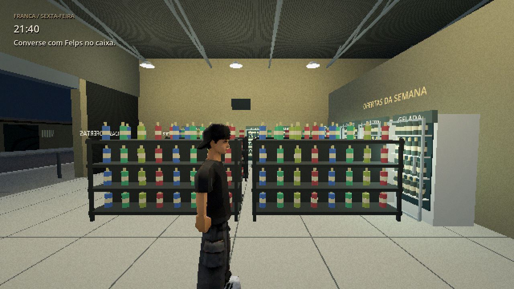
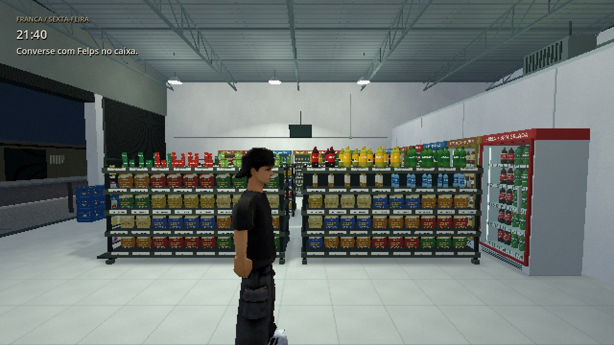
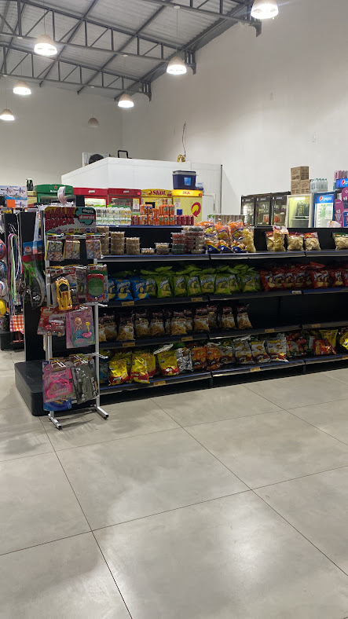
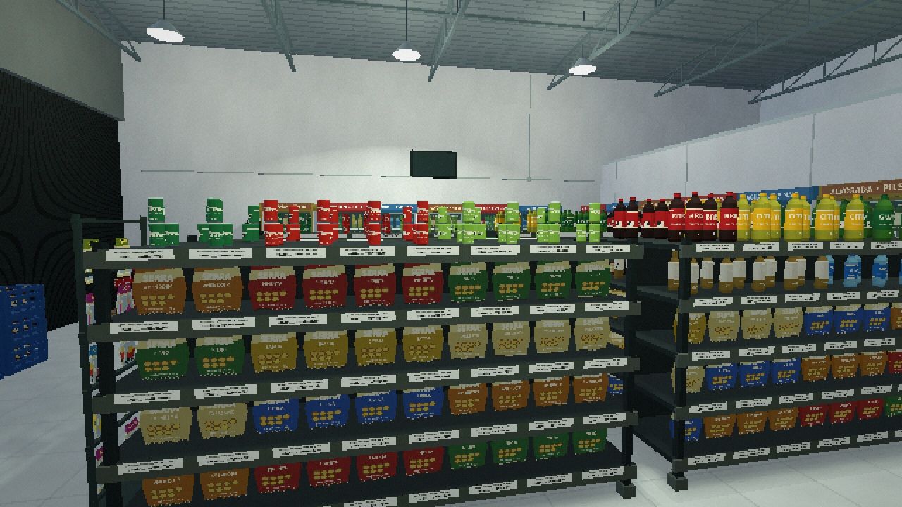
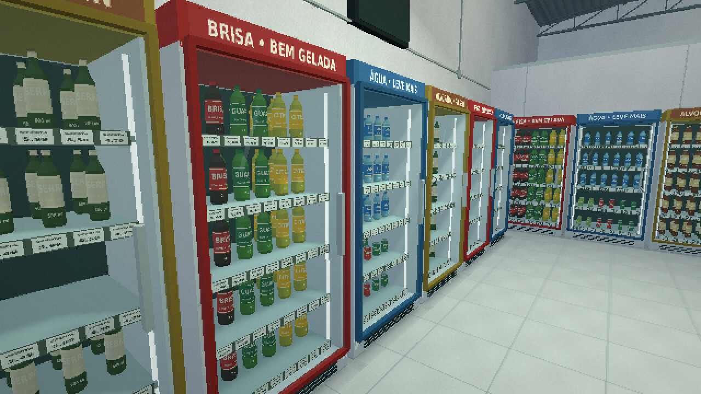
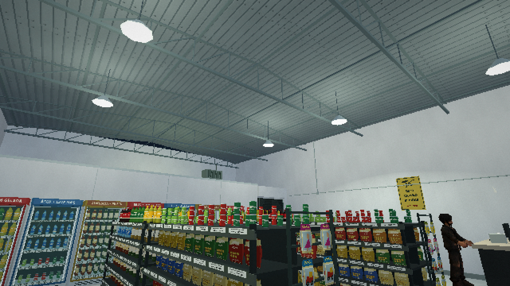

# Revisão 0.2 — reconstrução do interior

Esta entrega atende à escolha **1 — refazer o depósito a partir das fotos**. O foco é a área de vendas e os elementos arquitetônicos observáveis. Os modelos de Dery, Felps e Enemy, suas animações e a rua permanecem na base anterior.

## Antes / depois

Mesma posição de jogador e enquadramento usados na revisão anterior, com o cenário atualizado:

**0.1:**

**0.2:**

## Referência real e interpretação

A foto `interno4.jpg`, fornecida no ZIP original, mostra gôndola escura com salgadinhos e utilidades, geladeiras próximas umas das outras, volume branco ao fundo, piso cerâmico claro, paredes altas e treliças com luminárias pendentes:

A reconstrução usa esses elementos e sua relação espacial, com duas filas centrais, corredores laterais e equipamentos no perímetro. Não foi feita fotogrametria ou medição do imóvel. A imagem abaixo é uma vista da reconstrução ao nível dos olhos, com enquadramento diferente da foto:

## O que mudou

- **Gôndolas:** estrutura metálica, pés, cinco níveis, divisória central, porta-etiquetas e produtos agrupados por categoria. Salgadinhos, bebidas e produtos mistos têm composições diferentes, em vez das mesmas garrafas em todas as prateleiras.
- **Produtos:** malhas compartilhadas com perfis de PET, vidro, água, latas e pacotes estufados; rótulos e embalagens originais em baixa resolução. Marcas fictícias e paleta orientada pelas referências. Produtos repetidos usam MultiMesh.
- **Geladeiras:** fileiras próximas, sem os grandes vazios anteriores; gabinete vazado visualmente, prateleiras internas, bebidas recuadas, moldura articulada, puxador, vidro discretamente tingido, faixas de marca e grelha inferior. As duas reposições acrescentam instâncias visíveis no espaço vazio, inclusive ao carregar o save.
- **Pontas e entrada:** expositores de brinquedos em cartelas, engradados azuis empilhados e exposição sobre palete. Esses tipos de elementos aparecem nas fotos; quantidade e posicionamento exato são aproximações.
- **Caixa:** tampo, divisórias, rodapé, monitor voltado ao funcionário, teclado, impressora térmica, papel, produtos e placa decorativa de pagamento. Nenhum código de pagamento real foi inserido. A posição exata do balcão continua sendo uma aproximação.
- **Arquitetura:** cerâmica em módulo aproximado de 60 cm, juntas mais finas, rodapé, soleira escura, paredes claras, cobertura em duas águas com chapas corrugadas, terças e treliças conectadas. As luminárias têm cabo, cúpula e difusor. TV desligada, conduítes e veneziana completam as superfícies observadas.
- **Circulação:** as novas peças têm colisões e entram nos obstáculos usados pelos clientes. Checkpoints antigos dentro de uma peça nova são deslocados para um corredor próximo.

## Vistas de revisão

## Limites desta entrega

O salão continua com envelope aproximado de 12 × 11 m; altura das paredes de 5,6 m e cumeeira em torno de 6 m. As fotos não fornecem medições confiáveis. O estoque e o acesso antigo continuam fictícios e menos detalhados. O volume de armazenamento/câmara fria no fundo interpreta o volume branco das fotos, sem afirmar que o imóvel real tenha esse acesso ou essa planta.

A disposição é uma aproximação navegável baseada nos elementos recorrentes das fotos, não uma réplica arquitetônica certificada. A finalidade das prateleiras, densidade de produtos e continuidade dos equipamentos foram priorizadas nesta revisão. Não foram adicionadas áreas observadas apenas por suposição.

O tratamento geral de luz, câmera, personagens e efeitos retrô ainda precisa das próximas rodadas de acabamento. Foram feitos apenas os ajustes de iluminação necessários para ler a geometria nova: luzes neutras, contatos e duas fontes de sombra compatíveis com OpenGL; isso não conclui a etapa de direção de iluminação. A perseguição não foi acrescentada.

## Validação

- Godot 4.4.1, Compatibility, revisão visual real no OpenGL/Mesa llvmpipe.
- 60 verificações de integração no projeto e repetição no pacote Linux de QA; registros em `source_tests.txt` e `packed_tests.txt`.
- Percurso completo dos clientes, diálogo, duas reposições, caixa no palete, aviso e final da demonstração.
- Retorno de checkpoint e geometria visível das reposições; migração de checkpoint antigo colocado dentro de uma gôndola.
- Capturas do jogo e vistas dedicadas em altura de olhos. Comparação das vistas com as fotografias fornecidas.
- Exportação Windows x64 0.2.0 preparada. O `.exe` continua sem teste em Windows real. Não há certificação de FPS em hardware modesto.

Próximo foco recomendado: câmera e movimento de Dery, com contato dos pés/mãos e animações de trabalho mais convincentes.
