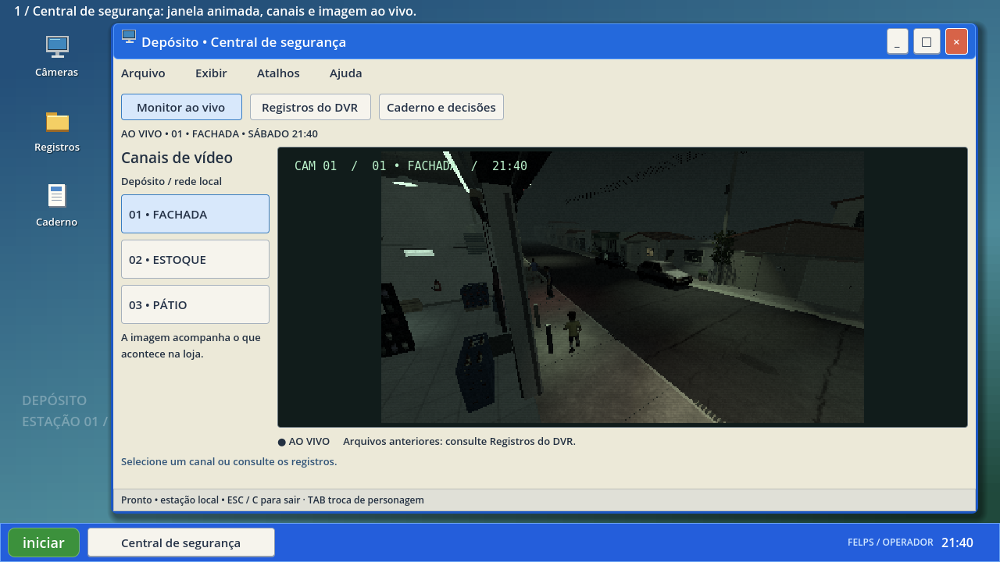
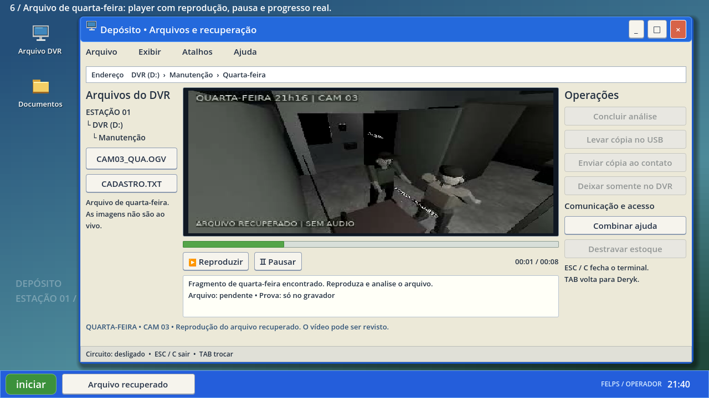
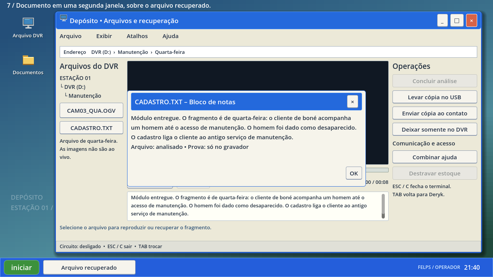

# 0.34.0 — o computador do depósito

[Assistir à prévia real](computador_preview.mp4) · [Baixar projeto Godot 4.4.1 sem EXE](../../downloads/project/TheLastSale_Godot_0.34.0.zip).

A gravação mostra oito telas reais do jogo: monitor ao vivo, pátio, registros, caderno, área de trabalho/Iniciar, reprodução, documento e confirmação de cópia. As condições da campanha foram preparadas para mostrar as funções; os intervalos foram cortados. As animações e o vídeo rodam em tempo normal. As legendas pertencem à captura.

O sistema usa uma área de trabalho original inspirada no XP: barra azul, Iniciar verde, ícones desenhados no próprio Godot, molduras, botões com relevo e tipografia própria. Não usa capturas ou arquivos de um sistema operacional. As janelas têm abertura e transições curtas, podem ser arrastadas, maximizadas, minimizadas e restauradas. Os menus Arquivo, Exibir, Atalhos e Ajuda têm funções locais. Os controles permanecem dentro da tela; conteúdo longo tem rolagem.

O CCTV mantém um único viewport de 384×216 compartilhando o mundo original. Mudar o canal reutiliza a câmera, mostra sincronização breve e atualiza a identificação. Minimizar, trocar para registros/caderno ou cobrir a imagem com um documento interrompe a renderização e remove a câmera observadora. A escuta 3D continua com o jogador. Os eventos antigos são registros escritos, não um vídeo inventado.

O domingo usa o Theora original com reprodução, pausa e progresso. Minimizar pausa o arquivo; restaurar retoma o que estava tocando e preserva uma pausa manual. O fim real do vídeo completa o progresso. A regra de liberação da análise e as condições de módulo, prova e energia continuam. O cadastro aparece em outra janela. Copiar e enviar mantêm o salvamento imediato; a animação é confirmação visual. Não há operação no computador do usuário ou envio externo.

ESC fecha primeiro o documento. ESC/C sai da estação; TAB continua trocando de personagem. Fechar libera movimento, mouse, escuta e viewport do protagonista. Saves preservam as ações e reabrem a partida com o terminal fechado. A rodinha continua oferecendo terceira pessoa depois de sair do computador. O menu principal mantém sua identidade de terror.

`tests/desktop_integration.tscn` acrescenta 35 verificações com cliques pela entrada GUI do Godot, teclas, vídeo real, geometria dos controles, minimizar, arrastar, documentos, retomada e prova. A extração final do ZIP executa as dezessete suítes. [Relatório da distribuição](../../downloads/project/release_verification.json) · [Log](integration.log).

Os 463 arquivos de assets, os 32 recursos e as onze bibliotecas de animação da 0.33.0 ficam byte a byte preservados. Não houve mudança em modelos, shaders, física, câmera, circuitos ou sistemas de campanha. A importação headless mantém os 14 avisos conhecidos de miniatura GLB. A suíte antiga de domingo pode emitir no encerramento o diagnóstico de compressor.ogg; os logs e o relatório registram o que ocorreu nesta validação. Não foi medida uma Radeon R7 física.
