# Exterior — revisão 0.4.0

Reconstrução baseada nas **sete capturas externas enviadas pelo usuário**, que mostram o Street View da Rua Alfredo Oliviere, em Franca-SP. Não houve navegação adicional no Maps. As imagens fornecidas estão integralmente em [reference_photos.zip](../reference_photos.zip); três delas aparecem abaixo com a atribuição original preservada.

**[Baixar o jogo 0.4.0 para Windows x64](../../downloads/windows/A_Ultima_Venda_Windows_x64.zip)** · **[Assistir ao passeio noturno de câmera](exterior.mp4)**

O vídeo usa o cenário real do pacote Linux exportado, com uma câmera de revisão. Não é uma gravação de controle do jogador. A iluminação diurna das comparações abaixo existe apenas na ferramenta de QA; o jogo mantém o expediente noturno.

## Fachada

Referência enviada:

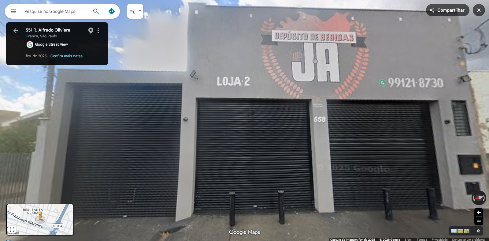

Antes, versão 0.3.1:

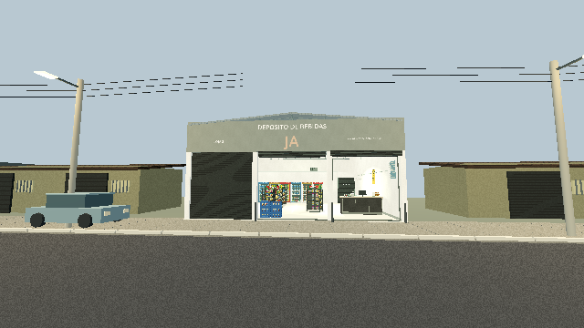

Agora, versão 0.4.0, com luz diurna de comparação:

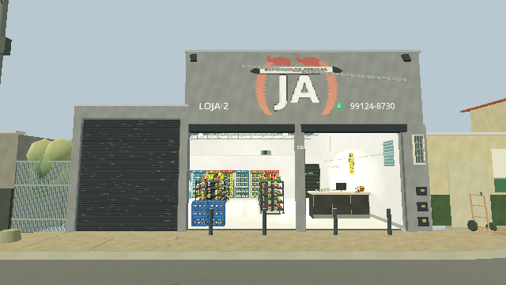

Durante a noite do jogo:

O bloco principal tem dois vãos, pilares estreitos e a marca JA; o anexo esquerdo é mais baixo e mantém sua porta metálica fechada. Foram incluídos o motivo vermelho do mural, os textos visíveis, o número 558, a pequena janela lateral, medidores e os quatro pilares de proteção. As duas portas principais ficam abertas para o expediente, embora a referência as mostre fechadas. A câmera da comparação frontal foi aproximada para ficar na rua, fora da nova casa oposta; o par não usa enquadramento idêntico.

## Casas em frente

Referência enviada:

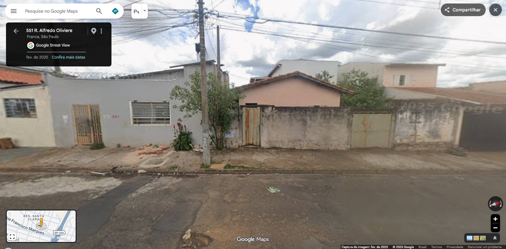

Antes:

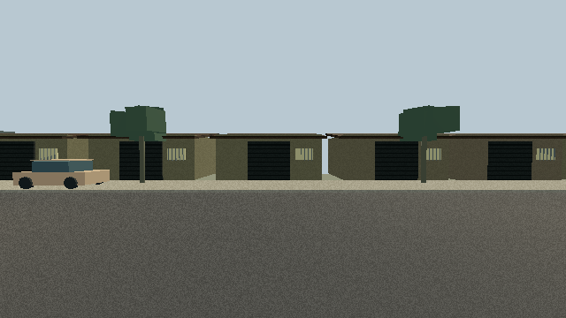

Agora:

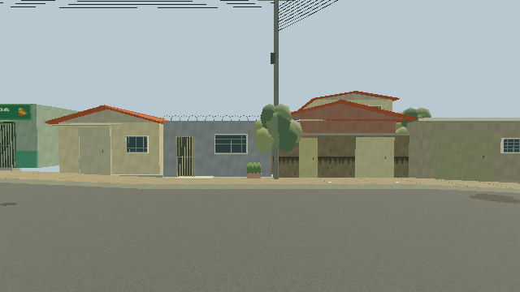

As casas deixaram de repetir um módulo único. O conjunto distingue a casa cinza com portão estreito e janela gradeada, a amarela com telhado de duas águas e a salmão atrás de muro e dois portões. O sobrado claro fica mais ao fundo. A vegetação e a fiação seguem os elementos visíveis nas capturas, com posições aproximadas.

## Rua e vizinhos

Referência enviada:

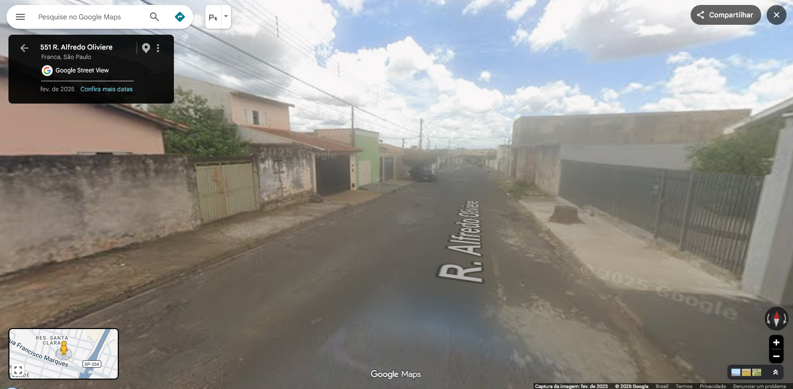

Antes:

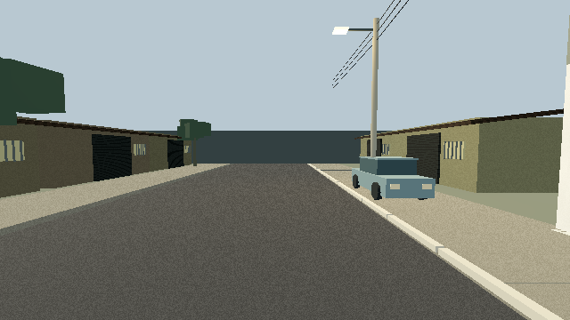

Agora, descida e subida:

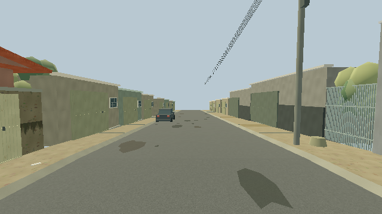

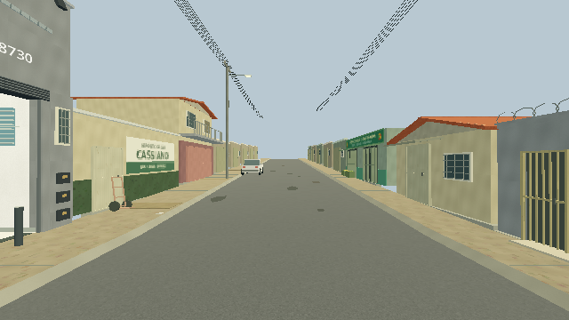

Foram refeitos o asfalto sem faixa central, remendos, sarjetas, calçadas, cerca ao lado do anexo, oficina cinza, depósito de gás CASSIANO e sobrado vizinho. Há postes com travessas e fios com queda entre apoios. A rua possui desnível físico, e a navegação dos clientes acompanha sua altura. Saves antigos na calçada são ajustados para a nova cota.

## O que ainda é aproximado

- Não houve medição do local. Larguras, profundidades e alturas foram estimadas; a rua usa 7,8 m de leito e declive de 4,5% além do patamar diante do depósito.
- Fundos das casas, profundidade do anexo, continuidade distante, carros e iluminação noturna foram interpretados para o jogo. Só um trecho do quarteirão é explorável.
- O mercado verde tem placa genérica porque seu nome não é legível nas imagens. O mural e as placas foram redesenhados; as texturas do jogo não usam recortes fotográficos.
- O estilo permanece de baixa resolução. Não é uma reprodução arquitetônica exata nem um acabamento artístico final.

## Verificação

A integração passou **78/78 no projeto e 78/78 no pacote Linux**, incluindo travessia dos dois meios-fios, colisão dos pilares e migração de checkpoint na rua. As imagens desta página e o vídeo foram capturados do pacote exportado, usando Compatibility/OpenGL em Linux com Mesa llvmpipe. A comparação das malhas agrupadas com objetos individuais também foi repetida no pacote, incluindo pausa e recarga; registros em [render_test.txt](render_test.txt).

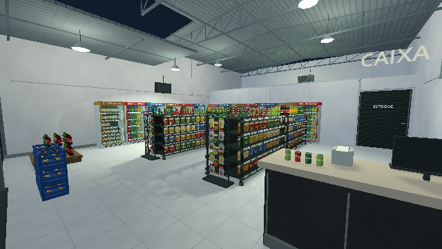

Os equipamentos internos e os novos detalhes externos continuam usando malhas estáticas comuns agrupadas por material, sem MultiMesh. Não houve execução no Windows 7 / Radeon R7 do usuário nem medição de desempenho nesse hardware. [Validação completa e limites](../VALIDACAO.md).
