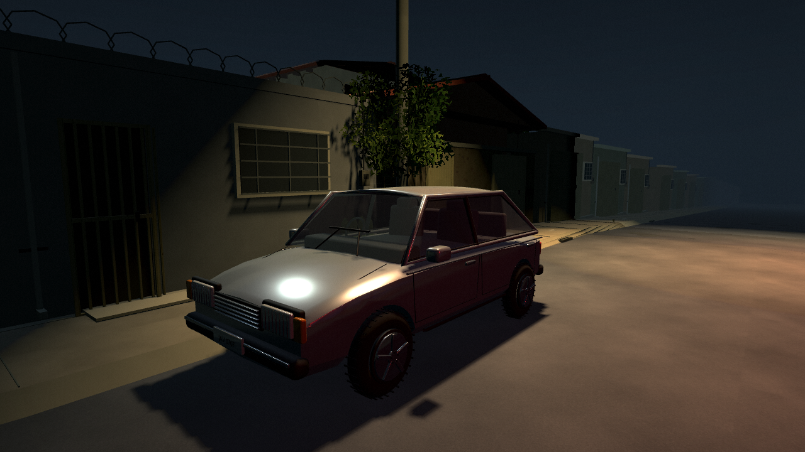
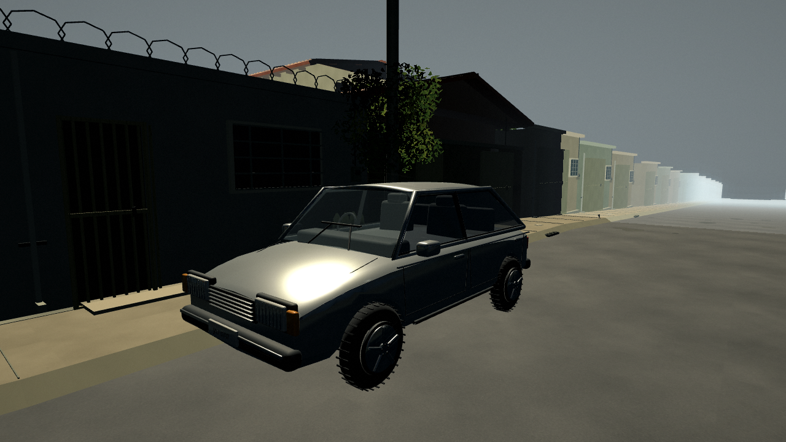
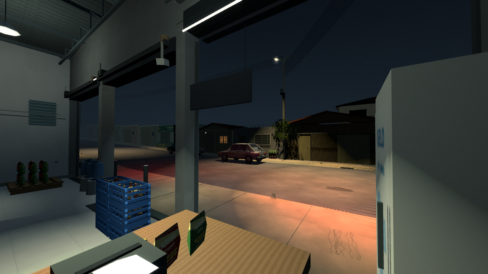
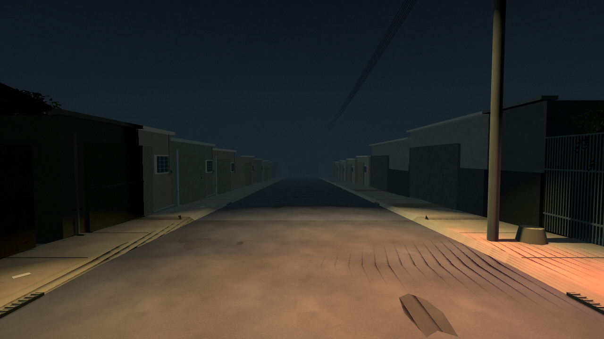
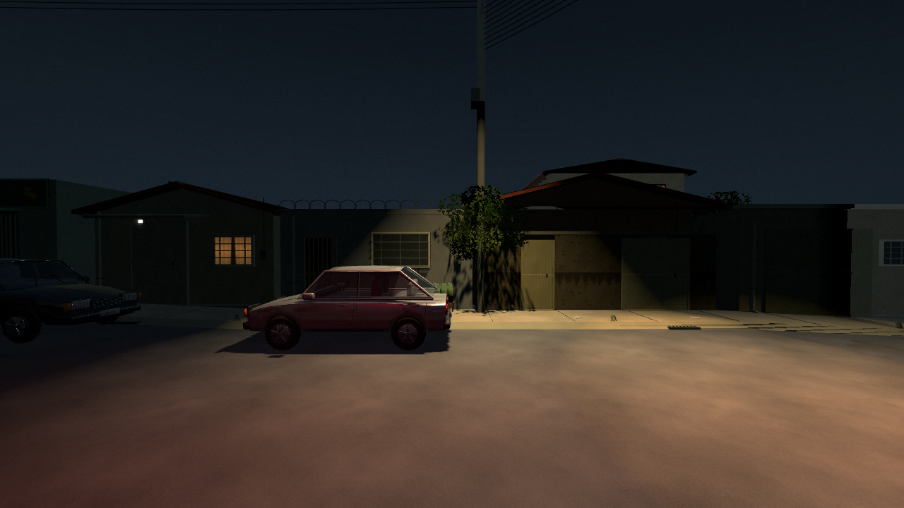
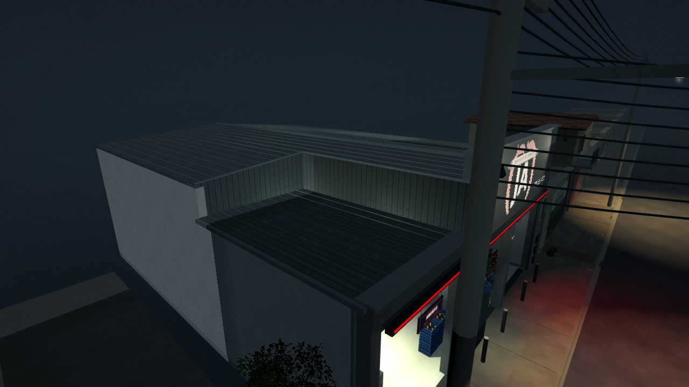
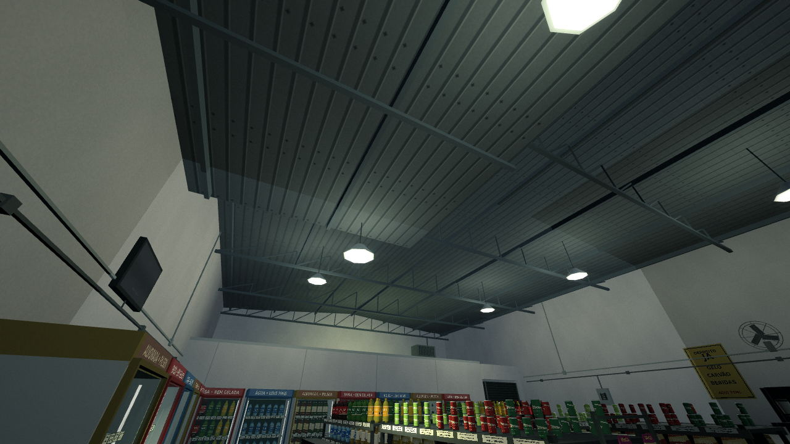
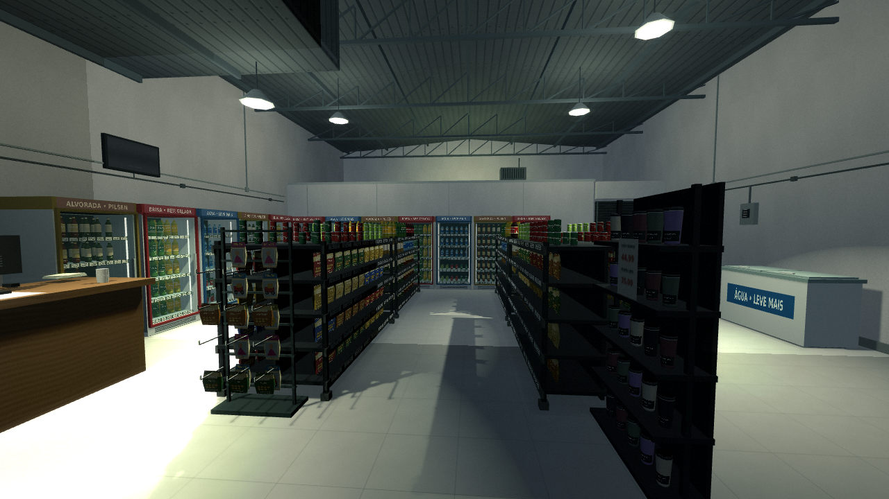

# Carros, neon e cobertura — 0.7.0

**[Baixar o jogo Windows 0.7.0](../../downloads/windows/A_Ultima_Venda_Windows_x64.zip)** · **[Caminhada no jogo com som](walk.mp4)**

As imagens abaixo vêm do cenário em execução no pacote Linux exportado, em Compatibility/OpenGL. Não são imagens conceituais ou renders de apresentação do Blender. As fotos do depósito continuam orientando a arquitetura; as imagens de jogos desta rodada orientam a noite, as cores das luzes e o ar exterior. [Referências e aproximações](../REFERENCIAS.md).

## Carros modelados

Antes, 0.6.0, no mesmo enquadramento:

Agora:

Sedã e hatch foram modelados no Blender, com carroceria curva e recortes dos para-lamas, capô, teto, vidros, molduras, portas, maçanetas, retrovisores, limpadores, bancos, painel e volante. Rodas têm pneus arredondados, sulcos, aros, raios e parafusos. Faróis têm lente e grade, e as placas são fictícias. São veículos genéricos, sem marca real medida.

Cada veículo usa dez grupos de materiais e aproximadamente 56 mil triângulos, incluindo os detalhes próximos. Pintura, vidro, metal e borracha têm respostas distintas à luz. Uma sonda estática reflete fachadas e a rua, sem incluir o próprio carro. Os modelos acompanham a inclinação do terreno e têm colisão e espaço reservado na navegação.

Fontes: [gerador Blender](../../tools/model_neighborhood_cars.py), [arquivos editáveis](../../tools/vehicle_sources), [relatório geométrico](../vehicle_report.json).

## Fachada e atmosfera

O vermelho aparece na faixa da fachada e na luz que alcança a calçada; as luminárias brancas mantêm a entrada legível. O letreiro ABERTO foi desenhado para o jogo. O mural JA e a disposição do depósito permanecem. O halo de câmera foi ampliado, e Nítida usa MSAA 2× para suavizar fios, telhas e contornos.

A neblina de profundidade se estende suavemente de 8 a 85 m. Seis planos transparentes de baixa opacidade adicionam movimento discreto ao ar da rua, com recorte antes do salão. Não há neblina volumétrica nem partículas por MultiMesh. O solo continua além do horizonte visível. A névoa não altera os limites exploráveis.

As casas próximas ganharam telhas curvas individuais, sobrepostas e agrupadas por material em malhas comuns, além de testeiras e pontas dos caibros. As partes não fotografadas continuam aproximadas.

## Telhado esquerdo e interior

O encontro do anexo baixo com o salão alto tinha faces de fechamento ausentes. A nova cobertura tem quatro painéis com espessura e bordas, fechamentos laterais/traseiros do desnível, rufos, cumeeira, calha e descida. Estrutura e luminárias seguem a altura de cada trecho. Raycasts verificam os dois níveis e as duas faces verticais do encontro.

O salão mantém geladeiras e prateleiras com malhas agrupadas comuns. Garrafas, latas e copos receberam perfis mais suaves; carvão ensacado, aviso de gelo, embalagem transparente, extintor e quadro elétrico complementam a área de trabalho. O caixa continua à esquerda de quem entra, conforme as fotos. Os modelos e rigs de Deryk e Felps foram preservados.

## Caminhada e validação

O [vídeo](walk.mp4) dirige o controlador real em primeira pessoa por 34 segundos, gravados em 960 × 540 a 30 quadros/s: saída sobre os meios-fios, descida pela rua, retorno e aproximação da entrada. Usa entradas de movimento e o áudio do jogo; não usa câmera livre. Quatro pontos físicos do percurso são verificados em [walk_test.txt](walk_test.txt).

Integração: **88/88 verificações no projeto e no pacote Linux**, incluindo os novos veículos e o fechamento físico da cobertura. Os testes de pausa, recarga, rotina completa dos clientes, caixa esquerdo, transporte, prateleiras e câmeras foram mantidos. Registros: [projeto](integration_source.txt) e [pacote](integration_packed.txt).

Comparação gráfica das malhas agrupadas com a montagem de objetos individuais: [Nítida](render_hd.txt) e [Retrô](render_retro.txt), incluindo pausa e recarga. Com 6.927 objetos individuais, a diferença foi de 21 pixels em Nítida (0,00228%) e três em Retrô (0,00130%), abaixo do limite de 1%. As 19 vistas também foram repetidas em Econômica, que desliga as sombras das cinco luzes e o halo: [registros de qualidade](quality_test.txt).

Os testes usam Mesa llvmpipe em Linux. A exportação Windows não foi executada em Windows 7/Radeon R7, e não houve medição de FPS nesse hardware. [Validação completa](../VALIDACAO.md).
