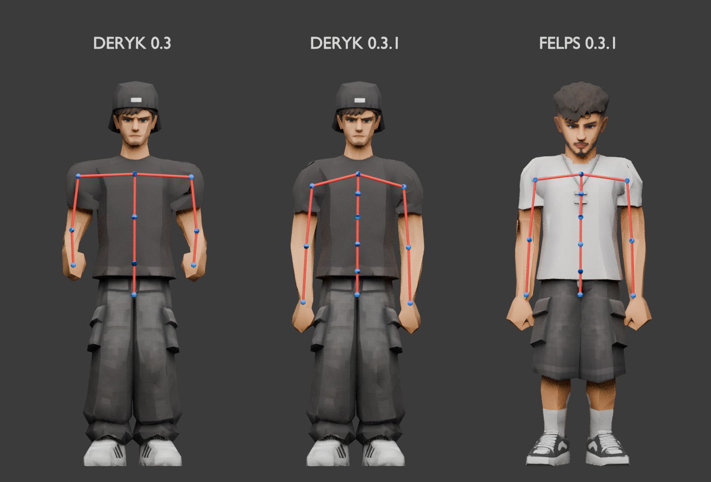
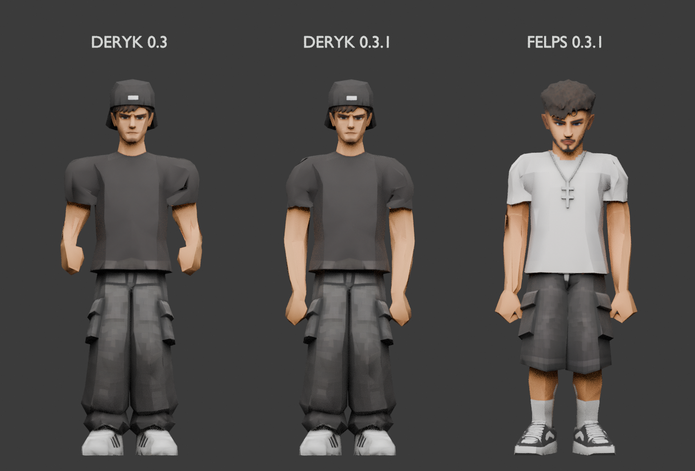
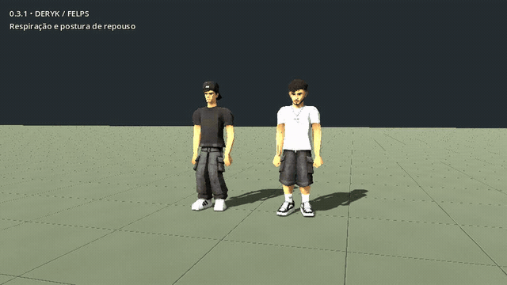
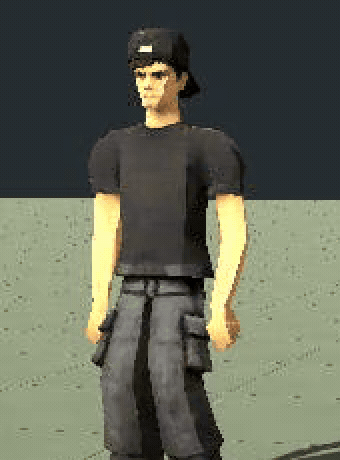
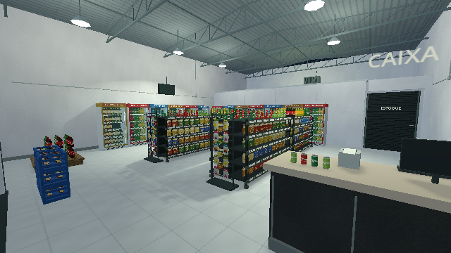

# Correção 0.3.1 — braços, tronco e cenário

Esta revisão responde às duas marcações de postura e à captura das geladeiras/prateleiras enviadas pelo usuário. O computador informado é **Windows 7 / AMD Radeon R7 200 series**.

## Postura e proporção dos braços

A articulação do punho estava avançada para dentro da mão, a separação de pesos do cotovelo estava deslocada e o braço derivado ficava curto. A correção reposiciona ombro, cotovelo e punho, ajusta a proporção dos braços no derivado e mantém mangas curtas. Os uploads originais e as UVs são preservados.

A figura mostra o **GLB antigo de Deryk**, o **novo Deryk** e o **novo Felps**, com os ossos reais dos arquivos exportados sobrepostos em vermelho e as articulações em azul:

A mesma comparação sem os ossos:

As mãos repousam abaixo do quadril, os cotovelos ficam mais baixos e os pulsos acompanham o antebraço. A altura de repouso depende do comprimento do braço de cada modelo. O verificador amostra o repouso exportado, confere as proporções do braço/antebraço e limita a flexão do cotovelo a 30 graus. [Medidas reais dos GLBs](arm_metrics.json).

## Rig do tronco

Deryk e Felps passaram de 19 para **21 ossos**. O tronco agora usa a cadeia **pelve → cintura → coluna → peito → peito superior**, seguida de pescoço/cabeça. As clavículas acompanham o peito superior. Há pesos próprios para as regiões lombar e torácica, com transições suaves.

A animação distribui flexão e rotação por essas articulações. A respiração move e expande a região das costelas; os passos recebem rotação oposta entre quadril e peito; o repouso tem transferência de peso. Agachamento, corrida, alcance e transporte foram regenerados para o novo esqueleto. Permanecem 23 clipes por personagem. [Folha de poses de Deryk](dery_poses.png), [folha de Felps](felps_poses.png) e [transporte no depósito](carry_ingame.png).

[Gravação real no motor, 38 segundos](motion.mp4): repouso, caminhada, corrida, caixas, gestos e agachamento.

Detalhe do tronco de Deryk, ampliado a partir da gravação:

## Geladeiras e prateleiras

As estruturas e os produtos que desapareceram na captura usavam desenho por instâncias da GPU (`MultiMesh`). O cenário agora usa **malhas estáticas comuns, agrupadas por material**, sem esse caminho de instancing. As transformações são aplicadas aos vértices uma vez na montagem; os limites de visibilidade são calculados pela geometria resultante. A reposição reconstrói apenas o grupo alterado.

Isso mantém os objetos agrupados, em vez de enviar milhares de objetos separados a cada quadro. O cenário estático fica fora da interpolação física; Deryk e a câmera mantêm sua suavização.

Captura real com a correção:

O teste renderiza o jogo, pausa, recarrega e compara as malhas agrupadas com uma segunda renderização de **2.030 objetos individuais** usando as mesmas formas, materiais e posições. São testadas cadências de 30 e 144 quadros por segundo de simulação, com física a 60 Hz. A comparação detecta regiões ausentes, esticadas ou mal posicionadas; o limite é 1% dos pixels com diferença superior a 20 níveis de cor. As execuções do projeto tiveram 56 e 78 pixels diferentes em 230.400; o pacote Linux exportado teve 56, sempre abaixo de 0,04%. O teste do pacote roda fora da pasta do projeto, carregando explicitamente o PCK. O limite não é uma medição de FPS do computador.

O problema completo da captura do usuário não foi reproduzido na GPU virtual Linux. A correção elimina o caminho de desenho compartilhado pelos objetos afetados e é verificada contra a referência independente. **Não há certificação do Windows 7 / R7 200 neste ambiente**; a Godot 4.4.1 tem suporte oficial a Windows 10/11.

## Validação e como testar

Resultados finais em [VALIDACAO.md](../VALIDACAO.md), [integração do projeto](../test_result.txt), [integração do pacote Linux](../packed_test_result.txt) e nos registros de renderização desta pasta.

Baixe o [ZIP Windows atualizado](https://github.com/Deriby/TheLastSale/raw/refs/heads/main/downloads/windows/A_Ultima_Venda_Windows_x64.zip), extraia em uma pasta nova e abra o executável dessa pasta. O menu deve mostrar **Demonstração 0.3.1**. Os dois arquivos `.exe` e `.pck` precisam ser da mesma entrega.
