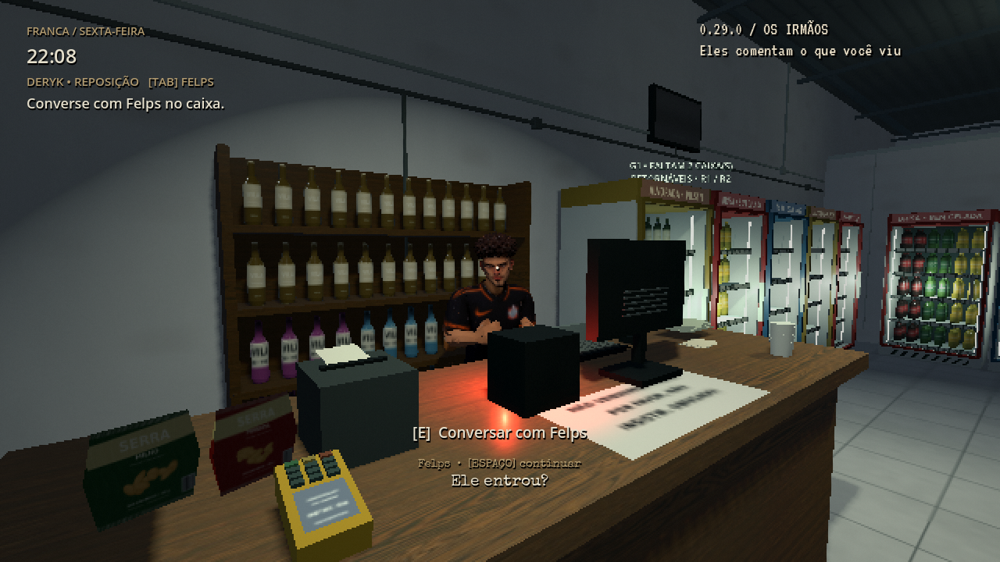
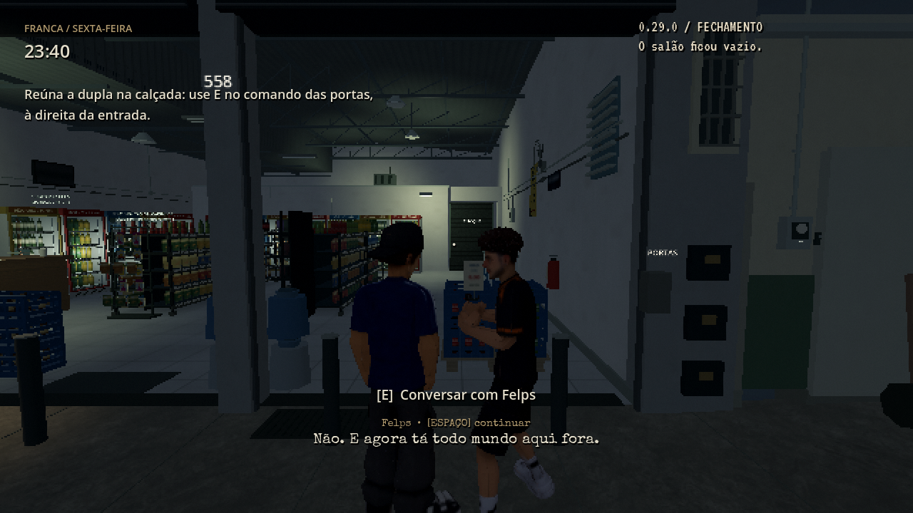
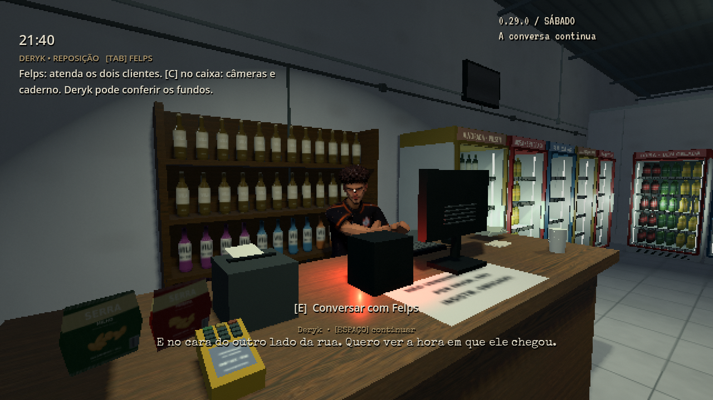

# 0.29.0 — os irmãos e a primeira noite

[Prévia com som](https://github.com/Deriby/TheLastSale/raw/refs/heads/main/docs/friday_story_v029/friday_story_preview.mp4) · [Projeto Godot 4.4.1](https://github.com/Deriby/TheLastSale/raw/refs/heads/main/downloads/project/TheLastSale_Godot_0.29.0.zip)

A chegada após Iniciar mostra a relação entre Deryk e Felps: voltar para casa depois do turno, a mãe esperando, e a provocação entre irmãos. Espaço mantém o avanço manual. A câmera continua livre; a rodinha mantém primeira e terceira pessoa. Continuar não repete a chegada, e a conversa habitual no balcão ainda inicia as tarefas.

Clientes têm conversas próprias sobre trânsito, uma corrida cancelada, comida esperando em casa e entrega no dia seguinte. O cliente de boné pergunta sobre o acesso pelos fundos. Felps responde com mais desconfiança se o jogador já percebeu alguém na rua ou o sino sem uma chegada visível. O pedido completo, preço, caixas, troco e a operação do caixa continuam intactos.

Bryan tenta apertar o caixa e negocia as garrafinhas esquecidas; Zirico brinca sobre seu equilíbrio e reconhece o sino quando esse acontecimento foi ouvido. Os modelos, animações e rotas são os existentes.

Conversar com o irmão depois de observar a pessoa, notar o carro ou ouvir sino/passos produz respostas próprias. A pergunta do cliente só vira anotação quando a fala é realmente exibida. Nenhuma suspeita é antecipada pela simples criação de uma fila de diálogo. Reações e memórias são salvas, e uma reação específica não se repete em cada conversa.

Ao fechar com os dois na calçada, passos vêm do salão que acabaram de esvaziar. A conversa reconhece o que foi percebido e termina antes de baixar as portas. Pausar congela a sequência. Espaço ou o avanço automático permitem concluir a noite; não é necessário descobrir uma nova pista. O relato aparece no resumo e no caderno, e sábado retoma a preocupação dos irmãos.

O save continua na versão 5, aceitando versões 1–5. Campos novos são opcionais. Anotações de sexta da 0.28 alimentam a memória; saves sem observações não ganham suspeitas inventadas. Carregar após um gancho já iniciado permite concluir o fechamento sem repetir a cena. A pane, o gerador, a refrigeração, as tarefas, investigação e finais continuam presentes.

A prévia usa o jogo real em Godot 4.4.1 / Linux / Mesa llvmpipe a 30 FPS. É uma apresentação condensada: locais, progressão e tempo são adiantados entre cenas; algumas falas são avançadas com Espaço. Não representa uma partida contínua nem uma medição de desempenho em Radeon R7.

[Validação desta revisão](validation.json) · [Verificação do pacote e resultados](../../downloads/project/release_verification.json)

Extraia o ZIP em pasta nova e abra `project.godot` no Godot **4.4.1**. Modelos, texturas, materiais, pesos e onze bibliotecas de animação permanecem byte a byte idênticos à 0.28.0. Sem EXE.
