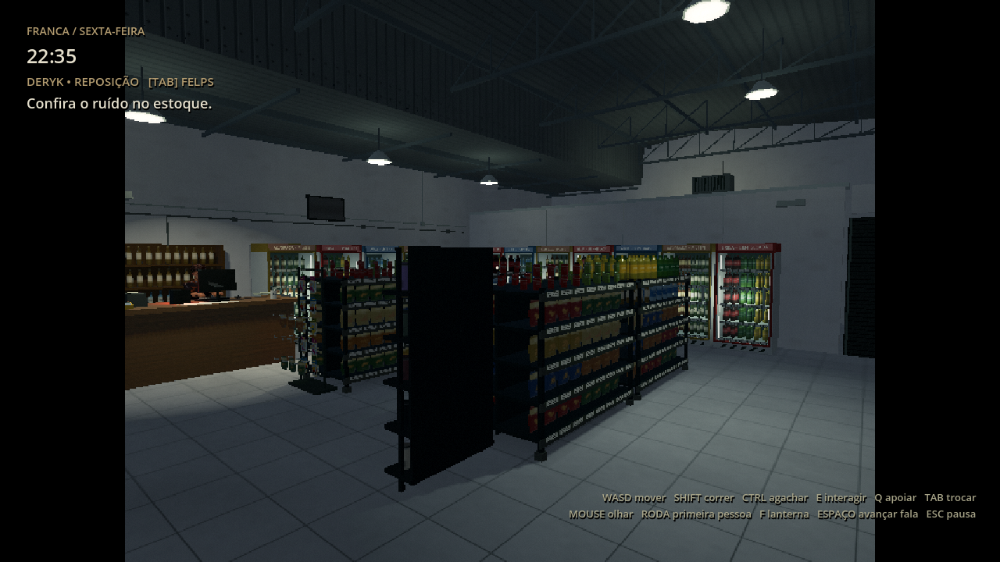
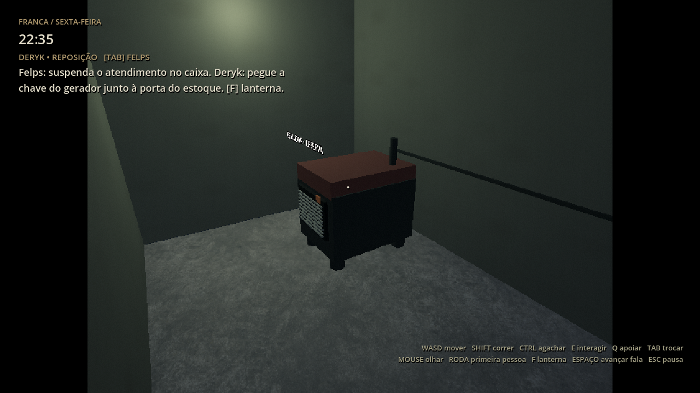
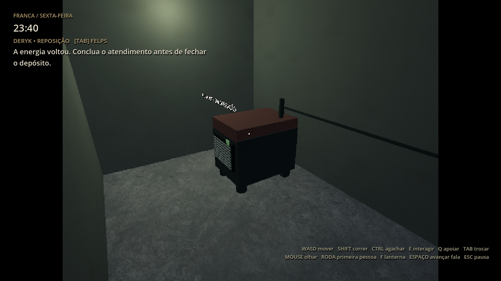
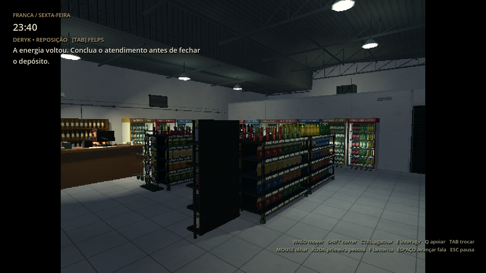
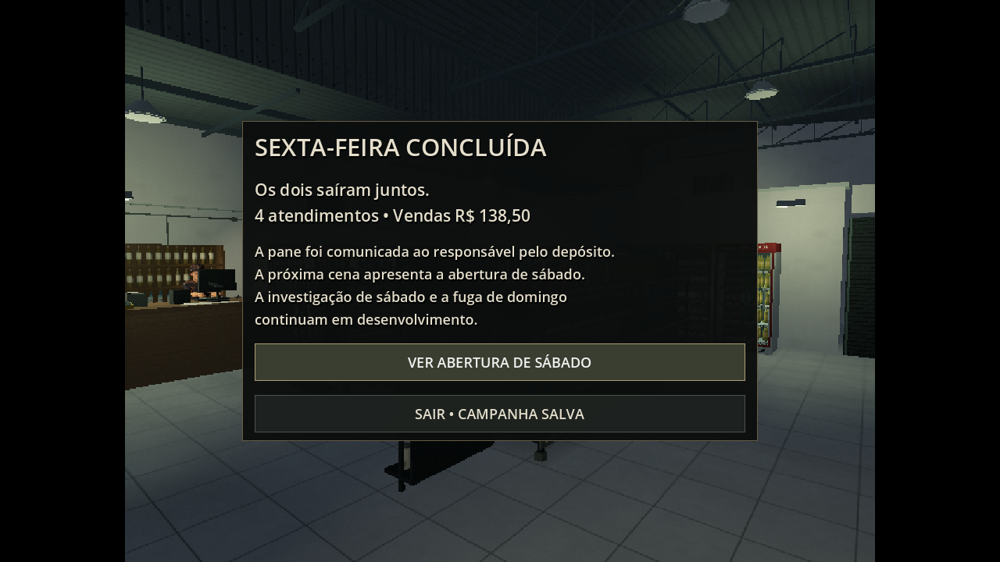
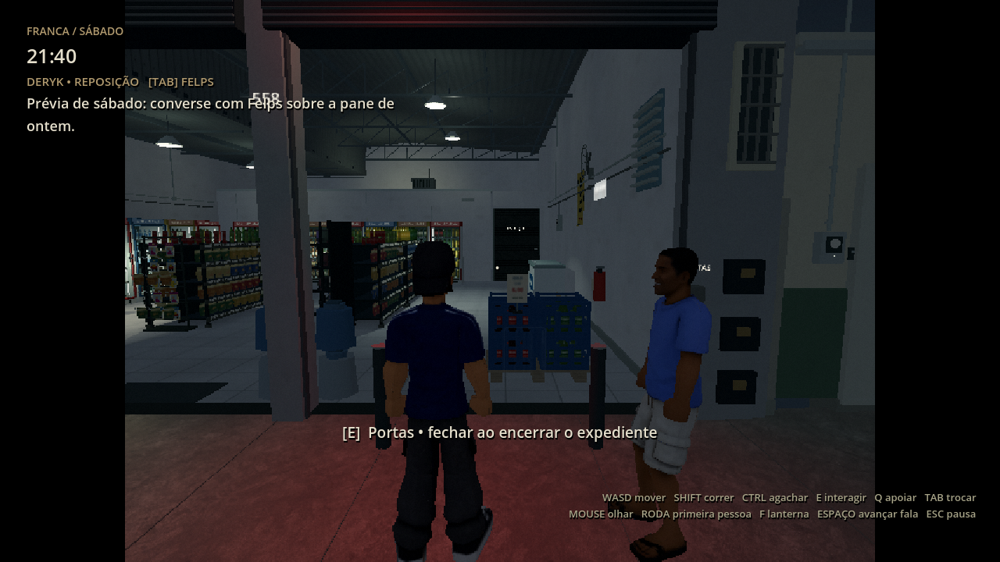

# Sexta-feira — 0.18.1

[Baixar projeto Godot 0.18.1](https://github.com/Deriby/TheLastSale/raw/refs/heads/main/downloads/project/TheLastSale_Godot_0.18.1.zip).
Extraia numa pasta nova e importe `project.godot` no Godot 4.4.1. Pressione F5 e
inicie um novo expediente. Esta entrega conclui a primeira sexta jogável e mostra
a abertura de sábado. A investigação do sábado, a fuga do domingo e os finais
descritos no roteiro continuam pendentes.

## Rotina e pane

Converse com Felps, reponha duas caixas, organize a caixa solta e atenda clientes.
Tab troca entre Deryk e Felps. E interage; Espaço avança falas. O atendimento usa
produtos, quantidades, dinheiro, troco e recibos. Alguns pedidos precisam de uma
caixa física do estoque. Existem seis identidades adicionais com modelos simples
e rig, preparadas para substituição pelos modelos do autor.

Depois do aviso e da saída do cliente, a energia cai. A dupla reage ao susto.
Luzes, letreiros, ventilador, rádio e refrigeração respondem ao corte. A rua
continua acesa. As baterias e as lanternas mantêm o caminho legível; F alterna a
lanterna. Trocar a qualidade durante a pane mantém os circuitos desligados.

1. Troque para Felps e use E no posto do caixa para suspender o atendimento.
2. Com Deryk, abra a porta do estoque à direita do salão. A chave está no suporte
   da parede, junto à entrada, pelo lado interno do estoque.
3. Abra a porta do pátio, na parede dos fundos do estoque. O gerador está no
   pequeno espaço externo. Ele exige a chave e a confirmação de Felps.
4. Ligue o gerador por E. Volte a Felps para concluir o atendimento antes de fechar.

O pátio, o gerador e a abertura de serviço são acréscimos fictícios coerentes com
o cenário. A área antiga central continua trancada. As paredes, portas e piso têm
colisão; os percursos até o pátio e a retomada do save nele foram testados.

## Fechar e sair juntos

Após o último cliente sair, Felps confere o caixa por E. Deryk examina a porta
antiga no estoque. Depois, use o quadro onde estava a chave para apagar o salão.
A refrigeração continua funcionando com a reserva e o rádio para.

Vá à calçada e use E no comando das portas, à direita da entrada. Isso chama o
outro protagonista: ele percorre o cenário e abre portas de serviço no caminho.
Os dois devem estar fora antes de baixar as portas. E novamente encerra a sexta.
A passagem ao lado do caixa foi ajustada para permitir a saída física de Felps.

O resumo salva atendimentos, receita e recibos da sexta. **Ver abertura de sábado**
prepara o dia seguinte. Converse com Felps para ouvir a reação à pane. O HUD
identifica essa cena como prévia; não há objetivos de investigação já implementados.

## Saves, compatibilidade e validação

O formato 4 conserva a noite, fase, energia, chave, fechamento, pistas e relatórios,
além das vendas e dos dois personagens. Uma venda interrompida mantém dinheiro e
troco parcial; a receita é creditada uma vez. Saves 1 e 2 continuam aceitos. Saves
3 já terminados na demonstração migram para o apagão, permitindo continuar a sexta.

**236/236 verificações** passaram no projeto e no ZIP extraído após
importação limpa. A suíte principal cobre 188 verificações de cenário, rig, modos
gráficos, caixas, clientes, pagamentos e saves. A suíte de sexta cobre os eventos
novos, percursos físicos, encerramento, cooperação dos dois personagens, retomada
e passagem de dia. Registros: [integração](integration.log), [render](render.log)
e [relatório](validation.json).

As capturas usam cenas preparadas para comparar luzes, gerador e interface; os
percursos físicos são validados separadamente pela integração. Render em
Linux/Mesa llvmpipe, janela de 1280×720 e cenário PS1/2 em 640×480. Reproduza com
`res://tests/friday_review.tscn`, que grava imagens em `/tmp/friday_018_*`.
O limite padrão continua em 30 FPS. Não foi medido FPS nativo no Windows/Radeon R7.
