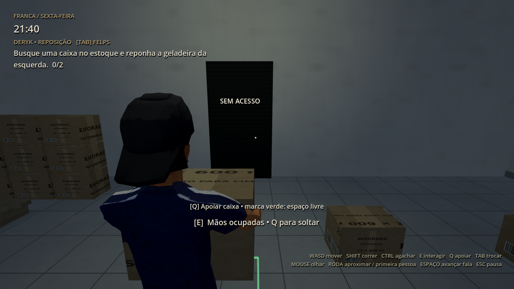
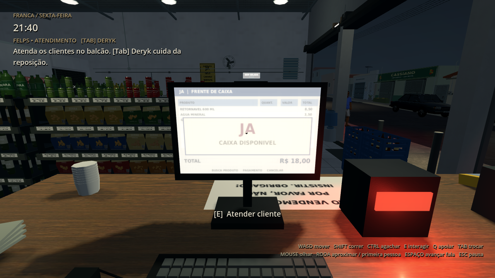
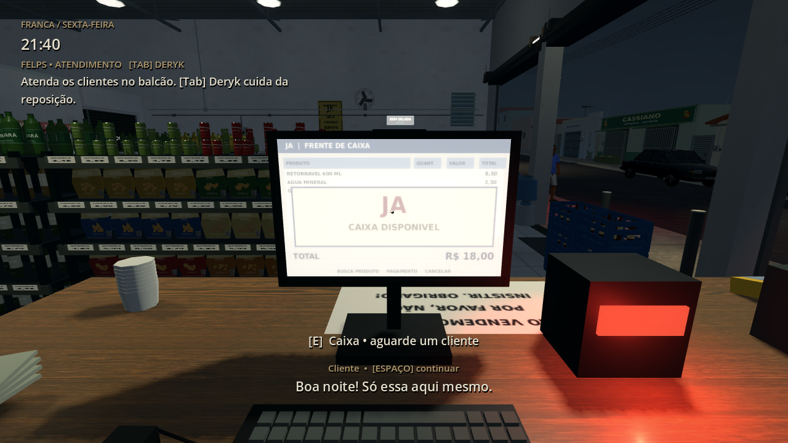

# Jogabilidade 0.16.0 — Deryk e Felps

[Baixar o projeto Godot 0.16.0 em ZIP](https://github.com/Deriby/TheLastSale/raw/refs/heads/main/downloads/project/TheLastSale_Godot_0.16.0.zip). Extraia numa pasta nova, importe `project.godot` no Godot 4.4.1 e pressione F5.

## Jogar com a dupla

**Tab** alterna entre Deryk e Felps. Cada personagem conserva corpo, posição, câmera, lanterna e objeto carregado. O personagem inativo permanece no cenário com animações de repouso, conversa ou trabalho. A câmera inativa não processa. A troca espera o fim de uma conversa ou movimentação de caixa e fica bloqueada durante a pausa.

O HUD identifica o personagem e sua função. Deryk cuida das caixas/reposição; Felps cuida do balcão. Ambos podem andar e explorar.

1. Comece com Deryk e converse com Felps por E para liberar as tarefas.
2. Vá ao estoque e pegue uma caixa de retornável por E. Abra a geladeira indicada e use E para repor.
3. Use Q para apoiar a caixa. A marca verde indica apoio e espaço; vermelha indica bloqueio. Q durante a pegada fica agendado até terminar a animação.
4. Quando chegar um cliente ao balcão, use Tab para Felps e E junto ao posto do caixa. O cliente aguarda esse atendimento antes de pagar e sair.
5. Volte a Deryk para continuar a reposição e a organização. Espaço avança as falas; Esc pausa e permite salvar.

## Atendimento inicial

O cliente percorre o salão, pega um produto e aguarda no balcão. Felps precisa estar junto ao posto e usar E para iniciar a compra e a conversa. Deryk não atende no lugar dele. Os atendimentos concluídos são salvos automaticamente quando o cliente sai. A visita de aviso continua dependendo das tarefas e dos clientes anteriores.

Esta entrega implementa o atendimento básico com as compras e animações existentes. Lista de itens, quantidades, dinheiro/troco, cartão e Pix ficam para a próxima etapa. As capturas posicionam um cliente no balcão para conferir a câmera; a suíte de integração percorre as rotas completas sem pular os caminhos.

## Caixas e salvamento

A caixa largada fica em pé, com colisão reativada, e pode ser pega novamente. A colocação valida o caminho, apoio nos quatro cantos e volume livre. Ao encontrar parede, desnível ou outro objeto, a caixa permanece com Deryk e um aviso aparece. A marca é atualizada a 10 Hz somente para quem está carregando, sem sombras adicionais.

O checkpoint versão 2 registra os dois personagens, o personagem ativo e as caixas colocadas ou carregadas. É possível salvar com Felps ativo e Deryk segurando uma caixa e continuar nessa situação. Câmeras próprias e lanterna são restauradas. O menu aguarda o fim de movimentações de caixas para salvar. Checkpoints antigos da versão 1 continuam aceitos, inclusive com caixa carregada.

A restauração usa os limites físicos das passagens para conservar posições válidas atrás do balcão, sem usar a grade mais ampla dos caminhos dos clientes. A antiga reserva de espaço do Felps estático foi retirada; agora ele tem seu próprio CharacterBody3D. Compras em andamento são retomadas como nova chegada de cliente ao continuar o turno; a contagem de vendas concluídas fica no checkpoint.

Comandos, legendas, stamina e avisos tiveram as âncoras corrigidas para permanecer na área visível da janela. O lembrete inferior de controles se oculta durante as falas, que mostram Espaço para continuar. Os modelos, materiais, rua e iluminação permanecem presentes. PS1 em 320×240 e PS1/2 em 640×480 continuam disponíveis; mantenha a resolução global do projeto em 1280×720.

## Validação

**168/168 verificações** passaram no projeto e no ZIP extraído após importação limpa. Foram testados Tab e E através da entrada real da viewport, movimentação de apenas um personagem, câmeras próprias/primeira pessoa, bloqueio da troca em pausa e diálogo, Q durante/depois da pegada, bloqueio por parede, nova coleta, troca com caixa carregada, salvamento/retomada, checkpoints antigos e o ciclo completo de clientes e objetivos.

Registros: [integration.log](integration.log), [render.log](render.log), [layout.json](layout.json) e [validation.json](validation.json). Para reproduzir as capturas em Linux com display, execute `res://tests/duo_review.tscn`. Capturas em Mesa llvmpipe; desempenho nativo em Windows/Radeon R7 não foi medido. O limite padrão continua em 30 FPS.

Próximas mecânicas: detalhar o atendimento, expandir reposição e comunicação da dupla, tarefas de fechamento e depois investigação/perseguição. O companheiro ainda mantém sua posição; comportamento de proteção durante perseguição fica para a etapa correspondente.
