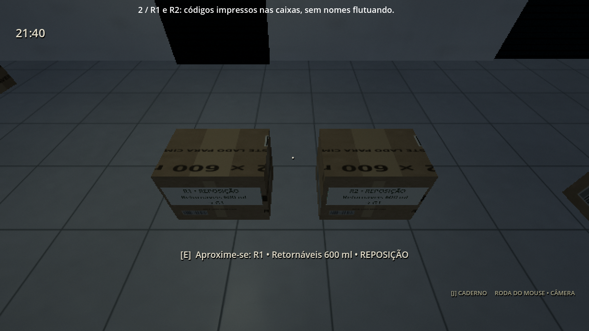
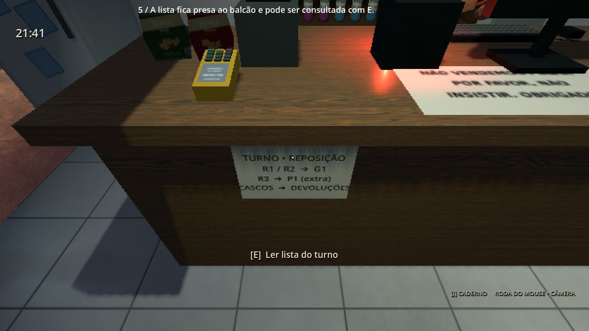
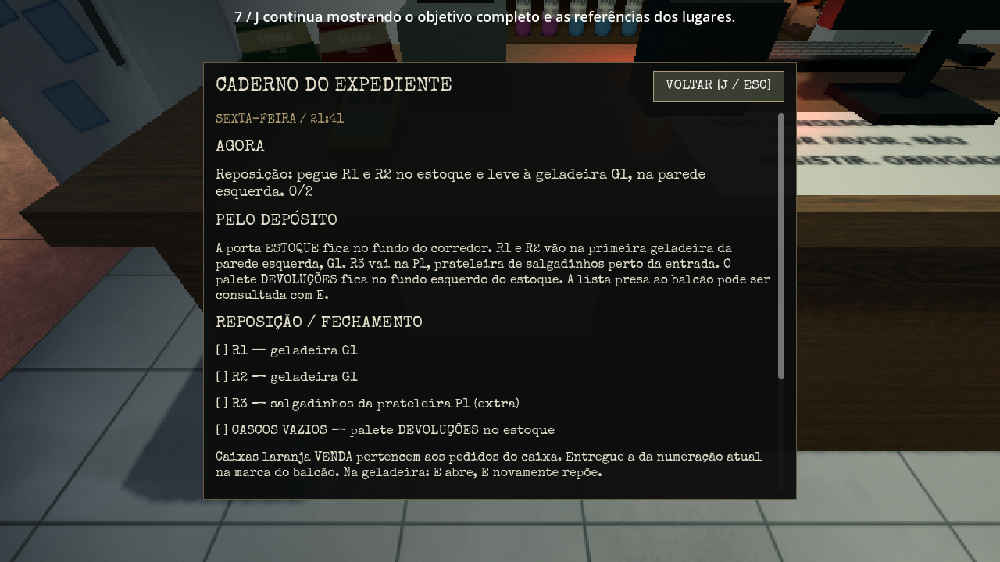

# 0.35.0 — orientação pelo cenário

[Assistir à prévia real](orientacao_preview.mp4) · [Baixar projeto Godot 4.4.1 sem EXE](../../downloads/project/TheLastSale_Godot_0.35.0.zip).

A gravação mostra oito trechos reais: porta do estoque, caixas R1/R2, geladeira G1, prateleira P1, lista no balcão, consulta ao irmão, caderno e HUD completo. São vistas separadas, com posições preparadas para revisão e intervalos cortados. Nenhuma tarefa é concluída para preparar a cena. A captura usa o modo Retrô, em 1280×720 a 30 fps; texto e menus mantêm a resolução plena. As legendas pertencem apenas à captura.

A sexta ganha códigos impressos nas caixas e placas fixas nos destinos. Eles respeitam profundidade, não giram com a câmera e não atravessam paredes. A conversa de abertura explica o caminho pelo estoque e identifica a primeira geladeira da parede esquerda. A lista presa ao balcão pode ser consultada com E, sem mover a câmera ou iniciar trabalho automaticamente. Ela não captura o foco assistido usado para falar com Felps; é preciso olhar para o papel.

A resposta muda com a situação: R1/R2 ainda pendentes, caixa carregada, cascos, pedido ou pane. Durante a pane, orientar para o gerador tem prioridade sobre a reposição. A consulta não muda flags, etapas, vendas ou regras de energia. Não há fala disparada por ficar parado nem aviso de aparição. O caderno J atualiza a tarefa antes de abrir e reúne as referências dos lugares.

No HUD discreto, a rotina da sexta perde as setas da reposição, os nomes que flutuavam sobre as caixas e os avisos de entrega correta. A preferência salva continua valendo. Pedidos de clientes mantêm as indicações existentes; erros de entrega continuam explicando o destino. O modo completo continua nas configurações e restaura as indicações ampliadas. Sábado e domingo não recebem uma lista de reposição da sexta. Não há novo objetivo obrigatório ou mudança no formato de save.

`tests/guidance_integration.tscn` acrescenta 40 verificações: entrada real de E/J/rodinha, foco e distância, reposição, modo completo, tarefa dinâmica, retomada, erro de destino e prioridade do gerador. A extração final executa dezoito suítes, com 941 verificações. [Relatório da distribuição](../../downloads/project/release_verification.json) · [Log](integration.log).

Os 463 arquivos de assets, 32 recursos e onze bibliotecas de animação da 0.34.0 permanecem byte a byte. Controladores dos personagens, câmera, shaders, sistemas de campanha, energia, aparições e interfaces do computador permanecem. A importação headless mantém os 14 diagnósticos conhecidos de miniatura GLB; o relatório registra eventuais avisos de áudio no encerramento da suíte antiga de domingo. Não foi medida uma Radeon R7 física.
