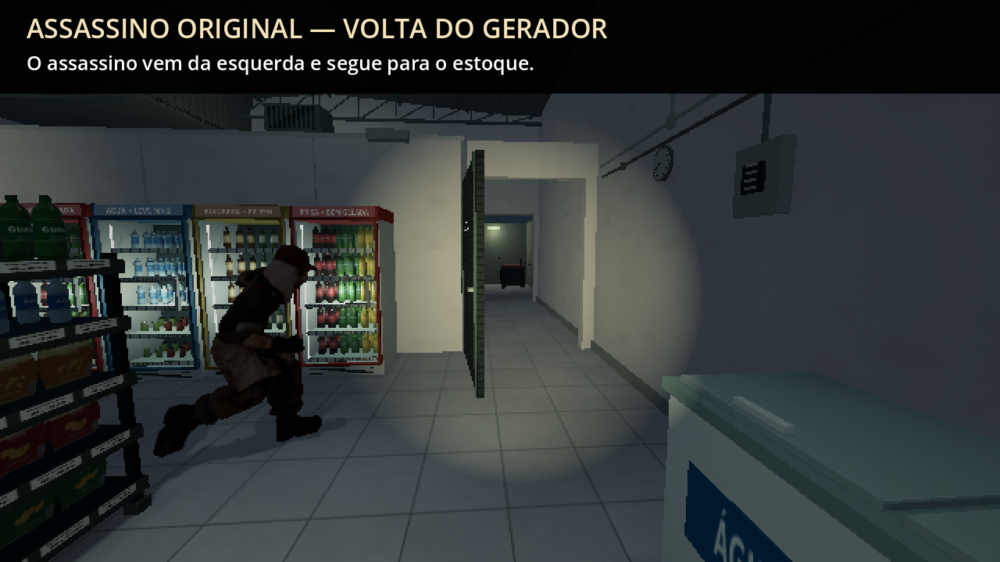

# 0.30.1 — o assassino original na aparição

[Ver a aparição com o modelo correto](https://github.com/Deriby/TheLastSale/raw/refs/heads/main/docs/killer_v0301/assassino_preview.mp4) · [Projeto Godot 4.4.1](https://github.com/Deriby/TheLastSale/raw/refs/heads/main/downloads/project/TheLastSale_Godot_0.30.1.zip)

A figura que atravessa o salão na volta do gerador agora usa **o modelo original do assassino**, `Enemy.glb`, e sua biblioteca de animação `resources/motion/Enemy.res`. É o mesmo modelo usado pelo perseguidor de domingo. A versão 0.30 usava um modelo de cliente nessa aparição; as capturas daquela entrega permanecem como histórico.

A correção conserva a rota física pelo estoque e pátio, a passagem pelas portas, a pausa e os saves da cena. Checkpoints da 0.30 em andamento carregam o visual corrigido na posição e fase já gravadas. O comportamento de perseguição de domingo continua o existente. Câmera e terceira pessoa pela rodinha permanecem disponíveis.

A prévia é uma gravação explicativa da cena real, com campo de visão de 80 graus e HUD ocultado para mostrar o corpo inteiro. Um cartão anuncia o trecho; posição, tempo e progresso são preparados para a demonstração. Não é uma partida contínua. As legendas grandes pertencem apenas à gravação.

[Validação desta correção](validation.json) · [Verificação do ZIP](../../downloads/project/release_verification.json)

Extraia em pasta nova e importe `project.godot` no Godot **4.4.1**. Modelos, texturas, materiais, pesos e as onze bibliotecas de animação existentes não foram modificados. Sem EXE.
