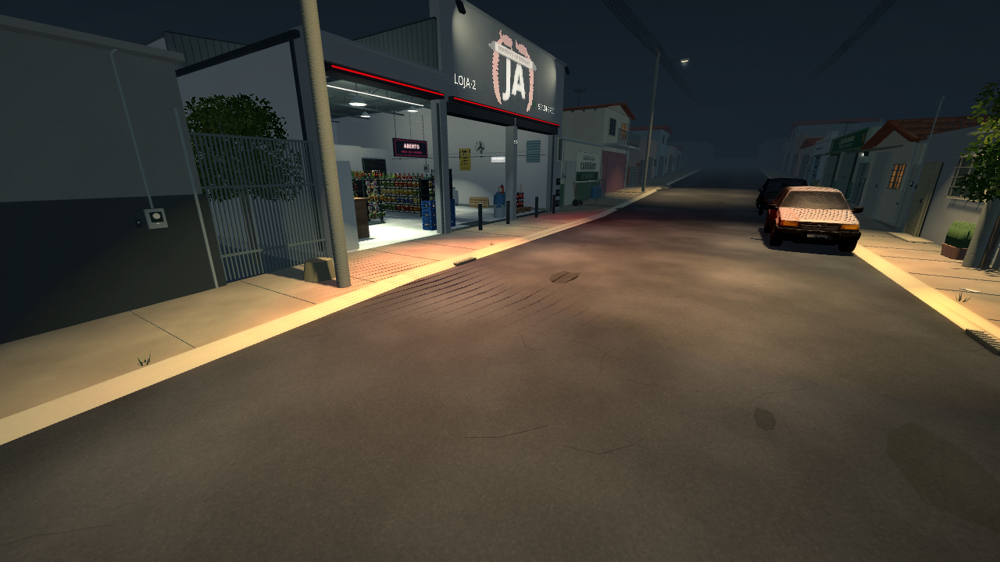
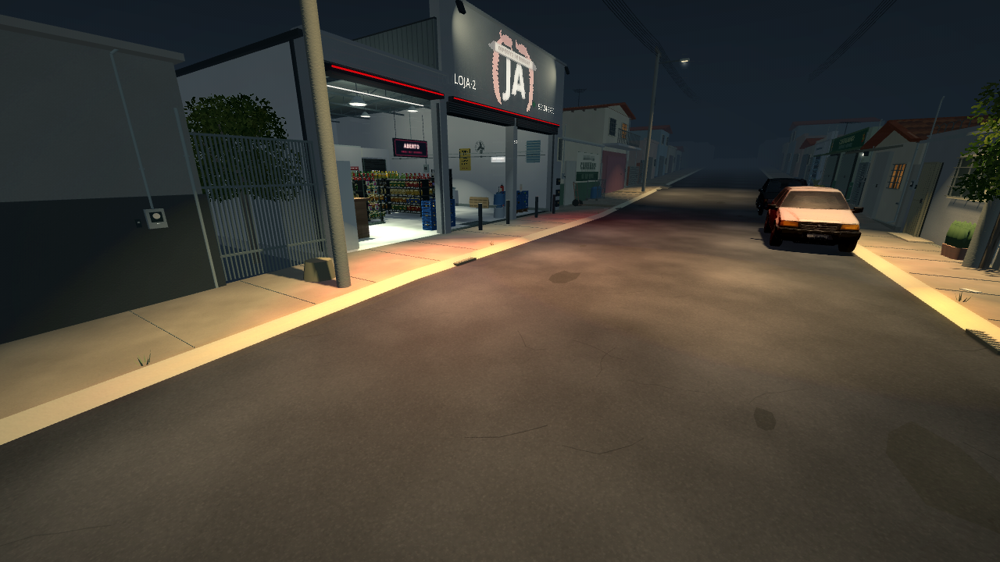
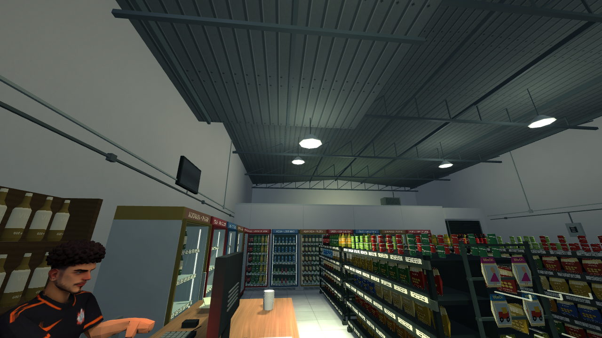
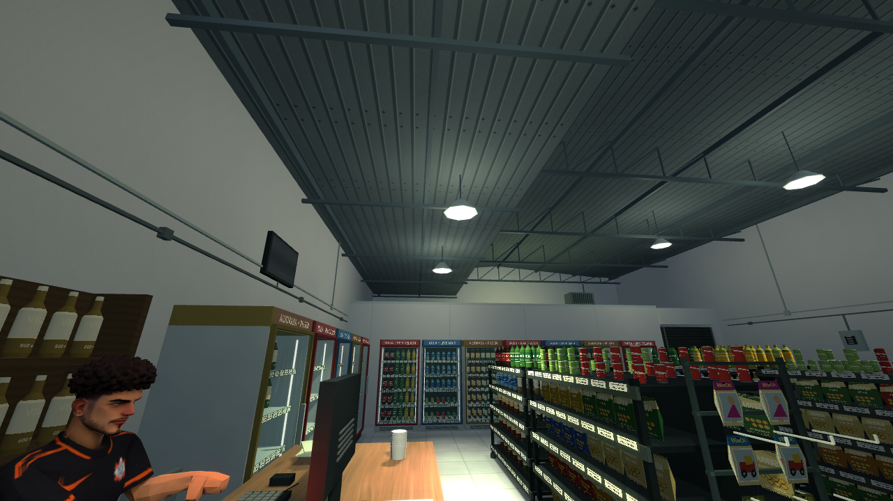
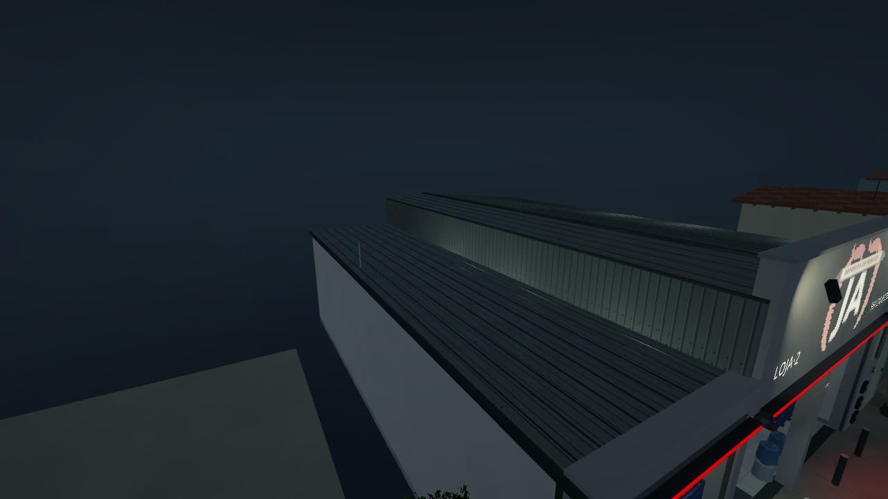
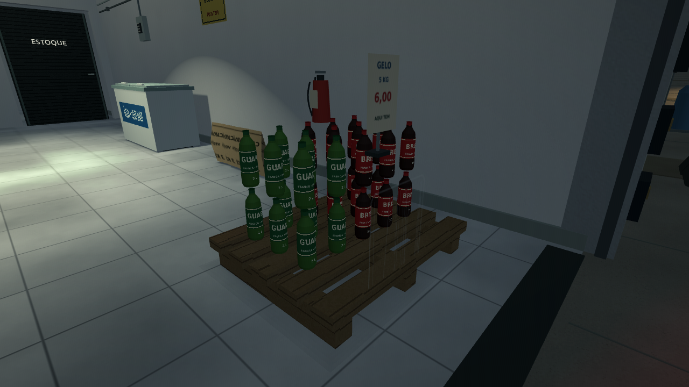
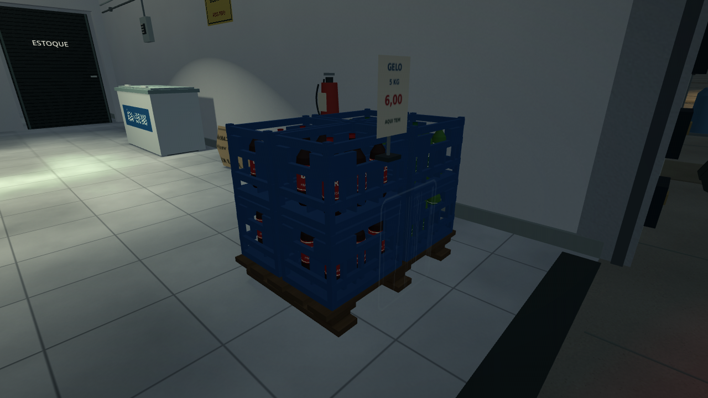
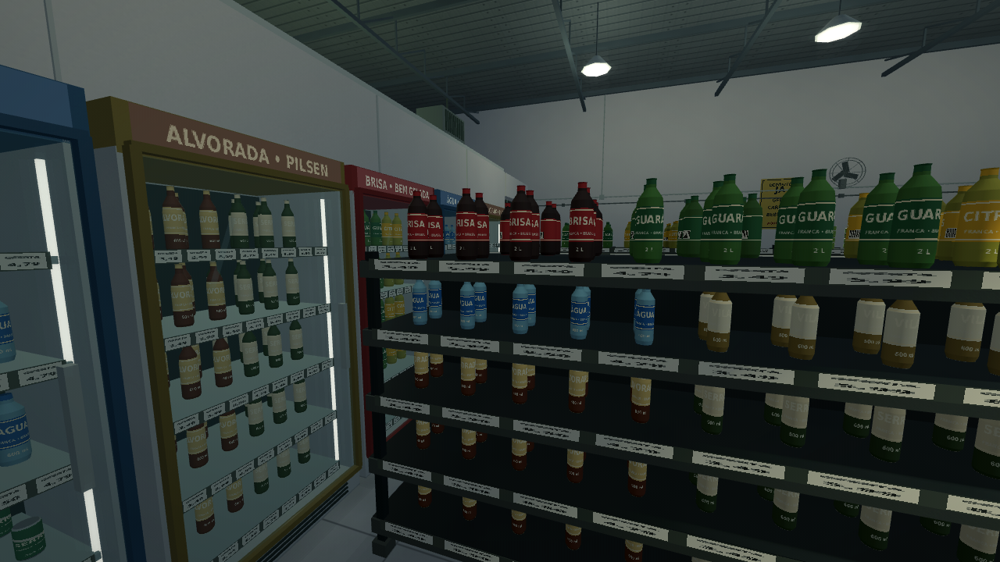
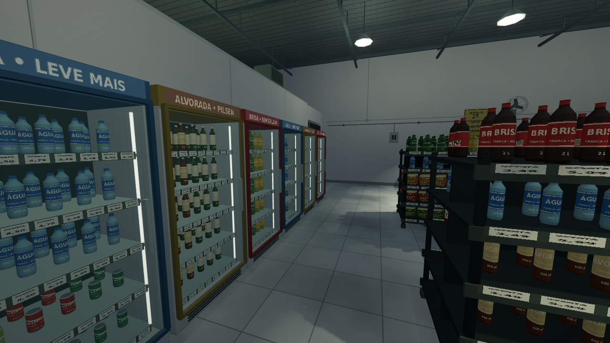

# Revisão 0.12.0 — sombras, teto e circulação

[Baixar o projeto Godot 0.12.0](https://github.com/Deriby/TheLastSale/raw/refs/heads/main/downloads/project/TheLastSale_Godot_0.12.0.zip). Importe `project.godot` no Godot 4.4.1 e pressione F5.

## Fiação e sombras

A fiação externa foi separada do restante do cenário e não projeta sombras. Cabos das luminárias e conduítes internos seguem a mesma regra. Postes, construções, carros e personagens mantêm suas sombras. A revisão das imagens também revelou artefatos de autossombra no asfalto: as superfícies de chão continuam recebendo sombras, mas deixaram de projetá-las. O viés dos mapas de sombra dos postes foi ajustado para reduzir os pontilhados nos carros.

As duas capturas usam a mesma câmera, iluminação e resolução. As imagens de inspeção usam Nítida, sem granulação, para mostrar a geometria; o efeito configurável do jogo continua disponível.

| Antes | Depois |
| --- | --- |
|  |  |

## Cobertura baixa contínua

O lado esquerdo agora permanece a 4,48 m por toda a profundidade do depósito. Chapa, estrutura, fechamento lateral, rufo e calha acompanham esse comprimento. A parede esquerda e o fechamento dos fundos seguem a nova cota. O degrau transversal antigo foi removido. As medidas são estimadas; a continuidade atende à correção indicada pelo autor.

| Antes | Depois |
| --- | --- |
|  |  |

## Expositor com apoio físico

O palete tem patins, nove blocos, travessas e cinco tábuas superiores. Oito engradados azuis, em duas camadas, recebem 48 garrafas. As bases, cantos, grades, divisórias e aberturas de pega foram modelados. Cada garrafa repousa na base de um engradado, sem outra garrafa servindo de apoio. O volume de colisão e o bloqueio de navegação acompanham o conjunto.

| Antes | Depois |
| --- | --- |
|  |  |

## Corredor diante das geladeiras

As quatro gôndolas centrais foram encurtadas para 2,10 m e redistribuídas, mantendo produtos e categorias. A frente do conjunto continua afastada dos expositores da entrada. Nos fundos, há aproximadamente **2,10 m até as portas fechadas** e **1,12 m livres com todas abertas**. A fileira foi deslocada 50 cm para a direita para a primeira porta também não invadir a geladeira da parede esquerda. Colisões e navegação usam o novo tamanho das gôndolas.

As doze geladeiras das duas fileiras podem ser abertas e fechadas com **E**. Só a geladeira de reposição participa das tarefas. As outras não consomem caixas nem avançam objetivos.

| Antes | Depois |
| --- | --- |
|  |  |

## Verificação e pendência

A suíte verifica continuidade e fechamento do teto por raios físicos, fiação visível sem sombras, apoio geométrico de todas as garrafas, área de giro das sete portas e travessia com o controlador real. Testa também a tecla E numa geladeira do fundo sem alterar o progresso, além do fluxo narrativo, personagens, reposição e checkpoints existentes.

Durante a validação, corrigimos a interrupção de uma variação de repouso por conversa e a consulta de foco em obstáculos sem metadados de interação. O desenho continua com ArrayMesh e a opção padrão de 30 FPS foi preservada. FPS na Radeon R7 não foi medido nesta máquina Linux/Mesa.

O relato de não conseguir largar a caixa foi **somente registrado para a etapa de jogabilidade**, em [PENDENCIAS.md](../PENDENCIAS.md). Não foi aplicada uma correção de pegar/largar caixas nesta revisão.

Capturas reproduzíveis em `tests/layout_review.tscn`; resultado da suíte em `integration.log` e resumo em `validation.json`.
