# Iluminação 0.14.0 — noite, geladeiras e fachada

[Baixar o projeto Godot 0.14.0](https://github.com/Deriby/TheLastSale/raw/refs/heads/main/downloads/project/TheLastSale_Godot_0.14.0.zip). Extraia em uma pasta nova, importe `project.godot` no Godot 4.4.1 e pressione F5.

## Salão e caixa

As luzes suspensas usam preenchimento de alcance menor e focos de intensidade controlada. A luz do caixa foi direcionada para Felps, a bancada e as bebidas atrás dele, com uma cor mais quente. A iluminação geral e o preenchimento noturno foram reduzidos. Estoque e cantos ficam mais escuros, preservando a leitura das caixas, placas e caminhos.

As geladeiras têm pequenas luzes internas sem sombras, restritas a uma camada dos próprios equipamentos. Elas não clareiam o piso inteiro. As faixas luminosas receberam mais destaque, e uma captura do salão fornece reflexos locais ao vidro e ao acabamento dos equipamentos.

## Exterior e imagem

A luz vermelha foi corrigida para alcançar a fachada, além da calçada e dos carros. Duas luzes pequenas destacam a parede próxima às faixas do neon. O alcance do vermelho e da luz que sai pelas entradas foi contido. Os postes têm focos mais localizados e intervalos mais escuros entre eles.

A névoa distante começa depois do primeiro plano e fecha o horizonte; as lâminas suaves de ar permanecem restritas à rua e aumentam discretamente com a distância. Não foi usada neblina volumétrica.

O halo de câmera foi reduzido e seu limiar aumentado para evitar espalhar o branco das grandes superfícies. A correção de cor ficou mais contida. Nítida preserva transições de cor sem a quantização de 191 níveis; Retrô e Econômica mantêm esse tratamento. Granulação e VHS continuam configuráveis.

## Comparações com as mesmas câmeras

Todas as capturas abaixo usam 1280×720, modo Nítida e granulação desligada. Incluem o pós-processamento de câmera de cada revisão. Layout, materiais, enquadramento e posição dos objetos são iguais.

| Vista | 0.13.0 | 0.14.0 |
| --- | --- | --- |
| Calçada para dentro da loja | 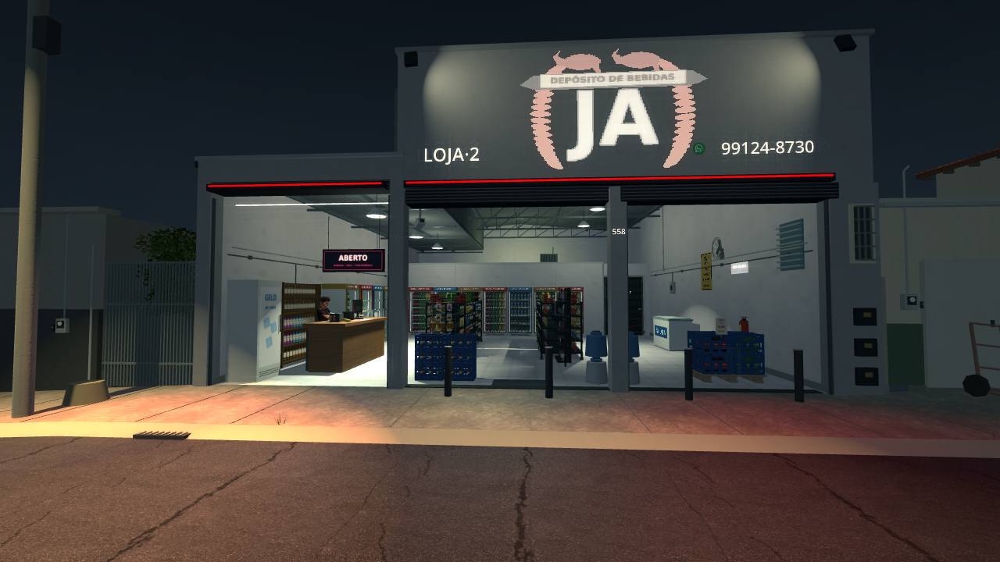 |  |
| Salão | 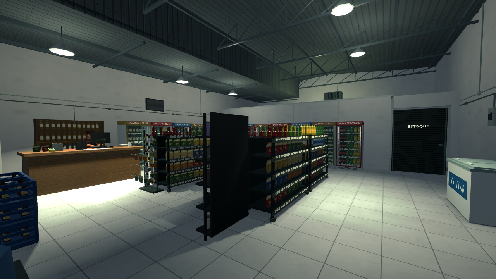 | 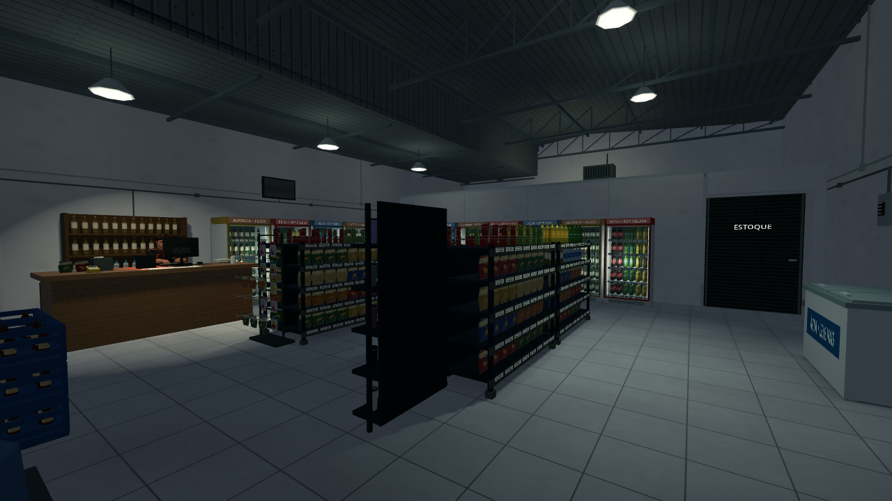 |
| Caixa e Felps | 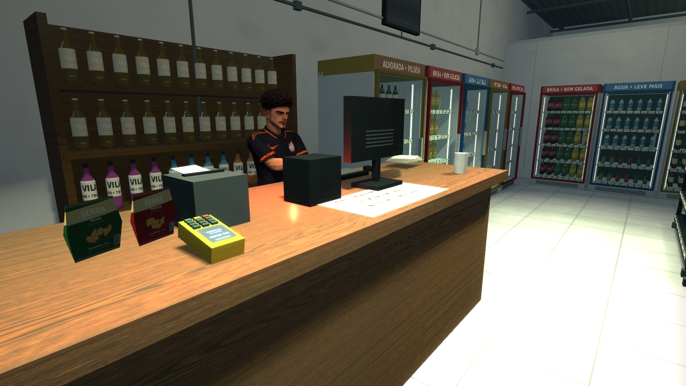 | 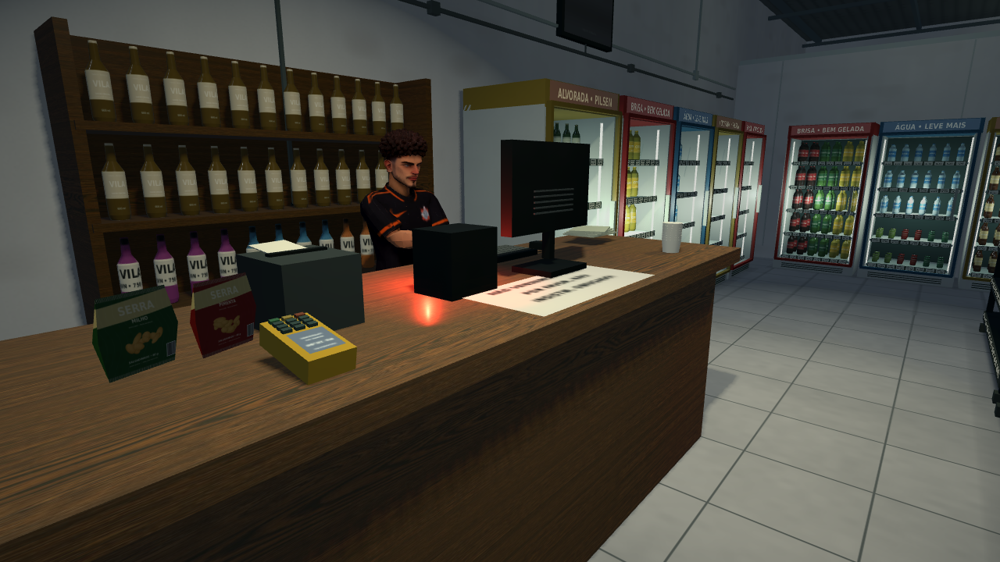 |
| Geladeiras | 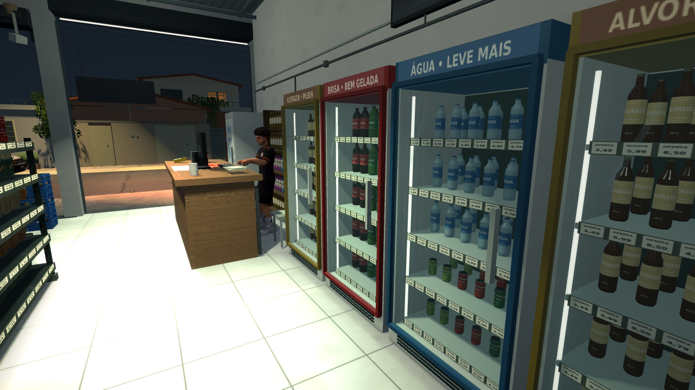 | 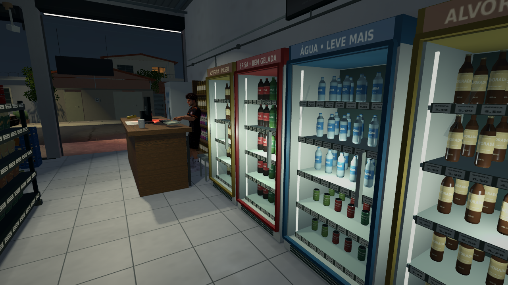 |
| Visão de dentro para fora | 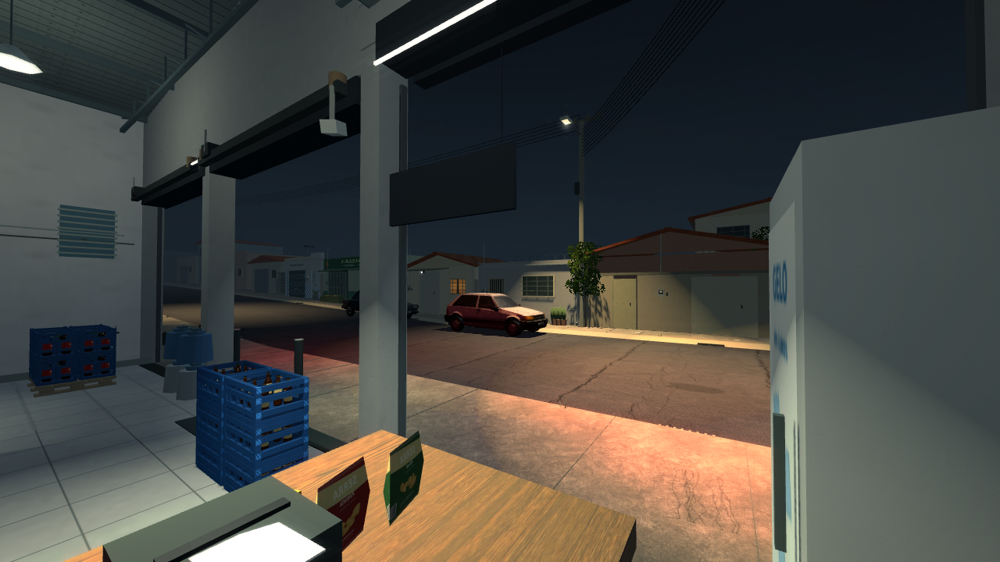 | 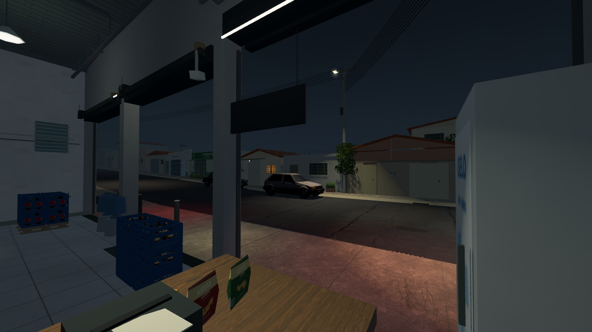 |
| Rua | 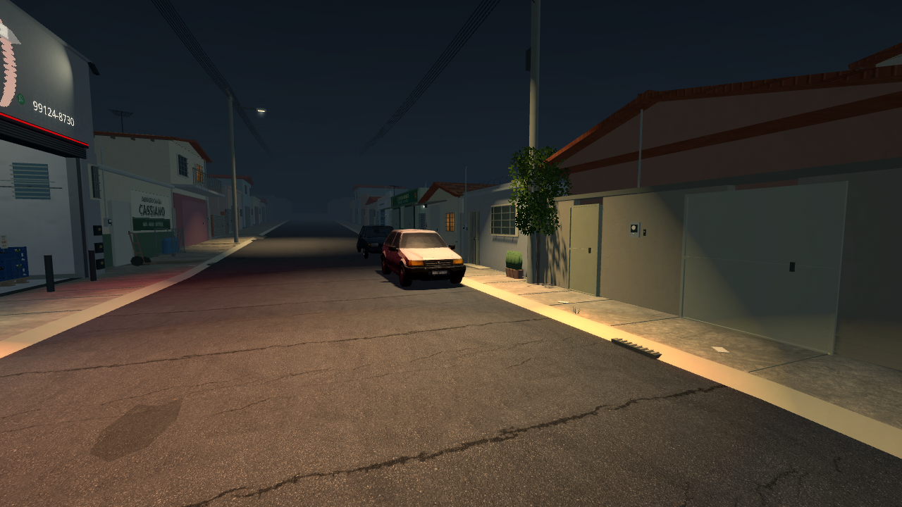 | 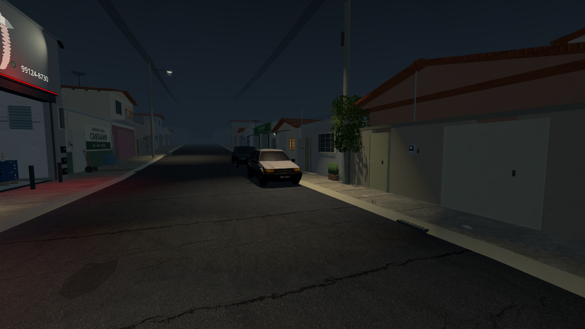 |
| Estoque | 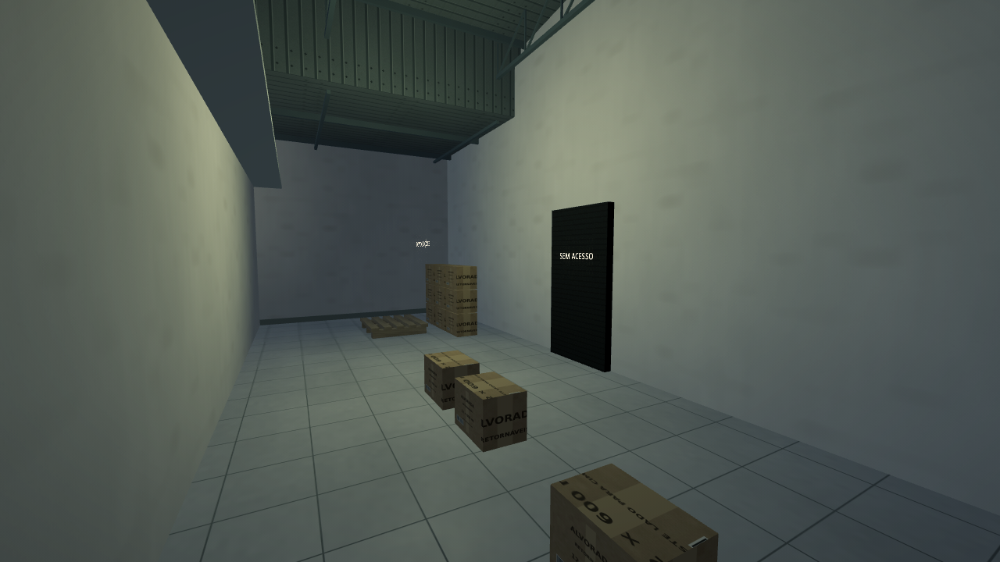 | 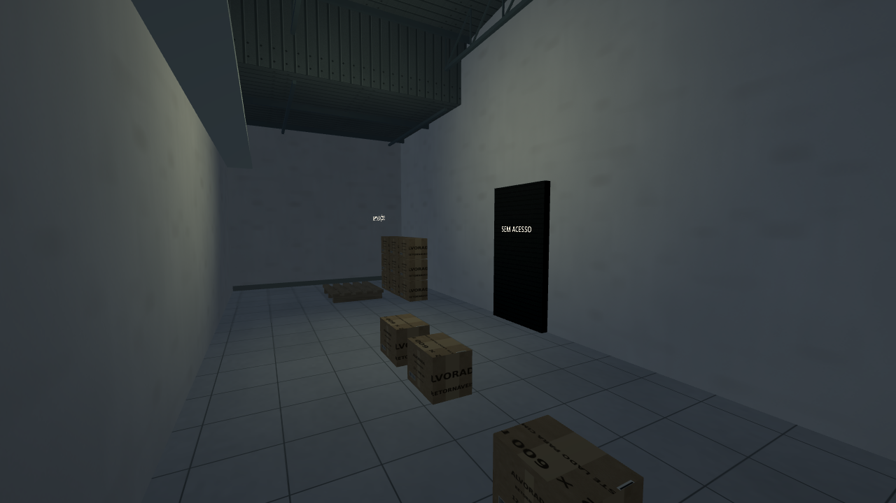 |
| Horizonte | 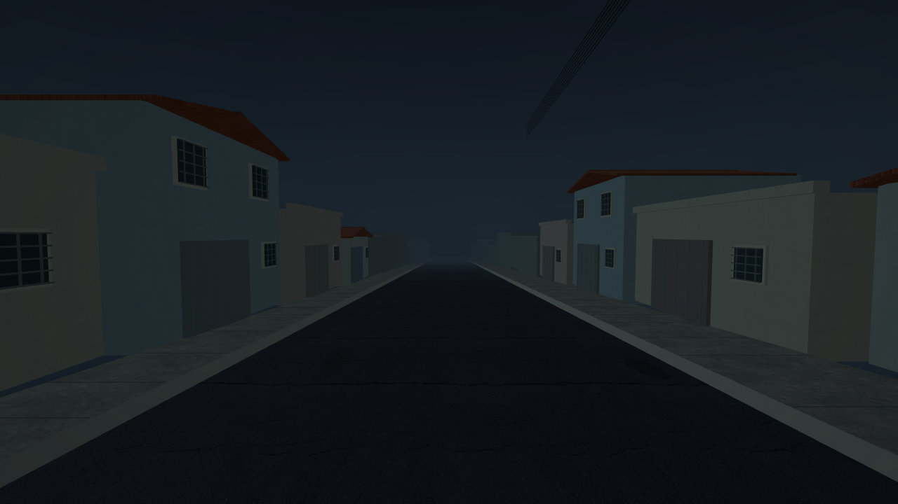 | 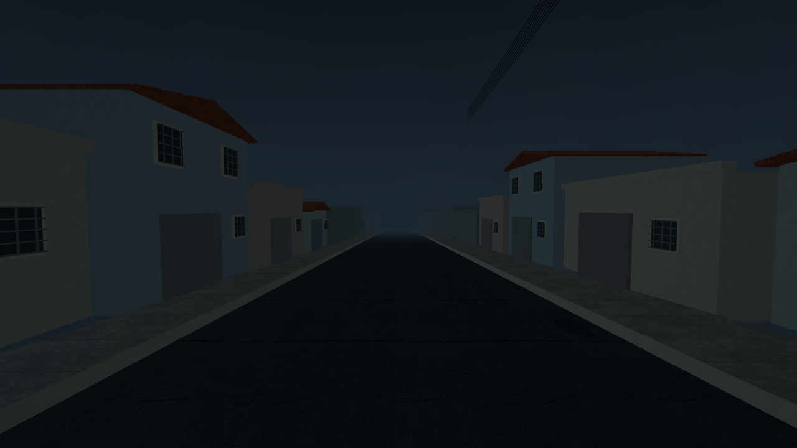 |

Também foram salvas vistas diretas do renderizador, antes do pós-processamento. Na câmera de entrada, a quantidade de pixels com os três canais em pelo menos 250/255 caiu de **6.765 para 1.973**, em 921.600 pixels. A mediana de luminância da amostra fixa do piso no corredor direito passou de 178,08 para 97,73, na escala de 0 a 255. Isso documenta a redução do estouro nesta vista; não mede todas as superfícies do jogo. As luminárias e faixas luminosas ainda podem atingir o branco.

Método, coordenadas da amostra e dados em [validation.json](validation.json). Imagens sem pós-processamento: [antes](entrance_before_raw.png) e [depois](entrance_after_raw.png).

## Custo e qualidade

- Permanecem **cinco luzes com sombras**, as mesmas da revisão anterior. Os fios continuam sem projetar sombras.
- Há 37 nós de luz, contra 23 antes: foram acrescentadas 12 luzes de curto alcance nas geladeiras e duas na parede do neon. As máscaras limitam os objetos afetados por essas luzes.
- A nova captura de reflexos atualiza **uma vez**. O atlas compartilhado foi limitado a **128 pixels e quatro posições**; há dois probes na cena. Não há captura de reflexão recalculada a cada quadro.
- Os **666.942 triângulos**, **696.552 vértices**, **43.887.176 bytes de arrays** e **1.328 instâncias de malha** foram preservados. Não houve remodelagem ou adição de MultiMesh.
- O halo continua usando as mesmas 12 amostras do shader anterior, com intensidade menor.

**Econômica** desliga as sombras, o halo, as 14 luzes adicionais e o reflexo adicional das geladeiras, junto da simplificação dos materiais já existente. Nítida restaura esses efeitos nos objetos já carregados. O padrão segue em **30 FPS**. FPS nativo no Windows/Radeon R7 não foi medido nesta máquina Linux/Mesa llvmpipe.

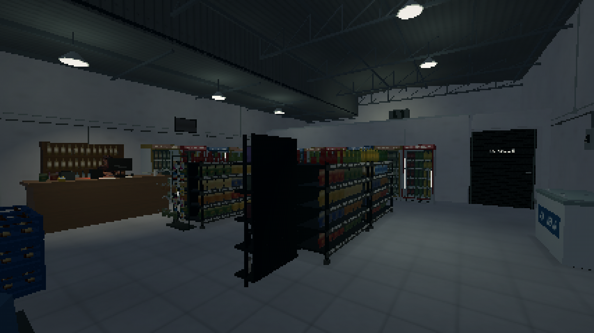

## Verificação

**132/132 verificações** passaram no projeto e no ZIP extraído depois de uma importação limpa. As novas verificações cobrem restrição das luzes das geladeiras, orçamento de sombras, captura única do reflexo, limites da névoa, troca de qualidade e pausa da deriva/variações de luz. O fluxo existente de câmera, portas, reposição, clientes e salvamento continua passando.

Registros em [integration.log](integration.log), [render.log](render.log), [lights_before.json](lights_before.json), [lights_after.json](lights_after.json) e [validation.json](validation.json). Para reproduzir as capturas em Linux com display, execute `res://tests/lighting_review.tscn`; as imagens são gravadas em `/tmp`. O argumento `economic014quick` faz a conferência reduzida do modo Econômica.

As galerias anteriores permanecem no GitHub. O ZIP inclui a galeria atual, o relatório de otimização e todos os recursos necessários ao jogo. O problema de largar a caixa continua somente registrado em [PENDENCIAS.md](../PENDENCIAS.md), aguardando a etapa de jogabilidade.
