# Materiais 0.13.0 — superfícies e embalagens

[Baixar o projeto Godot 0.13.0](https://github.com/Deriby/TheLastSale/raw/refs/heads/main/downloads/project/TheLastSale_Godot_0.13.0.zip). Extraia em uma pasta nova, importe `project.godot` no Godot 4.4.1 e pressione F5.

## O que mudou

A bancada usa grão de madeira real, com cor adaptada, rugosidade variável e uma camada leve de verniz. Os paletes têm um material separado de madeira crua. O piso cerâmico tem juntas, pequenas diferenças de esmalte e marcas suaves de limpeza. Pintura das gôndolas, aço, plástico e vidro respondem de maneiras diferentes à luz. Os veios das tábuas seguem o comprimento das peças.

Asfalto, reboco externo e concreto também usam bases de superfícies reais. A escala, a paleta, a rugosidade e a força dos mapas normais foram ajustadas ao cenário. A iluminação, a câmera e a geometria dos carros não foram alteradas nesta revisão.

Garrafas, latas, salgadinhos e caixas receberam arte mais definida. Os mapas de acabamento distinguem corpo, rótulo, tampa, metal exposto, impressão e fita de embalagem. As marcas continuam fictícias. A impressão usa texturas de 512 pixels; as máscaras de acabamento usam 256 pixels. Mipmaps e filtragem para distância reduzem a cintilação e a quebra de letras. Não foram acrescentadas camadas transparentes a cada garrafa.

## Antes e depois no jogo

As capturas usam exatamente as mesmas câmeras, luzes, resolução de 1280×720 e o modo Nítida. São imagens diretas do cenário, sem granulação ou pós-processamento, para comparar a resposta dos materiais. Os efeitos configuráveis continuam no jogo.

| Vista | 0.12.0 | 0.13.0 |
| --- | --- | --- |
| Bancada | 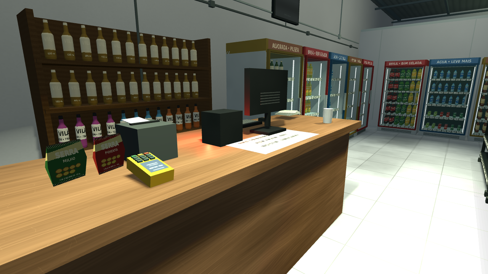 |  |
| Piso | 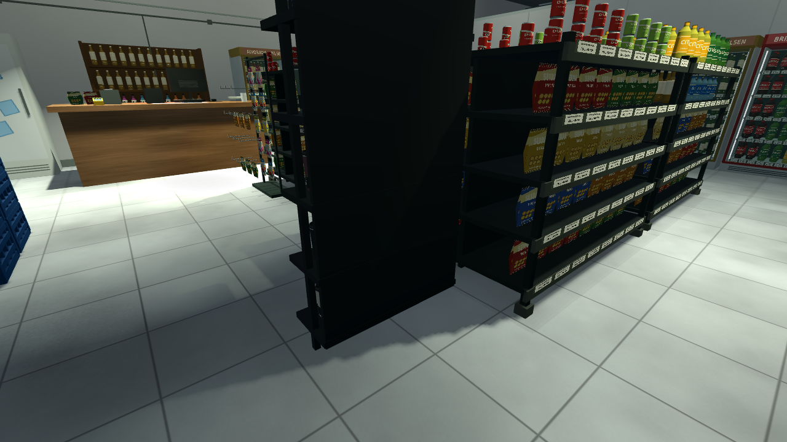 | 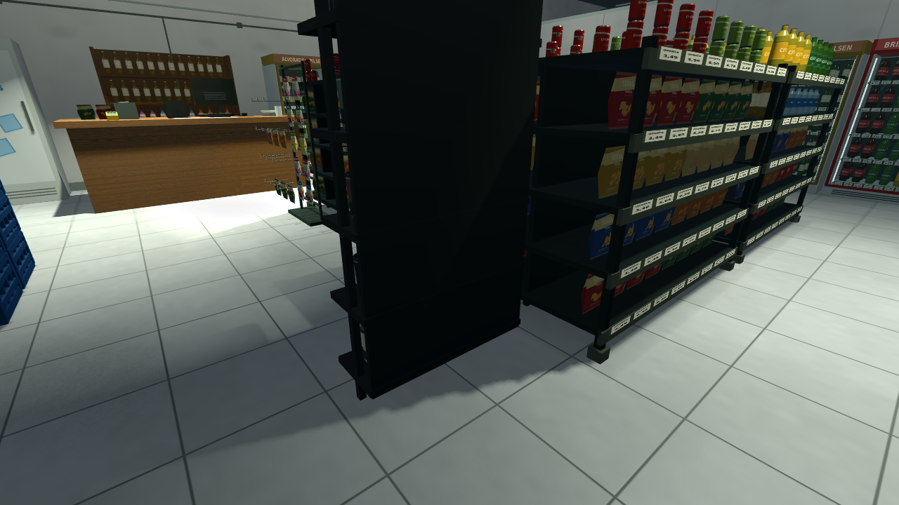 |
| Produtos e gôndolas | 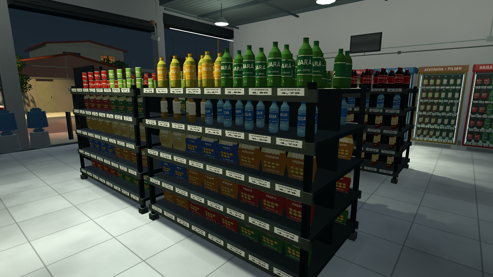 | 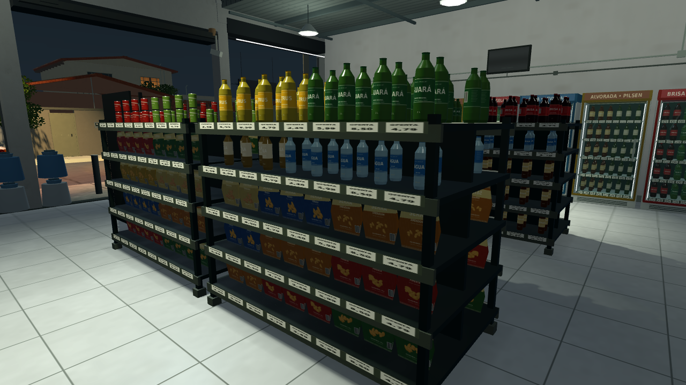 |
| Geladeiras | 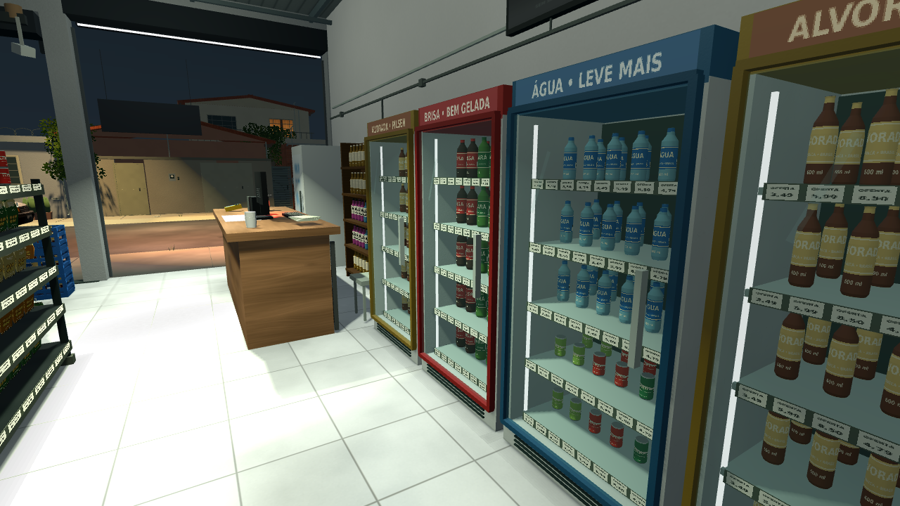 | 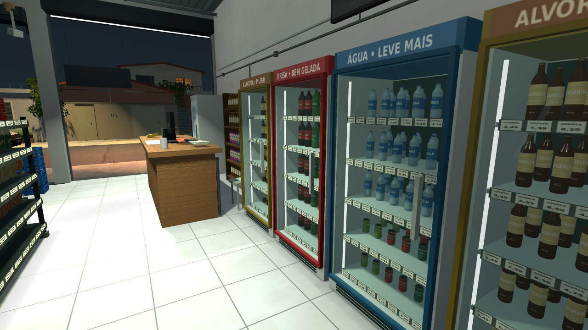 |
| Engradados e palete | 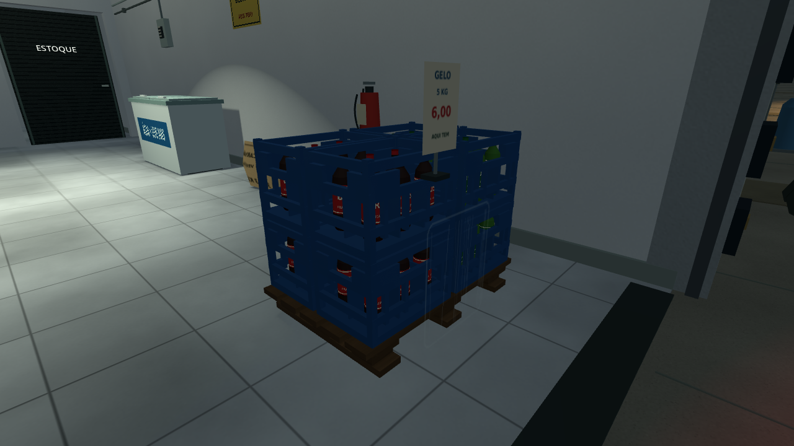 | 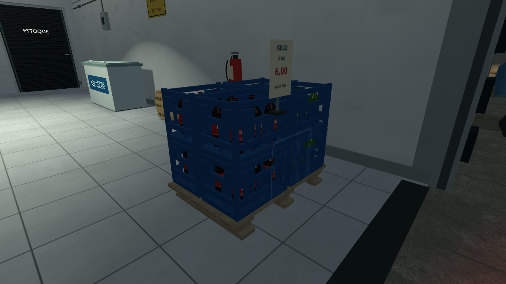 |
| Rua | 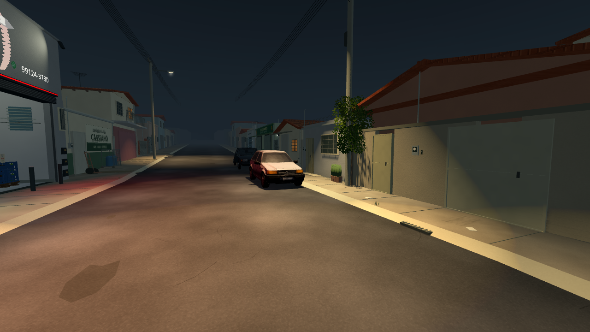 | 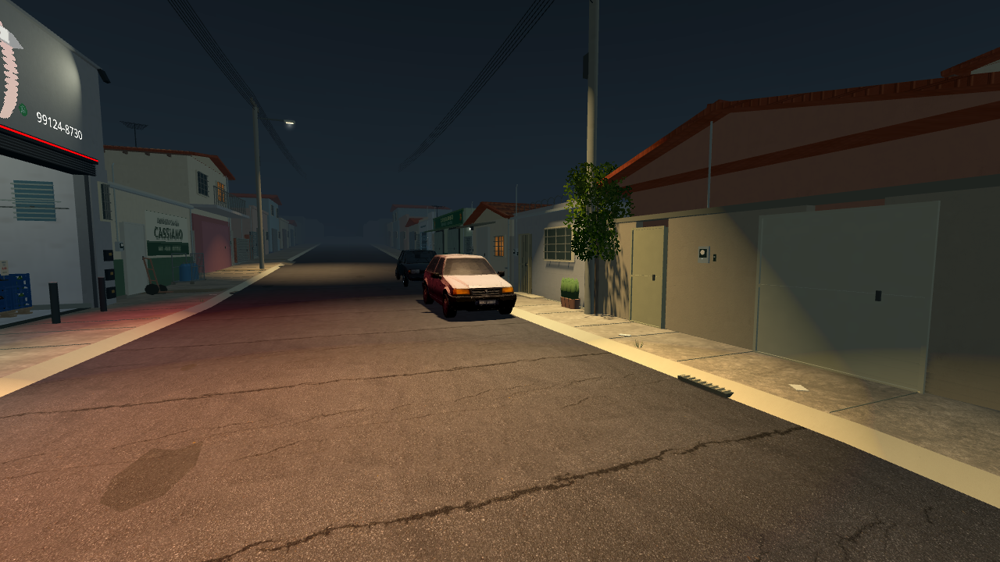 |

## Custo e qualidade

A cena mantém **666.942 triângulos**, **696.552 vértices armazenados**, **43.887.176 bytes de arrays de geometria** e **cinco luzes com sombras**. O alinhamento dos veios nas tábuas do móvel e do palete acrescenta 14 pequenos grupos de desenho: 1.314 passam a 1.328 instâncias de malha. O desenho continua com ArrayMesh, sem MultiMesh.

A soma dos níveis-base das imagens desses materiais passa de 95.207.424 para 106.364.928 bytes, aproximadamente **10,64 MiB adicionais**. É uma estimativa por dimensões e canais das imagens; exclui mipmaps, texturas dos personagens, buffers de renderização e os JPGs de origem, e não mede VRAM total. A madeira passou de 2048×1024 para 1024×1024; as máscaras das embalagens usam metade da largura e da altura da impressão.

O modo **Econômica** desliga os mapas normais, a oclusão, as texturas de acabamento e a camada de verniz, usando valores médios de rugosidade e metalização. Nítida restaura esses recursos nos materiais já existentes. O limite padrão permanece em **30 FPS**. Não foi medido desempenho nativo no Windows/Radeon R7; as capturas e verificações usam Linux/Mesa llvmpipe.

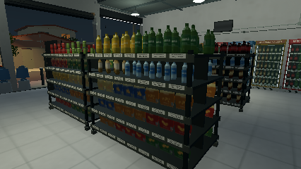

## Verificação

**125/125 verificações passaram** no projeto e no ZIP extraído após importação limpa. As seis verificações novas cobrem rótulo versus vidro, alumínio versus impressão, mipmaps, madeira crua versus verniz e troca de qualidade em tempo de execução. O fluxo completo de tarefas, clientes, câmera, portas e checkpoints continua passando.

Resultados em [validation.json](validation.json), [integration.log](integration.log) e [render.log](render.log). A integridade do ZIP distribuído está em [downloads/project/release_verification.json](../../downloads/project/release_verification.json).

As correções de teto, sombras dos fios e circulação da 0.12.0 foram preservadas. O problema de largar caixas permanece somente registrado em [PENDENCIAS.md](../PENDENCIAS.md), para a etapa de jogabilidade.

## Fontes e reprodução

Madeira, reboco externo, asfalto e concreto usam scans da **Poly Haven, CC0 1.0**. Os autores, os links dos materiais e os hashes dos downloads ficam em [resources/material_sources](../../resources/material_sources/LICENSE.md). Os JPGs de origem estão incluídos para gerar novamente sem conexão. As fotografias do autor orientam cor e acabamento; não foram recortadas para texturas. Os demais acabamentos e a arte das embalagens são procedurais/originais.

Para gerar novamente, com Python, NumPy e Pillow: `python3 tools/make_surface_materials.py`. Depois, importe os recursos no Godot. Para reproduzir as capturas, execute `res://tests/surface_finish_review.tscn` em um ambiente Linux com display; os arquivos são gravados em `/tmp`. A qualidade Econômica pode ser inspecionada passando o argumento `economic013quick`.

As galerias históricas permanecem no GitHub; este ZIP inclui a galeria atual e o relatório de otimização, junto de todos os recursos necessários para jogar.
