# Materiais e acabamento — 0.8.0

**[Baixar o jogo Windows 0.8.0](../../downloads/windows/A_Ultima_Venda_Windows_x64.zip)**

Estas comparações mostram o cenário real do jogo, com as mesmas câmeras e luzes. A coluna anterior foi capturada na 0.7.0 antes da aplicação dos materiais; a atual vem do pacote Linux 0.8.0 exportado, em Compatibility/OpenGL, qualidade Nítida. As imagens não são renders de apresentação do Blender.

## Madeira da bancada

| Antes — 0.7.0 | Agora — 0.8.0 |
|---|---|
| 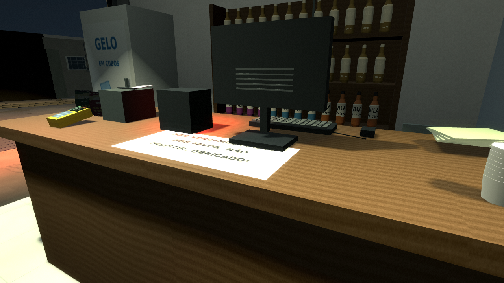 |  |

Os veios têm irregularidades, pequenos nós, riscos e variação de verniz. A bancada usa coordenadas UV na escala de 2,4 × 1,2 m, com os veios seguindo o comprimento. Isso evita que a textura seja esticada conforme as dimensões da peça ou mude ao agrupar as malhas. As cores foram orientadas pelas fotos do balcão.

## Piso e paredes

| Antes — 0.7.0 | Agora — 0.8.0 |
|---|---|
| 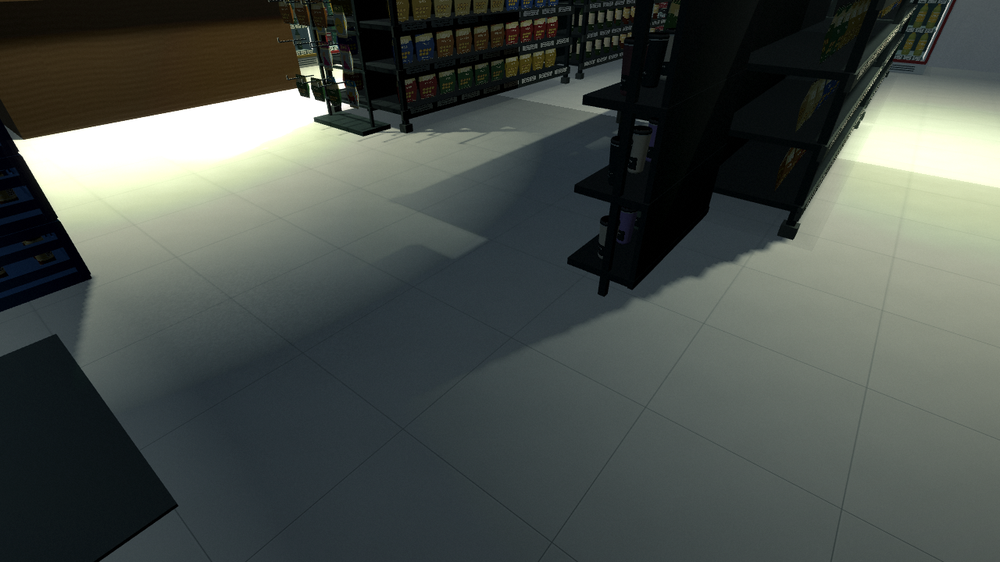 | 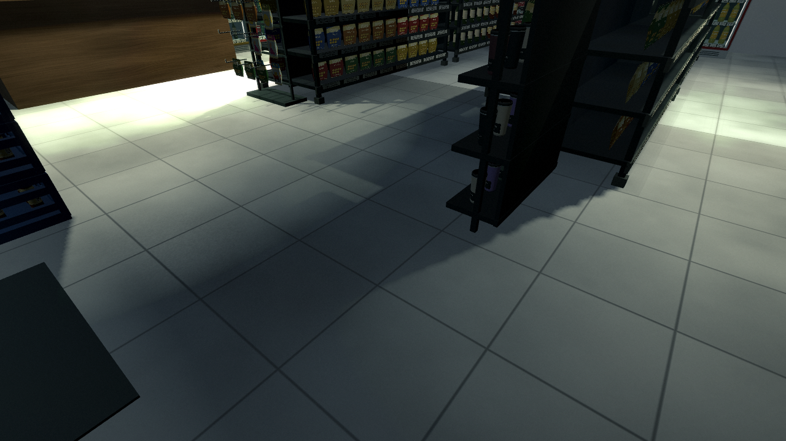 |
| 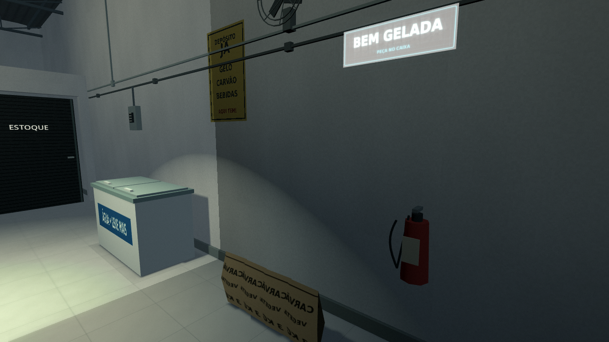 | 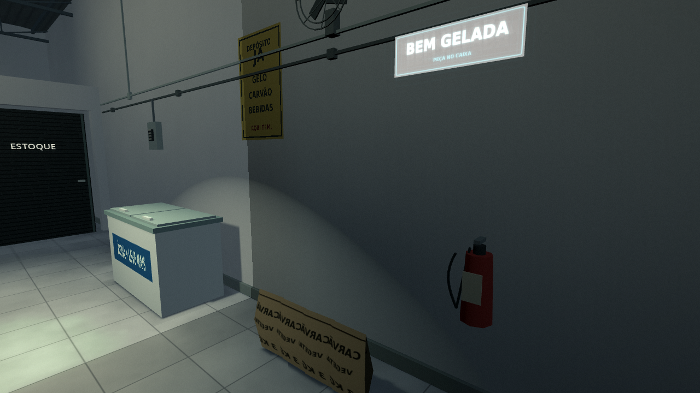 |

O piso acompanha a referência de `interno4.jpg`: peças cinza acetinadas, manchas suaves e rejunte fino. Um atlas contém 16 variações de peças de aproximadamente 60 cm. As paredes têm textura discreta de pintura/reboco e acabamento mais fosco. A luz encontra rugosidades diferentes no piso, na parede e na madeira.

## Asfalto e calçada

| Antes — 0.7.0 | Agora — 0.8.0 |
|---|---|
| 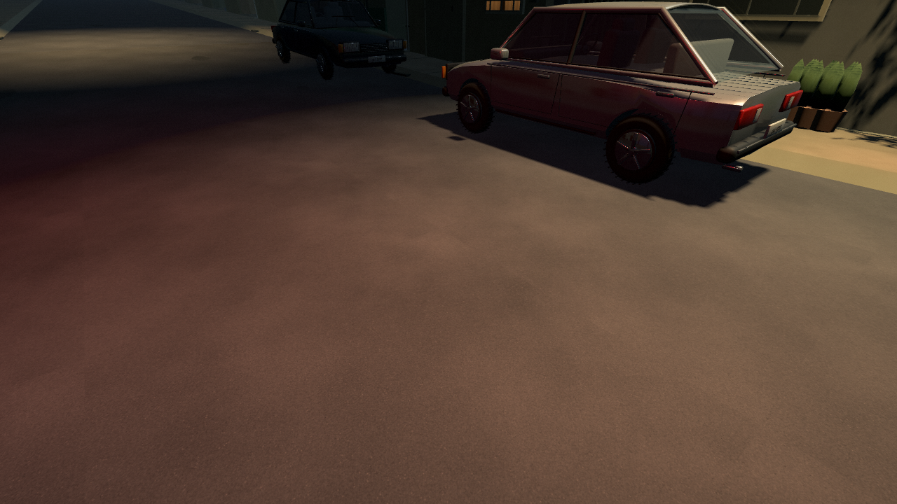 | 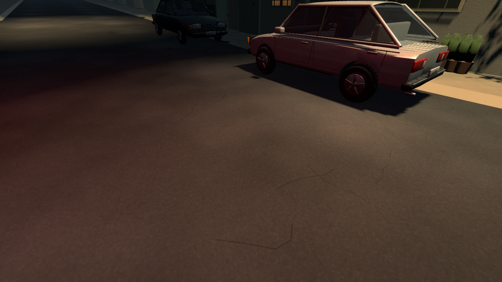 |
| 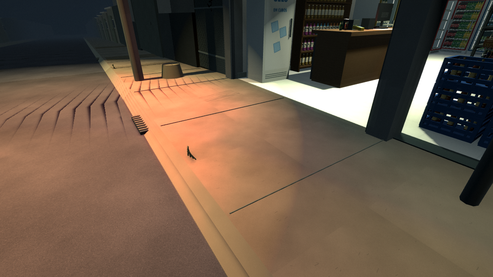 | 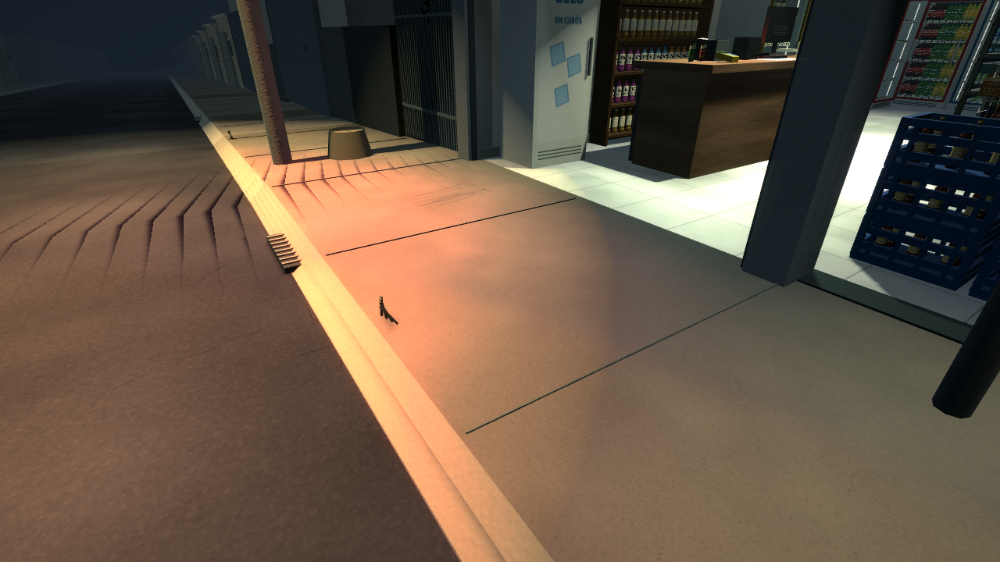 |

O asfalto recebeu agregado fino, poros, pequenas fissuras e diferenças discretas de acabamento. O cimento tem textura e desgaste próprios, conservando as juntas e o declive existentes. O relevo é fino e acompanha a luz; não muda a colisão ou a silhueta do terreno.

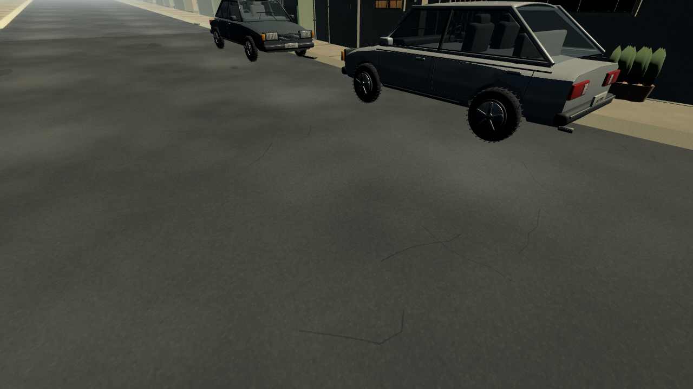

A iluminação diurna acima é uma ferramenta de revisão; o expediente do jogo continua à noite.

## Equipamentos, carros e vista geral

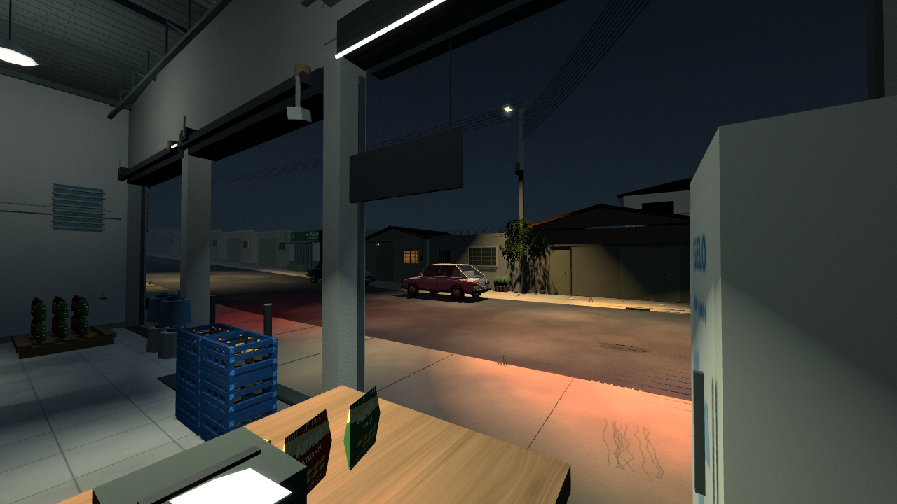

Metal pintado de gôndolas, geladeiras e portões, aço dos rufos/aros, plástico do caixa e engradados, borracha dos pneus, vidro e pintura automotiva receberam respostas distintas. A pintura dos carros tem metalização e verniz mais contidos; os modelos mantêm a geometria anterior.

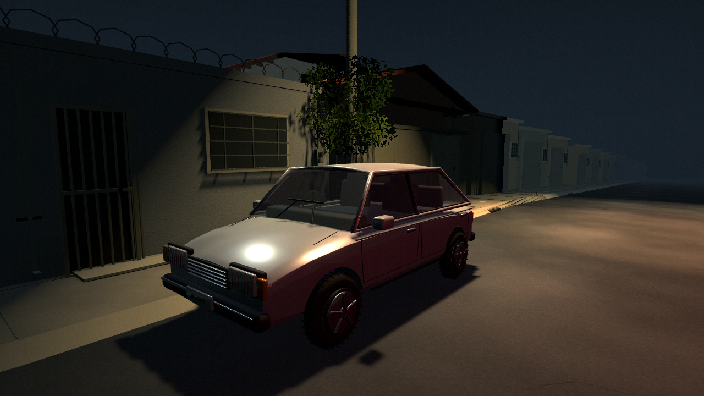

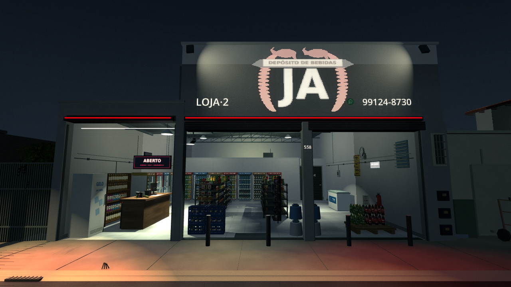

## Materiais e qualidade

São 12 conjuntos originais com 36 mapas: cor da superfície, normal para relevo fino e ORM para oclusão, rugosidade e metalização. Madeira: 2048 × 1024; piso, paredes, reboco, asfalto e cimento: 1024²; os seis outros conjuntos: 512². Todos têm mipmaps. [Dados e escalas](../surface_report.json) · [Gerador](../../tools/make_surface_materials.py) · [Aplicação no jogo](../../scripts/world/surface_materials.gd).

As fotografias orientaram paleta, escala e acabamento. As texturas são arte procedural original; os valores de rugosidade são estimados. [Referências e decisões](../REFERENCIAS.md).

Nítida e Retrô mantêm os detalhes dos materiais. Econômica desliga normal maps, oclusão das texturas e filtragem anisotrópica, além das sombras e do halo de câmera. A comparação de qualidade usa o sinal real de preferência depois de construir o cenário: 60 materiais próprios, 57 com relevo ativo em Nítida e zero em Econômica; luzes com sombras passam de cinco para zero. Registros: [Nítida](materials_hd.txt) e [troca para Econômica](materials_economic.txt).

## Verificação

Integração: **88/88 no projeto e 88/88 no pacote Linux exportado**, incluindo ciclo completo dos clientes, caixa esquerdo, portas, reposição, checkpoint, câmeras, terreno e cobertura. [Projeto](integration_source.txt) · [Pacote](integration_packed.txt).

As malhas agrupadas foram comparadas com a montagem de objetos individuais em Nítida e Retrô, incluindo pausa e recarga. A referência contém 6.927 objetos: diferença de 294 pixels em Nítida (0,03190%) e 90 em Retrô (0,03906%), abaixo do limite de 1%. Registros: [Nítida](render_hd.txt) · [Retrô](render_retro.txt). As capturas próximas acima também foram repetidas em Econômica.

A revisão usa Mesa llvmpipe em Linux. O ZIP Windows foi exportado, mas não foi executado em Windows 7/Radeon R7, e não houve medição de FPS nesse hardware. [Validação completa](../VALIDACAO.md).
