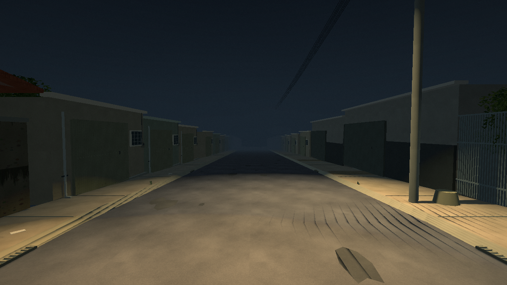
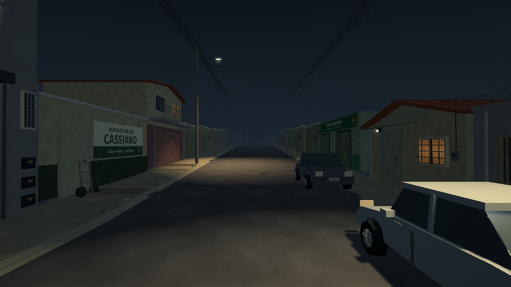
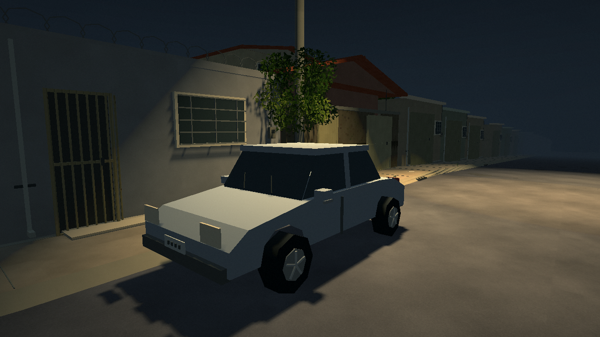
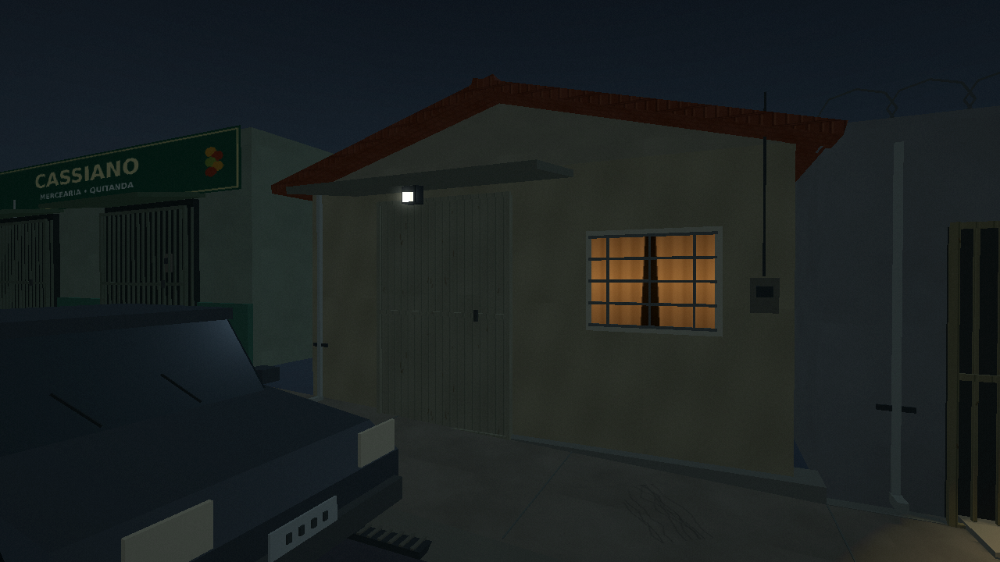
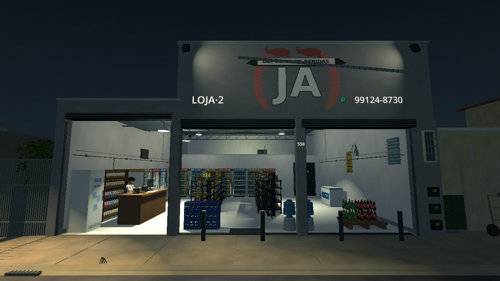
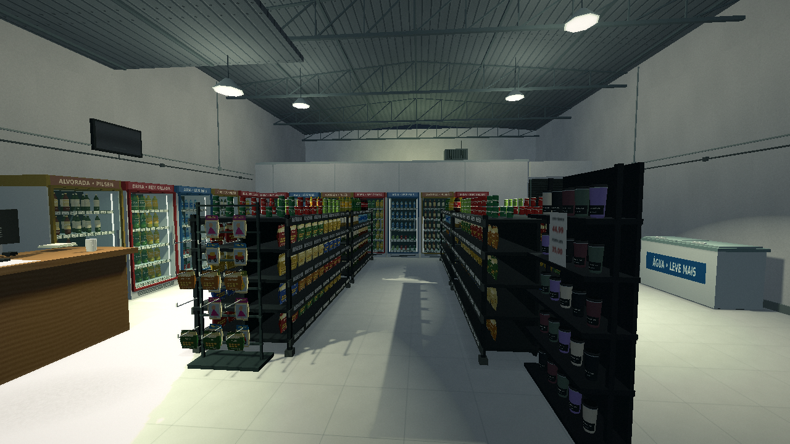

# Noite, luzes e rua — 0.6.0

**[Baixar o jogo Windows 0.6.0](../../downloads/windows/A_Ultima_Venda_Windows_x64.zip)** · **[Assistir à caminhada com som](walk.mp4)**

Esta revisão concentra o acabamento na atmosfera de terror cotidiano solicitada: loja acesa, rua vazia com áreas de luz e sombra, janelas pontuais, ar distante e detalhes próximos legíveis. A posição do balcão e a sequência das fachadas continuam baseadas nas fotos fornecidas. [Fontes e aproximações](../REFERENCIAS.md).

## De dentro para fora

Antes, 0.5.0:

Agora, no mesmo enquadramento:

Os postes agora projetam sombras dos carros, árvores e personagens. A luz da loja alcança a calçada, e as casas deixam de receber a mesma claridade geral. As luzes internas, da fachada e da rua foram organizadas para manter suas áreas de influência; a transição no asfalto foi conferida sem faixas retangulares entre os trechos de chão.

## Rua à noite

Antes:

Agora:

O céu tem variação discreta de nuvens e claridade no horizonte. A neblina se fecha antes da borda do cenário. Algumas janelas mostram cortinas acesas, e uma luminária distante falha brevemente em intervalos longos. Após o aviso narrativo já existente, a névoa distante se adensa aos poucos; os objetivos e corredores próximos permanecem claros.

## Detalhes próximos

Os carros receberam painéis inclinados, recortes para as rodas e detalhes das calotas. A copa usa folhas recortadas com movimento leve, formando sombras irregulares. As superfícies de asfalto, calçada, reboco e cerâmica foram refeitas com arte original; um halo discreto acompanha os pontos mais claros da imagem.

## Caminhada no jogo

O vídeo de aproximadamente 34 segundos usa **o controlador real de Deryk e sua câmera de primeira pessoa**, com um percurso automatizado por entradas de movimento. Sai da loja, atravessa o meio-fio, desce a rua, volta e se aproxima da entrada. Não usa câmera livre. O relatório verifica quatro pontos do percurso sem queda ou bloqueio: [walk_test.txt](walk_test.txt).

Os passos mudam de contato entre o piso cerâmico e o exterior. O som inclui ar do bairro, ruído discreto do poste e o ambiente da loja. A cabeça não aparece dentro da câmera, mas continua participando da sombra do personagem. Os modelos e seus rigs não foram substituídos.

## Validação e qualidade

As capturas e a caminhada foram produzidas no pacote Linux exportado, com Compatibility/OpenGL em Mesa llvmpipe. Integração: **83/83 verificações no projeto e no pacote**, incluindo física, rotina dos clientes, caixa esquerdo, câmeras e troca dos passos. A comparação das malhas agrupadas com objetos individuais foi repetida em [Nítida](render_hd.txt) e [Retrô](render_retro.txt), com pausa e recarga.

Nítida e Retrô mantêm as sombras. **Econômica** reduz a resolução, desliga as sombras das cinco luzes e desliga o halo de câmera. Foi renderizada separadamente: [registro](economic_test.txt). As preferências antigas são preservadas; escolha a qualidade em Configurações.

Não houve execução no Windows/Radeon R7 do usuário ou medição de FPS nesse hardware. Dimensões, iluminação noturna, profundidades e partes não fotografadas continuam estimadas. [Validação completa](../VALIDACAO.md).
