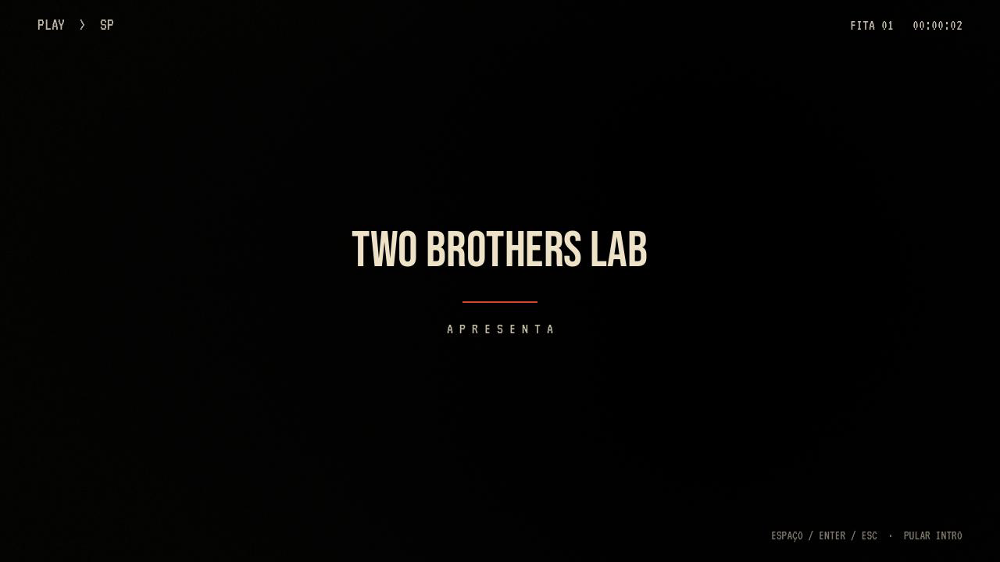
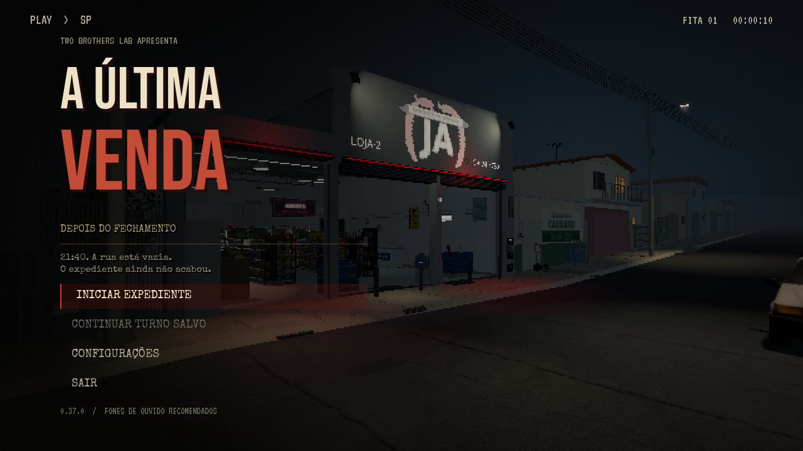

# 0.37.0 — Uncanny Valley na abertura / Godot 4.7

[Prévia real com áudio](uncanny_valley_preview.mp4) · [Projeto Godot 4.7, sem EXE](../../downloads/project/TheLastSale_Godot_0.37.0.zip).

A faixa enviada toca inteira na intro e no menu. O mesmo player continua ao pular a abertura e ao abrir/fechar configurações. O MP3 repete nativamente ao terminar; há entrada gradual de 0,8 s e saída de 0,34 s ao iniciar ou continuar o expediente. O arquivo recebido, com cerca de 2min40, foi preservado byte a byte, sem recodificação. A faixa anterior permanece no acervo do projeto.

Música / rádio controla a faixa; Efeitos e ambiente controla fita, botões e rua. O volume geral atua sobre a saída completa. O áudio de abertura termina ao entregar o controle ao jogador e não reinicia na pausa do expediente.

A prévia grava a abertura e o menu reais, com navegação de teclado e entrada no expediente. Foi capturada no Godot 4.7 em modo Retrô, 1280×720 a 30 fps, em tempo de jogo normal. O render usa OpenGL por software; não mede FPS no PC do jogador. O áudio do vídeo é comparado com o MP3 recebido para conferir a presença e a continuidade da faixa.

`title_music_integration` acrescenta 18 verificações de reprodução, repetição no fim, volume, configuração, pulo de intro, fade, Iniciar, Continuar e pausa. A validação do pacote extraído roda as 21 suítes (1.000 verificações) no Godot 4.7, além das 48 comparações renderizadas do piso PS1/PS1/2. [Relatório da distribuição](../../downloads/project/release_verification.json) · [Integração](integration.log) · [Piso renderizado](psx_motion_validation.json) · [Comparação do áudio](audio_comparison.json).

A migração acrescenta campos padrão em 190 arquivos de importação; nenhum valor anterior é removido ou substituído. Os 240 arquivos originais de dados de assets e os 32 recursos, incluindo onze bibliotecas de animação, permanecem byte a byte. GodotPhysics3D fica explícito para manter o backend anterior. Shaders, câmera, física dos personagens, campanha e computador preservam seus códigos. [Metadados atualizados](import_metadata.json).

Para comportar o MP3 completo no limite de 100 MiB do GitHub, sete capturas históricas da sexta 0.18 ficam na [galeria já publicada](https://github.com/Deriby/TheLastSale/tree/main/docs/friday_v018). Nenhum arquivo usado pelo jogo é retirado do ZIP. Resultados históricos do Godot 4.4.1 continuam documentando suas versões; a entrega atual é validada no 4.7.

Na primeira execução completa do teste, as 29 verificações passaram e o encerramento apontou `select.wav` ainda em uso. A limpeza da rota agora aguarda o mixer depois de liberar a cena. O [log anterior](audio_shutdown_before.log) é preservado; o pacote final repete as verificações com esse encerramento.
