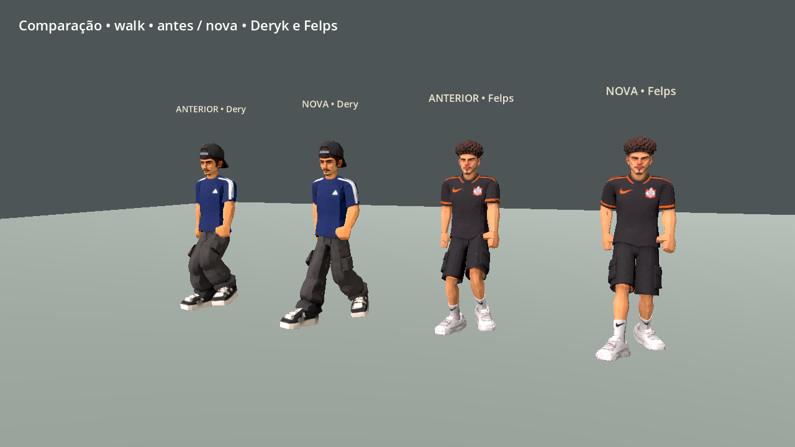
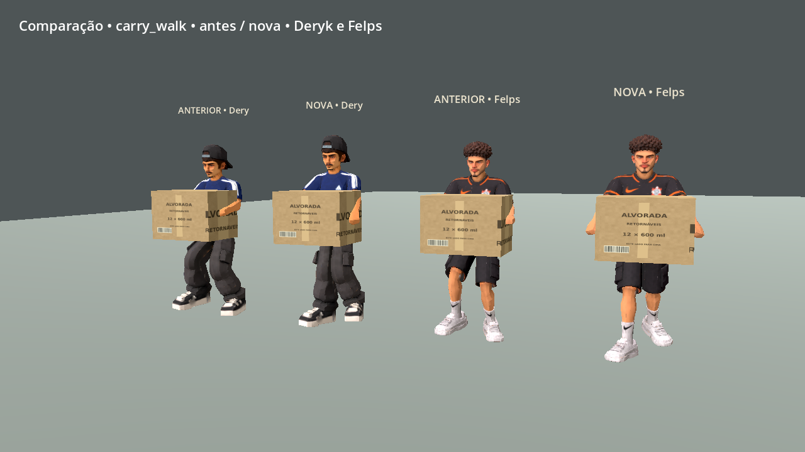
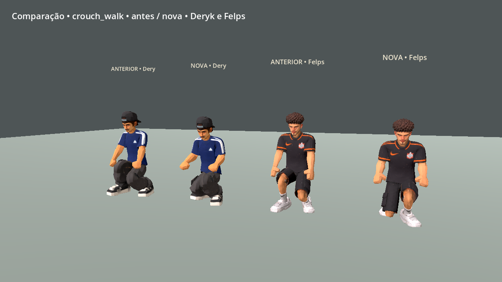
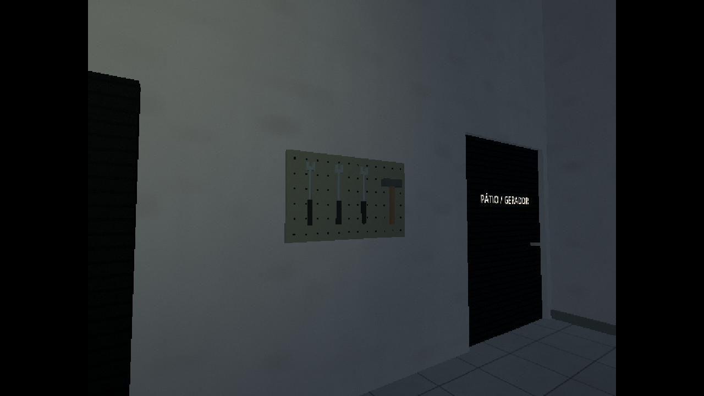
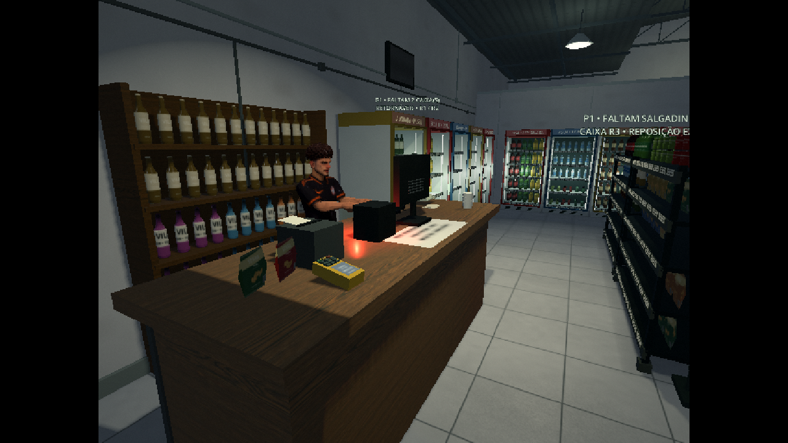
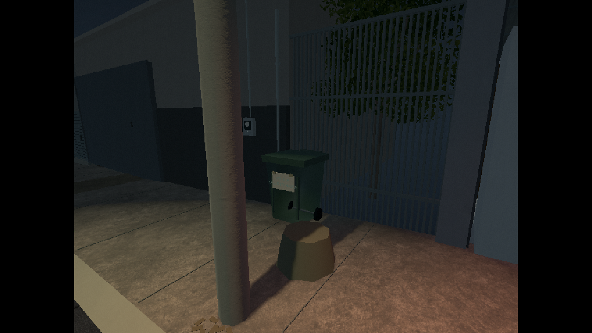

# 0.22.0 — movimento e detalhes do cenário

A caminhada foi refeita a partir das proporções reais de cada rig. Os modelos,
as texturas e os pesos recebidos do autor foram preservados. Novas bibliotecas
substituem os clipes de locomoção, repouso e gestos comuns sem alterar os controles.

[Vídeo comparativo de caminhada, corrida e transporte](motion_comparison.mp4)

## Movimento

- O quadril deixa de usar a mesma altura baixa para todos os personagens. A altura
  acompanha o apoio e o alcance medido das pernas, com transição suave entre apoios.
- A passada acompanha o deslocamento do corpo, com cadência própria para cada rig.
  Em Deryk, a passada normal passa de 1,12 para aproximadamente 1,28 m por ciclo;
  a 1,55 m/s, isso reduz a cadência de cerca de 166 para 145 passos por minuto.
- A elevação adicional do pé na fase aérea cai de 9,5 para 5,5 cm ao andar, de
  22 para 12,5 cm ao correr, com valores menores para agachar e carregar caixas.
- Os braços ficam mais próximos do corpo, os cotovelos permanecem flexíveis e
  ombros, peito e quadril fazem movimentos opostos. Respiração e transferência
  de peso continuam durante o repouso; a respiração também ocorre em movimento.
- A velocidade do clipe responde gradualmente às mudanças de velocidade. O apoio
  dos pés recebe uma estabilização limitada durante curvas, junto à correção de
  pequenos desníveis. A inclinação do tronco reage à aceleração e à mudança de direção.
- Deryk e Felps mantêm os punhos vinculados à caixa. Pegar, apoiar, entregar e soltar
  continuam com os tempos de interação existentes. Os clipes específicos de pegar,
  colocar, susto e ataque anteriores permanecem disponíveis.
- Bryan, Zirico, garotas, senhora, Killer e os modelos provisórios recebem
  bibliotecas próprias. O Killer usa corrida medida no seu rig, sem copiar as
  posições dos ossos do Deryk.

As bibliotecas são calculadas pela ferramenta de autoria e salvas em
`resources/motion`. O jogo carrega as curvas prontas. Não há solução de poses
completa sendo executada a cada quadro. Para gerar novamente após uma troca de
modelo, use `tools/godot.sh --headless res://tools/bake_natural_motion.tscn`.

## Cenário

O estoque recebeu um painel com ferramentas modeladas, etiquetas nas pilhas,
papéis e fita de embalagem. O aviso de entregas reforça a organização dos
vasilhames. No caixa há pequenos comprovantes; o relógio de parede acompanha o
horário do turno. A entrada tem um tapete baixo, sem obstáculo sobre o vão.

Na rua, uma lixeira com tampa, alça, eixo e rodas ocupa a faixa junto ao muro.
Sua colisão entra na navegação. O bueiro acompanha a inclinação da sarjeta, com
folhas próximas ao meio-fio e marcas localizadas nas paredes. Os novos objetos
usam malhas estáticas agrupadas e materiais existentes, sem novas luzes com sombras.
Os acessos, o espaço diante das geladeiras e a fuga cooperativa continuam livres.

## Verificação e limites

`natural_motion_integration.tscn` calcula a deformação de amostras reais das solas,
usando os pesos da malha. Verifica contato com o piso e transformações finitas em
repouso, caminhada, corrida e transporte nos modelos representativos.
Amostras, limites e resultados ficam em `contact_metrics.json`. As cinco suítes
anteriores verificam controles, câmeras, caixas, reposição, venda e as três noites.

As capturas do cenário são cenas preparadas em Compatibility/OpenGL/Linux Mesa
llvmpipe, PS1/2 640×480 ampliado para 1280×720. O comparativo de locomoção é uma
revisão separada, com os clipes anteriores ao lado dos novos; o vídeo foi gravado
por quadros. Essas imagens não são medição de FPS nativo na Radeon R7.

As animações ainda admitem acabamento manual, principalmente dedos, transições
rápidas de direção e gestos específicos. A correção dos pés cobre pequenos
desníveis; não planeja passos sobre obstáculos altos. O limite padrão continua
em 30 FPS e os modos PS1/PS1/2 são mantidos.

