# Rua e vizinhança — 0.9.0

**[Baixar o jogo Windows 0.9.0](../../downloads/windows/A_Ultima_Venda_Windows_x64.zip)**

A rua recebeu seis fachadas secundárias distintas, novos detalhes residenciais/comerciais e transições de calçada. Estas imagens vêm do cenário real no pacote Linux exportado, em Compatibility/OpenGL. As comparações usam as mesmas câmeras e as fontes de luz existentes. As vistas diurnas servem à revisão da modelagem; o expediente do jogo permanece à noite.

## Trecho da descida

| Antes — 0.8.0 | Agora — 0.9.0 |
|---|---|
| 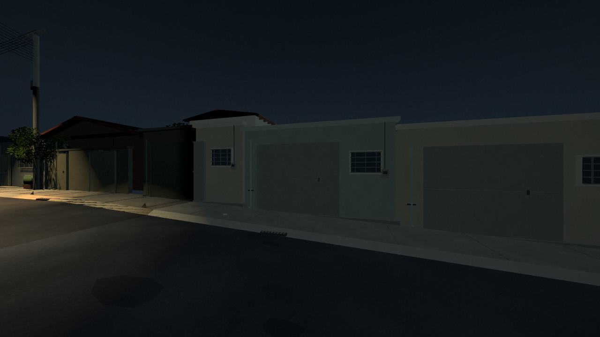 |  |
| 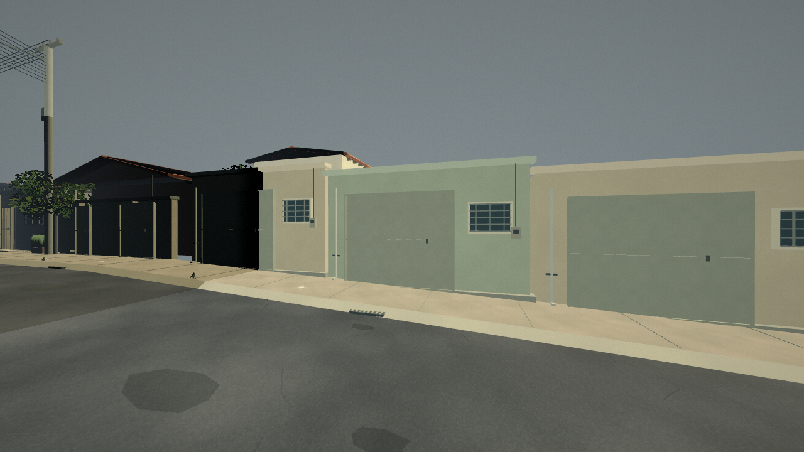 | 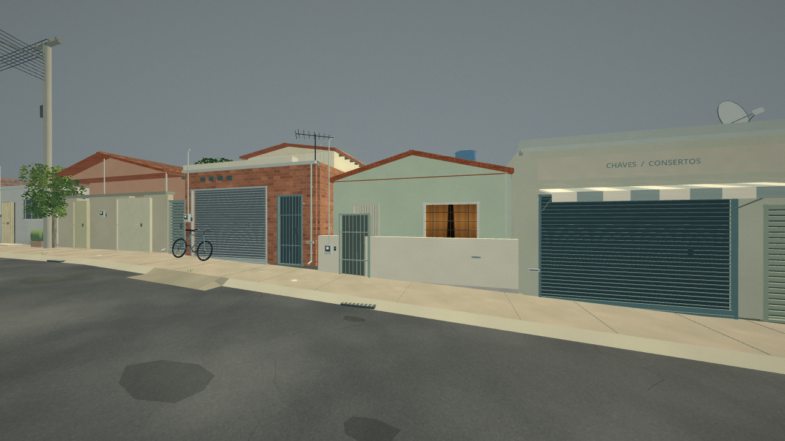 |

Os lotes secundários que repetiam o mesmo molde agora têm diferenças de volume, recuo, altura, aberturas e cobertura. A garagem de tijolo tem portão de enrolar e acesso separado; a casa verde tem jardim frontal, telhado cerâmico e janela recuada; o pequeno comércio tem toldo e placa próprios. O comércio e os números dos imóveis novos são fictícios. As partes aproximadas continuam descritas em [Referências](../REFERENCIAS.md).

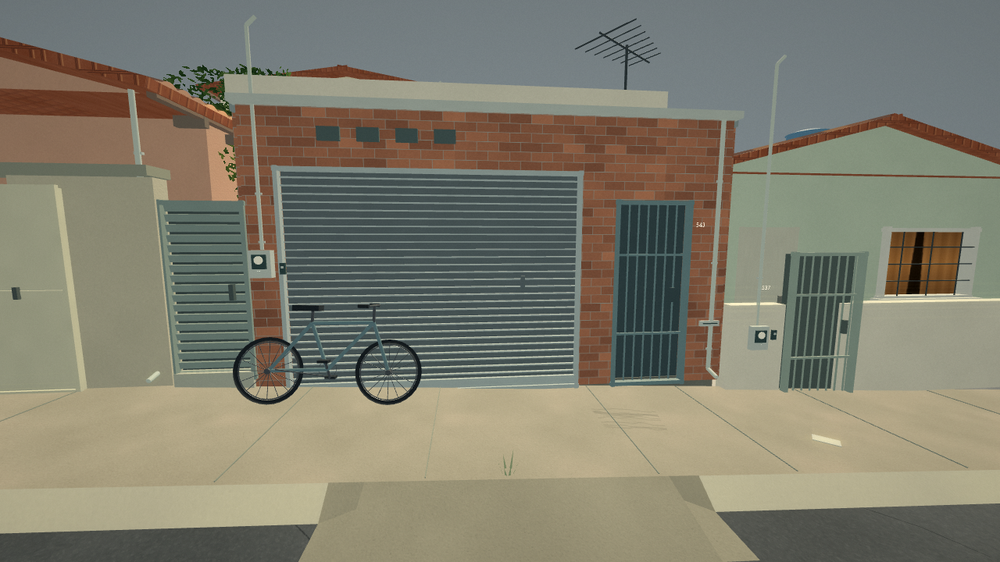

## Quintal, azulejos e oficina

| Antes — 0.8.0 | Agora — 0.9.0 |
|---|---|
| 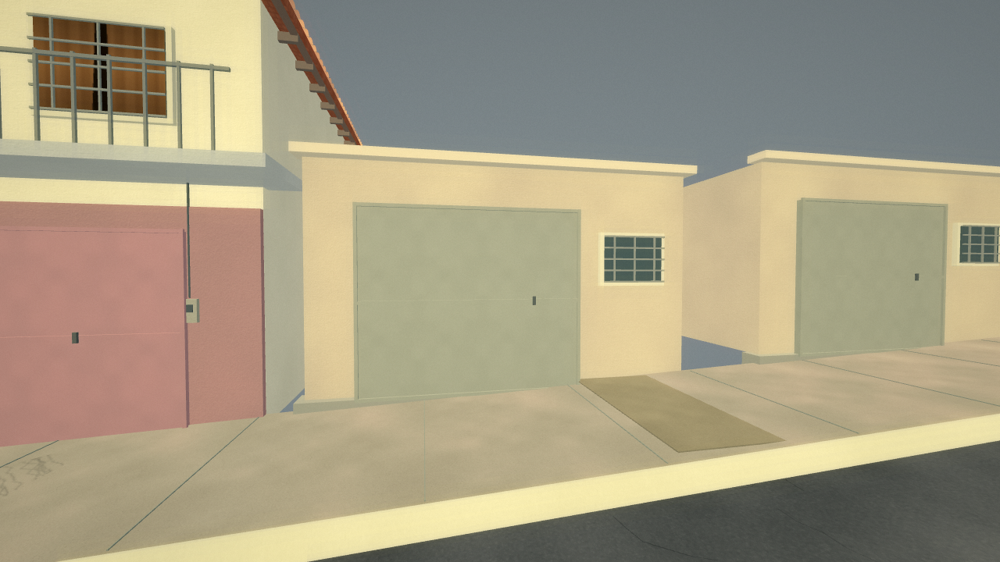 | 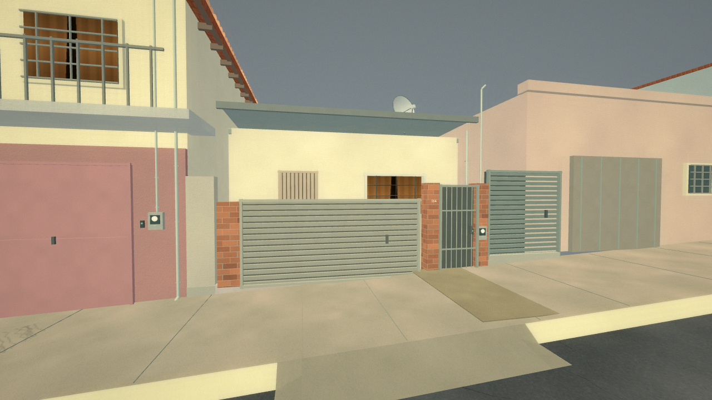 |

A casa recuada mostra portões com lâminas horizontais, pilares de tijolo, porta, janela e quintal atrás da entrada. A cobertura tem ondulação geométrica, e a parabólica tem prato côncavo e suporte. O imóvel do lado oposto recebeu uma faixa de azulejos e portões com desenho diferente.

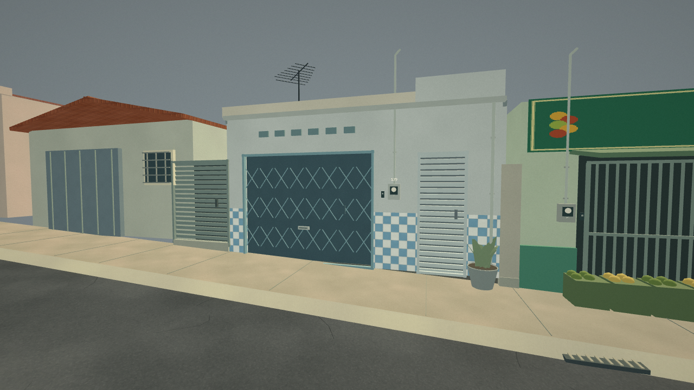

O anexo de oficina tem outra largura, altura e desenho de porta/ventilação. Sua largura física foi corrigida para o lote de 5,5 m, abrindo espaço para um fechamento lateral visível.

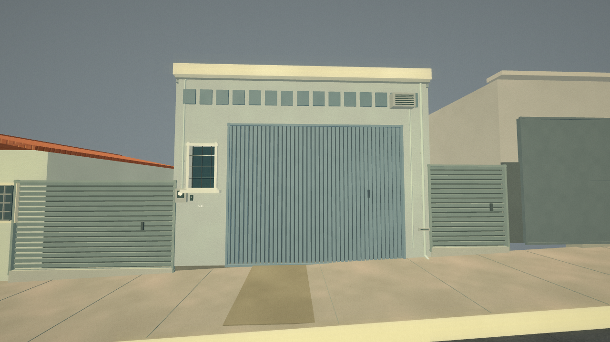

## Objetos e serviços

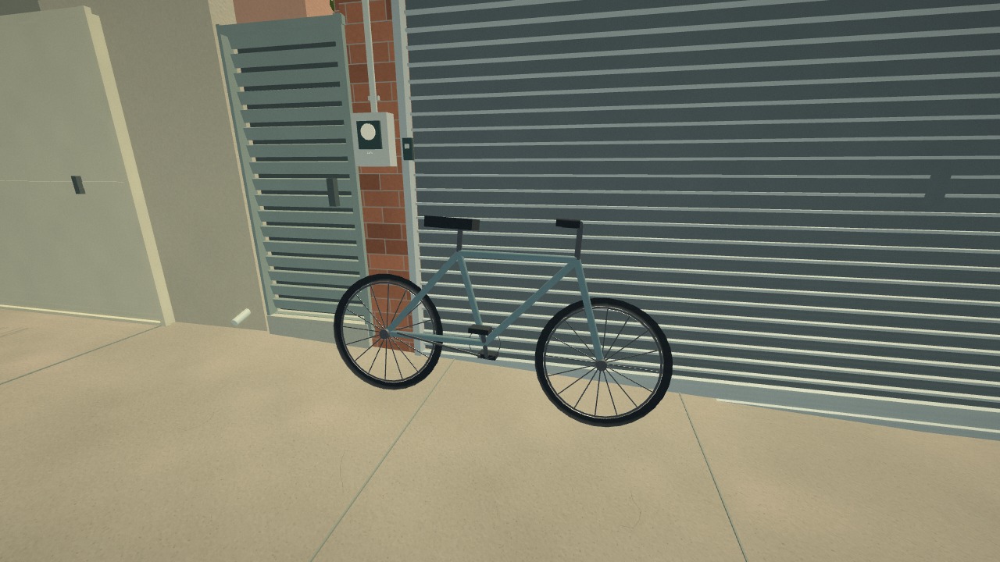

A bicicleta tem pneus, aros, raios, quadro, selim, guidão, corrente simplificada e pedais. Sua posição acompanha o declive da calçada. A gaiola de botijões tem grade, base elevada, apoios, recipientes, ombros e válvulas. Vasos externos usam a altura local do passeio.

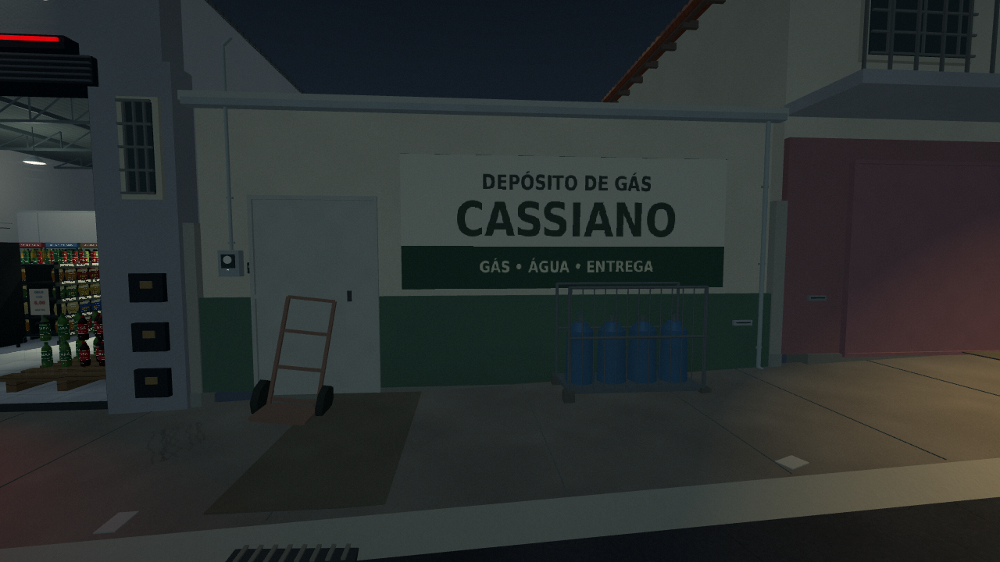

Medidores com mostrador, interfone, caixa de correspondência, conduítes, calhas e descidas têm posições ajustadas a cada fachada. Quatro antenas, duas parabólicas e uma caixa-d'água sobre apoios variam a silhueta dos telhados. Esses objetos são cenografia, sem novas interações de compra ou abertura de imóveis.

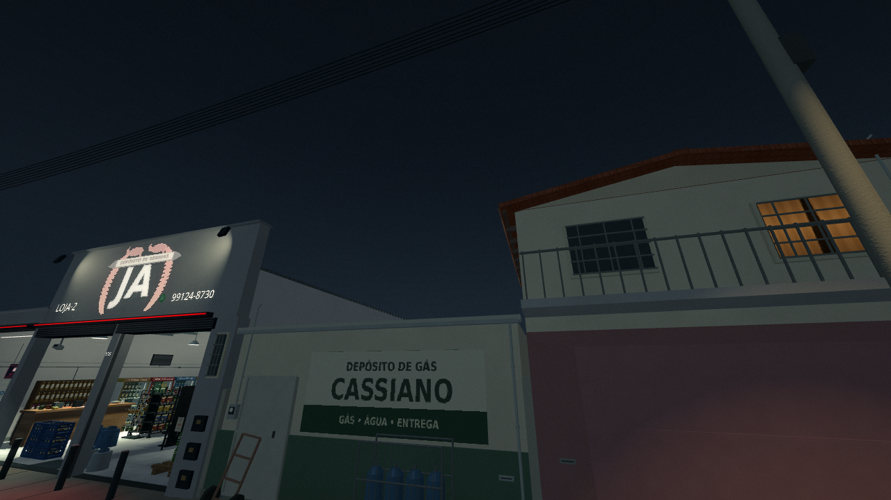

As árvores têm variação de altura, largura e orientação da copa, com textura própria de casca e o vento existente. Uma árvore que atravessava uma garagem foi reposicionada no vão lateral. Há folhagens de formas diferentes nos vasos, e as pequenas touceiras junto ao meio-fio passaram a usar lâminas triangulares.

## Referências próximas e perspectiva

| Antes — 0.8.0 | Agora — 0.9.0 |
|---|---|
| 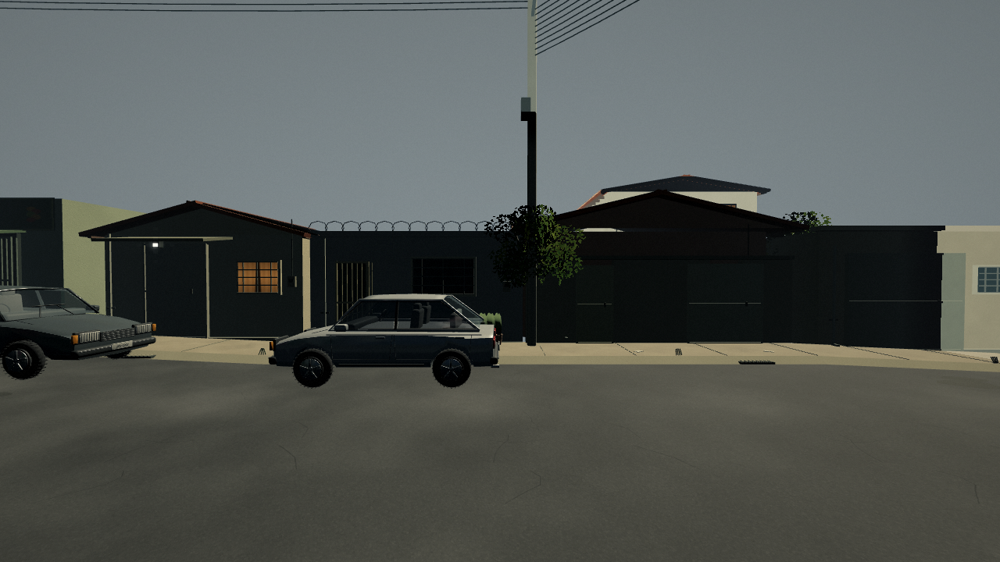 | 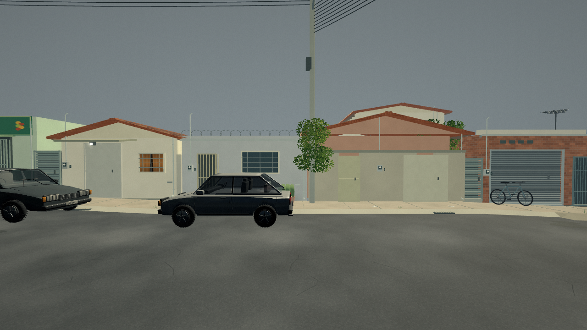 |

A posição e a identidade das casas cinza, salmão e amarela próximas ao depósito foram conservadas, assim como JA, CASSIANO e o sobrado. Os lotes secundários são complementos autorais orientados pela escala/paleta da rua. Os imóveis distantes usam quatro combinações simplificadas de altura e cobertura, com variação além dos limites exploráveis e dentro da névoa.

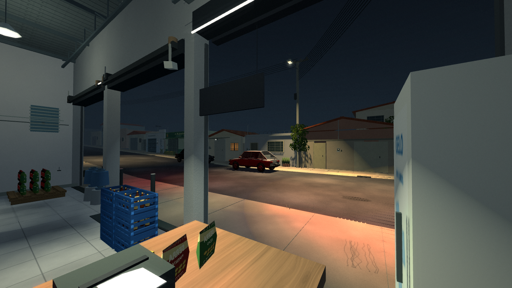

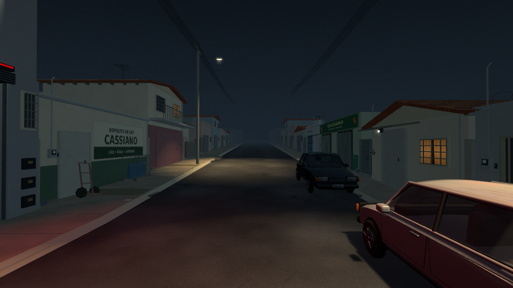

## Passagem e qualidade

Duas rampas físicas conectam a rua às calçadas junto às garagens, com transições laterais. A altura de navegação e de restauração de posições acompanha o topo dessas rampas. Fechamentos entre construções impedem passagem para vãos sem piso; os obstáculos novos junto à calçada registram sua projeção na navegação.

A integração executa movimento real sobre uma das rampas e amostra o contato com o piso, além de verificar altura física, checkpoint e fechamento entre oficinas. **92/92 verificações passaram no projeto e no pacote Linux exportado**, incluindo a rotina dos clientes, reposição, câmeras, portas, terreno e telhado. [Projeto](integration_source.txt) · [Pacote](integration_packed.txt).

Foram capturadas 20 vistas do pacote em Nítida e três vistas representativas em Econômica. A geometria usa malhas comuns agrupadas por material, sem MultiMesh. A comparação com 8.491 objetos independentes foi repetida com pausa e recarga: 20 pixels diferentes em Nítida (0,00217%) e três em Retrô (0,00130%), abaixo do limite de 1%. Registros: [Nítida](render_hd.txt) · [Retrô](render_retro.txt). [Qualidade Nítida](scene_hd.txt) · [Qualidade Econômica](scene_economic.txt).

Não foram acrescentados focos de luz de rua. A sonda de reflexo dos carros passou a influenciar apenas os veículos, corrigindo o recorte de claridade que aparecia em algumas fachadas. A iluminação e a neblina mantêm a direção anterior. Tijolo, azulejo e casca de árvore acrescentam três conjuntos originais de materiais, totalizando 15 conjuntos e 45 mapas no gerador. A revisão foi executada em Linux/Mesa llvmpipe; Windows 7/Radeon R7 não foram executados e não há medição de FPS nesse hardware. [Validação completa](../VALIDACAO.md).
