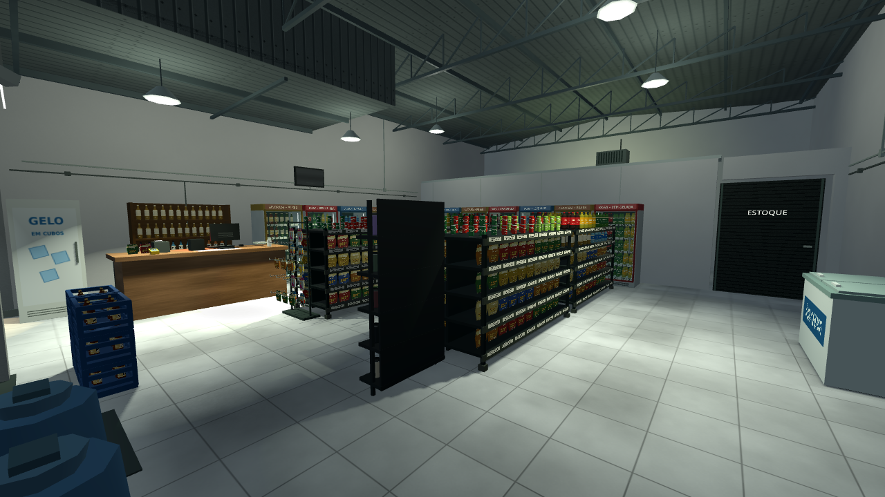

# Otimização 0.11.0 — meta de 30 FPS

[Baixar o projeto Godot 0.11.0](https://github.com/Deriby/TheLastSale/raw/refs/heads/main/downloads/project/TheLastSale_Godot_0.11.0.zip). Extraia em uma pasta nova, importe `project.godot` no Godot 4.4.1 e pressione F5.

## Dados reduzidos, geometria preservada

As malhas procedurais de produtos e elementos estáticos agora reutilizam vértices com os mesmos atributos. O índice é preparado na pequena malha de origem e reaproveitado em suas cópias, evitando reindexar uma prateleira ou cobertura inteira. A ordem dos triângulos, UVs, normais, AABBs e modo de desenho com ArrayMesh são preservados. Não foi introduzido MultiMesh.

| Auditoria das malhas únicas na cena | 0.10.0 | 0.11.0 |
| --- | ---: | ---: |
| Vértices armazenados | 1.267.170 | 701.981 |
| Dados decodificados dos arrays | 67.047.104 bytes | 44.238.968 bytes |
| Triângulos | 674.563 | 674.563 |
| Instâncias de malha | 1.302 | 1.302 |
| Luzes com sombra | 5 | 5 |

Isso representa **44,6% menos vértices armazenados** e **34,0% menos dados nos arrays de geometria**. A estimativa soma posições, normais, UVs, tangentes, cores, pesos/ossos e índices dos recursos únicos; não representa a memória total do jogo ou uma leitura da VRAM do PC. Os GLBs, mapas de textura, modelagem dos carros, vegetação, cenário, neblina e iluminação foram mantidos.

## Trabalho durante o jogo

- O primeiro início de expediente aproveita o cenário construído no menu. Reiniciar depois de jogar ou continuar um checkpoint ainda reconstrói o estado corretamente. Na medição estrutural local, a chamada de início passou de 940 ms para 0,135 ms; isso é um exemplo da máquina de revisão, não uma promessa de tempo de carregamento em outro PC.
- A seleção de malhas de corpo/cabeça é feita uma vez por personagem. A câmera só altera o estado de sombras quando muda entre corpo normal, primeira pessoa ou oclusão.
- O assassino oculto suspende o processamento de animação e retoma quando aparece.
- O padrão é **30 FPS**. Em Configurações, o usuário pode escolher **30 FPS**, **60 FPS** ou **Sem limite**. A física mantém sua frequência própria; a opção Nítida e os detalhes visuais continuam disponíveis.

## Verificação

109/109 testes passaram no projeto, incluindo reaproveitamento do primeiro cenário, retomada do assassino ao ficar visível, movimento, contatos dos pés, câmera, caixas, ciclo completo de clientes e restauração de checkpoints. A verificação do ZIP de distribuição fica em `downloads/project/release_verification.json`.

A comparação de renderização verifica as mesmas peças agrupadas contra objetos individuais, incluindo pausa e reinício em uma cadência simulada de 144 FPS. No renderizador de software da nuvem usamos a opção de aquecimento curto; a espera inclui `frame_post_draw` antes da captura. Isso verifica a imagem, sem certificar a falha específica de driver da Radeon.

## Limite da medição

A máquina de revisão usa **Linux/Mesa llvmpipe**, sem a Radeon R7 do usuário. A auditoria estrutural roda com o limite de quadros desativado e não mede FPS nativo. O objetivo de 30 FPS estáveis precisa de playtest no computador alvo; o limitador organiza o teto de quadros, mas a capacidade de cumprir esse teto depende do hardware. CPU, RAM e resultados de um teste no PC ainda não foram informados. Windows 7 continua fora do mínimo oficial do Godot 4.4.1.

Para reproduzir a auditoria estrutural:

```bash
./tools/godot.sh --headless --audio-driver Dummy --fixed-fps 60 res://tests/performance_review.tscn -- audit011
./tools/test.sh
```

O relatório é gravado em `/tmp/audit011.json`. Os números completos e a metodologia desta comparação estão em `resources_before_after.json`.

## Imagens da comparação

As malhas agrupadas e a referência de 8.491 objetos individuais diferiram em 20 de 921.600 pixels na resolução plena (0,00217%) e 3 de 230.400 no modo Retrô (0,00130%), abaixo do limite de 1% do teste. As cinco capturas cobrem menu, execução, pausa, referência e reinício, com frações de interpolação diferentes.




Os arquivos `retail_hd.log`, `retail_retro.log` e `render_comparison.json` preservam os resultados. As figuras verificam geometria e desenho, não medem FPS na Radeon R7.
