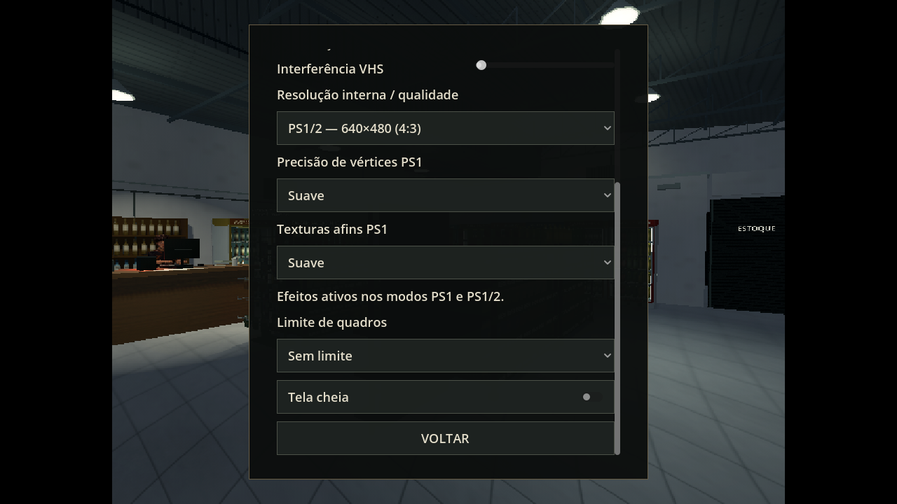

# 0.23.0 — precisão de vértices e texturas afins PS1

Abra Configurações e selecione **PS1 — 320×240 (4:3)** ou **PS1/2 — 640×480 (4:3)**. Os dois efeitos são independentes e persistem em `settings.cfg`:

| Intensidade | Precisão de vértices | Texturas afins |
|---|---|---|
| Desligada | Sem quantização | Interpolação com perspectiva |
| Suave — padrão | Passos de meio pixel interno | Mistura afim de 35% |
| Marcada | Passos de 1,5 pixel interno | Interpolação afim completa |

A quantização modifica a projeção dos vértices na tela, sem mover os objetos ou suas colisões. As texturas afins interpolam coordenadas pelos triângulos sem a correção completa de perspectiva; o efeito fica mais evidente no piso e nas superfícies vistas de lado. Desligar os dois efeitos ou sair dos modos PS1 restaura os materiais originais. Nítida, Retrô e Econômica mantêm sua renderização anterior.

Comparações no GitHub, com a mesma câmera e cenário pausado:

| Modo | Desligada | Suave | Marcada |
|---|---|---|---|
| PS1 | [Imagem](https://github.com/Deriby/TheLastSale/blob/main/docs/psx_v023/ps1_off.png) | [Imagem](https://github.com/Deriby/TheLastSale/blob/main/docs/psx_v023/ps1_soft.png) | [Imagem](https://github.com/Deriby/TheLastSale/blob/main/docs/psx_v023/ps1_strong.png) |
| PS1/2 | [Imagem](https://github.com/Deriby/TheLastSale/blob/main/docs/psx_v023/ps12_off.png) | [Imagem](https://github.com/Deriby/TheLastSale/blob/main/docs/psx_v023/ps12_soft.png) | [Imagem](https://github.com/Deriby/TheLastSale/blob/main/docs/psx_v023/ps12_strong.png) |

O ZIP inclui este guia e as duas imagens acima. A galeria completa fica no repositório para manter o ZIP abaixo do limite de 100 MiB por arquivo do GitHub.

## Implementação e preservação

`PSXMaterials` adapta os materiais das malhas na instância do cenário. Não grava alterações nas malhas, modelos, bibliotecas de animação ou materiais de origem. Os materiais originais ficam acessíveis aos sistemas de jogabilidade; a emissão do adaptador acompanha o valor original a cada quadro, inclusive com o mundo pausado. Atribuições de novos materiais por circuitos e interações são reconhecidas e preservadas. Novos objetos e mundos reconstruídos recebem os efeitos. O marcador de apoio de caixas acompanha as mudanças de cor verde/vermelha do material original.

Os shaders de folhagem e letreiro mantêm seu vento e sua arte. Névoa atmosférica, halos orientados à câmera e Label3D conservam seu caminho de renderização original. HUD, menus e pós-processamento 2D não recebem quantização de vértices nem interpolação afim. Nenhuma luz, viewport ou colisão foi acrescentada.

Todos os arquivos de `assets/` e `resources/` publicados na 0.22.0 foram mantidos byte a byte. O formato de checkpoint permanece na versão 5, com migração das versões anteriores.

## Validação reproduzível

- `./tools/test.sh`: sete suítes, incluindo `psx_integration` com 28 verificações de preferências, modos, HUD, materiais, rigs, colisões, energia e reconstrução do mundo.
- `./tools/godot.sh --audio-driver Dummy res://tests/psx_integration.tscn`: mesma suíte com renderização real e display disponível.
- `PSX_REVIEW_PATH=/caminho ./tools/godot.sh --audio-driver Dummy res://tests/psx_review.tscn`: seis comparações e captura das Configurações.
- `python3 tools/package_project.py`: ZIP para Godot 4.4.1, manifesto por arquivo e SHA-256.

Resultados em [validation.json](validation.json) e na [verificação da distribuição](../../downloads/project/release_verification.json). A validação usa Linux/Mesa/llvmpipe; desempenho na Radeon R7 não foi medido.
