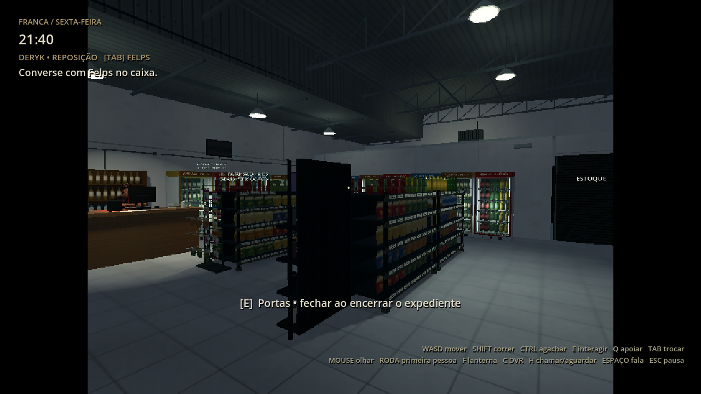

# 0.23.1 — piso estável ao girar a câmera

A 0.23.0 aplicava a interpolação afim também à posição usada pelas texturas triplanares. Em triângulos grandes do piso, o padrão se deslocava com a câmera. O shader ainda substituía a profundidade negativa dos vértices atrás da câmera por um valor positivo pequeno, deformando a interpolação durante o recorte. As capturas estáticas da revisão anterior não cobriam esse movimento.

A correção mantém a projeção triplanar presa ao cenário ou objeto, preserva a profundidade com seu sinal até o recorte e limita suavemente a deformação das texturas UV. Suave usa limite de 0,008 em coordenadas UV; Marcada usa 0,02. As intensidades de mistura e a precisão de vértices continuam independentes. Não é necessário apagar configurações nem checkpoints.



## Verificação com movimento real da câmera

O novo `tests/psx_motion_integration.tscn` renderiza um piso de 80×80 m, com dois triângulos que atravessam o plano da câmera. Move e gira a câmera por seis direções, em 320×240 e 640×480, nas intensidades Suave e Marcada. Há 24 casos com UVs e 24 com projeção triplanar no mundo. A textura de teste usa gradientes periódicos para evitar falsos alarmes nas bordas da repetição.

A câmera de teste desativa a interpolação de física para comparar poses fixas, inclusive com FPS liberado. Cada pose compara a imagem com o efeito afim desligado e ligado, mantendo a mesma geometria e quantização de vértices. A projeção do piso deve permanecer igual; o deslocamento das texturas UV deve ficar limitado.

| Verificação | Shader 0.23.0 | Correção 0.23.1 |
|---|---:|---:|
| Casos aprovados | 0/48 | 48/48 |
| Maior diferença de cor do piso triplanar | 0,40000 | 0,00000 |
| Maior diferença de cor UV — Suave | 0,19216 | 0,00784 |
| Maior diferença de cor UV — Marcada | 0,40000 | 0,02745 |

As diferenças são medidas em canais RGB normalizados de 0 a 1 no teste sintético. [Dados e medidas por pose](validation.json), [registro anterior](motion_before.log) e [registro corrigido](motion_after.log).

Com display disponível:

```sh
PSX_MOTION_PATH=/tmp/psx-motion ./tools/godot.sh --audio-driver Dummy res://tests/psx_motion_integration.tscn
```

O teste exige renderização real; não deve usar `--headless`. Para reproduzir a falha anterior, passe em `PSX_MOTION_BASELINE_SHADER` o shader 0.23.0 com `render_mode unshaded, cull_disabled`, obtido no commit `198ab39`.

Os 440 arquivos publicados de modelos, texturas, animações e recursos permanecem intactos. Código de física, energia e salvamento não foi modificado. A suíte geral continua em `./tools/test.sh`; a validação do ZIP extraído e seus hashes ficam na [verificação da distribuição](https://github.com/Deriby/TheLastSale/blob/main/downloads/project/release_verification.json).

O pacote é o projeto para Godot 4.4.1, sem EXE. Desempenho na Radeon R7 não foi medido.
