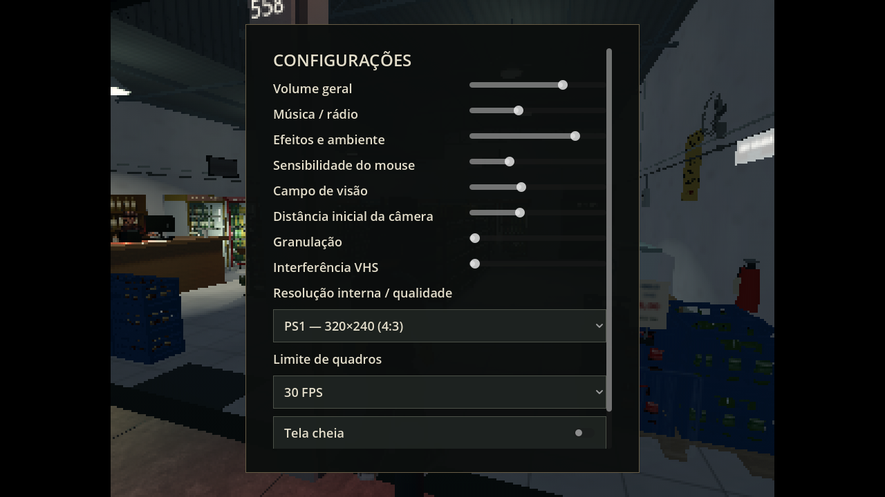

# PS1 — cenário em 320×240 e janela grande

[Baixar o projeto Godot 0.15.0](https://github.com/Deriby/TheLastSale/raw/refs/heads/main/downloads/project/TheLastSale_Godot_0.15.0.zip). Extraia em uma pasta nova e abra `project.godot` no Godot 4.4.1.

## Como ativar

1. Abra **Configurações** no menu ou na pausa.
2. Em **Resolução interna / qualidade**, escolha **PS1 — 320×240 (4:3)**.
3. Volte ao jogo. A preferência fica salva para a próxima abertura.

A janela padrão continua em **1280×720**. O cenário é desenhado em **320×240**, depois ampliado para **960×720**, com barras de **160 pixels** de cada lado. Os personagens preservam a proporção; o HUD e os menus mantêm a resolução normal. As barras seguem a imagem quando a janela é redimensionada.

O painel de Configurações agora tem altura limitada à janela e área de rolagem. Antes, seu tamanho calculado chegava a 1140 pixels de altura dentro de uma janela com 720 pixels. O botão Voltar e as opções podem ser alcançados pela rolagem ou pelo teclado.

## Resolução interna e tamanho da janela

Neste projeto, mantenha **Project Settings → Display → Window → Size** com a resolução base de **1280×720** e os valores de janela grandes. A baixa resolução do mundo é controlada pelo `SubViewport` criado em `scripts/systems/main.gd`. Alterar a resolução global para 320×240 também reduz a área disponível para a interface.

O modo PS1 fixa a imagem 3D em 320×240 e ajusta o `SubViewportContainer` ao maior múltiplo inteiro que cabe na área lógica da janela. O filtro de vizinho mais próximo preserva os pixels. O pós-processamento respeita os limites da imagem, deixando as barras pretas; a interface é desenhada depois, em uma camada separada. O fator físico final também depende da escala da janela/monitor aplicada pelo Godot.

Para preencher uma janela larga novamente, escolha **Nítida**, **Retrô** ou **Econômica**. A troca não reinicia o turno. O preset PS1 usa o acabamento de Retrô, com a iluminação da 0.14.0; a opção Econômica continua sendo a escolha que desliga os efeitos adicionais. O limite padrão segue em 30 FPS. Este modo reproduz a baixa resolução e a proporção pedidas; não emula o hardware inteiro de um PlayStation.

## Verificação

**140/140 verificações passaram** no projeto e no ZIP extraído após importação limpa. Foram testadas janelas de 1280×720, 1280×960 e 1600×900, manutenção de 320×240 internos, proporção 4:3, menu dentro da janela, persistência e retorno a Nítida. O fluxo existente completo continua passando.

Capturas feitas em Linux/Mesa llvmpipe. FPS nativo na Radeon R7 não foi medido. Registros: [validation.json](validation.json), [integration.log](integration.log) e [render.log](render.log). Para reproduzir as capturas, execute `res://tests/resolution_review.tscn` em Linux com display; as imagens são salvas em `/tmp`.

As galerias históricas permanecem no GitHub. Todos os modelos e recursos usados no jogo estão incluídos no ZIP. O problema de largar caixas permanece registrado em [PENDENCIAS.md](../PENDENCIAS.md), para a etapa de jogabilidade.
