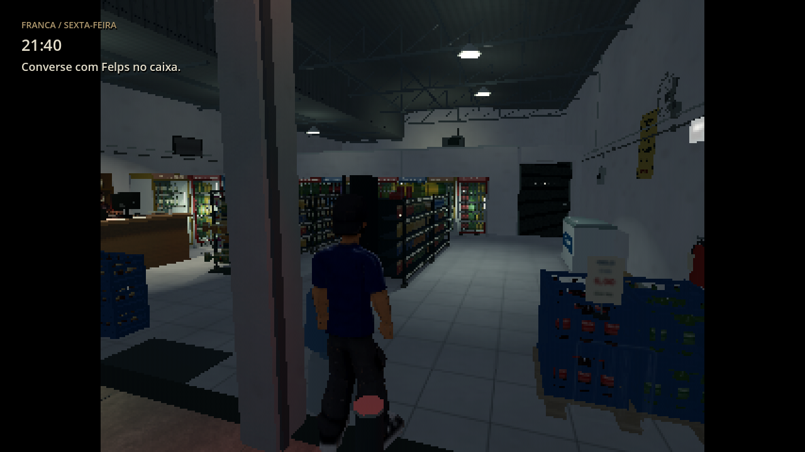

# PS1/2 — opção de 640×480

[Baixar o projeto Godot 0.15.1](https://github.com/Deriby/TheLastSale/raw/refs/heads/main/downloads/project/TheLastSale_Godot_0.15.1.zip). Extraia numa pasta nova e importe `project.godot` no Godot 4.4.1.

Abra **Configurações → Resolução interna / qualidade** e escolha:

| Modo | Resolução do cenário | Imagem na janela padrão de 1280×720 |
|---|---|---|
| PS1 | 320×240 | 960×720, com barras laterais |
| PS1/2 | 640×480 | 960×720, com barras laterais |

Os menus e o HUD continuam em resolução normal. A opção PS1/2 mostra mais definição sem diminuir o cenário na janela. A preferência fica salva e aparece selecionada ao reabrir as Configurações. A troca entre os modos não reinicia o turno. Nítida, Retrô e Econômica continuam disponíveis.

## Comparação

## Configuração e implementação

Mantenha **Configurações do Projeto → Exibição → Janela** com viewport e janela de 1280×720, modo de esticar `canvas_items`. A resolução interna do cenário é definida por `update_render_size()` em `scripts/systems/main.gd`, usando um SubViewportContainer. A interface usa uma camada separada.

O modo PS1 preserva a ampliação inteira da 0.15.0. PS1/2 mantém o SubViewport em 640×480 e escala o contêiner para ocupar a maior área 4:3 da janela, com filtro de vizinho mais próximo. Na janela padrão, a ampliação é de 1,5×. O fator físico final também depende da escala de janela/monitor aplicada pelo Godot. O nome PS1/2 identifica este acabamento visual; não é emulação dos consoles.

A iluminação e os materiais existentes foram preservados. O limite padrão continua em 30 FPS. A falha para largar a caixa permanece registrada para a etapa de jogabilidade em `docs/PENDENCIAS.md`.

## Verificação

146/146 verificações passaram no projeto e no ZIP extraído após importação limpa. A suíte cobre as duas resoluções internas, área ocupada na janela, interface, persistência, identificação da opção ao reabrir o painel, redimensionamento e retorno de PS1/2 para PS1 e Nítida. O fluxo completo de tarefas, câmera e clientes continua passando.

Capturas em Linux/Mesa llvmpipe; FPS nativo na Radeon R7 não foi medido. Dados de tamanho em [layout.json](layout.json), resultados em [validation.json](validation.json), [integration.log](integration.log) e [render.log](render.log). Para reproduzir as capturas em Linux com display, execute `res://tests/resolution_review.tscn`; os arquivos são salvos em `/tmp/ps12_0151_*`.
