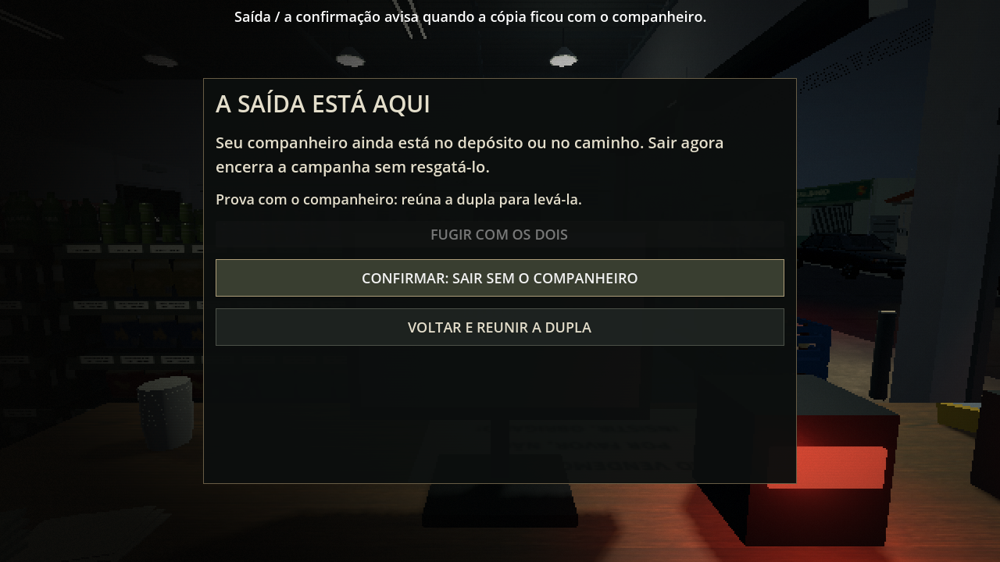
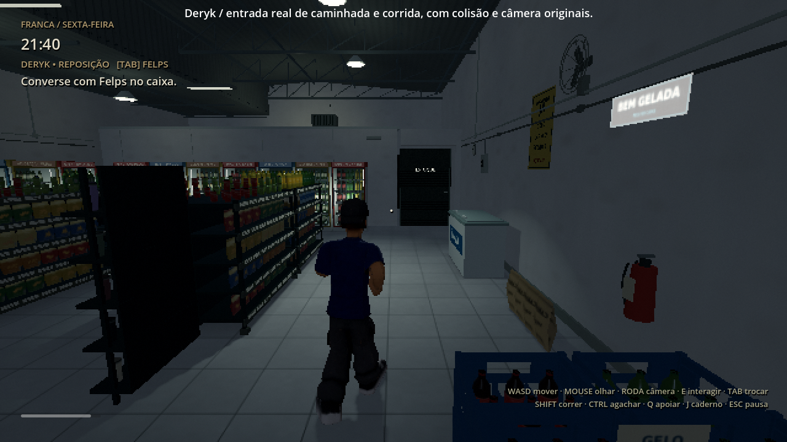
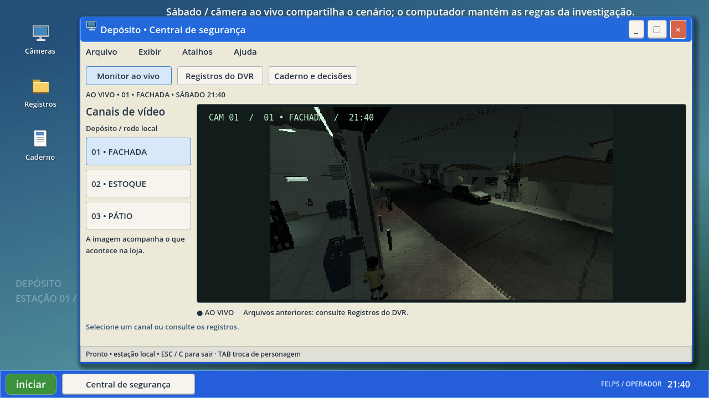

# 0.36.0 — revisão da campanha

[Prévia real](revisao_preview.mp4) · [Projeto Godot 4.4.1, sem EXE](../../downloads/project/TheLastSale_Godot_0.36.0.zip).

A revisão técnica cobre sexta, sábado, domingo, retomadas e os três finais. Foram encontrados e corrigidos três problemas:

- Esc ao sair das configurações aplicava volume, sensibilidade e FOV, mas não gravava as alterações. O fechamento agora salva os mesmos valores que o botão Voltar.
- A tela de fuga considerava os dois irmãos ao informar que a prova estava preservada, mesmo quando só o personagem sem a cópia estava na saída. Agora ela informa que a cópia está com o companheiro e mantém a confirmação explícita de abandono.
- Ao esgotar o fôlego com Shift segurado, gasto e regeneração alternavam a cada quadro. A corrida só volta depois de recuperar uma reserva. As velocidades de caminhada/corrida e as taxas de gasto e recuperação permanecem.

[Reprodução anterior das configurações e da prova](regressoes_antes.log) · [Reprodução anterior da exaustão](folego_antes.log).

`release_review_integration` cobre os problemas encontrados, saída por teclado, recuperação de fôlego com Shift mantido e retomado, e disposição dos menus em 800×600 e após redimensionar. A câmera pela rodinha, os modelos, as bibliotecas de movimento e a geometria não foram substituídos.

`campaign_route_integration` começa em uma campanha nova e segue até o epílogo com os dois sobreviventes e prova enviada. Faz reposição, cascos, atendimentos com dinheiro/troco, pane, chave, gerador, fechamento, duas vendas do sábado, quatro pistas, decisões, módulo, reprodução/análise, abertura cooperativa e fuga com o assassino ativo. Cinco retomadas verificam continuidade. O teste não atribui progresso, dinheiro ou posições para pular etapas: usa movimento físico, interações próximas e botões por entrada de teclado. O relógio é acelerado a 4× com 60 passos de física por segundo de jogo; conversas são adiantadas. É uma execução automatizada da rota, não uma sessão humana em tempo normal. Os outros dois finais e a derrota/retry são conferidos pela suíte de domingo.

A prévia visual é uma verificação separada, em 1280×720 a 30 fps, modo Retrô. Mostra onze vistas reais: menu, corrida dos dois irmãos, cliente, Zirico, Bryan, configurações, pane, câmeras, arquivo de domingo e confirmação de fuga. Posições e condições são preparadas para inspecionar cada função; os cortes não representam uma campanha contínua. As legendas pertencem apenas à captura. O vídeo não é uma medição de desempenho.

A validação do ZIP extraído executa vinte suítes, com 982 verificações, e mais 48 comparações renderizadas de texturas PS1/PS1/2 ao girar a câmera. Os 463 arquivos de assets, 32 recursos e onze bibliotecas de animação da 0.35.0 são comparados byte a byte. Física de colisão, gravidade, velocidades, acelerações, câmera, manejo das caixas, IA, eventos, circuitos e formato de save v5 permanecem; o controle de recuperação de fôlego foi corrigido.

[Relatório da distribuição](../../downloads/project/release_verification.json) · [Integração no ZIP extraído](integration.log) · [Texturas renderizadas](psx_motion_validation.json) · [Estrutura e carregamento](performance.json) · [Medições das passadas](gait_metrics.json).

O ambiente de revisão usa OpenGL por software (llvmpipe), sem a GPU do jogador. A auditoria de estrutura e carregamento não representa FPS, RAM total ou VRAM. Desempenho e sensação dos controles no PC de destino ainda exigem teste local. A importação headless mantém os 14 diagnósticos conhecidos de miniatura GLB; avisos de interpolação e eventuais diagnósticos de áudio no encerramento ficam nos logs. Esta revisão não declara o protótipo livre de todo defeito ou encerra o acabamento artístico dos NPCs provisórios.
