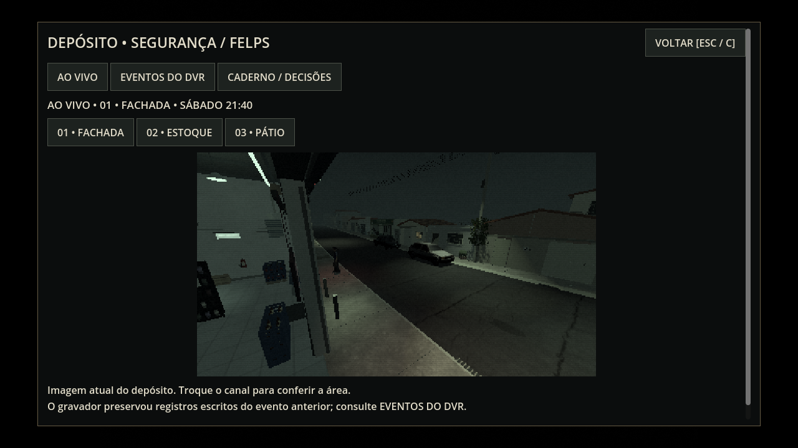
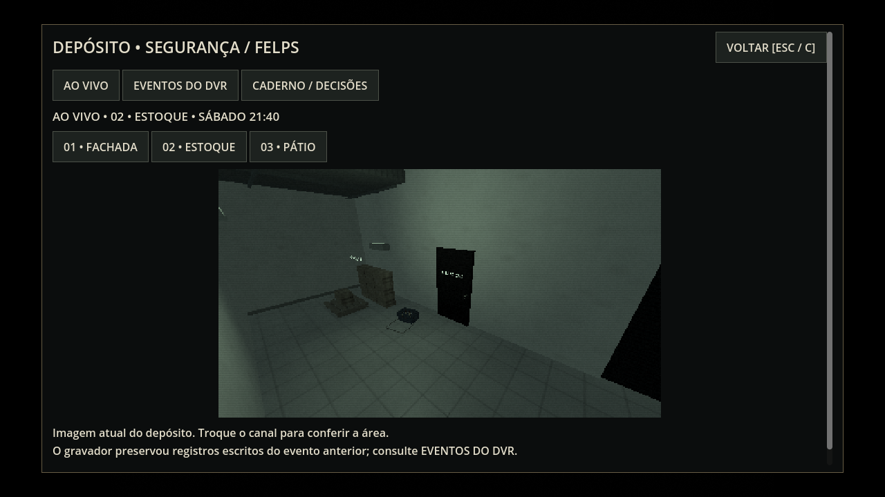
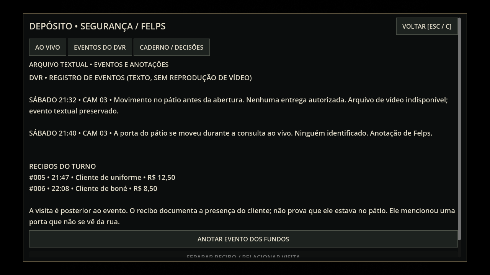
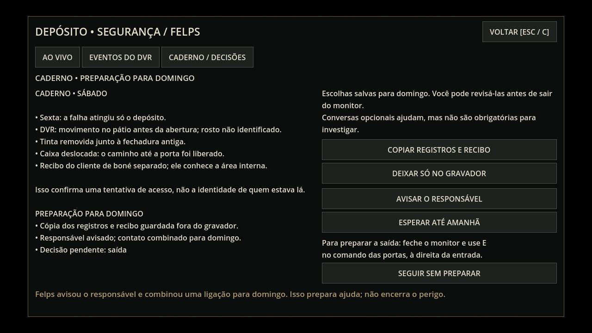
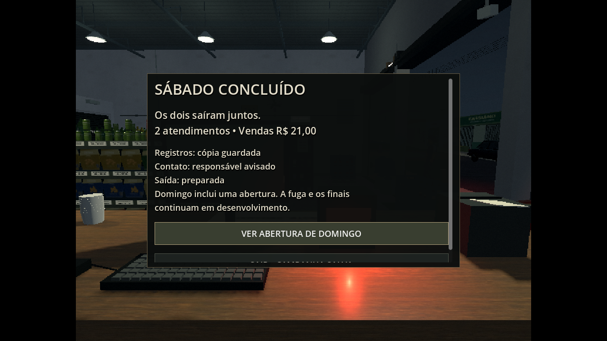

# Sábado — câmeras e investigação (0.19.0)

Esta é a primeira versão jogável da segunda noite, com começo, investigação e fechamento. Domingo contém apenas a abertura. A revelação do assassino, a perseguição, esconderijos e os finais ainda serão implementados.

## Como jogar

1. Termine a sexta e escolha **Começar sábado** no resumo. Saves 0.18.1 da antiga prévia passam à conversa de abertura. Para começar do zero, escolha **Iniciar expediente**.
2. Converse com Felps no caixa. Atenda os dois pedidos com ele. O cliente de boné volta como a mesma identidade da sexta; sua aparência continua provisória e substituível. Deryk libera o espaço do cliente ao ficar inativo junto ao balcão.
3. No posto de Felps, **C** abre o monitor. **E** também abre se não houver um cliente aguardando atendimento. Termine/feche o painel da venda antes de consultar as câmeras. **Esc/C** volta ao jogo; **Tab** fecha o monitor e troca para Deryk.
4. **Ao vivo** permite trocar entre fachada, estoque e pátio. O cenário é o mesmo mundo simulado: personagens, portas, objetos e iluminação. Durante a investigação, a primeira consulta ao pátio mostra um pequeno movimento físico da porta e registra a observação. Voltar ao canal ou continuar o save não repete o evento.
5. **Eventos do DVR** mostra registros escritos de detecção, sem fingir reprodução de vídeo arquivado. Anote o evento e separe o recibo do cliente de boné. O recibo tem identidade, noite e horário; sua visita posterior não prova que ele estava no pátio antes da abertura.
6. Com Deryk de mãos livres, abra o estoque e examine a porta antiga e a caixa deslocada. As marcas na tinta e no pó são objetos do cenário. Bryan e Zirico têm relatos opcionais e saem antes da tentativa na porta; perder uma conversa não bloqueia as pistas obrigatórias.
7. No **Caderno / decisões**, escolha copiar registros e recibo ou deixá-los no gravador; avisar o responsável ou esperar. As escolhas podem ser revistas enquanto o monitor está aberto. Para preparar a saída, feche o monitor e use E no comando das portas, à direita da entrada. A alternativa é seguir sem preparar, pelo caderno.
8. Depois das três escolhas, alguém força a porta do pátio. Felps confere o caixa; Deryk verifica a porta antiga/trava. Apague o salão no quadro junto ao estoque, chame o companheiro no comando das portas e aguarde os dois na calçada antes de baixar as portas.
9. O resumo salva sábado e oferece a abertura de domingo. Ela reconhece a cópia e o contato escolhido, sem iniciar uma perseguição inacabada.

## Estado entre noites

O save continua no formato 4, com campos aditivos. Mantém as duas posições, clientes/vendas em andamento, quatro pistas obrigatórias, testemunhas opcionais, registros, escolhas e relatórios por noite. A opção de copiar armazena uma cópia dos dados dos registros e recibos, preservada ao reiniciar as vendas de domingo. Reverter para deixar só no gravador remove essa cópia. O relatório de sábado conserva também os registros originais.

Saves 1–3 continuam migrando para a sexta. A recuperação da pane após o aviso, inclusive o intervalo entre diálogo e saída do cliente, permanece coberta pelos testes anteriores. Saves da antiga prévia de sábado voltam à abertura jogável.

## Renderização e limites

Há uma única câmera de segurança/viewport em 384×216, criada ao abrir o monitor e atualizada a até 10 imagens por segundo. O viewport encoberto do jogador para de renderizar. Nas abas de texto, o canal para; ao fechar, ele é destruído e o viewport principal retoma. A carcaça física das câmeras usa uma camada excluída da lente. O acabamento de CCTV adiciona baixa saturação, linhas discretas e ruído ao vídeo; a interface mantém sua resolução normal nos modos PS1/PS1/2.

Nenhuma nova luz com sombras, modelo de personagem ou textura de cenário foi adicionada. O pátio usa sua luz de bateria existente, com alcance ajustado no sábado para ler a porta. O limite padrão de jogo permanece em 30 FPS. **A estabilidade na Radeon R7/Windows 7 não foi medida.**

## Validação e capturas

`tests/saturday_integration.tscn` usa entrada de teclado, botões reais, pedidos completos e percursos físicos com colisão. Cobre o ciclo do monitor, canais, pausa/troca, dados do recibo, pistas, fontes opcionais, decisões alternativas, saves, fechamento e domingo. `tools/test.sh` executa também as suítes anteriores de integração e sexta.

As imagens abaixo vêm de uma revisão gráfica em Compatibility/OpenGL, Linux/Mesa llvmpipe, janela 1280×720. Posições e estados foram preparados para fotografia em `tests/saturday_review.tscn`; os percursos reais são verificados separadamente. Logs e contagens estão em `validation.json` e `integration.log`.

