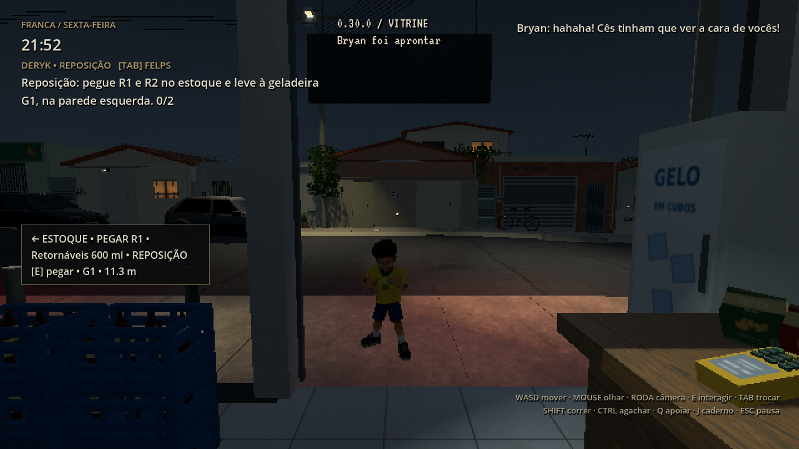
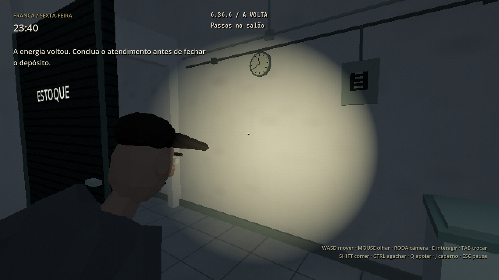
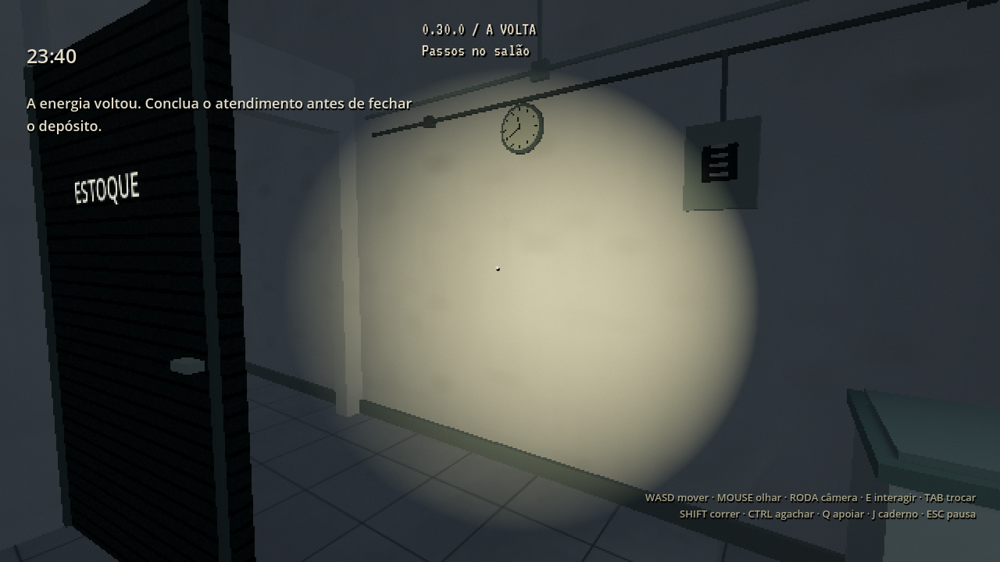

# 0.30.0 — sustos na primeira noite

[Prévia com som](https://github.com/Deriby/TheLastSale/raw/refs/heads/main/docs/scares_v030/scares_preview.mp4) · [Projeto Godot 4.4.1](https://github.com/Deriby/TheLastSale/raw/refs/heads/main/downloads/project/TheLastSale_Godot_0.30.0.zip)

A primeira noite recebeu dois momentos fortes e um falso alívio, integrados às tarefas existentes. A câmera continua livre em primeira ou terceira pessoa pela rodinha. Os eventos não criam objetivos obrigatórios nem alteram os finais.

No estoque, Deryk pode ouvir um arrasto atrás da porta antiga. Ao se aproximar, o arrasto para, há uma pausa e a maçaneta gira. A porta e sua colisão permanecem no lugar. O som sai da posição da porta, acompanha o volume de efeitos e interrompe quando Deryk sai da área. Continuar retoma a fase, sem tocar novamente o início já ouvido.

Depois de um intervalo de calma, Bryan caminha até a vitrine. A batida só ocorre quando ele realmente chegou e está no campo de visão. A brincadeira não trava o controle. Conversar com ele traz uma reação dos irmãos e Bryan vai para casa. O deslocamento e a batida são conservados no save.

Ligar o gerador prepara a travessia, que só começa quando Deryk volta ao salão, está com o controle disponível e olha para um corredor adequado. A figura entra de fora da visão desobstruída, cruza com colisão e animação de locomoção, abre as portas necessárias e segue ao pátio. A navegação considera móveis, protagonistas e folhas abertas das portas. Ela não recebe dano nem inicia a perseguição de domingo.

A porta do pátio só bate quando a figura já saiu de sua área de giro e os protagonistas estão afastados. A figura continua física no pátio; ao ser aproximada, procura sair por uma rota real. Sua remoção só ocorre longe do jogador e fora da visão, depois da saída. Salvar no meio mantém posição, fase e percurso.

A luz comercial baixa brevemente e se recupera, sem interromper refrigeração nem mudar os circuitos da campanha. Os sons de arrasto, maçaneta, vidro e porta foram sintetizados para o projeto. Fonte e créditos em `assets/audio/scares/README.txt` e `tools/make_scare_audio.py`.

Felps reage quando Deryk realmente percebe a figura. O fechamento dá continuidade à ameaça e o sábado retoma a lembrança. Caderno J e pausa congelam os acontecimentos. Atendimento, manipulação de caixas e diálogos bloqueiam o início de sustos incompatíveis; não há alteração do enquadramento, distância ou sensibilidade da câmera.

A prévia é uma apresentação condensada do jogo real em Godot 4.4.1 / Linux / Mesa llvmpipe, a 30 FPS: locais, horário e progresso são adiantados entre trechos para apresentar os eventos. Não é uma partida contínua ou uma medição de FPS em Radeon R7.

[Validação desta revisão](validation.json) · [Resultados do ZIP extraído](../../downloads/project/release_verification.json)

Extraia o ZIP em pasta nova, importe `project.godot` no Godot **4.4.1** e pressione F5. Os 451 arquivos de assets anteriores e as onze bibliotecas de animação permanecem idênticos à 0.29.0. Save versão 5, com versões 1–5 aceitas e campos novos opcionais. Sem EXE.
