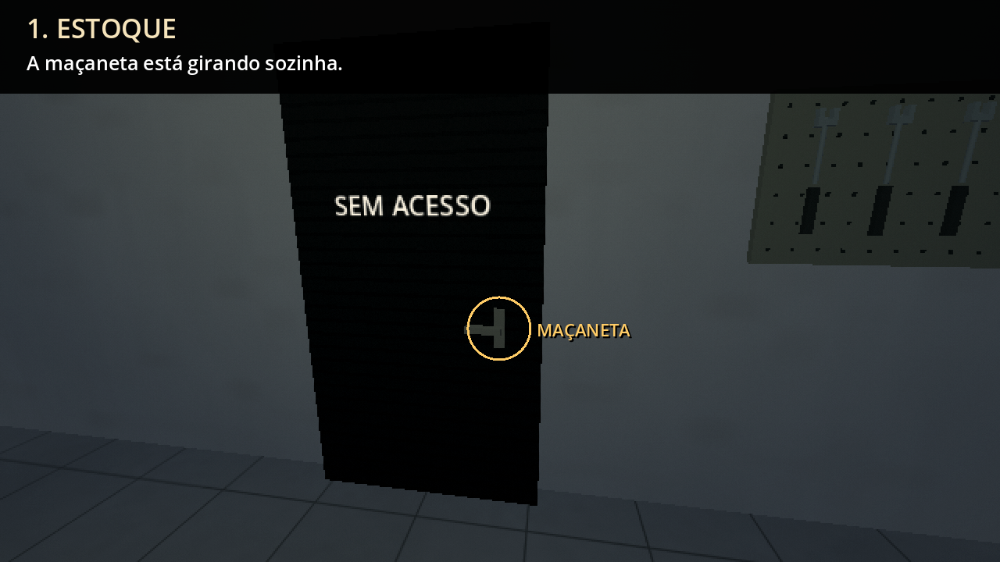
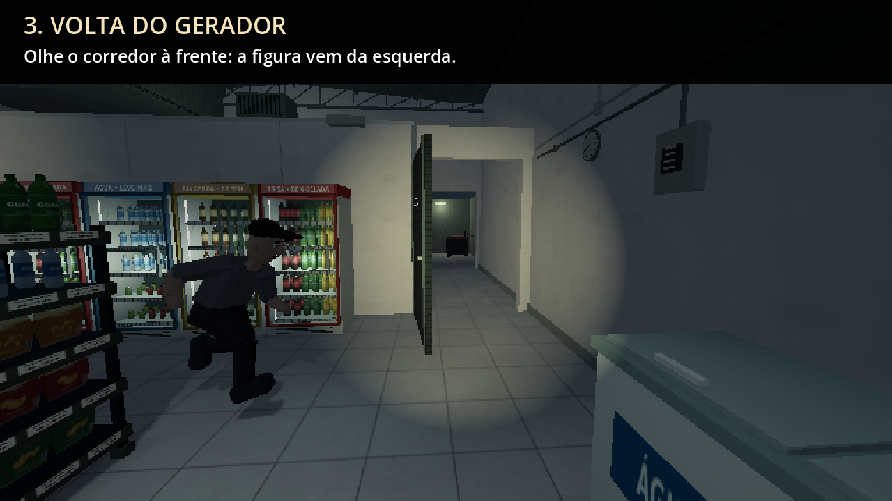

# Os três momentos da versão 0.30, explicados

[Assistir à prévia completa com explicações](previa_explicada.mp4)

Assista com som. Cada trecho começa com uma explicação e mostra uma situação separada:

1. **[Estoque — arrasto e maçaneta](01_estoque.mp4):** o arrasto para; depois, a maçaneta se mexe. O círculo mostra exatamente onde olhar.
2. **[Bryan — o falso susto](02_bryan.mp4):** a batida na frente da loja é uma brincadeira dele. É o momento de alívio entre as ameaças.
3. **[Figura — a volta do gerador](03_figura.mp4):** o homem aparece pela esquerda, cruza o corredor e entra no estoque. A batida seguinte vem da porta do pátio, nos fundos. Felps reage ao relato de Deryk.

Esta é outra gravação da versão **0.30.0**. Os títulos, a marcação da maçaneta e as legendas maiores foram acrescentados só à apresentação. O HUD foi ocultado e foi usado um campo de visão de 80 graus para mostrar o corredor inteiro. Locais, horário e progresso são preparados entre os trechos e anunciados pelos cartões; não é uma partida contínua.

O ZIP publicado e seus 972 arquivos permanecem idênticos. A primeira/terceira pessoa pela rodinha continua como na 0.30. Não é necessário baixar o projeto novamente para ver esta prévia.

[Verificação dos arquivos e da captura](verification.json) · [Fonte da captura](capture.gd) · [Projeto Godot 4.4.1](https://github.com/Deriby/TheLastSale/raw/refs/heads/main/downloads/project/TheLastSale_Godot_0.30.0.zip)
