# Balcão, detalhes e atmosfera — 0.5.0

**[Baixar o ZIP Windows 0.5.0](../../downloads/windows/A_Ultima_Venda_Windows_x64.zip)** · **[Vídeo de 30 segundos com som ambiente](scene.mp4)**

Esta revisão usa as sete capturas de Street View, as sete fotos internas do [arquivo original](../reference_photos.zip) e as **quatro novas fotografias enviadas na conversa**. O link do Google Maps foi tentado e recebeu HTTP 403 de conexão neste ambiente; as imagens enviadas continuam sendo a fonte visual. [Observações e aproximações](../REFERENCIAS.md).

## Balcão no lado correto

O balcão fica à esquerda de quem entra, com o eixo comprido da entrada para os fundos. O funcionário trabalha entre a bancada e a parede de bebidas. A navegação e o ponto de pagamento dos clientes foram mudados junto com o móvel.

Antes, à direita:

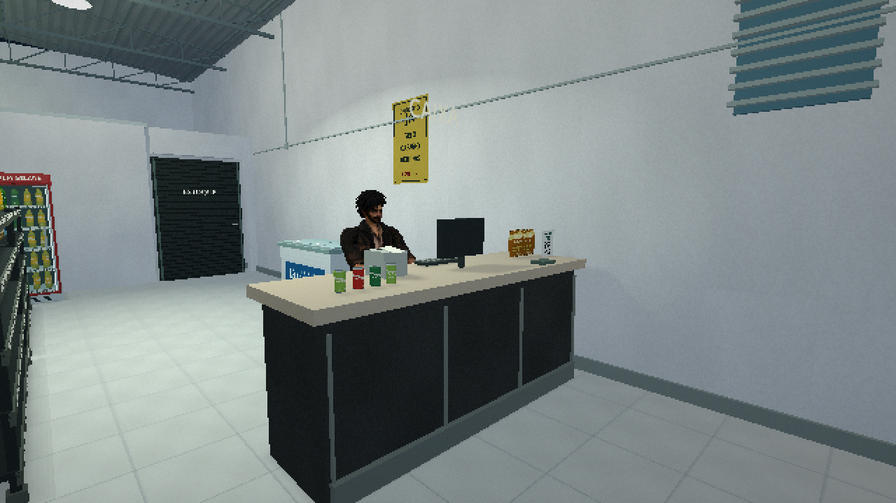

Agora, pela visão do cliente:

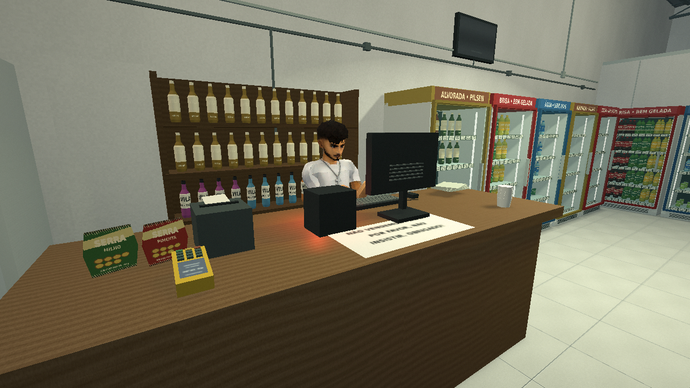

Pela visão do funcionário:

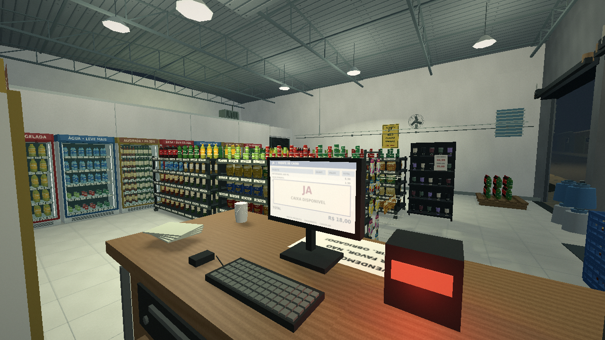

O tampo de madeira tem monitor voltado ao funcionário, teclado com teclas e barra de espaço, mouse com fio, leitor com luz vermelha sobre a bancada, impressora e maquininha amarela. O aviso, copos empilhados, pequenos produtos e gaveta seguem os elementos das fotos.

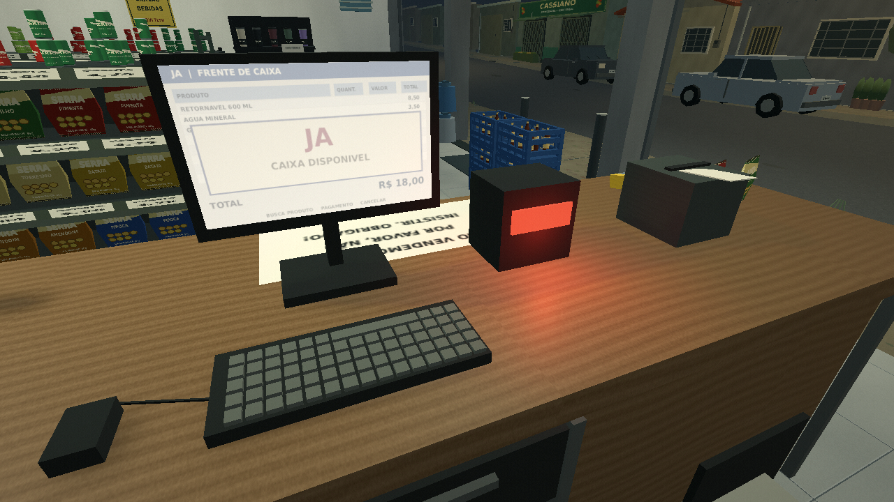

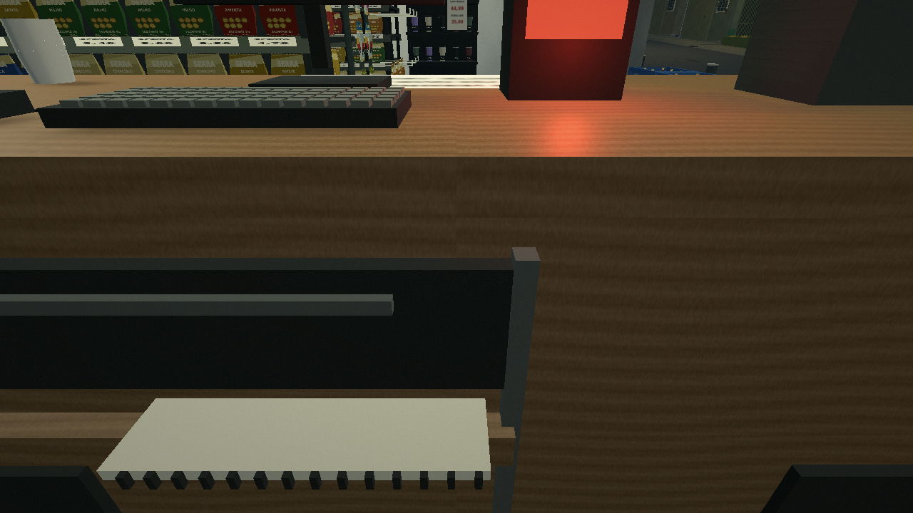

A interface do monitor é arte original inspirada no arranjo observado. Os equipamentos são cenografia. Não há sistema de cobrança, leitores reais ou novos dados pessoais dos funcionários.

## De dentro para fora

O vão do anexo foi aberto durante o expediente para não bloquear a visão do caixa. As ferragens das portas, os cilindros junto ao pilar e os carros ajudam a relacionar interior e rua. A nova foto permitiu ler **CASSIANO** na placa do comércio verde em frente.

Iluminação diurna usada apenas para comparar com a foto fornecida:

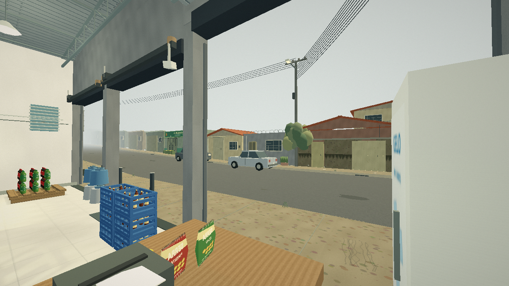

## Interior mais detalhado

Foram acrescentados freezer vertical de gelo, exposição de copos térmicos com etiquetas, garrafas coloridas atrás de Felps, ganchos de salgadinhos com posições vazias, tomadas, conduítes, ferragens e pequenos desgastes. A TV antiga foi substituída por um único aparelho detalhado. O ventilador gira, e Felps inicia no movimento de trabalho já existente, alternando com os repousos.

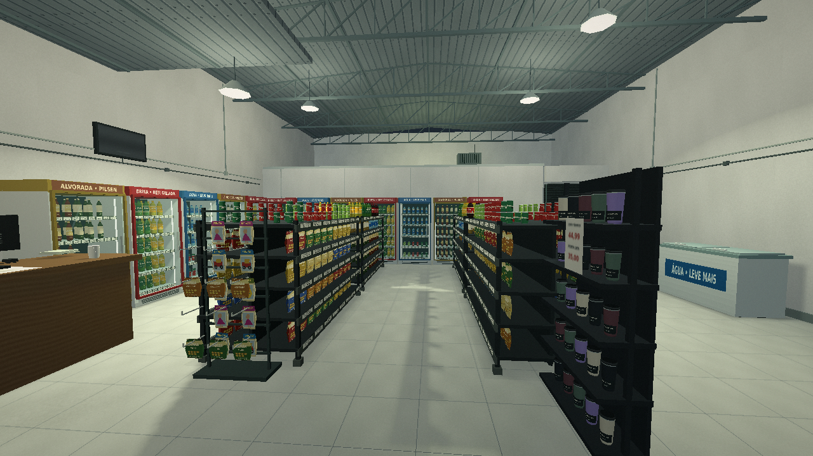

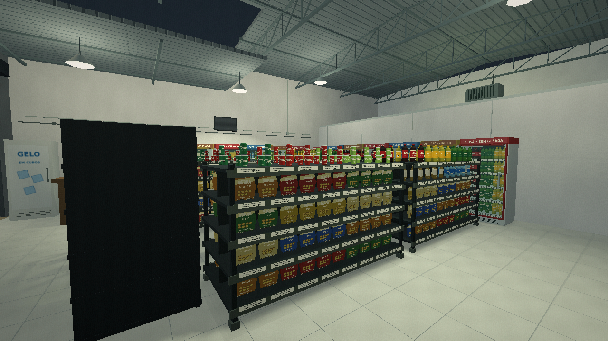

## Horizonte e atmosfera

A rua continua por trás da neblina, que se fecha antes da borda geométrica. A comparação abaixo usa a **mesma câmera junto ao limite explorável**, primeiro sem neblina apenas para QA, depois com o efeito normal do jogo.

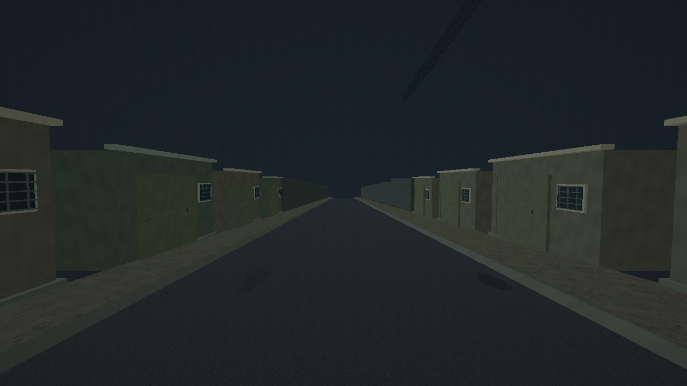

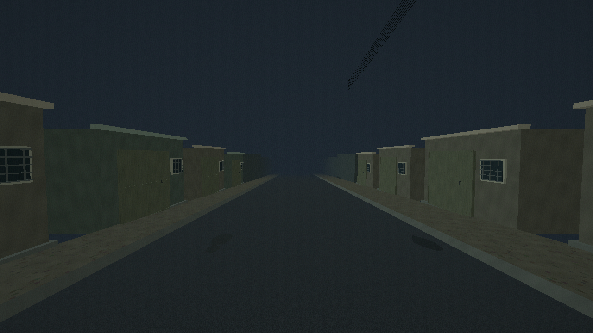

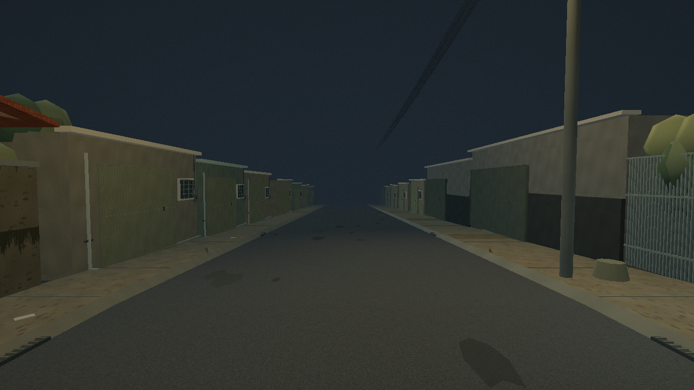

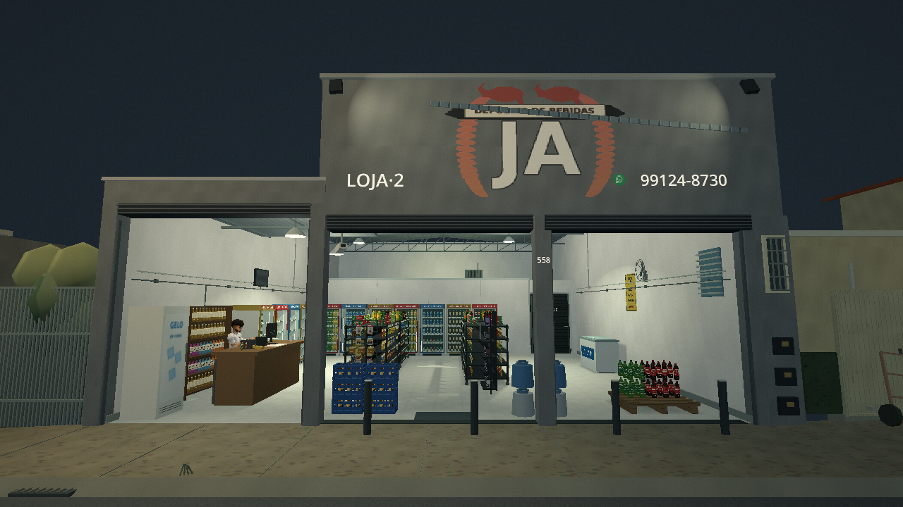

A direção pedida de terror cotidiano aparece no contraste entre o comércio aceso e a rua escura, na cor contida, na granulação leve e nos ruídos distantes. O rádio agora fica perto do caixa esquerdo. Há sons originais discretos de tráfego e acomodação dos equipamentos; o ambiente externo fica mais baixo dentro da loja. O vídeo é um **passeio de câmera no cenário em execução**, com áudio sintetizado do próprio jogo, sem gravação de controle do jogador.

## Qualidade e limites

O padrão novo usa **Nítida — resolução da janela**. Preferências antigas são preservadas; quem tiver selecionado Retrô pode trocar em Configurações. Retrô e Econômica continuam disponíveis para reduzir o custo gráfico. Isso não equivale a uma medição de FPS da Radeon R7.

Todas as capturas e o vídeo desta página vêm do **pacote Linux exportado**, usando Compatibility/OpenGL em Mesa llvmpipe. Os testes do projeto e do pacote, a comparação das malhas e os limites de execução estão em [VALIDACAO.md](../VALIDACAO.md). Não houve validação em Windows real.

Integração: **81/81 no projeto e 81/81 no pacote**. Comparação com 3.956 malhas individuais: [Nítida](render_hd.txt) e [Retrô](render_retro.txt), incluindo pausa e recarga. [Registro das capturas](capture_test.txt) · [Registro do vídeo](movie_test.txt) · [Acesso ao Maps](maps_access.txt).

Medidas, profundidades, posição exata dos objetos, iluminação noturna e partes não fotografadas continuam aproximadas. A neblina esconde a borda visual; o trecho jogável continua sendo uma parte do quarteirão. Os modelos enviados foram preservados. A revisão busca a direção visual solicitada e ainda permite mais acabamento artístico.
