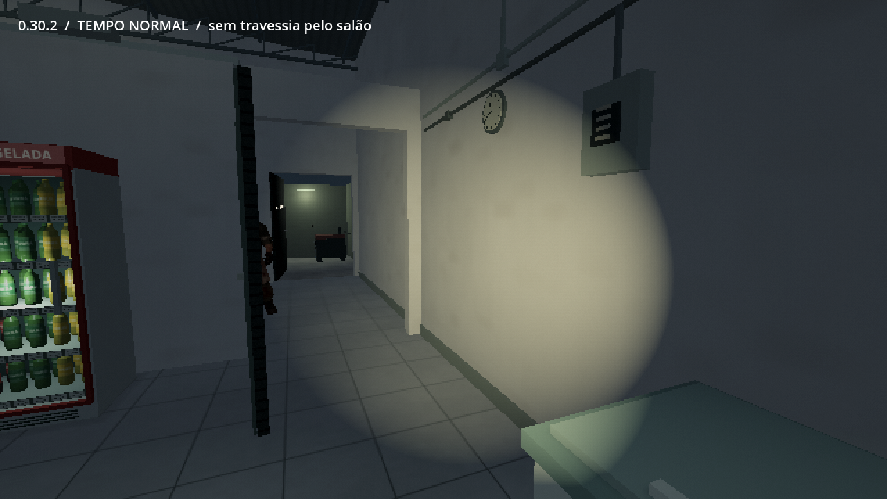

# 0.30.2 — uma presença breve nos fundos

[Assistir à gravação em velocidade normal](https://github.com/Deriby/TheLastSale/raw/refs/heads/main/docs/subtle_v0302/aparicao_sutil.mp4) · [Projeto Godot 4.4.1](https://github.com/Deriby/TheLastSale/raw/refs/heads/main/downloads/project/TheLastSale_Godot_0.30.2.zip)

A figura da volta do gerador **não atravessa mais o salão**. O assassino original faz uma aparição curta e parcialmente encoberta pelo batente do estoque, durante uma olhada de canto, e recua fisicamente atrás da parede. A posição inicial fica oculta; o modelo só é retirado depois de perder a linha de visão. Ele não volta ao salão para sair.

Felps, clientes e conhecidos que estejam perto ou voltados para o ponto impedem a aparição. Não há piscada de luz, porta batendo, música de susto, controle de câmera ou diálogo automático anunciando o evento. Só uma percepção real pode virar uma nota de dúvida; as conversas opcionais e a lembrança do sábado não confirmam um invasor.

A gravação usa o jogo real em velocidade normal, FOV 70 e sem HUD. Progresso, posição e giro da câmera são preparados pela ferramenta de captura; não é uma partida contínua. O cartão e a legenda pertencem só à apresentação. [Fonte da captura](../../tests/scares_review.gd).

Saves novos retomam posição, movimento e percepção do vulto. Saves da antiga travessia não a recriam; tarefas e observações existentes são preservadas. Modelos, texturas, pesos, onze bibliotecas de animação, física dos protagonistas, terceira pessoa pela rodinha, circuitos e perseguição de domingo permanecem os existentes. Sem EXE.

[Escopo da validação](validation.json) · [Resultados e avisos do ZIP](../../downloads/project/release_verification.json)
