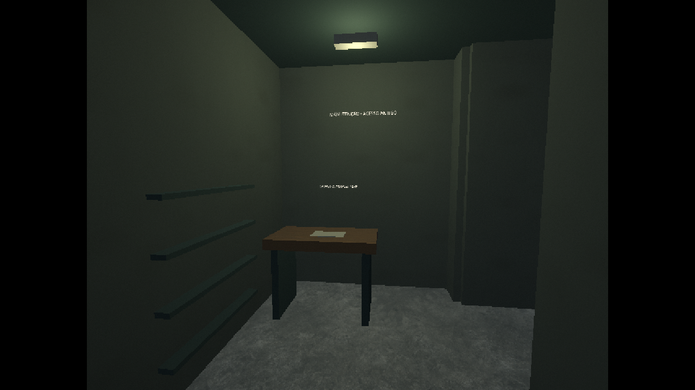
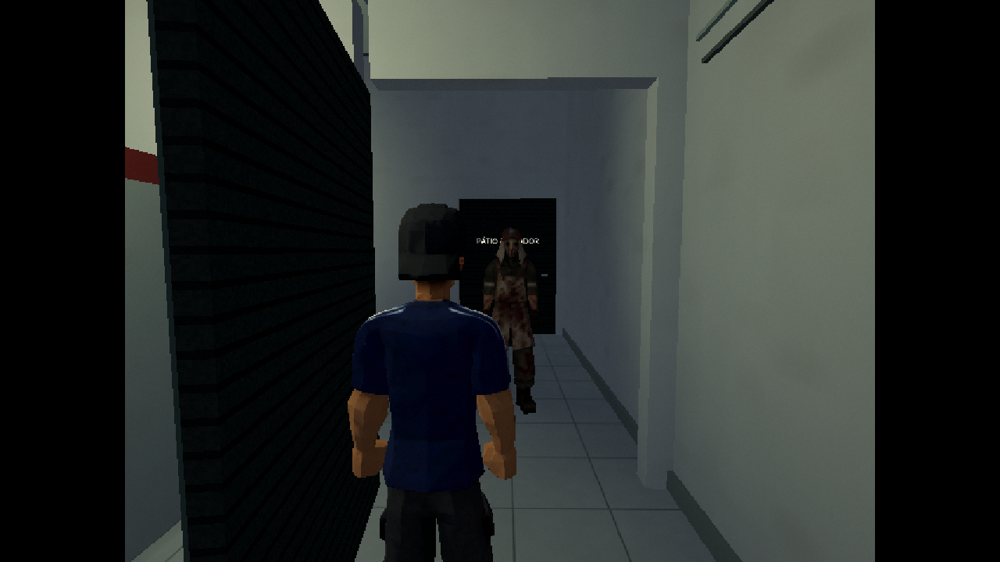
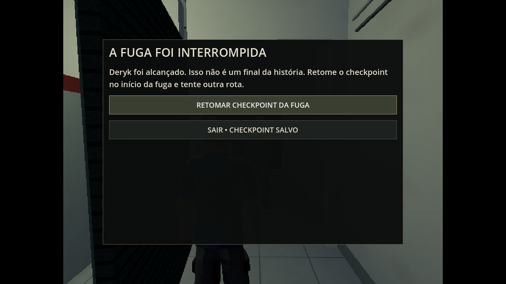
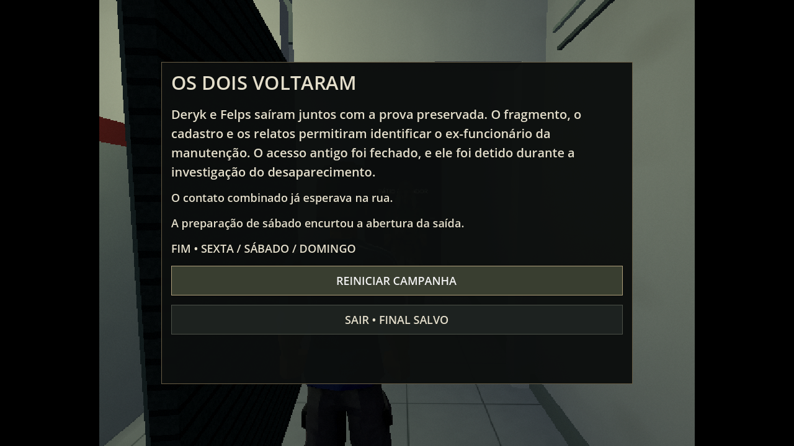
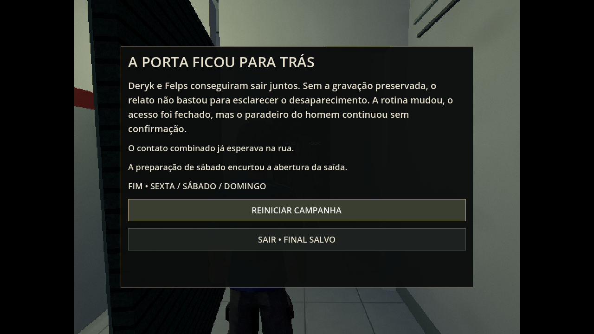
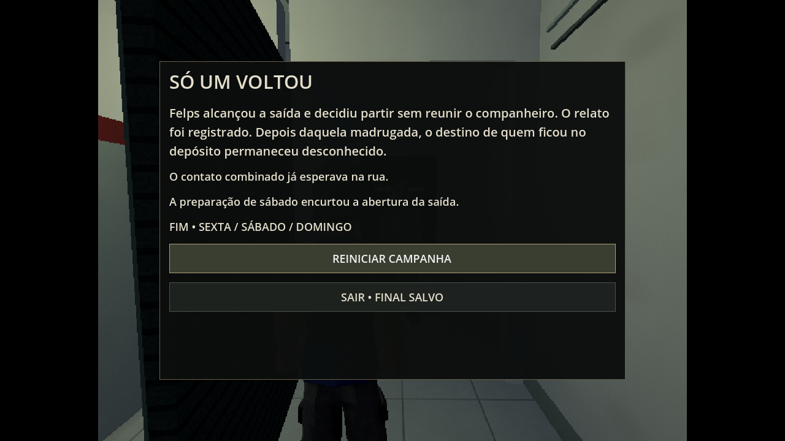

# 0.20.0 — domingo e os três desfechos

A primeira versão jogável da campanha agora vai da sexta ao epílogo de domingo.
A rotina da sexta e a investigação do sábado continuam no mesmo projeto.
O acabamento, o ritmo e a dificuldade ainda precisam de playtests.

## Recuperar e entender

1. Converse com Felps no balcão para começar o domingo fechado ao público.
2. Com Deryk, abra o estoque e a porta antiga. Entre na sala de manutenção,
   recolha o módulo e o cadastro sobre a bancada e leve-os ao balcão.
3. Com Felps no seu posto, C abre o DVR. Recupere o fragmento de quarta-feira,
   assista e analise. O vídeo arquivado é separado das câmeras ao vivo de sábado.
4. O cadastro e as imagens ligam o cliente recorrente ao acesso antigo e ao
   desaparecimento. A pane da sexta foi um teste da reação dos funcionários.
5. No terminal, copie o fragmento para levar com Felps e/ou avise o contato e
   envie a prova. Ainda é possível fazer isso sem preparar ajuda no sábado.

O fragmento é um arquivo Theora real de oito segundos, 384×216 a 10 FPS,
produzido com o cenário e modelos do próprio projeto. Mostra dois adultos na
área de serviço; Bryan não aparece na gravação nem no cenário de perseguição.
A reconstrução técnica usa modelos provisórios, substituíveis depois.

## Cooperar para sair

Felps fica no terminal e Deryk confere o quadro junto à entrada interna do estoque.
A energia cai, as portas da fachada descem e o assassino entra pelo acesso antigo.

- Deryk abre a porta do pátio e seleciona ESTOQUE no gerador. E alterna
  ESTOQUE → SALÃO → DESLIGADO; a partida produz ruído perceptível.
- Felps usa C → DESTRAVAR ESTOQUE no terminal energizado. Há também um
  comando manual junto à porta, pelo lado do salão.
- H alterna acompanhar/aguardar para o personagem fora do controle. Ele caminha
  por rotas reais e procura cobertura quando aguarda. Tab conserva a ameaça.
- Na frente, E no comando à direita inicia a abertura. Permaneça perto até
  concluir. A preparação de sábado encurta a espera; o circuito SALÃO também ajuda.
- Vá pela calçada à direita e reúna os dois no mesmo ponto de encontro.
  O contato avisado espera no primeiro ponto; a rota do vizinho fica adiante.

Os protagonistas continuam colidindo com cenário e assassino. No domingo, seus
corpos não se bloqueiam mutuamente nos vãos estreitos durante a cooperação.
O companheiro evita a posição atual do inimigo ao recalcular a rota.

## Perseguição e cobertura

O perseguidor usa o modelo Killer fornecido pelo autor. Visão depende de cone,
distância, iluminação, lanterna, postura e paredes/portas. Ruídos causam investigação;
perder a linha de visão inicia busca no último ponto conhecido antes de voltar à
patrulha. A troca de personagem mantém posição, alvo e memória do inimigo.

F apaga a lanterna. Ctrl agacha, reduzindo ruído e alcance de detecção.
Ctrl + E junto ao balcão, armário do estoque ou freezer usa a cobertura próxima;
mover-se ou usar E sai dela. Cobertura não torna o corpo invisível: o obstáculo
precisa bloquear a visão. O golpe tem preparação visível e pode ser evitado
saindo do alcance. A captura de qualquer protagonista permite repetir a fuga.

## Finais e retomada

| Desfecho | Condição |
| --- | --- |
| Os dois voltaram | Ambos no mesmo encontro, com prova enviada ou levada por um sobrevivente. |
| A porta ficou para trás | Ambos escapam, mas a gravação permanece no depósito. |
| Só um voltou | O jogador confirma partir sem o outro protagonista. |

A confirmação informa quando o companheiro ainda está ausente. Cancelar permite
voltar para resgatá-lo. Ajuda avisada e preparação da saída aparecem no epílogo.
O final é salvo; Continuar reabre o epílogo e Reiniciar começa pela sexta.
Ser alcançado é uma derrota recuperável, separada desses finais.

O formato 5 conserva portas, circuitos, prova, cobertura, posições, alvo, memória
e preparação do golpe. Há salvamento periódico na fuga e um checkpoint separado
para novas tentativas. Continuar após uma captura carrega esse checkpoint seguro.
Saves 1–4 continuam aceitos; a antiga prévia de domingo migra para a abertura.

## Validação e limites

`tests/sunday_integration.tscn` percorre a investigação e a fuga com entrada real,
colisão, companheiro e perseguidor ativos. As verificações posteriores preparam
posições para isolar percepção, golpe, retomada, coberturas e ramos narrativos.
`tools/test.sh` executa as quatro suítes. Contagens e logs ficam nesta pasta;
a integridade da distribuição fica em `downloads/project/release_verification.json`
no GitHub.

As capturas abaixo são de uma cena preparada para revisão visual em Linux,
Compatibility/OpenGL/Mesa llvmpipe, 1280×720, com cenário PS1/2 e interface nítida.
Não são prova de uma partida nem medição de desempenho na Radeon R7.
O vídeo não exige uma segunda cena 3D ao ser reproduzido; nenhuma luz com sombras
foi acrescentada. As animações e as rotas ainda precisam de acabamento artístico.

