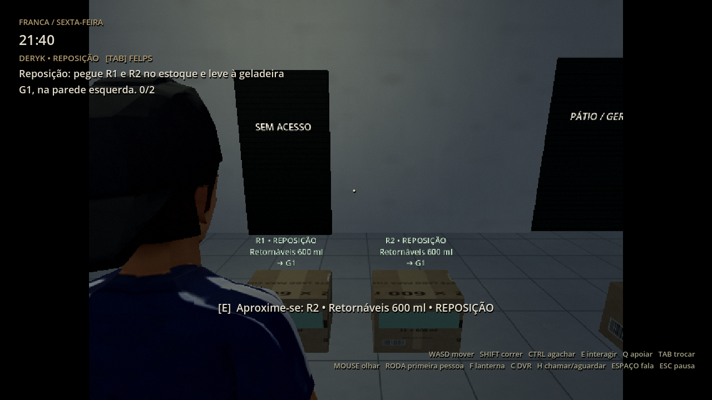
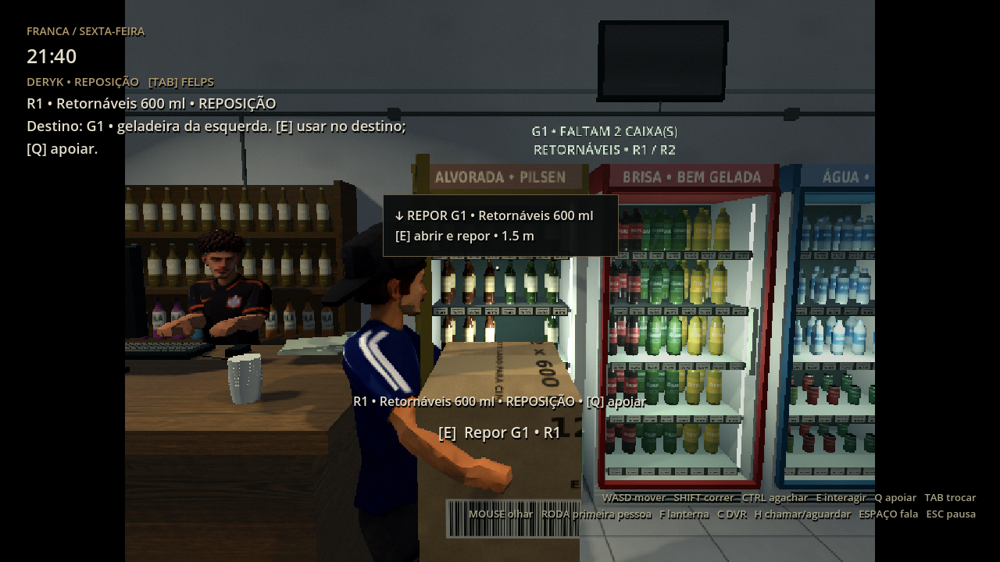
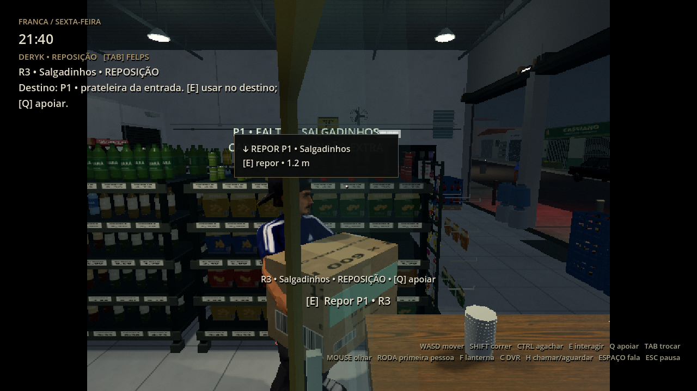

# 0.21.0 — reposição e entrega de pedidos

A reposição anterior estava limitada a uma geladeira sem identificação e dependia
da conversa inicial. As prateleiras não tinham interação de reposição. Esta revisão
identifica a mercadoria, mostra o destino e permite abastecer antes da conversa,
conservando a progressão quando o jogador volta a falar com Felps.

| Caixa | Conteúdo e uso | Destino |
| --- | --- | --- |
| R1 / R2, faixa verde | Retornáveis para reposição da sexta | Geladeira G1, na parede esquerda. |
| R3, faixa verde | Salgadinhos; reposição extra | Prateleira P1, a primeira gôndola à esquerda. |
| VENDA #NNN, faixa laranja | Caixa fechada de 12 retornáveis do pedido numerado | Área ENTREGA DE PEDIDOS no balcão. |
| CASCOS VAZIOS | Embalagens para devolução; sem mercadoria | Palete DEVOLUÇÕES no estoque. |

## Repor

Pegue R1 ou R2 com Deryk, usando E perto da caixa. A indicação na tela muda para
G1 e mostra a direção e a distância no chão. Vá até a geladeira marcada na parede
esquerda. E abre a porta; E novamente repõe. A caixa é consumida, os produtos
aparecem no espaço vazio e a placa atualiza a quantidade pendente.

R3 funciona na prateleira P1: aproxime-se do lado indicado e use E para repor os
salgadinhos. O espaço vazio recebe os produtos. Esta reposição extra não substitui
R1/R2 nem impede o avanço da noite se o jogador deixá-la para depois.

A câmera de ombro não precisa acertar uma faixa pequena: com a caixa certa perto
do móvel, a interação prioriza o destino, verificando distância e obstrução.
Uma caixa incompatível gera um aviso com seu destino e permanece com Deryk.
Geladeiras abastecidas continuam podendo abrir e fechar.

## Entregar para a venda

No atendimento de caixa fechada, Felps pede a caixa laranja VENDA com o número do
pedido. O botão CHAMAR DERYK troca o controle e indica essa caixa no estoque.

Pegue-a e leve à marca amarela ENTREGA DE PEDIDOS sobre o balcão. Use E pelo lado
do cliente para deixar a caixa. A mercadoria fica disponível para o pedido uma
única vez. Tab volta a Felps, que registra o produto, recebe o dinheiro, separa o
troco e entrega a compra. R1/R2/R3 não completam essa venda; a caixa de venda não
repõe geladeiras ou prateleiras. Q apenas apoia a caixa e permite retomá-la depois.

## Interface, saves e noites seguintes

Etiquetas curtas nas caixas evitam sobreposição. G1 e P1 mostram a falta e o código
da caixa. Um único marcador de objetivo, em resolução nativa, aponta para a caixa
ou destino atual; funciona também em PS1 320×240 e PS1/2 640×480. Não há nova luz,
viewport ou modelo de personagem.

O save mantém o formato 5 e os códigos antigos stock_1/stock_2. Reposição extra,
quantidades pendentes, caixas consumidas e entrega do pedido sobrevivem ao
salvamento. Os formatos anteriores continuam aceitos. Sábado e domingo não recriam
as caixas de trabalho já concluído da sexta nem indicam falta em móveis cheios.

`tests/supply_integration.tscn` usa E real nos destinos e no balcão, verifica
reposição antes da conversa, caixa errada preservada, retomada, diferenças entre
produtos/cascos, marcadores PS1/PS1/2, pedido e pagamento completo. As outras quatro
suítes continuam verificando a campanha e a fuga. Contagens e logs estão nesta
pasta; a distribuição tem verificação própria em downloads/project no GitHub.

As imagens são cenas preparadas para revisão visual em Compatibility/OpenGL/Linux
Mesa llvmpipe, com cenário PS1/2 e interface em resolução normal. Percursos físicos
são verificados separadamente. Não são uma medição de FPS na Radeon R7.

