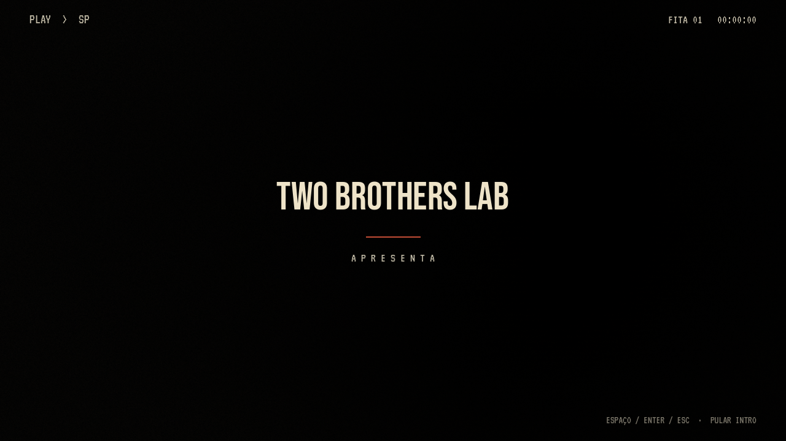

# 0.24.1 — tipografia retrô e menu em movimento

**[Assistir à prévia com som](https://github.com/Deriby/TheLastSale/raw/refs/heads/main/docs/title_v0241/intro_menu.mp4)**

A intro conserva **Two Brothers Lab**. O título ganhou letras altas de cartaz em **Bebas Neue**, creme e vermelho queimado; as opções e os textos usam **Special Elite**, com aparência de máquina de escrever; **VT323** dá ao visor de fita seus caracteres de videocassete. São arquivos originais incluídos no projeto, com licenças SIL OFL/Apache em `assets/fonts/title/retro/`.

## Animação

O cartão da intro sobe discretamente enquanto uma linha vermelha se abre. A sequência mantém os 9,4 segundos e as teclas Espaço/Enter/Esc/clique para pular. O menu entra com deslocamento curto e revelação em etapas: título, textos e opções. A seleção clareia e recua suavemente ao trocar o foco por teclado ou mouse; Continuar desabilitado permanece apagado.

A câmera faz uma aproximação lenta do depósito vazio. Pausa e retorno das configurações usam uma transição mais curta, sem repetir a abertura. As animações terminam corretamente mesmo após um quadro longo e são canceladas ao entrar no jogo.

## Preservação e validação

A apresentação continua usando o mundo e o viewport já existentes, sem novas luzes. Câmera e visibilidade dos personagens são restauradas antes do jogo. Modelos, animações dos personagens, física, energia, saves, HUD e a correção das texturas do piso permanecem intactos.

- 48 verificações da abertura/menu, incluindo conclusão da animação em baixa taxa de quadros, foco, seleção, janela de 800×600 e cancelamento ao jogar.
- 507 verificações nas oito suítes de integração do projeto.
- 48 poses/comparações de câmera para confirmar a estabilidade das texturas PS1/PS1/2.
- Importação do ZIP extraído em Godot 4.4.1, CRC, SHA-256 e manifesto por arquivo.

[Dados](validation.json) · [Verificação do pacote](../../downloads/project/release_verification.json)

A prévia foi gravada em Godot 4.4.1 com Linux/Mesa llvmpipe, preset Retrô, 15 FPS de captura. O limite padrão do jogo continua em 30 FPS. Desempenho na Radeon R7 não foi medido. O ZIP distribui o projeto do editor, sem EXE; o vídeo e as imagens ficam no repositório para respeitar o limite do GitHub.
