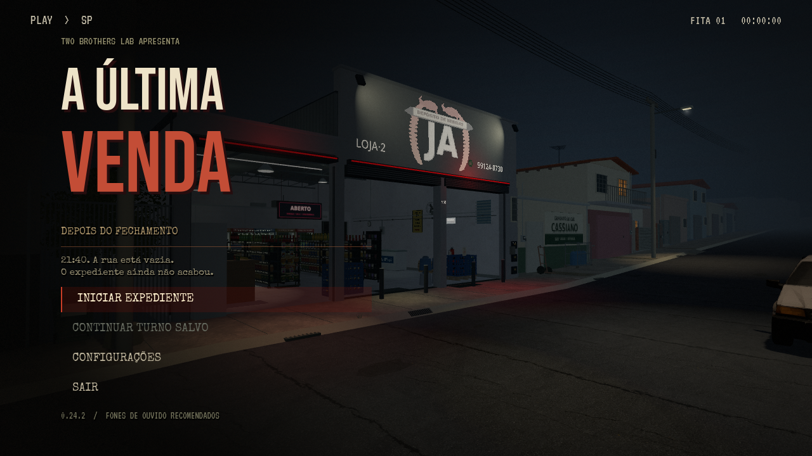

# 0.24.2 — suspense no cenário e entrada no expediente

**[Assistir à prévia com som](https://github.com/Deriby/TheLastSale/raw/refs/heads/main/docs/title_v0242/intro_menu.mp4)**

A apresentação de **Two Brothers Lab** mantém as fontes retrô. O título ficou um pouco menor, com mais espaço entre as opções para revelar o depósito e a rua.

## O cenário conta uma história

O letreiro tem uma falha curta e discreta. A iluminação do estoque se revela lentamente ao fundo. Carro passando de um lado para o outro, cachorro distante, uma ressonância metálica e o zumbido da iluminação dão profundidade ao som. Os eventos seguintes usam intervalos variáveis e espaçados; só acontecem na apresentação.

Todos os sons novos foram sintetizados para o jogo e estão incluídos em `assets/audio/title/ambient/`, com o gerador em `tools/make_title_ambience.py`. Música controla a trilha; Efeitos controla os novos ambientes, a fita e a seleção.

As mudanças usam as luzes e o letreiro já existentes. Nenhum material, textura, modelo, colisão ou flag de energia é alterado. A visibilidade original do letreiro e a intensidade exata das luzes são restauradas antes de iniciar ou carregar a partida. Uma luz desligada pelo circuito permanece desligada.

## Continuar e iniciar

**Continuar** mostra a noite e o horário do checkpoint, por exemplo `CONTINUAR — SÁBADO, 22:15`. A leitura aceita os saves das versões 1 a 5 e não carrega nem modifica a campanha. Um arquivo inválido permanece intacto e não oferece uma opção de continuação enganosa.

Ao iniciar, as letras se apagam, a fita dá um estalo e a troca de câmera acontece sob 0,34 segundo de escurecimento. O mundo permanece pausado até a entrega do controle, seguida de 0,5 segundo de revelação da imagem. Cliques repetidos e teclas durante a transição são consumidos. Pausa e retorno das configurações continuam usando a entrada curta.

## Validação

- 68 verificações da apresentação, incluindo metadados de saves antigos/corrompidos, áudio zerado, circuitos, restauração das luzes, clique duplo e transição.
- 527 verificações nas oito suítes de integração.
- 48 comparações de câmera PS1/PS1/2 para confirmar que o piso continua estável.
- ZIP extraído e importado em Godot 4.4.1, com CRC, SHA-256 e manifesto por arquivo.
- Modelos, animações dos personagens, HUD, física, energia, saves e shaders do piso preservados.

[Dados](validation.json) · [Verificação do pacote](../../downloads/project/release_verification.json)

A prévia usa Godot 4.4.1, Linux/Mesa llvmpipe, qualidade Retrô e captura em 15 FPS. O limite padrão do jogo permanece em 30 FPS. Desempenho na Radeon R7 não foi medido. A distribuição é o projeto Godot 4.4.1, sem EXE. Vídeo e capturas ficam no repositório para respeitar o limite de 100 MiB por arquivo do GitHub.
