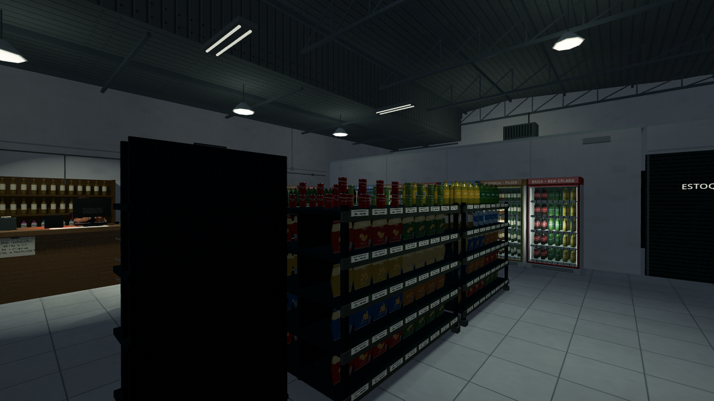
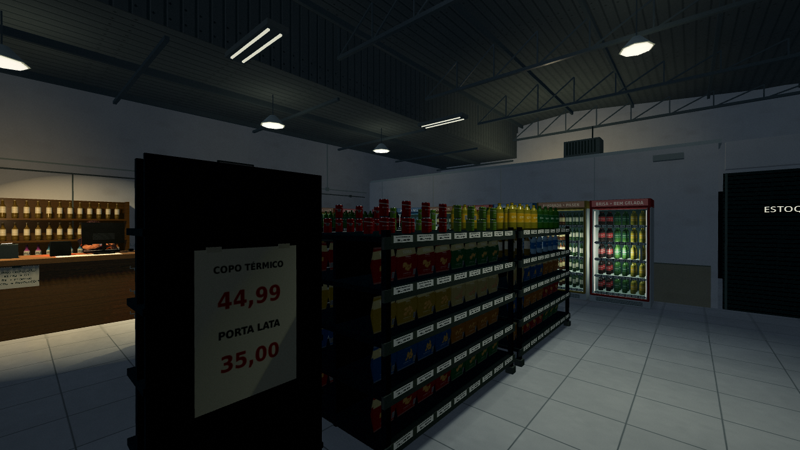
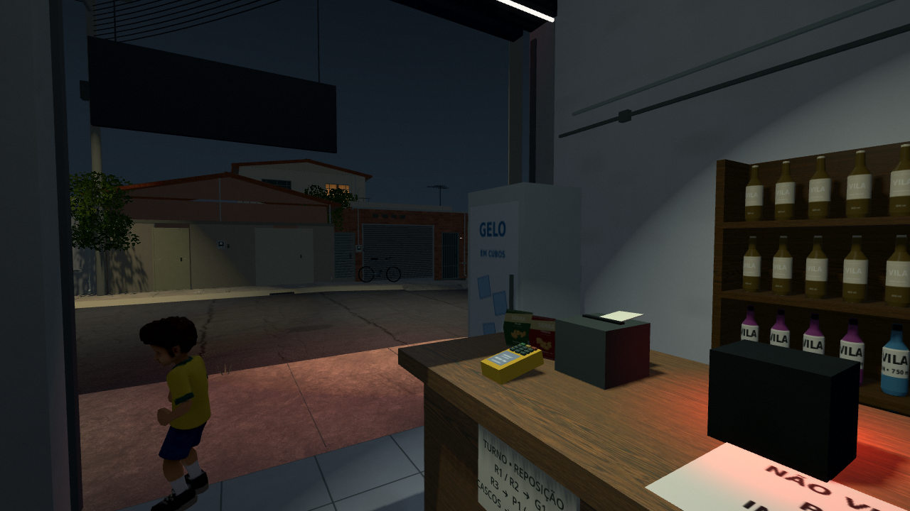
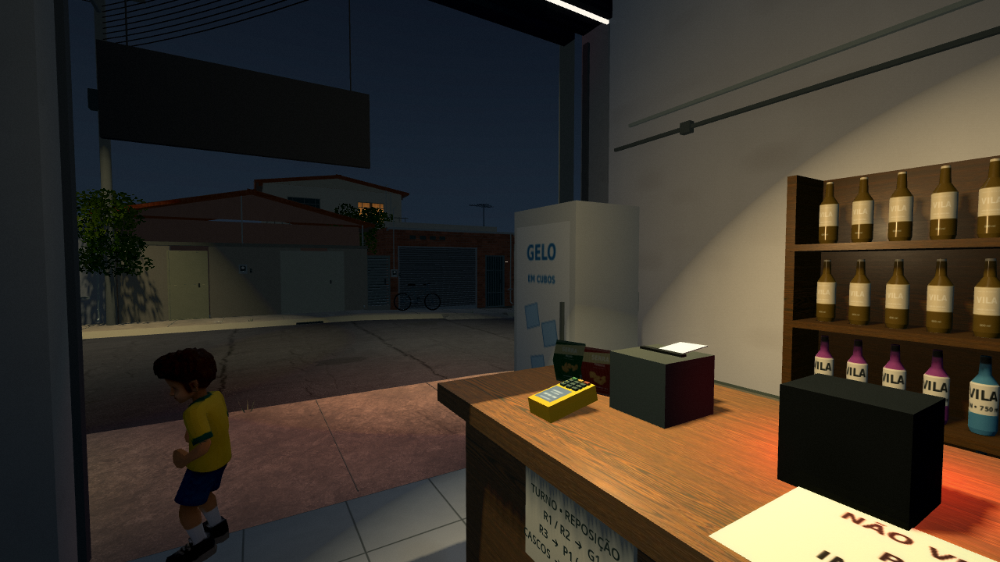
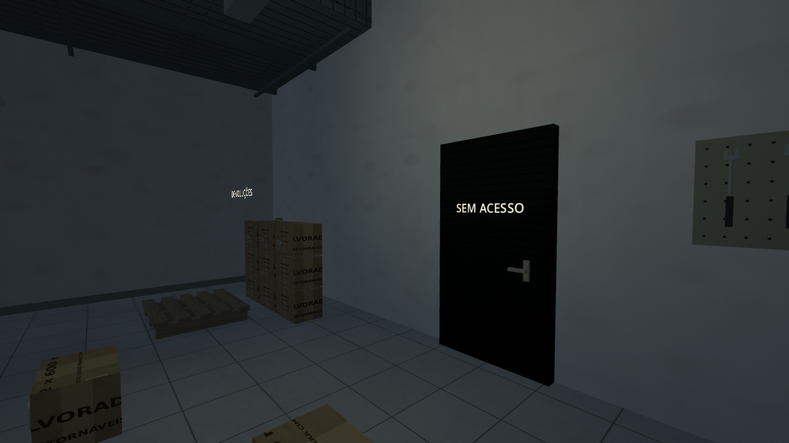
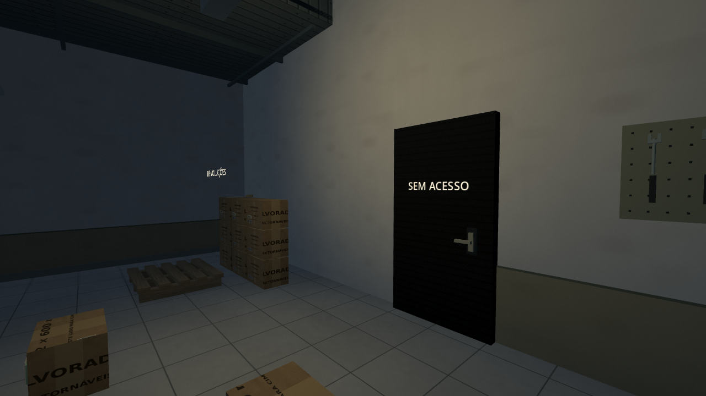
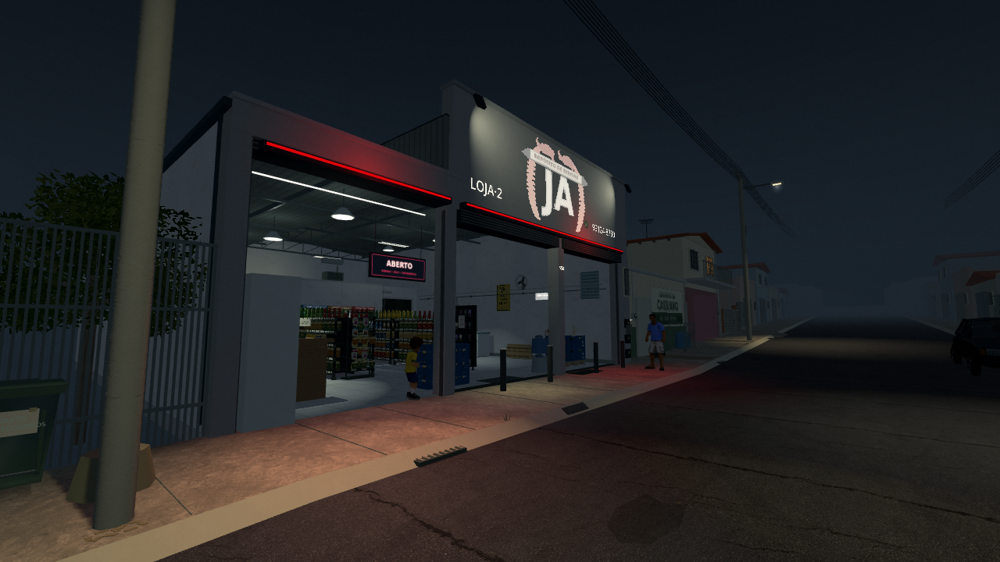
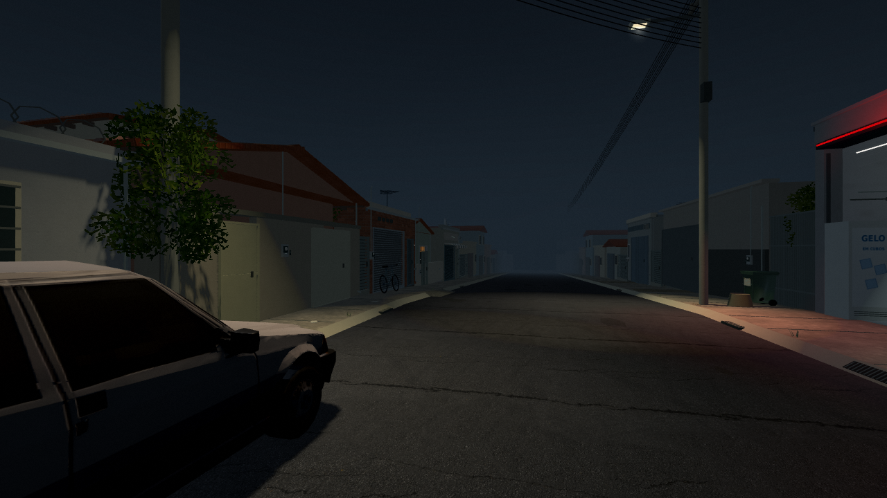
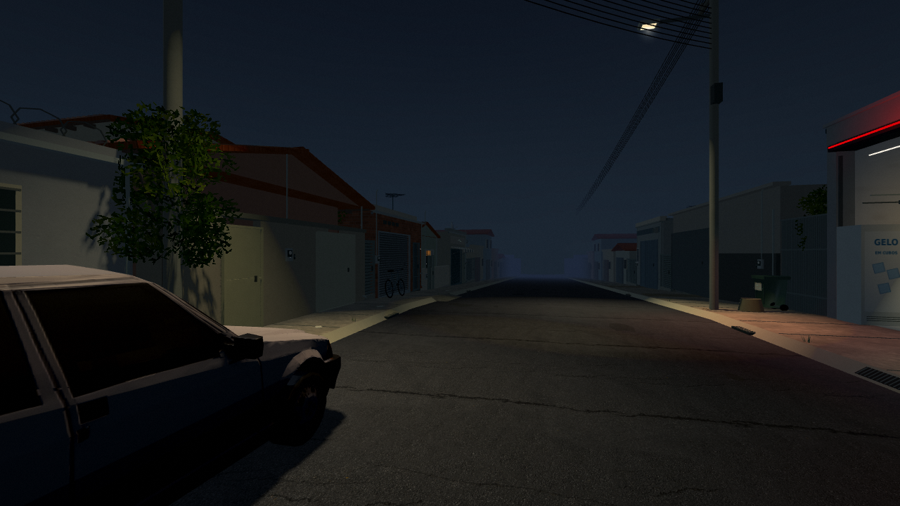

# 0.40.0 — luz de loja, bairro frio

[Ver a prévia real com som](https://raw.githubusercontent.com/Deriby/TheLastSale/main/docs/visual_v040/direcao_visual_preview.mp4) · [Projeto Godot 4.7 sem EXE](../../downloads/project/TheLastSale_Godot_0.40.0.zip).

A direção busca o lugar familiar que começa a incomodar: o balcão conserva uma luz amarelada de comércio, as gôndolas recebem luz mais neutra e a rua permanece fria, com distância e silêncio. A referência é a nostalgia e o terror cotidiano de Fears to Fathom e das primeiras temporadas de Stranger Things. O depósito brasileiro mantém sua identidade e sua época; esta revisão não transforma os personagens nem a história numa ambientação americana dos anos 80.

Três focos existentes ganham contraste e temperatura próprios. O preenchimento geral baixa um pouco, sem apagar a leitura das interações. O estoque recebe luz de serviço mais legível. Neon e halo ficam mais contidos, e o acabamento da imagem preserva cores de rótulos e tons quentes sob as lâmpadas. O relevo do piso e o verniz do balcão ficam mais discretos; o mapeamento das texturas continua preso ao cenário.

Faixas de pintura baixa, borda verde envelhecida, patina nas paredes e marcas de passagem dão uso aos fundos. Uma pequena placa metálica acompanha a maçaneta da porta original. O verso do expositor recebe o cartaz da oferta já existente no jogo, com duas fitas. Todas essas peças são visuais e não criam colisões, rotas ou obstáculos. As texturas, modelos, áudios e onze bibliotecas de animação publicados permanecem byte a byte.

Dois rebates suaves usam as mesmas regras elétricas do cenário. Apagam na pane, voltam pelo gerador e respeitam os setores no domingo. Não recebem sombras adicionais: o orçamento continua em cinco luzes com sombra. Econômica recolhe as camadas transparentes e esses dois rebates, além das reduções anteriores. Restaurar qualidade não acende um setor sem energia. A rodinha, terceira pessoa, aparições, sustos, campanha, saves e música da intro/menu conservam o comportamento anterior.

As imagens abaixo usam a mesma posição, direção, FOV 68 e resolução interna plena nas duas versões. Grão e VHS são idênticos; personagens e ruído podem variar entre quadros. A prévia é uma captura do Godot 4.7 / Compatibility com vistas preparadas e pequenos movimentos de câmera em velocidade normal. Não é uma sessão completa nem uma medição de FPS da placa do jogador. O ZIP inclui este guia e o escopo; vídeo e galeria ficam no GitHub.

| Vista | Antes — 0.39.0 | Depois — 0.40.0 |
| --- | --- | --- |
| Salão |  |  |
| Caixa |  |  |
| Estoque |  |  |
| Fachada |  |  |
| Bairro |  |  |

As verificações do pacote extraído cobrem qualidade, sombras, colisões, panes, circuitos, campanha, interfaces, animações e os 48 casos renderizados de estabilidade do piso PS1/PS1/2. [Escopo](validation.json) · [Resultado da distribuição](../../downloads/project/release_verification.json).
