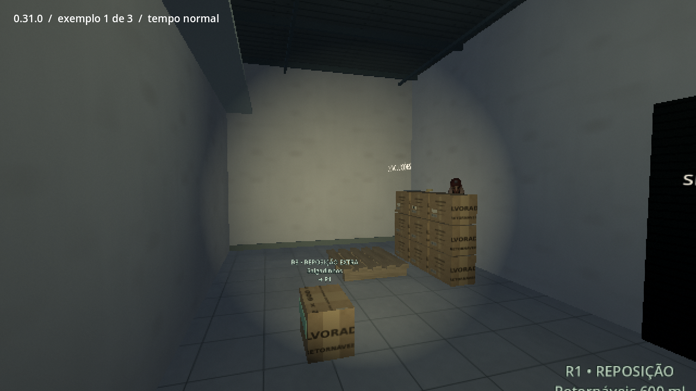
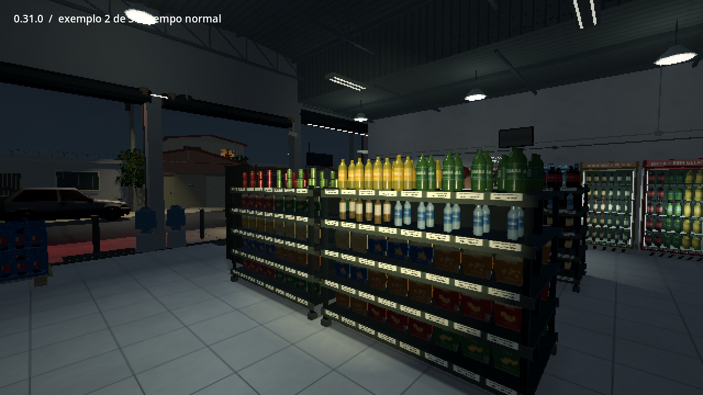
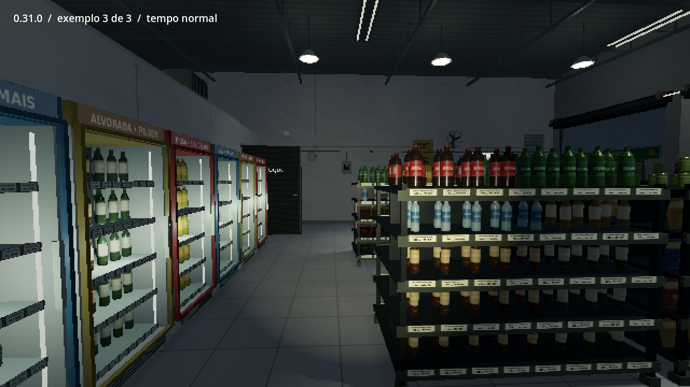

# 0.31.0 — alguém está observando?

[Ver três exemplos em tempo normal](https://github.com/Deriby/TheLastSale/raw/refs/heads/main/docs/watching_v031/cabecas_preview.mp4) · [Projeto Godot 4.4.1](https://github.com/Deriby/TheLastSale/raw/refs/heads/main/downloads/project/TheLastSale_Godot_0.31.0.zip)

O assassino original pode espiar **só com a cabeça**, de lado por um canto ou por cima das gôndolas e das caixas. O corpo permanece encoberto, usando o modelo completo e poses aplicadas apenas a esse ator. Modelos, materiais, pesos e as onze bibliotecas de animação anteriores não foram alterados.

Existem treze pontos candidatos na sexta e no sábado. A geometria, o chão, o espaço, a distância e outras pessoas determinam quais podem ser usados. As oportunidades têm intervalos variáveis, não repetem o mesmo ponto em seguida e têm limite por noite. A maioria dura uma fração de segundo; alguns olhares mais distantes podem durar mais. Não é necessário encontrar todos.

O jogo **não espera o jogador olhar**. A aparição também pode acontecer inteiramente fora da câmera; virar rápido pode fazê-la passar despercebida. Não há aviso, música de susto, fala ou anotação confirmando essas novas presenças. Se o jogador achar que viu alguém, essa conclusão é dele. O ator se recolhe atrás da cobertura e só é retirado quando deixa de ser visto.

A prévia reúne **três oportunidades separadas**, em velocidade normal. Posição, progresso e giro da câmera são preparados para a gravação; os intervalos entre as oportunidades foram cortados. Não é uma partida contínua nem a frequência normal do jogo. A gravação prepara uma situação após o gerador, com a lanterna existente ligada. O cartão e a legenda pertencem só à apresentação. [Fonte](../../tests/watching_review.gd).

Os saves conservam a oportunidade em andamento e a sequência já consumida, sem repetir uma oportunidade concluída. Saves anteriores continuam compatíveis; observações e tarefas existentes são preservadas. A sexta e o sábado recebem as novas oportunidades. Domingo mantém somente a perseguição original. Física dos protagonistas, circuitos e câmera pela rodinha foram preservados. Sem EXE.

[Escopo da validação](validation.json) · [Resultados do ZIP e avisos](../../downloads/project/release_verification.json)
